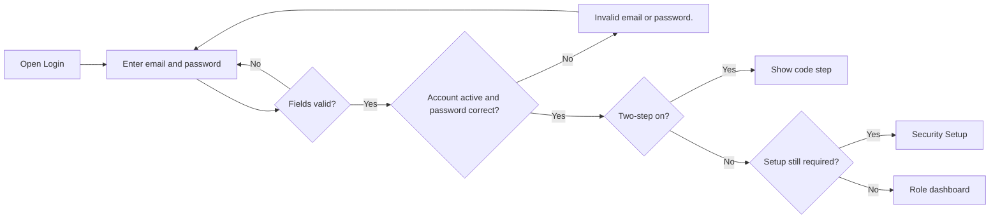
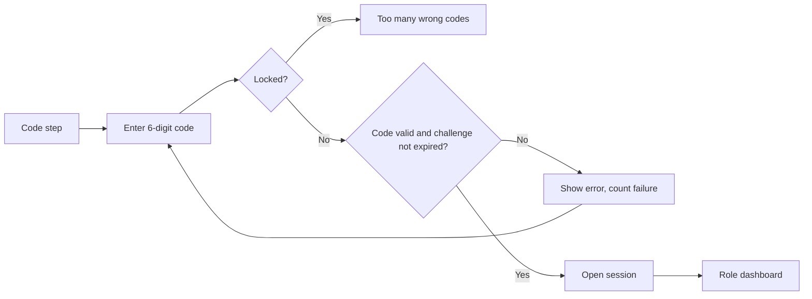

# Login – Functional Workflow

> **Project:** TaskFlow – Intelligent Task Allocation & Tracking System
> **Parent Module:** Authentication  ·  **Child Module:** 01.1 Login
> **Version:** 1.0  ·  **Last Updated:** 31-Oct-2026
> **Author:** Jojo George (jojogeorge3344@gmail.com)
> © 2026 Jojo George. All rights reserved.

---

## 1. Overview
Login is the opening page of TaskFlow. A registered, active user signs in with their email (or username) and password; when two-step verification is on, a second step asks for the 6-digit code from their authenticator app. After a successful sign-in the user is sent to the dashboard that fits their role and permissions, or to Security Setup if they still have to secure their account.

## 2. Purpose / Business Value
- Only active, registered users can enter TaskFlow; inactive or deleted accounts are refused (BRD Screen 1, requirement 5).
- A correct password alone never opens a session when two-step verification is on, so a stolen password is not enough.
- The same message is shown for every sign-in failure, so the screen never reveals whether an account exists.
- Each user lands on the dashboard that matches their role and permissions (BRD Screen 1, requirement 3).

## 3. Who Can Access

| Role          | Can See | Can Use | Access Level (Own / Team / Organization) |
|---------------|:-------:|:-------:|------------------------------------------|
| Administrator | ✅ | ✅ | Own |
| Manager       | ✅ | ✅ | Own |
| Employee      | ✅ | ✅ | Own |
| Custom Role   | ✅ | ✅ | Own |

The Login screen is public: it needs no permission key. Only active, not deleted accounts can complete sign-in.

## 4. Screens

| # | Screen Name | Menu Path | Purpose | Visible To |
|---|-------------|-----------|---------|------------|
| 1 | Login (Sign in) | Opening page `/login` (no menu) | Enter email and password; then the 6-digit authenticator code when two-step verification is on | Everyone (not signed in) |
| 2 | Two-step verification (second step of Login) | Shown on `/login` after a correct password | Enter the code from the authenticator app | Users whose two-step verification is on |

---

## 5. Screen & Functionality Details

### 5.1 Screen: Login
**Purpose:** Let a registered user sign in to TaskFlow securely.
**Who can see this screen:** Everyone who is not signed in (also the landing page for any unknown address).
**Required permission:** None (public screen).

**Screen Elements**
- TaskFlow logo ("TF"), title **TaskFlow** and subtitle *"Sign in to continue"*.
- Notice area that explains why the user was sent back to sign in (for example after a password reset).
- **Email** field (pre-filled with the identifier last used on this device).
- **Password** field with a **Show password / Hide password** eye button.
- Error message area.
- **Sign in** button (shows *"Signing in…"* while working).
- **Forgot password?** link to the Account Recovery screen.
- Second step (only when two-step verification is on): title **Two-step verification**, subtitle *"Enter the 6-digit code from your authenticator app."*, **Authentication code** field, **Verify** button and **← Back to sign in** link.
- Legal footer.

### 5.2 Functionalities

| # | Functionality | Purpose | Who Can See | Who Can Use | Permission Required | Scope |
|---|---------------|---------|-------------|-------------|---------------------|-------|
| 1 | Sign in with password | Check email/username and password and open a session (or ask for the second step) | Everyone | Everyone with an active account | None (public) | Own |
| 2 | Show / hide password | Let the user check what they typed | Everyone | Everyone | None (public) | Own |
| 3 | Two-step verification code | Second sign-in step with the authenticator code (the server also accepts an unused backup code) | Users with two-step verification on | Same | None (public, needs the sign-in challenge from step 1) | Own |
| 4 | Back to sign in | Leave the code step and start again with the password | Users on the code step | Same | None | Own |
| 5 | Remember last identifier | Pre-fill the Email field on the same device | Everyone | Everyone | None | Own (this device only) |
| 6 | Redirect to dashboard | Open the dashboard that fits the user's role and permissions, or the page they originally asked for | Signed-in users | Signed-in users | None (dashboard keys decide which dashboard) | Own |

### 5.3 Step-by-Step Workflow – Sign in
1. User opens TaskFlow; the **Login** screen appears.
2. User enters their **Email** and **Password** and clicks **Sign in**.
3. The screen checks that both fields are filled and that the email looks valid.
4. The system looks up the account by username or email. If the account does not exist, is inactive or deleted, or the password is wrong, the screen shows *"Invalid email or password."*
5. If the password is right and two-step verification is **off**, the system opens the session, records the last-login time and sends the user to their dashboard (Administrator → Admin dashboard, Manager → Manager dashboard, custom roles → the widest dashboard their permissions allow, otherwise the personal dashboard). If two-step verification is still required but not set up, the user is taken to **Security Setup** first (see 01.3 MFA Security Setup).
6. If two-step verification is **on**, no session is opened yet; the screen switches to **Two-step verification** (see 5.4).

**Flow Diagram**

### 5.4 Step-by-Step Workflow – Two-step verification at sign-in
1. After a correct password the screen shows **Two-step verification**.
2. User opens their authenticator app and types the 6-digit code into **Authentication code**, then clicks **Verify**.
3. The system checks that the sign-in step is still valid (it expires after 5 minutes, or earlier if the password was changed meanwhile) and that the code is correct and has not been used before.
4. Correct code → the session opens and the user goes to their dashboard.
5. Wrong or expired → *"The code is incorrect, or the sign-in has expired. Try again or sign in again."*; the code box is cleared.
6. After 5 wrong codes in a row the account's code check is locked for 5 minutes → *"Too many wrong codes. Try again in a few minutes."*
7. **← Back to sign in** returns to the password step and clears the password.

**Flow Diagram**

### 5.5 Business Rules & Validations
- Email (or username) and password are required; the server accepts at most 256 characters for the identifier and 128 for the password.
- The server accepts either the username or the email address; the screen itself asks for a valid email address.
- Inactive and deleted accounts cannot sign in; the message is the same as for a wrong password, so it never reveals whether an account exists.
- Passwords are stored only as secure hashes; an old hash is upgraded automatically on the next successful sign-in.
- When two-step verification is on, a correct password alone never opens a session.
- The sign-in challenge is valid for 5 minutes and becomes invalid if the user's password, recovery or MFA reset changes the account's security stamp.
- An authenticator code can be used only once; codes from one step before or after the current 30-second window are accepted.
- 5 wrong codes in a row lock code checking for 5 minutes (shared by sign-in, profile checks and backup-code regeneration).
- A "return address" after sign-in is used only if it is a page inside TaskFlow.

### 5.6 Messages Shown to the User

| Situation | Message |
|-----------|---------|
| Email empty | Email is required. |
| Email not valid | Enter a valid email address. |
| Password empty | Password is required. |
| Wrong credentials / inactive account | Invalid email or password. |
| Code empty | Enter the code to continue. |
| Wrong or expired code | The code is incorrect, or the sign-in has expired. Try again or sign in again. |
| Too many wrong codes | Too many wrong codes. Try again in a few minutes. |
| Code failed (no server message) | That code did not work. Check the code and try again. |
| Sent back after session ended | Your session has ended, for example because your username or password was changed. Please sign in again. |
| Sent back after credentials changed | Your username or password was changed. Sign in again with your new details. |
| Sent back after password reset | Your password has been reset. Sign in with your new password. |
| No permission | Not applicable: public screen, no permission needed. |

---

## 6. Permission Summary

| Permission Key | Description | Administrator | Manager | Employee | Custom Role |
|----------------|-------------|:-------------:|:-------:|:--------:|:-----------:|
| (none – public) | Sign in with password, two-step code at sign-in | Always On | Always On | Always On | Always On |

Which dashboard opens after sign-in depends on the role and the `dashboard.view.*` permissions (Dashboard module).

## 7. Related Modules
- **01.2 Account Recovery** – opened from **Forgot password?**; after a reset the user returns here with a notice.
- **01.3 MFA Security Setup** – users who still have to set up two-step verification are sent there after sign-in.
- **01.4 Sessions and Tokens** – a successful sign-in opens the session that is then renewed, checked and ended there.
- **Dashboard** – after sign-in the user is sent to the Admin, Manager or personal dashboard (decided by role and the `dashboard.view.*` permissions).
- **Management (Employee Management)** – administrators create accounts and activate/deactivate them (inactive accounts cannot sign in).
- **Legal** – the legal footer is shown on the Login screen.

## 8. Expected Outcome
Every registered, active user can sign in with their password and authenticator code and lands on the dashboard for their role, while wrong details, inactive accounts and guessed codes are refused without revealing which accounts exist.

---
© 2026 Jojo George. All rights reserved. Unauthorized copying or distribution of this document is prohibited.
