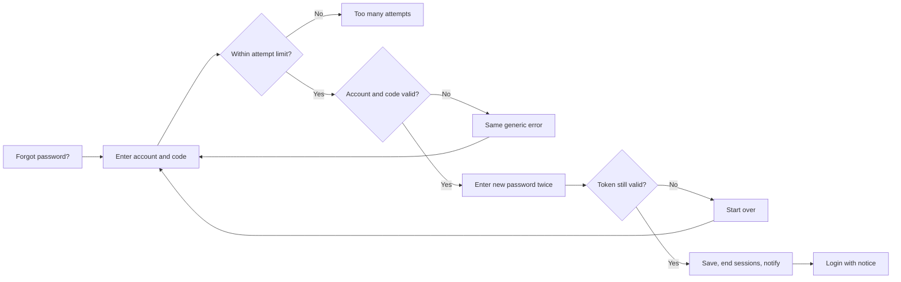

# Account Recovery – Functional Workflow

> **Project:** TaskFlow – Intelligent Task Allocation & Tracking System
> **Parent Module:** Authentication  ·  **Child Module:** 01.2 Account Recovery
> **Version:** 1.0  ·  **Last Updated:** 31-Oct-2026
> **Author:** Jojo George (jojogeorge3344@gmail.com)
> © 2026 Jojo George. All rights reserved.

---

## 1. Overview
Account Recovery (password reset) lets a user who forgot their password choose a new one from the login page, without an administrator. The user proves who they are with the current code from their authenticator app and then sets a new password. It works only for accounts that have two-step verification turned on.

## 2. Purpose / Business Value
- Users who forget their password can recover it without waiting for an administrator.
- No password, code or link is ever sent by SMS or email; the authenticator app is the only recovery factor.
- A successful reset ends every session of the user, so anyone using the old password is signed out at once.
- Attempt limits and identical error messages stop strangers from guessing codes or finding out which accounts exist.

## 3. Who Can Access

| Role          | Can See | Can Use | Access Level (Own / Team / Organization) |
|---------------|:-------:|:-------:|------------------------------------------|
| Administrator | ✅ | ✅ (with two-step verification on) | Own |
| Manager       | ✅ | ✅ (with two-step verification on) | Own |
| Employee      | ✅ | ✅ (with two-step verification on) | Own |
| Custom Role   | ✅ | ✅ (with two-step verification on) | Own |

The screen is public and needs no permission key. Users without two-step verification must ask an administrator to set a new password.

## 4. Screens

| # | Screen Name | Menu Path | Purpose | Visible To |
|---|-------------|-----------|---------|------------|
| 1 | Forgot your password? (Account Recovery) | Login → **Forgot password?** (`/account-recovery`) | Verify with an authenticator code, then choose a new password | Everyone (not signed in) |

---

## 5. Screen & Functionality Details

### 5.1 Screen: Forgot your password?
**Purpose:** Let a user who has two-step verification on set a new password without an administrator.
**Who can see this screen:** Everyone (opened from **Forgot password?** on the Login screen).
**Required permission:** None (public screen).

**Screen Elements**
- Title **Forgot your password?** with a short explanation.
- Step 1 (Verify): **Email or username** field, **Code from your authenticator app** field, **Continue** button, and a note: *"This works if you turned on two-step verification from your Profile. If you did not, ask an administrator to set a new password for you."*
- Step 2 (New password): subtitle *"Code verified. Choose a new password for your account."*, **New password**, **Confirm new password**, **Reset password** button, and **Start over** (shown only when the reset is refused).
- **← Back to sign in** link and legal footer.

### 5.2 Functionalities

| # | Functionality | Purpose | Who Can See | Who Can Use | Permission Required | Scope |
|---|---------------|---------|-------------|-------------|---------------------|-------|
| 1 | Verify with authenticator code | Prove identity with account name and current 6-digit code; receive a single-use reset permission | Everyone | Users with two-step verification on | None (public) | Own |
| 2 | Set new password | Choose and confirm a new password using the single-use reset permission | Users who passed step 1 | Same | None (public, reset token) | Own |
| 3 | Start over | Return to step 1 when the reset permission expired or was used | Users whose reset was refused | Same | None | Own |
| 4 | Back to sign in | Return to the Login screen | Everyone | Everyone | None | – |

### 5.3 Step-by-Step Workflow – Reset a forgotten password
1. User clicks **Forgot password?** on the Login screen.
2. User enters **Email or username** and the 6-digit **Code from your authenticator app**, then clicks **Continue**.
3. The system checks the attempt limits (5 attempts per account and 20 per network address in any 5 minutes). If exceeded → *"Too many attempts. Try again in a few minutes."*
4. The system checks that the account exists, is active, has two-step verification on, and that the code is right. Any failure shows the same message: *"The details are incorrect, or the code has expired. Check them and try again."* (backup codes are not accepted here).
5. Correct → the screen moves to step 2. The reset permission is valid for 10 minutes and works once.
6. User enters **New password** and **Confirm new password** (6–128 characters, must match) and clicks **Reset password**.
7. The system saves the new password, ends every session of that user, cancels any other open reset permissions, and sends the user a notification: *"Your password was reset with your authenticator app. If this was not you, contact an administrator now."*
8. The user is taken to the Login screen with *"Your password has been reset. Sign in with your new password."*
9. If the reset permission has expired or was already used → *"This reset link is no longer valid. Start again from the login page."* and the **Start over** button appears.

**Flow Diagram**

### 5.4 Business Rules & Validations
- Identifier is required (max 256 characters); the code is required (the screen requires exactly 6 digits; the server accepts up to 32 characters).
- New password: 6 to 128 characters; **Confirm new password** must match (*"Passwords do not match."*).
- Recovery works only for accounts that have two-step verification turned on. Users without it must ask an administrator.
- Every failure gives the same message, so the screen never reveals whether an account exists or has two-step verification on.
- Attempts are limited to 5 per account and 20 per caller address in a 5-minute sliding window. Wrong recovery codes do not count toward the account's sign-in code lockout, so a stranger cannot lock the owner out; an account already locked for codes is still refused.
- An unused backup code is not accepted as a recovery factor.
- The reset permission lasts 10 minutes, can be used once, and all other open reset permissions of the user are cancelled when one is used.
- A successful reset ends every session of the user (all devices).
- If the new password is rejected by validation, the same reset permission can still be used until it expires.

### 5.5 Messages Shown to the User

| Situation | Message |
|-----------|---------|
| Identifier empty | Email or username is required. |
| Code missing or not 6 digits | Enter the 6-digit code from the app. |
| Wrong account / code / no two-step verification | The details are incorrect, or the code has expired. Check them and try again. |
| Too many attempts | Too many attempts. Try again in a few minutes. |
| Verification failed (no server message) | Could not verify the code. Please try again. |
| Password length wrong | Use at least 6 and at most 128 characters. |
| Passwords differ | Passwords do not match. |
| Reset permission used or expired | This reset link is no longer valid. Start again from the login page. |
| Reset failed (no server message) | Could not reset your password. Please try again. |
| Success (on Login screen) | Your password has been reset. Sign in with your new password. |
| Notification to the account owner | Your password was reset with your authenticator app. If this was not you, contact an administrator now. |
| No permission | Not applicable: public screen, no permission needed. |

---

## 6. Permission Summary

| Permission Key | Description | Administrator | Manager | Employee | Custom Role |
|----------------|-------------|:-------------:|:-------:|:--------:|:-----------:|
| (none – public) | Verify with authenticator code and reset a forgotten password | Always On | Always On | Always On | Always On |

## 7. Related Modules
- **01.1 Login** – the **Forgot password?** link opens this screen; after a reset the user signs in again on the Login screen.
- **01.3 MFA Security Setup** – recovery needs two-step verification to be set up first.
- **01.4 Sessions and Tokens** – a successful reset ends every session of the user.
- **Communication (Notifications)** – a system notification is sent to the account owner after a reset.
- **Management (Employee Management)** – users without two-step verification must ask an administrator to set a new password.
- **Legal** – the legal footer is shown on the Account Recovery screen.

## 8. Expected Outcome
A user who forgets their password can reset it alone in a few minutes with their authenticator app; the old password and every old session stop working immediately, and the owner is notified in case the reset was not theirs.

---
© 2026 Jojo George. All rights reserved. Unauthorized copying or distribution of this document is prohibited.
