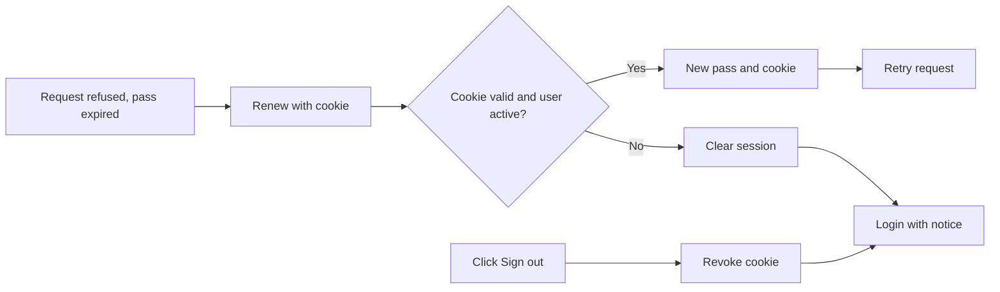

# Sessions and Tokens – Functional Workflow

> **Project:** TaskFlow – Intelligent Task Allocation & Tracking System
> **Parent Module:** Authentication  ·  **Child Module:** 01.4 Sessions and Tokens
> **Version:** 1.0  ·  **Last Updated:** 31-Oct-2026
> **Author:** Jojo George (jojogeorge3344@gmail.com)
> © 2026 Jojo George. All rights reserved.

---

## 1. Overview
Sessions and Tokens keeps a signed-in user's session alive safely after Login: it restores the session when the app is reopened, renews it silently in the background, checks it regularly so role and permission changes apply at once, and ends it on sign-out or after a security change.

## 2. Purpose / Business Value
- Users stay signed in across page reloads without typing their password again.
- Sessions end automatically when a password is changed or reset, or when an administrator resets someone's two-step verification, so an old session cannot outlive a security change.
- Role and permission changes made by an administrator take effect straight away, without the user signing in again.
- The renewal cookie cannot be read by page scripts, which limits the damage of a script attack.

## 3. Who Can Access

| Role          | Can See | Can Use | Access Level (Own / Team / Organization) |
|---------------|:-------:|:-------:|------------------------------------------|
| Administrator | ✅ | ✅ | Own |
| Manager       | ✅ | ✅ | Own |
| Employee      | ✅ | ✅ | Own |
| Custom Role   | ✅ | ✅ | Own |

No permission key is needed; every signed-in user has a session and a **Sign out** button.

## 4. Screens

| # | Screen Name | Menu Path | Purpose | Visible To |
|---|-------------|-----------|---------|------------|
| 1 | Sign out button | Header → account area → **Sign out** icon | End the current session | All signed-in users |

---

## 5. Screen & Functionality Details

### 5.1 Screen: Sign out (header) and background session handling
**Purpose:** Keep a signed-in user's session alive safely, check it regularly, and end it on sign-out.
**Who can see this screen:** All signed-in users (the **Sign out** icon in the header account area and on Security Setup step 1).
**Required permission:** None (any signed-in user).

**Screen Elements**
- **Sign out** button in the header account area.
- No dedicated screen: session renewal and checks run in the background. When a session ends the user lands on the Login screen with a notice.

### 5.2 Functionalities

| # | Functionality | Purpose | Who Can See | Who Can Use | Permission Required | Scope |
|---|---------------|---------|-------------|-------------|---------------------|-------|
| 1 | Stay signed in after reload | When the app opens, restore the session from the secure cookie | All users | All users with a valid session | None | Own |
| 2 | Automatic session renewal | When the short access pass expires, get a new one silently and retry the request | Signed-in users | Same | None | Own |
| 3 | Session check | Every 15 seconds and when the browser tab becomes visible, confirm the session is still valid and pick up role or permission changes | Signed-in users | Same | None | Own |
| 4 | Sign out | End the session on this device | Signed-in users | Same | None | Own |
| 5 | End sessions after security changes | Password change, password reset or administrator MFA reset end all sessions of the user | Affected users | System | None | Own |

### 5.3 Step-by-Step Workflow – Session renewal and sign-out
1. After sign-in the user receives a short access pass (30 minutes) and a long-lived renewal cookie (7 days) that the browser keeps securely.
2. When the access pass expires and a request is refused, TaskFlow uses the cookie to get a new pass and a new cookie (the old cookie stops working) and repeats the request.
3. If renewal fails (cookie expired, revoked, user inactive or deleted), TaskFlow signs the user out and shows *"Your session has ended, for example because your username or password was changed. Please sign in again."*
4. Every 15 seconds, and when the tab is shown again, TaskFlow checks the session. A role or permission change made by an administrator applies straight away without signing in again.
5. When the user clicks **Sign out**, the renewal cookie is revoked and removed, and the Login screen opens.

**Flow Diagram**

### 5.4 Business Rules & Validations
- Access pass lifetime: 30 minutes; renewal cookie lifetime: 7 days (configurable).
- The renewal cookie is HttpOnly, Secure and SameSite Strict and is sent only to the sign-in endpoints, so page scripts cannot read it.
- Each renewal replaces the cookie; a used, expired or revoked cookie cannot be used again.
- Every request re-checks that the user still exists, is active and that their security stamp has not changed (password change or reset, MFA reset); otherwise the session is refused.
- Role and permissions are re-read from the database on every request.
- Signing out without a cookie, or with an already revoked one, still succeeds quietly.

### 5.5 Messages Shown to the User

| Situation | Message |
|-----------|---------|
| Session ended or renewal failed | Your session has ended, for example because your username or password was changed. Please sign in again. |
| Credentials changed | Your username or password was changed. Sign in again with your new details. |
| Two-step setup still required (stale session) | User is taken to Security Setup; server message: Set up two-step verification to continue. |
| Concurrent change | Someone else changed this record while you were saving. Reload it and try again. |
| Unexpected error | Something went wrong. Please try again. |
| Not signed in / session invalid | The API answers 401; the user is sent to Login (see first row). |

---

## 6. Permission Summary

| Permission Key | Description | Administrator | Manager | Employee | Custom Role |
|----------------|-------------|:-------------:|:-------:|:--------:|:-----------:|
| (none – public) | Session renewal and sign-out | Always On | Always On | Always On | Always On |
| (none – any signed-in user) | Session check (current user, role and permissions) | Always On | Always On | Always On | Always On |

## 7. Related Modules
- **01.1 Login** – a successful sign-in opens the session; when a session ends the user returns to the Login screen with a notice.
- **01.2 Account Recovery** – a password reset ends every session of the user.
- **01.3 MFA Security Setup** – a session with setup pending is sent to Security Setup; an administrator MFA reset ends all of the employee's sessions.
- **Profile** – changing the password there ends all sessions.
- **Settings (Role Configuration)** – role and permission changes reach signed-in users on their next request through the session check.
- **Management (Employee Management)** – deactivating an account ends its session on the next request.

## 8. Expected Outcome
Signed-in users stay signed in smoothly while they work, any password change, reset or administrator MFA reset immediately ends old sessions, and role or permission changes apply without signing in again.

---
© 2026 Jojo George. All rights reserved. Unauthorized copying or distribution of this document is prohibited.
