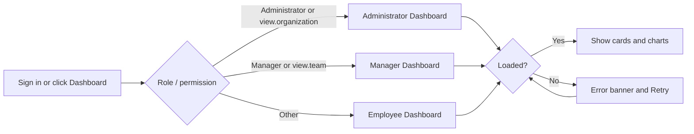
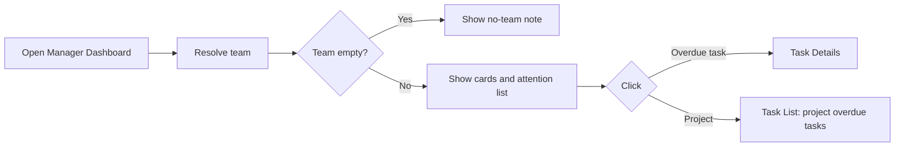
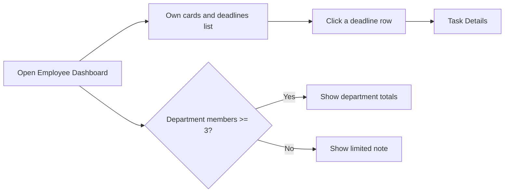

# Overview – Functional Workflow

> **Project:** TaskFlow – Intelligent Task Allocation & Tracking System
> **Parent Module:** Dashboard  ·  **Child Module:** 02.1 Overview
> **Version:** 1.0  ·  **Last Updated:** 31-Oct-2026
> **Author:** Jojo George (jojogeorge3344@gmail.com)
> © 2026 Jojo George. All rights reserved.

---

## 1. Overview
Overview is the landing part of the Dashboard. It sends each signed-in user to the right dashboard (Administrator, Manager or Employee) and shows the summary cards for the user's scope, the Manager's team performance summary, and the Employee's upcoming deadlines and department overview. The charts and filters on the same screens are described in `02.2-Analytics.md`.

## 2. Purpose / Business Value
- One **Dashboard** menu item that always opens the correct dashboard for the user's role and permissions.
- Summary cards give an at-a-glance count of total, completed, in-progress, pending and overdue work, plus completion percentage.
- Managers see the most overdue team tasks and the projects needing attention without searching for them.
- Employees see what is due soon and how their department is doing, without seeing any colleague's details.

## 3. Who Can Access

| Role          | Can See | Can Use | Access Level (Own / Team / Organization) |
|---------------|:-------:|:-------:|------------------------------------------|
| Administrator | ✅ | ✅ | Organization – Administrator Dashboard (can also open the Manager Dashboard by direct address) |
| Manager       | ✅ | ✅ | Team – Manager Dashboard |
| Employee      | ✅ | ✅ | Own – Employee Dashboard |
| Custom Role   | ✅ | ✅ | Organization if it holds `dashboard.view.organization`, Team if it holds `dashboard.view.team`, otherwise Own |

Every signed-in user has a personal dashboard (`dashboard.view.own` is Always On). The figures on the cards also need `dashboard.analytics.view` (see `02.2-Analytics.md`).

## 4. Screens

| # | Screen Name | Menu Path | Purpose | Visible To |
|---|-------------|-----------|---------|------------|
| 1 | Administrator Dashboard (`/admin`) | Side menu → **Dashboard** | Organisation-wide summary cards | Administrator; custom roles holding `dashboard.view.organization` |
| 2 | Manager Dashboard (`/manager`) | Side menu → **Dashboard** | Team summary cards and team performance summary | Manager; custom roles holding `dashboard.view.team`; Administrator (by direct address) |
| 3 | Employee Dashboard (`/me`) | Side menu → **Dashboard** | Own summary cards, upcoming deadlines and department overview | Every signed-in user |

## 5. Screen & Functionality Details

### 5.1 Screen: Administrator, Manager and Employee Dashboards
**Purpose:** Show the user a summary of the tasks in their scope as soon as they sign in.
**Who can see this screen:** Administrator Dashboard – Administrator; Manager Dashboard – Manager (and Administrator); Employee Dashboard – every signed-in user.
**Required permission:** `dashboard.view.organization` (Administrator Dashboard), `dashboard.view.team` (Manager Dashboard), `dashboard.view.own` (Employee Dashboard, Always On). The figures on all three also need `dashboard.analytics.view`.

**Screen Elements – Administrator Dashboard**
- Header: "Administrator Dashboard", "Welcome back, *name*", and a subtitle "Organisation-wide analytics · *range* by *date basis*".
- Filter bar (see `02.2-Analytics.md`), shown only with `dashboard.filters.use`.
- Ten summary cards: Employees, Managers, Departments, Projects, Total tasks, Completed, In progress, Pending, Overdue, Completion (%).
- Analytics sections (see `02.2-Analytics.md`): Department-wise tasks, Employee-wise workload, Task status & priority, Completion trend, Deadlines, Manager-wise teams, Project-wise progress.
- Error banner with a **Retry** button; an empty-state note when no task matches the filters.

**Screen Elements – Manager Dashboard**
- Header: "Manager Dashboard", "Welcome back, *name*", subtitle "Team analytics · *range* by *date basis*".
- Filter bar without the Department and Manager fields (shown only with `dashboard.filters.use`).
- Six summary cards: Team tasks, Completed, In progress, Pending, Overdue, Completion (%).
- **Team performance summary** – "Most overdue tasks" (up to 5, each opens the task) and "Projects needing attention" (up to 5 projects with overdue tasks).
- Task status & priority donuts, Project-wise progress, Employee-wise workload table with "High workload" and "Overdue" flags (see `02.2-Analytics.md`).
- A "no team" note when the manager has nobody on the team yet (a different note is shown to an Administrator).

**Screen Elements – Employee Dashboard**
- Header: "Employee Dashboard", "Welcome back, *name*", subtitle "Your tasks, projects and progress · *period*".
- Period chips: Last 7 days, Last 30 days (default), This month, with the note "Only your own data is shown." (see `02.2-Analytics.md`).
- Six summary cards: My tasks, Completed, In progress, Pending, Overdue, Completion (%).
- **Overall task summary** – progress bar, "*n* completed · *n* outstanding · *n*%", status donut and priority donut.
- **Upcoming deadlines & overdue** – up to 10 open tasks that are overdue or due within the next 7 days, soonest first, each opening the task.
- **Personal performance** – created vs completed per day for the chosen period, and "*n* completed in this period".
- **My projects** – progress of the user's own tasks in each project.
- **Department overview** – aggregate figures of the user's department only (no colleague names or tasks).

### 5.2 Functionalities

| # | Functionality | Purpose | Who Can See | Who Can Use | Permission Required | Scope |
|---|---------------|---------|-------------|-------------|---------------------|-------|
| 1 | Open my dashboard | Land on the right dashboard from the **Dashboard** menu item or after sign-in | All signed-in users | All signed-in users | `dashboard.view.own` (Always On) | Own / Team / Org by role |
| 2 | View organisation summary cards | See total employees, managers, departments, projects and task counts | Administrator | Administrator | `dashboard.view.organization` + `dashboard.analytics.view` | Org |
| 3 | View team summary cards | See the team's task counts and completion | Manager, Administrator | Manager, Administrator | `dashboard.view.team` + `dashboard.analytics.view` | Team |
| 4 | View team performance summary | See the 5 most overdue team tasks and the 5 projects with the most overdue tasks | Manager, Administrator | Manager, Administrator | `dashboard.view.team` + `dashboard.analytics.view` | Team |
| 5 | View my summary cards | See my own task counts and completion | All signed-in users | All signed-in users | `dashboard.view.own` + `dashboard.analytics.view` | Own |
| 6 | View my upcoming deadlines | See up to 10 open tasks that are overdue or due in the next 7 days | All signed-in users | All signed-in users | `dashboard.view.own` + `dashboard.analytics.view` | Own |
| 7 | View my department overview | See my department's task totals without any colleague's details | All signed-in users | All signed-in users | `dashboard.view.own` + `dashboard.analytics.view` | Own (department aggregate) |
| 8 | Open a task from the dashboard | Open a listed task's details (deadlines list, most overdue tasks) | All signed-in users | All signed-in users | Task access rules of the Task Management screen | Own / Team / Org |
| 9 | Retry loading | Reload the dashboard after an error | All signed-in users | All signed-in users | – | – |

> ⚠️ To be confirmed: the backend also offers simple counter endpoints for the three dashboards (total, pending, due today, upcoming, overdue, in progress, completed, and active employees for the Administrator), but no screen uses them today.

### 5.3 Step-by-Step Workflow – Open My Dashboard
1. User signs in (or clicks **Dashboard** in the side menu).
2. System decides the dashboard: Administrator → Administrator Dashboard, Manager → Manager Dashboard; any other role → Administrator Dashboard if it holds `dashboard.view.organization`, else Manager Dashboard if it holds `dashboard.view.team`, else Employee Dashboard.
3. If the user types the address of a dashboard they are not allowed to open, the system quietly sends them to their own dashboard instead.
4. System loads the summary cards and charts. While loading, the cards show placeholders.
5. If loading fails, the system shows *"Could not load analytics. Check your connection and try again."* (Administrator / Manager) or *"Could not load your dashboard. Check your connection and try again."* (Employee) with a **Retry** button.

**Flow Diagram**

### 5.4 Step-by-Step Workflow – Review Team Performance (Manager)
1. Manager opens **Dashboard** (Manager Dashboard).
2. System works out the manager's team: active members of the departments the manager runs, plus members of projects where the manager is flagged as project manager (the manager is not counted).
3. If the team is empty, system shows *"You have no team yet. Ask an administrator to assign departments or direct reports to you."* (an Administrator instead sees *"This dashboard shows one manager's team. Organisation-wide figures are on the Administrator Dashboard."*).
4. Otherwise, system shows the team cards, the most overdue tasks with days overdue, and projects needing attention.
5. Manager clicks an overdue task → the Task Details screen opens; or clicks a project → the Task List opens with that project's overdue tasks.

**Flow Diagram**

### 5.5 Step-by-Step Workflow – Check My Deadlines and Department (Employee)
1. User opens **Dashboard** (Employee Dashboard).
2. System shows the user's own cards and the **Upcoming deadlines & overdue** list (up to 10 tasks, soonest first). Each row shows the task code, title, priority, deadline and a badge such as "Due today", "Due tomorrow", "In 3 days", "Overdue" or "2 days overdue".
3. User clicks a row → the Task Details screen opens.
4. System shows the **Department overview** for the user's first department (by name). If the department has fewer than 3 active members, only the note *"Departments with fewer than 3 members do not show task figures."* is shown.

**Flow Diagram**

### 5.6 Business Rules & Validations
- A task is counted only if it is not deleted and not cancelled.
- Each counted task is in exactly one bucket: **Completed** if its status is Completed; otherwise **Overdue** if its deadline has passed; otherwise **In progress** if its status is In Progress or In QA; otherwise **Pending** (To Do, Blocked).
- "Completion %" is completed tasks ÷ all counted tasks, rounded to the nearest whole number (0 % when there are no tasks).
- A task belongs to a person if they are its assignee or one of its recipients (people notified about it).
- "Today", "due today" and "next 7 days" use the application timezone set in Application Settings, so they match the deadline reminders.
- The Manager Dashboard covers only the manager's team; an employee or project outside the team cannot be selected.
- The Employee Dashboard always shows the signed-in user's own tasks; it cannot be pointed at anyone else.
- The Department overview never shows a colleague's name or task, and shows no figures at all for departments with fewer than 3 active members.
- The "Employees" card on the Administrator Dashboard counts active users whose role cannot view all tasks (that is, staff rather than managers or administrators). The "Managers" card counts users holding the Manager system role.

### 5.7 Messages Shown to the User

| Situation | Message |
|-----------|---------|
| Administrator / Manager dashboard failed to load | Could not load analytics. Check your connection and try again. |
| Employee dashboard failed to load | Could not load your dashboard. Check your connection and try again. |
| Manager has no team | You have no team yet. Ask an administrator to assign departments or direct reports to you. |
| Administrator opens the Manager Dashboard (no team) | This dashboard shows one manager's team. Organisation-wide figures are on the Administrator Dashboard. |
| Employee has no tasks | You have no tasks yet. New assignments will appear here. |
| No upcoming deadlines | Nothing is due in the next 7 days. |
| Nothing overdue for the team | Nothing is overdue for the team. |
| Small department | Departments with fewer than 3 members do not show task figures. |
| User not in any department | No department assigned |
| No permission for a dashboard address | No message – the user is taken to their own dashboard. |

## 6. Permission Summary

| Permission Key | Description | Administrator | Manager | Employee | Custom Role |
|----------------|-------------|:-------------:|:-------:|:--------:|:-----------:|
| `dashboard.view.own` | View my dashboard – personal task summary, deadlines, performance and projects | Always On | Always On | Always On | Always On |
| `dashboard.view.team` | View team dashboard – task statistics and team performance for the people the user manages | Granted | Granted | Denied | Configurable |
| `dashboard.view.organization` | View organization dashboard – task, department, project and employee statistics for the whole organization | Granted | Denied | Denied | Configurable |

The three view keys are levels of one selector: Organization includes Team, and Team includes Own. The figures on the cards also need `dashboard.analytics.view` (see `02.2-Analytics.md`).

## 7. Related Modules
- **02.2 Analytics** (sibling child) – supplies the charts, filters, period chips and drill-down on the same three screens; the summary cards are loaded with the analytics data.
- **Monitoring (Task Management)** – listed tasks (deadlines, most overdue) open Task Details; a project in "Projects needing attention" opens the Task List. The bucket rules are shared with the Task List.
- **Management** – departments, department managers and project allocations decide the manager's team and the employee's department.
- **Settings** – the application timezone decides "today"; Role Configuration grants the view keys.
- **Communication** – "due today" and "overdue" use the same day rules as the deadline reminders.
- **Authentication** – after sign-in (and security setup) the user is sent to their dashboard.

## 8. Expected Outcome
Each user lands on the dashboard that matches their role, immediately sees the counts of their (or their team's, or the organisation's) pending, in-progress, completed and overdue work, and can open the most urgent tasks directly.

---
© 2026 Jojo George. All rights reserved. Unauthorized copying or distribution of this document is prohibited.
