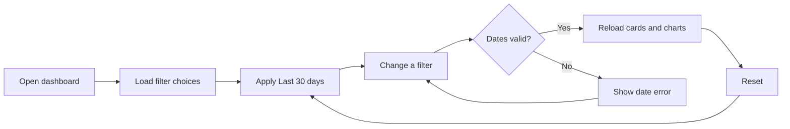
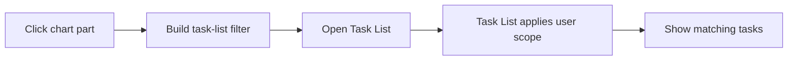
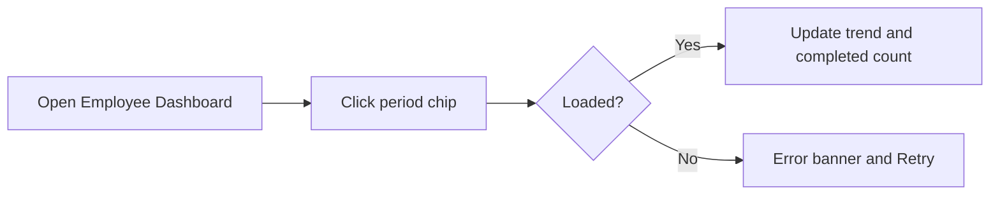

# Analytics – Functional Workflow

> **Project:** TaskFlow – Intelligent Task Allocation & Tracking System
> **Parent Module:** Dashboard  ·  **Child Module:** 02.2 Analytics
> **Version:** 1.0  ·  **Last Updated:** 31-Oct-2026
> **Author:** Jojo George (jojogeorge3344@gmail.com)
> © 2026 Jojo George. All rights reserved.

---

## 1. Overview
Analytics provides the charts and breakdowns on the three dashboards: task status and priority, completion trend, deadlines, department-wise, employee-wise, manager-wise and project-wise figures. It also provides the filter bar (Administrator and Manager dashboards), the period chips (Employee Dashboard) and the drill-down from any chart part to the matching tasks in the Task List.

## 2. Purpose / Business Value
- Lets administrators compare departments, managers, employees and projects over any date range.
- Lets managers spot overloaded team members ("High workload") and members with overdue work.
- Lets employees follow their own created-vs-completed trend and progress per project.
- Every chart part opens exactly the tasks it counts, so figures can always be checked in the Task List.

## 3. Who Can Access

| Role          | Can See | Can Use | Access Level (Own / Team / Organization) |
|---------------|:-------:|:-------:|------------------------------------------|
| Administrator | ✅ | ✅ | Organization (charts and filter bar on the Administrator Dashboard; team charts on the Manager Dashboard) |
| Manager       | ✅ | ✅ | Team (charts and filter bar on the Manager Dashboard) |
| Employee      | ✅ | ✅ | Own (charts and period chips on the Employee Dashboard; no filter bar) |
| Custom Role   | Configurable | Configurable | Charts only if the role holds `dashboard.analytics.view`; filter bar only if it holds `dashboard.filters.use` and opens the Administrator or Manager Dashboard; scope follows the role's dashboard view key |

## 4. Screens
Analytics has no screen of its own; it is a set of sections on the dashboards listed in `02.1-Overview.md`.

| # | Screen Name | Menu Path | Purpose | Visible To |
|---|-------------|-----------|---------|------------|
| 1 | Administrator Dashboard – analytics sections and filter bar | Side menu → **Dashboard** | Organisation-wide charts with filters | Administrator; custom roles holding `dashboard.view.organization` and `dashboard.analytics.view` |
| 2 | Manager Dashboard – analytics sections and filter bar | Side menu → **Dashboard** | Team charts and workload table with filters | Manager; custom roles holding `dashboard.view.team` and `dashboard.analytics.view`; Administrator (by direct address) |
| 3 | Employee Dashboard – analytics sections and period chips | Side menu → **Dashboard** | Own charts, personal performance trend, my projects | Every signed-in user holding `dashboard.analytics.view` |

## 5. Screen & Functionality Details

### 5.1 Screen: Analytics Sections and Dashboard Filter Bar
**Purpose:** Break the dashboard figures down by status, priority, deadline, time, department, employee, manager and project, and let the user narrow them with filters.
**Who can see this screen:** The sections appear on the three dashboards for the roles listed in `02.1-Overview.md` (section 5.1).
**Required permission:** `dashboard.analytics.view` (charts and figures), `dashboard.filters.use` (filter bar on the Administrator and Manager dashboards).

**Screen Elements**
- **Filter bar** (Administrator and Manager dashboards): date preset chips (Today, Last 7 days, Last 30 days, This month, Previous month, Custom range), From / To dates, Date basis (Created date, Deadline, Completed date), Department, Project, Manager, Employee drop-downs (Department and Manager are hidden on the Manager Dashboard) and a **Reset** button.
- **Task status & priority** – two donuts; click a slice to open those tasks.
- **Completion trend** – tasks created vs completed per day (per week when the range is longer than 31 days).
- **Deadlines** – open tasks split into Overdue, Due today, Next 7 days, Later; click a bar to open those tasks.
- **Department-wise tasks** – stacked bars by status, including a "No department" row when needed (Administrator).
- **Employee-wise workload** – top 10 by open tasks with **View all *n* employees with tasks** / **Show top 10** (Administrator); a table with Open, Done, Overdue, Completion, Flag and Tasks-by-status bar (Manager).
- **Manager-wise teams** – Manager, Depts, Staff, Projects and task counts (Administrator).
- **Project-wise progress** – progress per project with "Projected end" (latest task deadline).
- **Employee only:** Period chips, Personal performance trend, My projects progress list.

### 5.2 Functionalities

| # | Functionality | Purpose | Who Can See | Who Can Use | Permission Required | Scope |
|---|---------------|---------|-------------|-------------|---------------------|-------|
| 1 | View task status & priority charts | See the share of tasks per status and per priority | All signed-in users | All signed-in users | `dashboard.analytics.view` | Own / Team / Org |
| 2 | View completion trend | Compare tasks created and completed over the period | Administrator, Employee (own trend) | Administrator, Employee | `dashboard.analytics.view` | Org / Own |
| 3 | View deadlines breakdown | See open tasks by deadline window | Administrator | Administrator | `dashboard.analytics.view` + `dashboard.view.organization` | Org |
| 4 | View department-wise tasks | Compare departments | Administrator | Administrator | `dashboard.analytics.view` + `dashboard.view.organization` | Org |
| 5 | View employee-wise workload | See who carries the most open work (top 10 or all) | Administrator | Administrator | `dashboard.analytics.view` + `dashboard.view.organization` | Org |
| 6 | View team workload with flags | See each team member's tasks with "High workload" and "Overdue" flags | Manager, Administrator | Manager, Administrator | `dashboard.analytics.view` + `dashboard.view.team` | Team |
| 7 | View manager-wise teams | Compare managers' teams | Administrator | Administrator | `dashboard.analytics.view` + `dashboard.view.organization` | Org |
| 8 | View project-wise progress | See progress and projected end per project | Administrator, Manager | Administrator, Manager | `dashboard.analytics.view` + `dashboard.view.organization` or `dashboard.view.team` | Org / Team |
| 9 | Filter dashboard analytics | Narrow figures by date range, date basis, department, project, manager, employee | Administrator, Manager | Administrator, Manager | `dashboard.filters.use` (+ the dashboard's view key) | Org / Team |
| 10 | Reset filters | Return to Last 30 days by Created date with no other filter | Administrator, Manager | Administrator, Manager | `dashboard.filters.use` | Org / Team |
| 11 | Change my period | Switch the Employee Dashboard between Last 7 days, Last 30 days, This month | All signed-in users | All signed-in users | `dashboard.analytics.view` | Own |
| 12 | View my projects | See progress of my own tasks in each of my projects | All signed-in users | All signed-in users | `dashboard.analytics.view` | Own |
| 13 | Drill down to the Task List | Click any chart part to open exactly those tasks in the Task List | All signed-in users | All signed-in users | `dashboard.analytics.view` (Task List applies its own access rules) | Own / Team / Org |

### 5.3 Step-by-Step Workflow – Filter Dashboard Analytics
1. User opens **Dashboard** (Administrator or Manager Dashboard).
2. System loads the filter choices (departments, projects, employees, managers; for a Manager only the team's employees and projects) and applies the default: Last 30 days by Created date.
3. User picks a preset chip or enters From / To dates, chooses a Date basis, and optionally a Department, Project, Manager or Employee.
4. System checks the dates on the screen. If one is missing it shows *"Choose both a start and an end date."*; if the end is before the start it shows *"The end date cannot be before the start date."* and does not reload.
5. If the dates are valid, the system reloads every card and chart for the new filters and updates the subtitle (for example "Last 7 days by deadline").
6. User clicks **Reset** to return to the default filters.

**Flow Diagram**

### 5.4 Step-by-Step Workflow – Drill Down from a Chart
1. User clicks a chart part (a donut slice, a bar segment, a deadline bar, a trend point, a project or a manager's count).
2. System opens the **Task List** with the same filters plus the clicked part (for example status bucket "Overdue", priority "High", or department).
3. The Task List shows a drill-down banner and exactly the tasks the dashboard counted, limited again to what the user may see.

**Flow Diagram**

### 5.5 Step-by-Step Workflow – Change My Period (Employee)
1. User opens **Dashboard** (Employee Dashboard).
2. User clicks **Last 7 days**, **Last 30 days** or **This month**.
3. System reloads the Personal performance trend and "completed in this period" figure for that period. The summary cards, donuts, deadlines and projects always cover all of the user's tasks.

**Flow Diagram**

### 5.6 Business Rules & Validations
- Default range is the last 30 days (ending today) by Created date.
- The end date cannot be before the start date, and the range must be shorter than 3660 days (about 10 years).
- The date basis decides which task date must fall in the range: Created date, Deadline or Completed date.
- The completion trend always uses created and completed dates over the selected range, whatever the date basis. It is shown per day for ranges up to 31 days and per week (weeks start on Monday) for longer ranges.
- The Deadlines breakdown counts only open tasks: Overdue (deadline passed), Due today (rest of today), Next 7 days (tomorrow up to 7 days ahead), Later.
- Employee-wise workload on the Administrator Dashboard shows the top 10 people by open tasks unless **View all** is chosen.
- On the Manager Dashboard, a member is flagged **High workload** when their open tasks are at least 5 and at least 1.5 × the team's average; **Overdue** when they have any overdue task. Choosing one employee in the filter still compares them with the whole team.
- A Manager cannot filter by an employee outside the team or a project outside their scope (projects they are assigned to or that their team's tasks belong to).
- Project "Projected end" is the latest task deadline in the project, because projects have no deadline of their own.
- On the Employee Dashboard, "My projects" lists projects where the user has tasks or is allocated; figures cover only the user's own tasks in each project.
- The bucket, ownership and timezone rules in `02.1-Overview.md` (section 5.6) apply to every chart.

### 5.7 Messages Shown to the User

| Situation | Message |
|-----------|---------|
| Start or end date missing | Choose both a start and an end date. |
| End date before start date | The end date cannot be before the start date. |
| No task matches (Administrator) | No tasks match these filters. Try a wider date range or reset the filters. |
| No task matches (Manager) | No team tasks match these filters. Try a wider date range or reset the filters. |
| Empty chart | No tasks match these filters. |
| Empty trend | No tasks were created or completed in this period. |
| Empty personal trend | You created or completed no tasks in this period. |
| No projects | No projects match these filters. / You have no projects yet. |
| No managers | No managers match these filters. |
| Manager has no team members | No team members to show. Ask an administrator to assign departments or direct reports to you. |
| Server rejects the filter (bad range, employee outside the team, and similar) | Could not load analytics. Check your connection and try again. |
| No permission | No message – the user is taken to their own dashboard, or the dashboard shows the load error above. |

## 6. Permission Summary

| Permission Key | Description | Administrator | Manager | Employee | Custom Role |
|----------------|-------------|:-------------:|:-------:|:--------:|:-----------:|
| `dashboard.analytics.view` | View charts and reports – status, trend, deadlines, workload and progress | Granted | Granted | Granted | Configurable |
| `dashboard.filters.use` | Use dashboard filters – department, project, employee and period | Granted | Granted | Granted | Configurable |

Organisation and team charts also need the dashboard's view key (`dashboard.view.organization` or `dashboard.view.team`), described in `02.1-Overview.md`. The Employee holds `dashboard.filters.use` but the Employee Dashboard has no filter bar; the period chips do not need this key.

## 7. Related Modules
- **02.1 Overview** (sibling child) – the three dashboard screens and summary cards that host these sections.
- **Monitoring (Task Management)** – every chart click opens the Task List with a drill-down filter; the Task List uses the same bucket rules and the user's own access rules.
- **Management** – departments, department managers, projects and project allocations decide the department, manager, team and project figures.
- **Settings** – the application timezone decides the date ranges and "today"; Role Configuration grants `dashboard.analytics.view` and `dashboard.filters.use`.

## 8. Expected Outcome
Users can break their dashboard figures down by status, priority, deadline, time, department, employee, manager and project, narrow them with filters or periods, and click through to the exact tasks behind any chart part.

---
© 2026 Jojo George. All rights reserved. Unauthorized copying or distribution of this document is prohibited.
