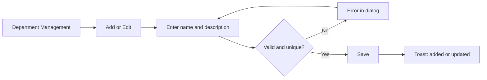
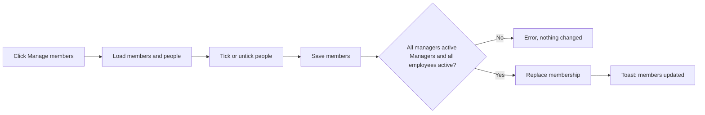
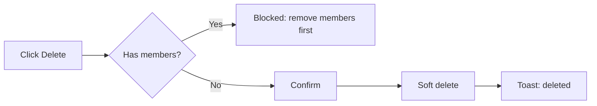

# Department Management – Functional Workflow

> **Project:** TaskFlow – Intelligent Task Allocation & Tracking System
> **Parent Module:** Management  ·  **Child Module:** 03.2 Department Management
> **Version:** 1.0  ·  **Last Updated:** 31-Oct-2026
> **Author:** Jojo George (jojogeorge3344@gmail.com)
> © 2026 Jojo George. All rights reserved.

---

## 1. Overview
Department Management (menu **TaskFlow Management → Department Management**) is where administrators create departments and choose who manages them and who belongs to them. Department managers automatically become the managers of every employee in that department, and a manager's team includes everyone in the departments they manage.

## 2. Purpose / Business Value
- Groups managers and employees into departments, so a person's managers come from the groups they are in and no one keeps a separate "reports to" list.
- Feeds a manager's team, which decides what the manager dashboard and task visibility show.
- Keeps the structure safe: a department cannot be deleted while people still belong to it, and only active Managers can manage a department.

## 3. Who Can Access This Child Module

| Role          | Can See Screen | Can Use Screen | Access Level (Own / Team / Organization) |
|---------------|:--------------:|:--------------:|------------------------------------------|
| Administrator | ✅ | ✅ | Organization |
| Manager       | ❌ (menu hidden, `/departments` redirects) | Only through other screens, using `departments.view` | Organization (no team limit on the list) |
| Employee      | ❌ | ❌ | – |
| Custom Role   | Configurable (needs at least one department action permission) | Configurable | As granted (Organization) |

> Managers hold `departments.view` by default. It lets other screens list departments (for example the employee form), but it does **not** show the Department Management menu. The menu and route need at least one of `departments.create`, `departments.edit`, `departments.delete` or `departments.members.manage`.

## 4. Screens in This Child Module

| # | Screen Name | Menu Path | Purpose | Visible To |
|---|-------------|-----------|---------|------------|
| 1 | Department Management | TaskFlow Management → Department Management (`/departments`) | Add, edit and delete departments and choose their managers and employees | Administrator; custom roles holding any department action permission |
| 2 | Add / Edit department (dialog) | Department Management → **Add department** or card **Edit** | Enter the name and description | Same as screen 1, with `departments.create` or `departments.edit` |
| 3 | Manage members (dialog) | Department Management → card **Manage members** | Choose the department's managers and employees | Same as screen 1, with `departments.members.manage` |

---

## 5. Screen & Functionality Details

### 5.1 Screen: Department Management
**Purpose:** Organize managers and employees into departments.
**Who can see this screen:** Administrator. A custom role sees it only if it holds at least one department action permission.
**Required permission:** any one of `departments.create`, `departments.edit`, `departments.delete`, `departments.members.manage` (to open the screen). The list is loaded with `departments.view`.

**Screen Elements**
- Header with the department count and an **Add department** button (shown with `departments.create`).
- **Search by name** box (filters the cards on screen).
- One card per department, showing its name, description ("No description" when empty) and the counts "{n} managers · {n} employees".
- Card actions: **Manage members** (people icon), **Edit** (pencil) and **Delete** (trash), each shown only with its permission. When the department still has members, Delete shows the tooltip "Remove its managers and employees before deleting".
- **Add/Edit department** dialog with the fields Name (required) and Description.
- **Manage members** dialog: a searchable list ("Search by name or username") of active Managers and Employees, sorting (Name A to Z, Name Z to A, Selected first, Role), "{n} selected", **Select all shown / Clear shown**, **Clear all**, and **Save members**.

### 5.2 Functionalities

| # | Functionality | Purpose | Who Can See | Who Can Use | Permission Required | Scope |
|---|---------------|---------|-------------|-------------|---------------------|-------|
| 1 | View departments | See each department with its manager and employee counts | Administrator | Administrator, Manager (through other screens) | `departments.view` | Org |
| 2 | Add department | Create a department | Administrator | Administrator | `departments.create` | Org |
| 3 | Edit department | Rename it or change the description | Administrator | Administrator | `departments.edit` | Org |
| 4 | Manage members | Choose the managers and employees of a department | Administrator | Administrator | `departments.members.manage` (the people list also needs `employees.view`) | Org |
| 5 | Delete department | Remove an empty department | Administrator | Administrator | `departments.delete` | Org |

### 5.3 Step-by-Step Workflow – Add or edit a department
1. User opens **TaskFlow Management → Department Management**.
2. User clicks **Add department**, or the **Edit** icon on a card.
3. System opens the dialog **Add department** or **Edit department**.
4. User enters the **Name** and optionally a **Description**, then clicks **Add department** or **Save changes**.
5. System checks that the name is unique (ignoring case) and saves, then shows *"{name} added"* or *"{name} updated"*.

**Flow Diagram**

### 5.4 Step-by-Step Workflow – Manage department members
1. User clicks **Manage members** on a card.
2. System loads the current members and every active Manager and Employee. Current members who are now inactive stay listed and ticked, with an "Inactive" badge.
3. User searches, sorts and ticks or unticks people. Each person is saved as a manager or an employee according to their role.
4. User clicks **Save members**. System replaces the department's membership in one step, then shows *"{department} members updated"*.

**Flow Diagram**

### 5.5 Step-by-Step Workflow – Delete a department
1. User clicks **Delete** on a card. If the department still has managers or employees, nothing happens and the tooltip explains why.
2. System asks *"Delete department?"* – *"\"{name}\" will be permanently deleted."*
3. System checks the department has no members, removes its manager links and hides it (a soft delete).
4. System shows *"{name} deleted"*.

**Flow Diagram**

### 5.6 Business Rules & Validations
- The name is required (at most 200 characters). The description is optional (at most 500).
- Department names must be unique among live departments, ignoring case. A deleted department's name can be reused.
- A department with any manager or employee cannot be deleted. Remove them first.
- Every manager picked must be an active user with the **Manager** role. Every employee picked must be an active user. One bad choice rejects the whole save.
- A person may belong to several departments. Saving one department changes only that department's rows.
- Department managers become the "managers" of every employee in that department.
- Departments ticked when an employee is first added (Employee Management) create the same memberships. After that, memberships are changed only here.

### 5.7 Messages Shown to the User

| Situation | Message |
|-----------|---------|
| Added / updated / deleted | {name} added · {name} updated · {name} deleted |
| Members saved | {department} members updated |
| Name missing | Name is required. |
| Duplicate name | Department name already exists. |
| Delete with members | Department cannot be deleted because it still has members. Remove them first. |
| Bad member | User {id} is not an active manager. · User {id} is not an active user. |
| List failed | Could not load departments. Check your connection and try again. |
| Members failed | Could not load the department members. · Could not save the department members. |
| No one to pick | There are no active managers or employees to pick from. |
| Empty list | No departments yet – Add the first department to start grouping managers and employees. |
| No permission | The menu is hidden and `/departments` redirects to the dashboard. A refused call shows "Could not add the department.", "Could not update the department." or "Could not delete the department." |

---

## 6. Permission Summary

| Permission Key | Description | Administrator | Manager | Employee | Custom Role |
|----------------|-------------|:-------------:|:-------:|:--------:|:-----------:|
| `departments.view` | View departments and their members | Granted | Granted | Denied | Configurable |
| `departments.create` | Create departments | Granted | Denied | Denied | Configurable |
| `departments.edit` | Edit departments | Granted | Denied | Denied | Configurable |
| `departments.delete` | Delete departments | Granted | Denied | Denied | Configurable |
| `departments.members.manage` | Manage department members | Granted | Denied | Denied | Configurable |

Every key except `departments.view` also needs `departments.view`. Older roles may still hold `departments.manage`, which acts like the finer department keys it was split into. The **Manage members** dialog loads people from Employee Management, so it also needs `employees.view`.

## 7. Related Modules
- **03.1 Employee Management** – the people picked as members come from the employee list. The employee details panel shows each person's departments and the managers derived from them. Departments can also be set when an employee is first added.
- **03.3 Project Management (incl. Positions)** – a manager's team is the members of the departments they manage plus the people on projects they are flagged as manager of.
- **Dashboard** – the manager dashboard uses the manager's team. The organization dashboard counts departments.
- **Monitoring (Tasks)** – task visibility for managers uses the same team.

## 8. Expected Outcome
Administrators keep an accurate list of departments, each with the right managers and employees. Every employee's managers follow automatically from the departments they belong to, and departments can be removed only once they are empty.

---
© 2026 Jojo George. All rights reserved. Unauthorized copying or distribution of this document is prohibited.
