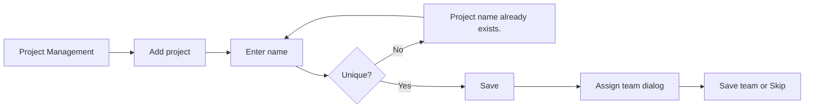
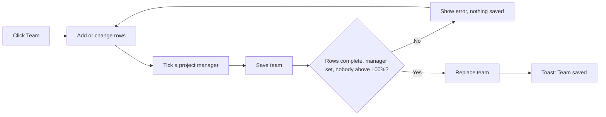
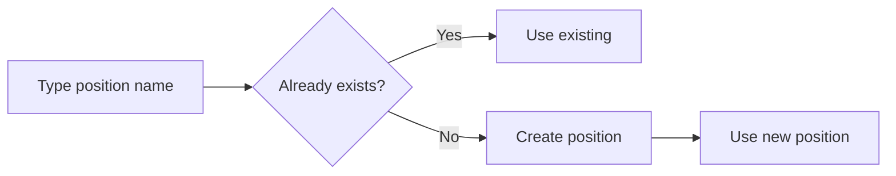
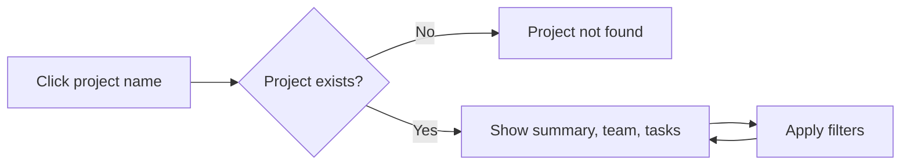
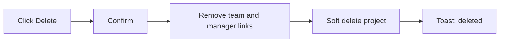

# Project Management (incl. Positions) – Functional Workflow

> **Project:** TaskFlow – Intelligent Task Allocation & Tracking System
> **Parent Module:** Management  ·  **Child Module:** 03.3 Project Management (incl. Positions)
> **Version:** 1.0  ·  **Last Updated:** 31-Oct-2026
> **Author:** Jojo George (jojogeorge3344@gmail.com)
> © 2026 Jojo George. All rights reserved.

---

## 1. Overview
Project Management (menu **TaskFlow Management → Project Management**) is where administrators keep the list of projects and decide who works on each one, in which position, for what percentage of their time, and who manages the project. The **Project Details** screen shows one project's team, summary figures and tasks. Positions (such as Developer or QA) are labels picked or created while building a team.

## 2. Purpose / Business Value
- Keeps one list of projects that every task belongs to.
- Stops people being over-booked: one person can be given at most 100% across all projects.
- Makes sure every project with a team has at least one project manager, who then sees that team on the manager dashboard and in task visibility.
- Gives managers a read-only view of every project's team and tasks for planning.

## 3. Who Can Access This Child Module

| Role          | Can See Screen | Can Use Screen | Access Level (Own / Team / Organization) |
|---------------|:--------------:|:--------------:|------------------------------------------|
| Administrator | ✅ | ✅ | Organization |
| Manager       | ✅ | View only (projects, project details, positions) | Organization (no team limit on the lists) |
| Employee      | ❌ | ❌ | – |
| Custom Role   | Configurable (needs `projects.view`) | Configurable | As granted (Organization) |

## 4. Screens in This Child Module

| # | Screen Name | Menu Path | Purpose | Visible To |
|---|-------------|-----------|---------|------------|
| 1 | Project Management | TaskFlow Management → Project Management (`/projects`) | List projects, add, edit and delete them, and manage each project's team | Administrator, Manager (read only); custom roles with `projects.view` |
| 2 | Project Details | Project Management → click a project name (`/projects/{id}`) | See the project's team, summary figures and tasks, with filters | Administrator, Manager; custom roles with `projects.view` |
| 3 | Add / Edit project (dialog) | Project Management → **Add project** or card **Edit** | Enter the name and description | Administrator; custom roles with `projects.create` or `projects.edit` |
| 4 | Project team / Assign team (dialog) | Project Management → card **Team**, or automatically after a project is added | Choose people, positions, percentages and project managers | Administrator; custom roles with `projects.members.manage` |

---

## 5. Screen & Functionality Details

### 5.1 Screen: Project Management and Project Details

#### Project Management (list)
**Purpose:** Keep the list of projects and who works on each.
**Who can see this screen:** Administrator, Manager (read only), and custom roles with `projects.view`.
**Required permission:** `projects.view`

**Screen Elements**
- Header with the project count and an **Add project** button (shown with `projects.create`).
- **Search by name or description** box.
- One card per project showing its name (a link to Project Details), description, "{n} employees", **Manager/Managers** names, and **View employees** (opens Employee Management filtered by the project, shown only if the user can open that screen).
- Card actions: **Team** (manage team), **Edit** and **Delete**, each shown with its permission.
- **Add/Edit project** dialog with the fields Name (required) and Description.
- **Project team** dialog. It is titled **Assign team** when it opens straight after a project is created, and then has a **Skip for now** button. It has one row per person: Employee, Position, Allocation %, a **Project manager** tick box and Remove. It also has **Add employee** and **Save team**.

#### Project Details
**Purpose:** See who is on a project and the project's tasks.
**Who can see this screen:** Administrator, Manager, and custom roles with `projects.view`.
**Required permission:** `projects.view`

**Screen Elements**
- The project name, plus the summary figures for members, tasks, **Overdue** and **Completed** (percentage).
- **Team** list (each person with their position and percentage).
- **Tasks** table (Task, Assignee, Priority, Status, Deadline, with an "Overdue" badge) and the filters **Status**, **Priority**, **Assigned to**, **Role** (position on this project), **Deadline from** and **Deadline to**, plus **Clear filters**.

### 5.2 Functionalities

| # | Functionality | Purpose | Who Can See | Who Can Use | Permission Required | Scope |
|---|---------------|---------|-------------|-------------|---------------------|-------|
| 1 | View projects | List projects with their team size and managers | Administrator, Manager | Administrator, Manager | `projects.view` | Org |
| 2 | View project details | Team, summary figures and filtered tasks of one project | Administrator, Manager | Administrator, Manager | `projects.view` | Org (task list is not limited by task scope) |
| 3 | Add project | Create a project | Administrator | Administrator | `projects.create` | Org |
| 4 | Edit project | Rename it or change the description | Administrator | Administrator | `projects.edit` | Org |
| 5 | Manage project team | Choose people, their position, percentage and the project manager(s) | Administrator | Administrator | `projects.members.manage` (the people picker also needs `employees.view`) | Org |
| 6 | Create position | Add a new position name while picking one | Administrator | Administrator | `positions.create` | Org |
| 7 | View positions | Fill the position pickers | Administrator, Manager | Administrator, Manager | `projects.view` | Org |
| 8 | Delete project | Remove a project and take everyone off it | Administrator | Administrator | `projects.delete` | Org |

### 5.3 Step-by-Step Workflow – Add a project and assign its team
1. User opens **TaskFlow Management → Project Management** and clicks **Add project**.
2. User enters the **Name** and an optional **Description**, then clicks **Add project**.
3. System checks that the name is unique and saves, then shows *"{name} added"*.
4. System opens **Assign team: {name}**. The user can add people now or click **Skip for now**.

**Flow Diagram**

### 5.4 Step-by-Step Workflow – Manage a project team
1. User clicks **Team** on a project card.
2. System loads the current team and the positions.
3. User clicks **Add employee** and picks a person. The picker shows "{n}% remaining" or "Fully allocated". The user then picks or types a **Position** and enters an **Allocation %**.
4. User ticks **Project manager** for at least one person. Only people with the Manager role can be ticked.
5. User clicks **Save team**. The whole team is saved only if every rule passes. System shows *"Team saved"*, or *"Team cleared"* when no one is left.

**Flow Diagram**

### 5.5 Step-by-Step Workflow – Create a position
1. In any **Position** field (project team or employee form), the user types a name that is not in the list.
2. When the field is committed, the system returns the existing position if the name matches one (ignoring case). Otherwise it creates the position for everyone to reuse.
3. If this fails, *"The position could not be created."* is shown (or the server reason).

**Flow Diagram**

### 5.6 Step-by-Step Workflow – View project details
1. User clicks a project name on the list.
2. System shows the summary figures, the team and all tasks of the project, soonest deadline first.
3. User sets filters. The tasks reload with all filters applied together.
4. If the project does not exist, *"Project not found – It may have been deleted, or the link is wrong."* is shown.

**Flow Diagram**

### 5.7 Step-by-Step Workflow – Delete a project
1. User clicks **Delete** on a card.
2. System asks *"Delete project?"* – *"\"{name}\" will be permanently deleted and its {n} employees will be taken off it."* (or only the first part when the project has no team).
3. System removes every allocation and manager link for the project and hides the project (a soft delete).
4. System shows *"{name} deleted"*.

**Flow Diagram**

### 5.8 Business Rules & Validations
- The project name is required (at most 200 characters) and must be unique among live projects, ignoring case. The description is optional (at most 500).
- Every team row needs an employee, a position and a whole percentage from 1 to 100.
- A person can appear only once on a project.
- At least one person on a non-empty team must be marked as the project manager, and only a person with the **Manager** role can be one.
- Every person on the team must exist and be active.
- A person's total across all projects can never pass 100%. Saving a team is all-or-nothing: if one person would pass the cap, nothing is saved.
- Position names are required, at most 100 characters, and unique ignoring case ("qa" matches "QA"). Extra spaces are removed. Positions are only labels and grant no access.
- The built-in positions are Member, Manager, QA, Developer, DevOps and System Admin. New rows start with **Member** when it exists.
- Deleting a project takes every person off it and removes its managers. Its tasks are not deleted.
- A manager's team is everyone in the departments they manage plus everyone on the projects they are flagged as manager of. The manager dashboard and task visibility use this team.

### 5.9 Messages Shown to the User

| Situation | Message |
|-----------|---------|
| Added / updated / deleted | {name} added · {name} updated · {name} deleted |
| Team saved | Team saved · Team cleared |
| Name missing | Name is required. |
| Duplicate name | Project name already exists. |
| Incomplete rows | Give every row an employee, a position and a percentage, or remove the row. |
| Bad percentage | Use a whole percentage from 1 to 100. · Allocation percentage must be a whole number from 1 to 100. |
| Over capacity (form) | {name} is fully allocated on other projects. · {name} has only {n}% remaining. |
| Over capacity (server) | {name} would be allocated {total}% in total. They already have {other}% on other projects, so {left}% remains. |
| No manager | Mark at least one person as the project manager. (form) / Mark at least one person on the team as the project's manager. (server) |
| Not a Manager | Only a person with the Manager role can manage a project (tooltip) / Only a person with the Manager role can manage a project: {names}. |
| Duplicate person | A person can only appear once on a project. |
| Inactive person | One or more people do not exist or are not active. |
| Position errors | Position name is required. · Position name must be 100 characters or fewer. · The position could not be created. |
| Load errors | Could not load projects. Check your connection and try again. · Could not load the team. Close this and try again. · Could not load the project. · Could not load the project tasks. · Could not load the tasks. |
| Not found | Project not found – It may have been deleted, or the link is wrong. |
| Empty | No projects yet – Add the first project to start organising employees. · No one is assigned to this project yet. · No tasks yet – Tasks created for this project will appear here. |
| No permission | Buttons are hidden for users without the permission, and `/projects` redirects to the dashboard without `projects.view`. A refused call shows "Could not add the project.", "Could not update the project.", "Could not delete the project." or "Could not save the team." |

---

## 6. Permission Summary

| Permission Key | Description | Administrator | Manager | Employee | Custom Role |
|----------------|-------------|:-------------:|:-------:|:--------:|:-----------:|
| `projects.view` | View projects, members, tasks and positions | Granted | Granted | Denied | Configurable |
| `projects.create` | Create projects | Granted | Denied | Denied | Configurable |
| `projects.edit` | Edit projects | Granted | Denied | Denied | Configurable |
| `projects.delete` | Delete projects | Granted | Denied | Denied | Configurable |
| `projects.members.manage` | Manage project members | Granted | Denied | Denied | Configurable |
| `positions.create` | Create positions | Granted | Denied | Denied | Configurable |

Every key except `projects.view` also needs `projects.view`. Older roles may still hold `projects.manage`, which acts like the finer project keys it was split into. The team dialog's people picker loads people from Employee Management, so it also needs `employees.view`.

## 7. Related Modules
- **03.1 Employee Management** – the people on a team come from the employee list. Allocations can also be set when an employee is first added, and the employee list shows each person's projects and can be filtered by project (**View employees**).
- **03.2 Department Management** – a manager's team combines the departments they manage with the projects they are flagged on.
- **Monitoring (Tasks, Board, Workload)** – every task belongs to a project, and workload uses project allocations. Project Details lists the project's tasks.
- **Dashboard** – the manager dashboard uses the manager's team. The organization dashboard counts projects.
- **Reports** – reports filter by project.

## 8. Expected Outcome
Administrators keep an accurate list of projects. Every project with a team has a manager, and nobody is allocated more than 100% across projects. Managers can see every project's team and tasks when they plan and assign work.

---
© 2026 Jojo George. All rights reserved. Unauthorized copying or distribution of this document is prohibited.
