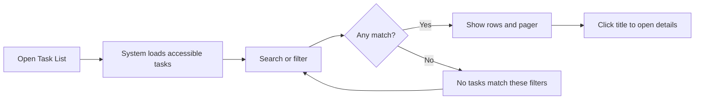
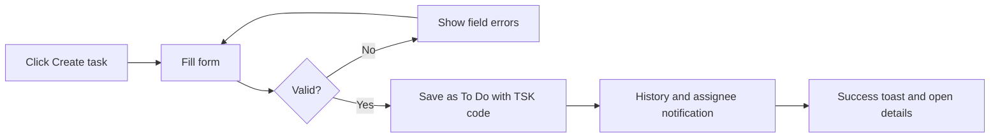
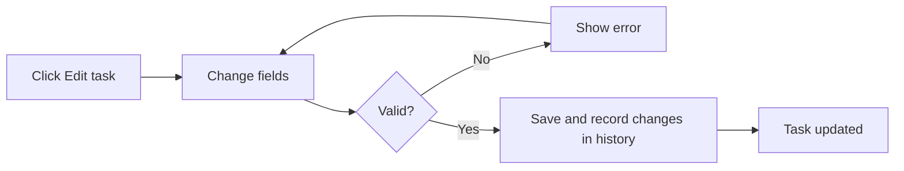
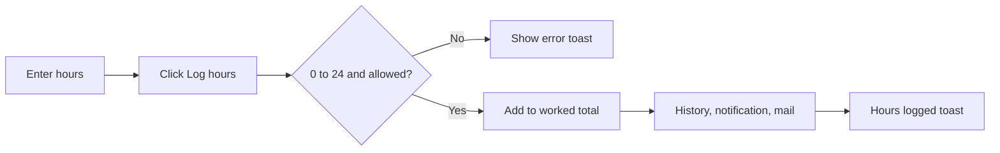
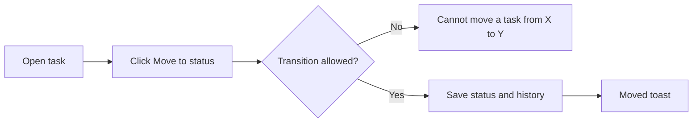
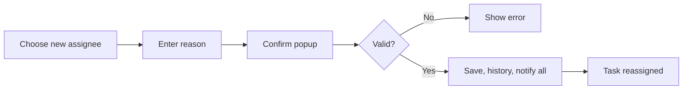
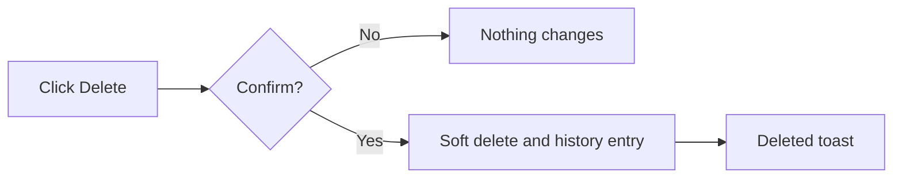

# Task Management – Functional Workflow

> **Project:** TaskFlow – Intelligent Task Allocation & Tracking System
> **Parent Module:** Monitoring  ·  **Child Module:** 04.1 Task Management
> **Version:** 1.0  ·  **Last Updated:** 31-Oct-2026
> **Author:** Jojo George (jojogeorge3344@gmail.com)
> © 2026 Jojo George. All rights reserved.

---

## 1. Overview
Task Management is the core of Monitoring. Users list, search and filter the tasks they may access, and authorised users create, copy, edit, reassign and delete tasks. On Task Details, users log worked hours and move a task to its next allowed status.

## 2. Purpose / Business Value
- Gives every task one owner, one deadline and one status, and every change is recorded with who made it and when.
- Each person sees only the tasks they are allowed to see: Employees see their own tasks, Managers see their team's tasks, Administrators see all tasks.
- Managers can move tasks to someone else, giving a reason that is recorded and shown to everyone notified.
- Assignment, reassignment and worked-hours changes send in-app notifications, and reassignment and worked-hours changes also send internal mail.
- Worked hours are tracked against the estimate, so managers can see how much effort a task has left.

## 3. Who Can Access

| Role          | Can See | Can Use | Access Level (Own / Team / Organization) |
|---------------|:-------:|:-------:|------------------------------------------|
| Administrator | ✅ | ✅ | Organization – all task actions, including delete |
| Manager       | ✅ | ✅ | Team (the team's tasks plus the tasks the manager created, is assigned or is notified about) – create, edit, reassign, status, recipients; no delete |
| Employee      | ✅ | ✅ | Own (tasks they are assigned, created or are notified about) – view, change status, log hours on tasks assigned to them |
| Custom Role   | Configurable | Configurable | As granted (Own by default; Organization or Team when `tasks.view.all` is granted) |

Users with `tasks.view.all` reach the list through **TaskFlow Monitoring → Task Management**. Everyone else sees **Task Management → My Tasks**.

## 4. Screens

| # | Screen Name | Menu Path | Purpose | Visible To |
|---|-------------|-----------|---------|------------|
| 1 | Task List ("Task Management" / "My Tasks") | TaskFlow Monitoring → Task Management, or Task Management → My Tasks (`/tasks`) | Search, filter and page through accessible tasks | All signed-in users |
| 2 | Create Task | Task List → **Create task** (`/tasks/new`) | Create and assign a new task, or a copy of an existing one | `tasks.create` (Administrator, Manager) |
| 3 | Task Details | Task List / Board → click a task (`/tasks/{id}`) | Full task information, edit, status, hours, tabs | Users who can access the task |
| 4 | Reassign Task | Task Details → **Reassign task** tab → **Choose new assignee** (`/tasks/{id}/reassign`) | Move the task to another person with a reason | `tasks.reassign` (Administrator, Manager) |

---

## 5. Screen & Functionality Details

### 5.1 Screens

#### 5.1.1 Screen: Task List
**Purpose:** Show every task the user may access, with search, filters and paging.
**Who can see this screen:** All signed-in users. The page title is "Task Management" for users with `tasks.view.all` and "My Tasks" for everyone else.
**Required permission:** none beyond signing in (`tasks.view.own`, Always On). What the list contains depends on the user's task scope.

**Screen Elements**
- Header with the count text, for example "1–20 of 57 tasks", followed by " match the current filters" when filters are active.
- **Board view** button and **Create task** button. Create task needs `tasks.create`.
- Filter bar: **Search** ("Task code or title"), **Employee** (only with `tasks.view.all`), **Project** (shown only when the project list loads), **Status**, **Priority**, **Deadline from** and **Deadline to**, and a **Reset** button.
- Dashboard drill-down banner: "Opened from the dashboard: …" with a **Show all tasks** button.
- Table columns: Code, Title (a link to the details), Project, Assignee, Creator, Priority, Start, Deadline (with a "Overdue", "Due today" or "Upcoming" chip), Est. hours, Status. Overdue rows are highlighted.
- Row actions: **Copy task** (`tasks.create`) and **Delete** (`tasks.delete`).
- Pager with Previous and Next, "Page X of Y", 20 tasks per page.

#### 5.1.2 Screen: Create Task
**Purpose:** Create a task and assign it to an employee.
**Who can see this screen:** Administrator and Manager by default.
**Required permission:** `tasks.create`

**Screen Elements**
- Project* (drop-down), Title* (up to 200 characters), Description (up to 4000 characters).
- Assigned employee* (active users whose role is "Employee"), Priority* (Low, Medium, High, Critical; the default comes from Application Settings).
- Start date* and Deadline* (date and time; they default to now and now + 3 days), Estimated hours*.
- **Additional recipients** checklist (any active user except the assignee). The hint says: "The assigned employee is always notified."
- **Reminders**: First reminder, Second reminder and "After the deadline" (Daily / Weekly), filled in from Reminder Settings.
- **Cancel** and **Create task** buttons.
- When opened with **Copy**, the form is filled from the source task and the notice "Copied from TSK-…. Check the dates before creating." is shown.

#### 5.1.3 Screen: Task Details
**Purpose:** Show everything about one task and let authorised users act on it.
**Who can see this screen:** The task's assignee, creator and additional recipients, users with `tasks.view.all` (Managers only for their team), and Administrators.
**Required permission:** task access. Each action has its own key.

**Screen Elements**
- Header with the task code, project and stage chip (Upcoming, Due today, Overdue, Completed). Buttons: **Copy** (`tasks.create`), **Delete** (`tasks.delete`) and **Edit task** (`tasks.update`).
- Details card: description, project, assignee, created by, priority, start date, deadline, estimated hours, worked hours, status, last updated, and "Also notified" (recipients).
- Edit form (when editing): Title, Description, Priority segments, Start date, Deadline with a schedule summary, Estimated hours and Worked hours steppers with an effort bar, and **Cancel** / **Save changes**.
- Tabs: **Discussion** (latest 3 comments) and **Activity history** (latest 4 entries, needs `tasks.activity.view`) – both described in child module 04.2 – and **Reassign task** (needs `tasks.reassign`).
- Side panel: **Time tracking** (Estimated, Worked, Remaining, a **Log hours** box and a "View hours in activity history" link) for the assignee or `tasks.update` holders, and **Move to** status buttons.

#### 5.1.4 Screen: Reassign Task
**Purpose:** Give the task to another person and record why.
**Who can see this screen:** Administrator and Manager by default.
**Required permission:** `tasks.reassign`

**Screen Elements**
- Step "1 · Who takes over?": Current and New cards, a "Search people…" box and a list of active users except the current assignee.
- Step "2 · Why is it moving?": **Reason** (required). The hint says it is "recorded in the activity history and shown to everyone notified".
- "What happens next" list: everyone who will be told (new assignee, previous assignee, also notified).
- **Cancel** and **Reassign** buttons. A confirmation popup appears before saving.

### 5.2 Functionalities

| # | Functionality | Purpose | Who Can See | Who Can Use | Permission Required | Scope |
|---|---------------|---------|-------------|-------------|---------------------|-------|
| 1 | View task list | Browse accessible tasks, soonest deadline first | All roles | All roles | `tasks.view.own` (Always On) / `tasks.view.all` | Own / Team / Org |
| 2 | Search and filter tasks | Find tasks by code or title, status, priority, project, deadline range | All roles | All roles | none (Employee filter needs `tasks.view.all`) | Own / Team / Org |
| 3 | Open a dashboard drill-down | See exactly the tasks a dashboard chart segment counted | All roles | All roles | none (dashboard keys apply on the dashboard) | Own / Team / Org |
| 4 | Create task | Add and assign a new task | Administrator, Manager | Administrator, Manager | `tasks.create` | Org |
| 5 | Copy task | Start a new task from an existing one | Administrator, Manager | Administrator, Manager | `tasks.create` | Own / Team / Org |
| 6 | View task details | See full information, recipients and stage | All roles with task access | All roles with task access | task access (`tasks.view.own` / `tasks.view.all`) | Own / Team / Org |
| 7 | Edit task | Change title, description, priority, dates, estimated and worked hours | Administrator, Manager | Administrator, Manager | `tasks.update` | Team / Org |
| 8 | Log worked hours | Add hours to the task's worked total | Assignee, `tasks.update` holders | Assignee, `tasks.update` holders | none for the assignee, otherwise `tasks.update` | Own / Team / Org |
| 9 | Change status (details) | Move the task to its next allowed status | All roles with task access | All roles with task access | `tasks.status.change` | Own / Team / Org |
| 10 | Reassign task | Move the task to another active person with a reason | Administrator, Manager | Administrator, Manager | `tasks.reassign` | Team / Org |
| 11 | Delete task | Remove the task for everyone (history kept) | Administrator | Administrator | `tasks.delete` | Org |
| 12 | View recipients | See who else is notified ("Also notified") | All roles with task access | All roles with task access | task access | Own / Team / Org |
| 13 | Manage recipients | Replace the extra recipient list | Administrator, Manager | Administrator, Manager (API only, no screen) | `tasks.recipients.manage` | Org |

### 5.3 Step-by-Step Workflow – View, Search and Filter Tasks
1. User opens **TaskFlow Monitoring → Task Management** (or **Task Management → My Tasks**).
2. System loads the first 20 tasks the user may access, ordered by deadline.
3. User types in **Search**. The list refreshes 300 ms after typing stops.
4. User picks Employee, Project, Status, Priority or a deadline range. The list refreshes from page 1.
5. If nothing matches, the system shows *"No tasks match these filters"* and a **Clear filters** button.
6. User clicks a task title to open **Task Details**.

**Flow Diagram**

### 5.4 Step-by-Step Workflow – Create Task
1. User opens **Task List** and clicks **Create task** (or **Copy** on a row).
2. System shows the **Create task** form, filled with the reminder defaults and the default priority.
3. User chooses Project, enters Title, picks the Assigned employee, Priority, Start date, Deadline and Estimated hours, and optionally recipients and reminders.
4. User clicks **Create task**.
5. System validates the form and the server rules, creates the task with status **To Do** and a code `TSK-000123`, and adds the assignee as a recipient.
6. System records two history entries ("Task created" and "Assigned to …"), sends the assignee the notification *"A task was assigned to you: …"*, shows *"TSK-… created and assigned to …"* and opens the new task.

**Flow Diagram**

### 5.5 Step-by-Step Workflow – Edit Task
1. User opens **Task Details** and clicks **Edit task**.
2. System shows the edit form with the current values.
3. User changes title, description, priority, dates, estimated hours or worked hours, and clicks **Save changes**.
4. System validates the data and saves it. A deadline change records "Deadline updated", a priority change records "Priority updated", and a worked-hours change records "Worked hours logged: Xh (total)".
5. If worked hours changed, the assignee and recipients get a notification and internal mail.
6. System shows *"Task updated"*.

**Flow Diagram**

### 5.6 Step-by-Step Workflow – Log Worked Hours
1. The assignee (or a `tasks.update` holder) opens **Task Details**.
2. In **Time tracking**, the user enters hours in **Log worked hours** and clicks **Log hours**.
3. System checks that the hours are more than 0 and at most 24, adds them to the worked total and records "Worked hours logged: Xh (total)".
4. System notifies the assignee, the recipients and the user (in-app and internal mail), for example "… added 3h of worked time (was 2h) …".
5. System shows *"3h logged"* and updates Worked and Remaining.

**Flow Diagram**

### 5.7 Step-by-Step Workflow – Change Status (Task Details)
1. User opens **Task Details**.
2. Under **Move to**, the system shows only the allowed next statuses.
3. User clicks a status.
4. System checks that the move is allowed, saves it, records "Status changed from X to Y" (and "Task completed" when completed), and shows *"TSK-… moved to Y"*.

**Flow Diagram**

### 5.8 Step-by-Step Workflow – Reassign Task
1. User opens **Task Details**, chooses the **Reassign task** tab and clicks **Choose new assignee**.
2. System shows the **Reassign task** screen.
3. User selects the new person and enters a **Reason**.
4. User clicks **Reassign**. The system asks *"Reassign task?"* and the user clicks **Reassign** again.
5. System checks the permission, the reason and that the new person is active. It changes the assignee, adds them as a recipient, and records "Reassigned from A to B. Reason: …".
6. System notifies the new assignee, the previous assignee, the recipients and the user (in-app and internal mail), shows *"Task reassigned"* and returns to the task.

**Flow Diagram**

### 5.9 Step-by-Step Workflow – Delete Task
1. User clicks **Delete** on a list row or on Task Details.
2. System asks *"Delete task?"* and says the task "will be removed for everyone. Its comments and history are kept."
3. User clicks **Delete**.
4. System marks the task as deleted, records "Task deleted", and shows *"TSK-… deleted"*.

**Flow Diagram**

### 5.10 Business Rules & Validations
- A task code is generated automatically as `TSK-` followed by the 6-digit id, for example `TSK-000042`.
- Every new task starts as **To Do**. The creator and the creation time are recorded.
- Title is required (up to 200 characters). Description is up to 4000 characters. Project and Assigned employee are required.
- The deadline must be later than the start date. Estimated hours must be more than 0.
- The assigned employee must exist and be active, and the project must exist and be active.
- At most 50 additional recipients. Every recipient must exist. The assignee is always a recipient and is never removed.
- Reminder days are 0 to 30. The second reminder cannot come before the first (0 means "on the deadline day"). Fields left empty take the configured Reminder Settings defaults.
- Allowed status moves:
  - To Do → In Progress, Blocked or Cancelled
  - In Progress → In QA, Blocked, Completed or Cancelled
  - In QA → In Progress, Blocked, Completed or Cancelled
  - Blocked → In Progress or Cancelled
  - Completed and Cancelled are final.
  - Choosing the same status is always allowed.
- Completing a task stores the completion time. Cancelling stores the cancel time.
- The stage (Upcoming, Due today, Overdue, Completed) is worked out when the task is read, using the application time zone. It is never stored.
- One worked-hours entry must be more than 0 and at most 24 hours. Only the assignee or a `tasks.update` holder can log hours.
- A reassignment needs a reason (up to 500 characters). The new assignee must be an active user.
- Deleting is a soft delete. The task disappears from every list, but its comments and history are kept.
- A Manager's list, board and details are limited to their team: active people in a department they manage or on a project where they are flagged as project manager. Tasks the manager created, is assigned or is notified about are also shown. When a Manager opens the list from a dashboard drill-down, only the team's tasks are shown.
- On the Create screen, only users whose role is "Employee" can be chosen as assignee. On the Reassign screen, any active user except the current assignee can be chosen.

### 5.11 Messages Shown to the User

| Situation | Message |
|-----------|---------|
| Task created | `TSK-000123 created and assigned to <name>` (toast) |
| Task updated | Task updated |
| Hours logged | `3h logged` |
| Status changed | `TSK-000123 moved to InProgress` |
| Task reassigned | Task reassigned |
| Task deleted | `TSK-000123 deleted` |
| Delete confirmation | Delete task? – "… will be removed for everyone. Its comments and history are kept." |
| Reassign confirmation | Reassign task? – "… will move from A to B. The new assignee will be notified." |
| List failed to load | Could not load tasks. Check your connection and try again. |
| No results | No tasks match these filters / No tasks yet / Tasks assigned to you will appear here. |
| Validation error (form) | Project is required. · Title is required. · Title must be 200 characters or fewer. · Description must be 4000 characters or fewer. · Select the employee to assign. · Start date is required. · Deadline is required. · Deadline must be after the start date. · Estimated hours are required. · Estimated hours must be a positive number. · Enter at least 0.5 hours. (edit form) |
| Validation error (server) | An assigned employee is required. · A project is required. · A task can have at most 50 additional recipients. · The second reminder cannot come before the first reminder. · The assigned employee does not exist or is not active. · The selected project does not exist. · One or more recipients do not exist. · A reassignment reason is required. · The target employee does not exist or is not active. |
| Invalid hours | Enter the hours worked (greater than 0). · Hours must be greater than 0 and at most 24 per entry. |
| Not the assignee | Only the assignee can log hours on this task. |
| Disallowed status move | Cannot move a task from Completed to InProgress. (the statuses vary) |
| Save conflict | The task's worked hours changed while you were saving. Please try again. |
| No permission (server) | Your role is not allowed to create tasks. · Your role is not allowed to edit tasks. · Your role is not allowed to reassign tasks. · You do not have access to this task. |
| No permission (screen) | The route guard sends the user back to their dashboard. A blocked API call shows the screen's fallback text, such as "Could not load the task." |
| Copy problems | That task could not be copied, so the form is empty. · "Copied from TSK-…, but … can no longer be assigned. Choose another employee." |

---

## 6. Permission Summary

| Permission Key | Description | Administrator | Manager | Employee | Custom Role |
|----------------|-------------|:-------------:|:-------:|:--------:|:-----------:|
| `tasks.view.own` | View my tasks (assigned, created, notified) | Always On | Always On | Always On | Always On |
| `tasks.view.all` | View all tasks (Managers are limited to their team) | Granted | Granted | Denied | Configurable |
| `tasks.create` | Create and copy tasks | Granted | Granted | Denied | Configurable |
| `tasks.update` | Edit tasks (and log hours on any accessible task) | Granted | Granted | Denied | Configurable |
| `tasks.delete` | Delete tasks | Granted | Denied | Denied | Configurable |
| `tasks.reassign` | Reassign tasks | Granted | Granted | Denied | Configurable |
| `tasks.recipients.manage` | Manage task recipients | Granted | Granted | Denied | Configurable |
| `tasks.status.change` | Update task status (board and details) | Granted | Granted | Granted | Configurable |

`tasks.status.change` is shared with child module 04.3 Kanban Board.

## 7. Related Modules
- **04.2 Comments & Activity History** – The Discussion and Activity history tabs on Task Details, and every history entry written by the actions above.
- **04.3 Kanban Board** – The board shows the same tasks and uses the same status rules; clicking a card opens Task Details.
- **04.4 Employee Workload** – The **Tasks →** link opens this Task List filtered to one employee.
- **Dashboard** – Dashboard chart segments open the Task List as a drill-down. The Manager or Administrator dashboard keys also decide whether a role with `tasks.view.all` is limited to its team.
- **Management** – Projects (required on every task), employees (assignee, recipients) and departments or project-manager flags (which define a Manager's team).
- **Communication** – Assignment, reassignment and worked-hours changes create in-app notifications and internal mail. Deadline reminders use each task's reminder fields.
- **Settings** – Reminder Settings give the default reminder intervals. Application Settings give the default priority and the time zone used for "Due today" and "Overdue".
- **TaskFlow Assistant (TFA)** – The assistant reads the user's tasks (for example "get my tasks" and "prioritise tasks") through the same task scope.

## 8. Expected Outcome
Every user sees exactly the tasks they are allowed to see. Managers and Administrators create, edit, reassign and (Administrators) delete tasks, assignees log their worked hours, and everyone moves their tasks through the allowed statuses on the details screen.

---
© 2026 Jojo George. All rights reserved. Unauthorized copying or distribution of this document is prohibited.
