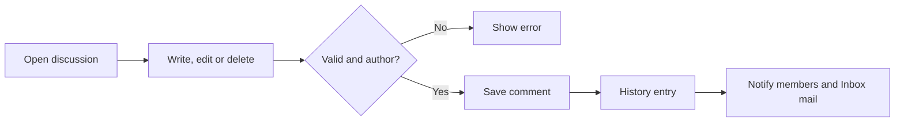
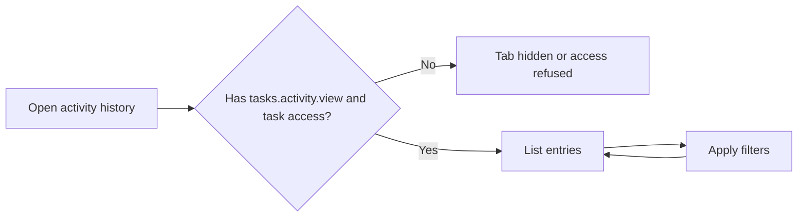
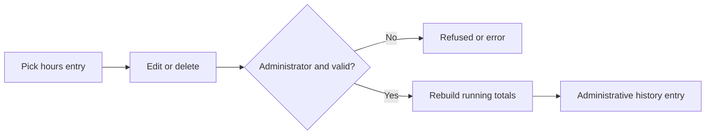

# Comments & Activity History – Functional Workflow

> **Project:** TaskFlow – Intelligent Task Allocation & Tracking System
> **Parent Module:** Monitoring  ·  **Child Module:** 04.2 Comments & Activity History
> **Version:** 1.0  ·  **Last Updated:** 31-Oct-2026
> **Author:** Jojo George (jojogeorge3344@gmail.com)
> © 2026 Jojo George. All rights reserved.

---

## 1. Overview
Comments & Activity History lets the people on a task talk about it in one discussion and see an unchangeable, time-ordered record of everything that happened to it. Administrators can also correct or remove individual worked-hours entries, and each correction is itself recorded.

## 2. Purpose / Business Value
- Keeps all conversation about a task in one place, next to the task, instead of in scattered mail.
- Every change to a task is recorded with who made it and when, giving a reliable audit trail.
- Everyone on the task is told when a comment is added, edited or deleted, in-app and (when mail is enabled) in their Inbox.
- Administrators can fix a wrongly logged worked-hours entry without losing the history of the fix.

## 3. Who Can Access

| Role          | Can See | Can Use | Access Level (Own / Team / Organization) |
|---------------|:-------:|:-------:|------------------------------------------|
| Administrator | ✅ | ✅ | Organization – comment, view history, and correct or delete worked-hours entries (role check) |
| Manager       | ✅ | ✅ | Team on screen (reached through Task Details, which is team-limited). The comment and activity API itself is not team-limited – see the technical document, section 12 |
| Employee      | ✅ | ✅ | Own (tasks they are assigned, created or are notified about) – comment and view history |
| Custom Role   | Configurable | Configurable | As granted through `tasks.comment.*` and `tasks.activity.view`; the hours correction is never available (Administrator role only) |

Comments are only edited or deleted by their author, whatever permissions the user holds.

## 4. Screens

| # | Screen Name | Menu Path | Purpose | Visible To |
|---|-------------|-----------|---------|------------|
| 1 | Task Discussion | Task Details → **Open full discussion →** (`/tasks/{id}/discussion`) | Read, post, edit and delete comments | Users who can access the task |
| 2 | Activity History | Task Details → **Open full history →** (`/tasks/{id}/activity`) | Read the full, filtered change history | `tasks.activity.view` |

---

## 5. Screen & Functionality Details

### 5.1 Screens

#### 5.1.1 Screen: Task Discussion
**Purpose:** Let the people on a task talk about it.
**Who can see this screen:** Anyone who can access the task.
**Required permission:** task access to read. `tasks.comment.create`, `tasks.comment.edit` and `tasks.comment.delete` to write.

**Screen Elements**
- On Task Details, the **Discussion** tab shows the comment count, the latest 3 comments (author initials, name, time, "(edited)"), "Showing the latest 3 of N." and **Open full discussion →**.
- On the full page: **Back to task #N**, chips with the task code, title and comment count, and the thread grouped by day. Each comment shows initials, author ("You" on your own), time and "(edited)". Your own comments have **Edit** (inline box, **Cancel** / **Save**) and **Delete** (asks for confirmation).
- **Add a comment** box (up to 1000 characters, counter "N / 1000 · Everyone on the task is notified") with **Post comment**.
- A side panel **Who is notified** (assignee and recipients) and **Task** (status, priority, deadline).
- Empty thread: "No comments yet – Start the discussion about this task below."

#### 5.1.2 Screen: Activity History
**Purpose:** Show an unchangeable, time-ordered record of what happened to a task.
**Who can see this screen:** Users with `tasks.activity.view` who can access the task (all system roles by default).
**Required permission:** `tasks.activity.view`

**Screen Elements**
- On Task Details, the **Activity history** tab shows the latest 4 entries (event chip, time, message) and **Open full history →**.
- On the full page (newest first, grouped by day, with an event count): event-type pills (**All** and the common types) plus an **Other events** list, **Search activity…**, **From** / **To** dates, **Clear** and **Apply**. Each entry shows an event chip, the time, the message, the old → new value and who did it.
- From **Time tracking**, the link "View hours in activity history" opens the page filtered to worked-hours entries.
- For Administrators: **Edit hours** (minimum 0.25, steps of 0.25, **Cancel** / **Save**) or **Delete** on a "worked hours logged" entry.

### 5.2 Functionalities

| # | Functionality | Purpose | Who Can See | Who Can Use | Permission Required | Scope |
|---|---------------|---------|-------------|-------------|---------------------|-------|
| 1 | View comments | Read the discussion, oldest first | All roles with task access | All roles with task access | task access (no key) | Own / Team / Org |
| 2 | Post comment | Add a comment to the discussion | All roles with task access | Administrator, Manager, Employee | `tasks.comment.create` | Own / Team / Org |
| 3 | Edit own comment | Correct a comment you wrote | Comment author | Comment author | `tasks.comment.edit` | Own |
| 4 | Delete own comment | Remove a comment you wrote | Comment author | Comment author | `tasks.comment.delete` | Own |
| 5 | View activity history | See every change, who made it and when | Administrator, Manager, Employee | Administrator, Manager, Employee | `tasks.activity.view` | Own / Team / Org |
| 6 | Filter activity | Narrow by event type, person, date range, text | Same as 5 | Same as 5 | `tasks.activity.view` | Own / Team / Org |
| 7 | Correct a worked-hours entry | Change the hours one entry added | Administrator | Administrator role only | none (role check: Administrator) | Org |
| 8 | Delete a worked-hours entry | Remove one entry and rebuild the total | Administrator | Administrator role only | none (role check: Administrator) | Org |

### 5.3 Step-by-Step Workflow – Post, Edit or Delete a Comment
1. User opens **Task Details → Discussion → Open full discussion →**.
2. User writes a comment and posts it, or edits or deletes one of their own comments.
3. System checks that the comment is not empty (up to 4000 characters) and, for edit and delete, that the user is the author.
4. System saves the change. A delete is a soft delete: the comment is hidden but the history keeps an excerpt.
5. System records "New comment added", "Comment edited" or "Comment deleted" in the activity history.
6. System notifies the assignee, every recipient and the user, for example *`<name> added a comment on "<task>": "<excerpt>"`*. When mail is enabled in settings, it also places a system mail "Comment added: `<task>`" in their Inbox.

**Flow Diagram**

### 5.4 Step-by-Step Workflow – View Activity History
1. User opens **Task Details → Activity history**, or **Open full history →**.
2. System lists the entries oldest first (the tab shows the newest 4).
3. User filters by event type, person, from/to date or text. A date with no time includes that whole day.
4. System shows the matching entries with old and new values.

**Flow Diagram**

### 5.5 Step-by-Step Workflow – Administrator Corrects Worked Hours
1. Administrator opens the task's **Activity history**, filtered to worked-hours entries.
2. Administrator changes the hours of one "Worked hours logged" entry, or deletes it.
3. System checks the hours (more than 0, at most 24). An entry that did not add hours can only be deleted.
4. System recalculates every worked-hours entry in order, updates the task's worked total, and adds an "Administrative" entry such as "Administrator changed a worked-hours entry from 3h to 2h; worked total is now 5h".

**Flow Diagram**

### 5.6 Business Rules & Validations
- Comments cannot be empty and are at most 4000 characters.
- Comments are listed oldest first, with the author and the time. Edited comments show "(edited)".
- Only the author can edit or delete a comment, even when the user holds the edit or delete permission.
- Deleting a comment hides it. The activity history keeps an excerpt of up to 200 characters.
- History entries are added automatically for: task created, assigned, reassigned, status changed, deadline changed, priority changed, completed, comment added, comment edited, comment deleted, worked hours logged, recipients updated ("Task recipients updated"), task deleted, and administrator corrections.
- Ordinary users cannot change or delete history. The only exception is that an Administrator can correct or remove "worked hours logged" entries, and each correction is itself recorded.
- Comment notifications go to the assignee, every recipient and the person who made the change. Deleted users are never notified.

### 5.7 Messages Shown to the User

| Situation | Message |
|-----------|---------|
| Comment notification | `<name> added a comment on "<task>": "<excerpt>"` (also "edited" and "deleted") |
| Comment mail subject | `Comment added: <task>` / `Comment edited: <task>` / `Comment deleted: <task>` |
| Empty comment | Comment must not be empty. (the request validator rejects an empty body first) |
| Task missing | Task not found. |
| Not the author | Only the author can edit this comment. · Only the author can delete this comment. |
| Bad hours correction | Hours must be greater than 0 and at most 24 per entry. · This entry did not add hours, so it can only be deleted. |
| Empty states | No comments yet · No activity yet |
| No permission | The Activity history tab is hidden without `tasks.activity.view`. A direct API call returns 403. |

---

## 6. Permission Summary

| Permission Key | Description | Administrator | Manager | Employee | Custom Role |
|----------------|-------------|:-------------:|:-------:|:--------:|:-----------:|
| `tasks.comment.create` | Post task comments | Granted | Granted | Granted | Configurable |
| `tasks.comment.edit` | Edit own task comments | Granted | Granted | Granted | Configurable |
| `tasks.comment.delete` | Delete own task comments | Granted | Granted | Granted | Configurable |
| `tasks.activity.view` | View task history | Granted | Granted | Granted | Configurable |

Correcting or deleting worked-hours history entries has no permission key. It is limited to the Administrator role.

## 7. Related Modules
- **04.1 Task Management** – The Discussion and Activity history tabs live on Task Details; every task action (create, edit, hours, status, reassign, recipients, delete) writes an entry to the history shown here.
- **Communication** – Comment changes create in-app notifications and a system mail in each member's Inbox.
- **Settings** – Application Settings hold the switches for in-app notifications and mail. Role Configuration grants the comment and activity keys.

## 8. Expected Outcome
The people on a task discuss it in one place and are told about each comment, and the activity history shows what changed, who changed it and when. Administrators can fix a wrong worked-hours entry, and the fix itself stays on record.

---
© 2026 Jojo George. All rights reserved. Unauthorized copying or distribution of this document is prohibited.
