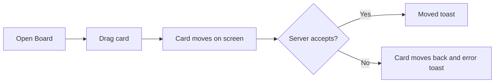

# Kanban Board – Functional Workflow

> **Project:** TaskFlow – Intelligent Task Allocation & Tracking System
> **Parent Module:** Monitoring  ·  **Child Module:** 04.3 Kanban Board
> **Version:** 1.0  ·  **Last Updated:** 31-Oct-2026
> **Author:** Jojo George (jojogeorge3344@gmail.com)
> © 2026 Jojo George. All rights reserved.

---

## 1. Overview
The Kanban Board shows the tasks a user may access as status columns. Users with the status permission drag a card to another column to change the task's status, and click a card to open its details.

## 2. Purpose / Business Value
- Gives a quick visual picture of where work stands across To Do, In Progress, In QA, Blocked and Completed.
- Overdue cards are highlighted, so late work stands out.
- Moving a card is the fastest way to update a status, and the same rules and history apply as on Task Details.

## 3. Who Can Access

| Role          | Can See | Can Use | Access Level (Own / Team / Organization) |
|---------------|:-------:|:-------:|------------------------------------------|
| Administrator | ✅ | ✅ | Organization (all tasks) |
| Manager       | ✅ | ✅ | Team (the team's tasks plus the manager's own) |
| Employee      | ✅ | ✅ | Own (tasks they are assigned, created or are notified about) |
| Custom Role   | Configurable | Configurable | As granted (`board.view` to see; `tasks.status.change` to drag; scope follows the task list) |

The menu item is **TaskFlow Monitoring → Board** for users with `tasks.view.all` and **Task Management → Board** for everyone else. It is shown only with `board.view`.

## 4. Screens

| # | Screen Name | Menu Path | Purpose | Visible To |
|---|-------------|-----------|---------|------------|
| 1 | Board (Kanban) | TaskFlow Monitoring → Board, or Task Management → Board (`/board`) | See tasks as status columns and drag them to change status | `board.view` |

---

## 5. Screen & Functionality Details

### 5.1 Screen: Board
**Purpose:** Show accessible tasks as status columns and let users drag a card to change its status.
**Who can see this screen:** All system roles by default.
**Required permission:** `board.view`

**Screen Elements**
- Header: "N tasks across 5 stages" and a **Refresh** button.
- Filter row (needs `board.filters.use`): Project, Assignee (only with `tasks.view.all`), Status, Deadline from and Deadline to, and **Clear filters**.
- Columns: To Do, In Progress, In QA, Blocked and Completed, each with a count.
- Cards: task code, priority, title, project, assignee and deadline. Overdue cards and deadlines are highlighted.
- Empty column text "Drop tasks here". When filters hide every task: "No tasks match the current filters."

### 5.2 Functionalities

| # | Functionality | Purpose | Who Can See | Who Can Use | Permission Required | Scope |
|---|---------------|---------|-------------|-------------|---------------------|-------|
| 1 | View board | See accessible tasks by status | Administrator, Manager, Employee | Administrator, Manager, Employee | `board.view` | Own / Team / Org |
| 2 | Filter board | Narrow cards by project, assignee, status, deadline | Same as 1 | Same as 1 | `board.filters.use` (+ `tasks.view.all` for Assignee) | Own / Team / Org |
| 3 | Drag card to new status | Change a task's status | Same as 1 | Roles with `tasks.status.change` | `tasks.status.change` | Own / Team / Org |
| 4 | Open task from card | Go to Task Details (Back returns to the board) | Same as 1 | Same as 1 | task access | Own / Team / Org |
| 5 | Refresh board | Reload the latest statuses | Same as 1 | Same as 1 | `board.view` | Own / Team / Org |

### 5.3 Step-by-Step Workflow – Move a Card
1. User opens **Board**.
2. User drags a card from one column to another.
3. The card moves at once, and the system sends the status change.
4. If the move is allowed, the system saves it, records "Status changed from X to Y" and shows *"TSK-… moved to In Progress"*.
5. If it is refused, the card goes back to its column and the system shows the reason (for example "Cannot move a task from Completed to InProgress.") or *"Could not move TSK-…."*.

**Flow Diagram**

### 5.4 Business Rules & Validations
- The board shows the same tasks as the user's task list scope (Own, Team or Organization), ordered by deadline.
- The status rules are the same as on Task Details (see 04.1 Task Management, Business Rules). Completed and Cancelled cards cannot be moved out.
- Cancelled tasks have no column, so they are not shown on the board.
- Cards cannot be reordered within a column. The order always follows the deadline.
- Cards can be dragged only when the user holds `tasks.status.change`.
- All filters work together (AND), and the deadline range includes both end dates.

### 5.5 Messages Shown to the User

| Situation | Message |
|-----------|---------|
| Success | `TSK-000123 moved to In Progress` |
| Load failed | Could not load the board. Try again. |
| Move failed | Server message, or `Could not move TSK-000123.` |
| Filters hide all cards | No tasks match the current filters. |
| No permission | Without `board.view` the menu item is hidden and the route sends the user back to the dashboard. |

---

## 6. Permission Summary

| Permission Key | Description | Administrator | Manager | Employee | Custom Role |
|----------------|-------------|:-------------:|:-------:|:--------:|:-----------:|
| `board.view` | View board | Granted | Granted | Granted | Configurable |
| `board.filters.use` | Use board filters (requires `board.view`) | Granted | Granted | Granted | Configurable |
| `tasks.status.change` | Update task status (board and details) | Granted | Granted | Granted | Configurable |
| `tasks.view.all` | View all tasks (enables the Assignee filter; Managers are limited to their team) | Granted | Granted | Denied | Configurable |

`tasks.status.change` and `tasks.view.all` are owned by 04.1 Task Management and reused here.

## 7. Related Modules
- **04.1 Task Management** – Same tasks, same scope and same status-transition rules; clicking a card opens Task Details, and the Task List has a **Board view** button.
- **04.2 Comments & Activity History** – Every card move writes a "Status changed" entry to the task's history.
- **Settings** – Role Configuration grants `board.view`, `board.filters.use` and `tasks.status.change`.

## 8. Expected Outcome
Users see their accessible tasks by status at a glance, spot overdue cards, and move tasks to their next allowed status by dragging, with every move recorded.

---
© 2026 Jojo George. All rights reserved. Unauthorized copying or distribution of this document is prohibited.
