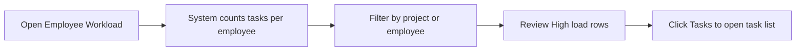

# Employee Workload – Functional Workflow

> **Project:** TaskFlow – Intelligent Task Allocation & Tracking System
> **Parent Module:** Monitoring  ·  **Child Module:** 04.4 Employee Workload
> **Version:** 1.0  ·  **Last Updated:** 31-Oct-2026
> **Author:** Jojo George (jojogeorge3344@gmail.com)
> © 2026 Jojo George. All rights reserved.

---

## 1. Overview
Employee Workload shows how open work is spread across employees: each person's active, high-priority, overdue and completed task counts, their project allocations, and a "High load" badge for people carrying much more than average. Managers use it to balance work and jump to a person's tasks.

## 2. Purpose / Business Value
- Lets managers spot overloaded and under-used employees before deadlines slip.
- Shows project allocation percentages next to task counts, so planning uses both.
- Gives a one-click path from a busy person to their task list, where tasks can be reassigned.

## 3. Who Can Access

| Role          | Can See | Can Use | Access Level (Own / Team / Organization) |
|---------------|:-------:|:-------:|------------------------------------------|
| Administrator | ✅ | ✅ | Organization |
| Manager       | ✅ | ✅ | Organization (the list is not narrowed to the Manager's team; the **Tasks →** link then applies the normal team scope) |
| Employee      | ❌ | ❌ | – |
| Custom Role   | Configurable | Configurable | As granted through `workload.view` (Organization) |

The menu item is **TaskFlow Monitoring → Employee Workload**, shown only with `workload.view`.

## 4. Screens

| # | Screen Name | Menu Path | Purpose | Visible To |
|---|-------------|-----------|---------|------------|
| 1 | Employee Workload | TaskFlow Monitoring → Employee Workload (`/workload`) | See each employee's task counts and allocation | `workload.view` (Administrator, Manager) |

---

## 5. Screen & Functionality Details

### 5.1 Screen: Employee Workload
**Purpose:** Show how open work is spread across employees so managers can balance it.
**Who can see this screen:** Administrator and Manager by default.
**Required permission:** `workload.view`

**Screen Elements**
- Header: "N employees · average X active tasks".
- Filters (need `workload.filters.use`): **Project** (reloads from the server) and **Employee** (filters on screen), and **Reset**.
- Table: Employee (with a "High load" badge), Projects (name and %), Allocated %, Active, High priority, Overdue (highlighted when more than 0), Completed, a workload bar, and a **Tasks →** link (needs `workload.tasks.open`).
- Legend: "Highlighted rows carry at least twice the average active load (X active tasks)."

### 5.2 Functionalities

| # | Functionality | Purpose | Who Can See | Who Can Use | Permission Required | Scope |
|---|---------------|---------|-------------|-------------|---------------------|-------|
| 1 | View workload | See each employee's task counts and allocation | Administrator, Manager | Administrator, Manager | `workload.view` | Org |
| 2 | Filter by project / employee | Focus on one project or one person | Administrator, Manager | Administrator, Manager | `workload.filters.use` | Org |
| 3 | Open an employee's tasks | Jump to the task list filtered to that employee | Administrator, Manager | Administrator, Manager | `workload.tasks.open` | Own / Team / Org (task list scope still applies) |
| 4 | Spot high load | Highlight people with at least twice the average active tasks | Administrator, Manager | Administrator, Manager | `workload.view` | Org |

### 5.3 Step-by-Step Workflow – Review Workload
1. User opens **TaskFlow Monitoring → Employee Workload**.
2. System lists every active user whose role does not hold `tasks.view.all` (the Employee role by default), with their counts.
3. User optionally picks a **Project** (the list reloads) or an **Employee**.
4. User reviews the "High load" rows and clicks **Tasks →** to open that person's task list.

**Flow Diagram**

### 5.4 Business Rules & Validations
- **Active** = tasks that are not completed, cancelled or deleted. **High priority** = active tasks with High or Critical priority. **Overdue** = active tasks past their deadline. **Completed** = completed tasks.
- Employees with no tasks are listed with zero counts.
- The Project filter shows only people allocated to that project. Allocated % is the sum of the person's project allocations.
- "High load" means the person's active count is at least twice the average of the rows shown (worked out on screen).
- The list covers the whole organization. It is not narrowed to a Manager's team.

### 5.5 Messages Shown to the User

| Situation | Message |
|-----------|---------|
| Load failed | Could not load the workload. Check your connection and try again. |
| No rows | No employees to show – There are no active employees in this project. |
| Legend | Highlighted rows carry at least twice the average active load (X active tasks). |
| No permission | Without `workload.view` the menu item is hidden and the route sends the user to the dashboard. The API returns 403. |

---

## 6. Permission Summary

| Permission Key | Description | Administrator | Manager | Employee | Custom Role |
|----------------|-------------|:-------------:|:-------:|:--------:|:-----------:|
| `workload.view` | View workload | Granted | Granted | Denied | Configurable |
| `workload.filters.use` | Use workload filters (requires `workload.view`) | Granted | Granted | Denied | Configurable |
| `workload.tasks.open` | Open an employee's tasks from workload (requires `workload.view`) | Granted | Granted | Denied | Configurable |

## 7. Related Modules
- **04.1 Task Management** – The **Tasks →** link opens the Task List filtered to that employee, where tasks can be reassigned.
- **Management** – Project allocations (project, position, percentage) and the employee list come from Management.
- **Reports** – Reports use the same task data. Managers move between Workload and Reports for planning.
- **Settings** – Role Configuration grants the workload keys; which roles hold `tasks.view.all` decides who is listed.

## 8. Expected Outcome
Managers and Administrators can see workload imbalances and overdue work across employees and open a person's tasks to move work and balance it.

---
© 2026 Jojo George. All rights reserved. Unauthorized copying or distribution of this document is prohibited.
