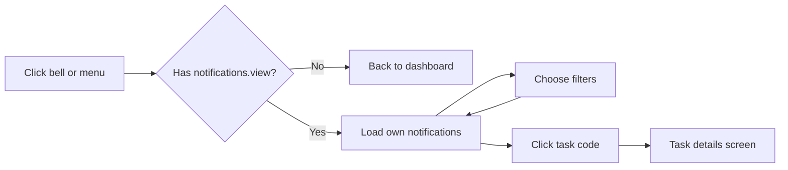
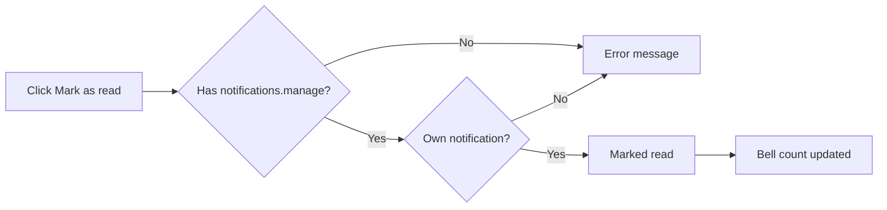
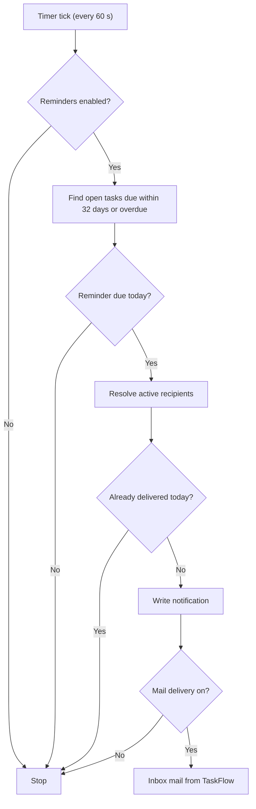

# Notifications – Functional Workflow

> **Project:** TaskFlow – Intelligent Task Allocation & Tracking System
> **Parent Module:** Communication  ·  **Child Module:** 05.1 Notifications (incl. deadline reminders engine)
> **Version:** 1.0  ·  **Last Updated:** 31-Oct-2026
> **Author:** Jojo George (jojogeorge3344@gmail.com)
> © 2026 Jojo George. All rights reserved.

---

## 1. Overview
Notifications are short in-app alerts that tell a user about their own work, for example a new task, a reassignment, a comment, worked hours or an account security event. They are collected in the **Notification Center** and signalled by the bell in the header. A background **reminder engine** checks open tasks every minute and sends deadline, due-today and overdue reminders as notifications and, when mail delivery is switched on, as Inbox mails from "TaskFlow".

## 2. Purpose / Business Value
- Nobody misses an assignment, reassignment, comment or approaching deadline, because TaskFlow raises the alert automatically.
- Deadline reminders run on their own, on a schedule set per task (first and second reminder, due today, overdue daily or weekly). Each reminder arrives once only, no matter how often the engine runs.
- Every user sees at a glance whether anything is unread, through the dot on the header bell.

## 3. Who Can Access

| Role          | Can See | Can Use | Access Level (Own / Team / Organization) |
|---------------|:-------:|:-------:|------------------------------------------|
| Administrator | ✅ | ✅ | Own (own notifications only) |
| Manager       | ✅ | ✅ | Own (own notifications only) |
| Employee      | ✅ | ✅ | Own (own notifications only) |
| Custom Role   | Configurable (`notifications.view`) | Configurable (`notifications.manage` to mark read) | Own, as granted |

> No role, including Administrator, can read another person's notifications. Every list and every action works on the signed-in user's own records. If a notification belongs to someone else, the action reports "not found".

## 4. Screens

| # | Screen Name | Menu Path | Purpose | Visible To |
|---|-------------|-----------|---------|------------|
| 1 | Notifications (Notification Center) | Communication Management → Notifications (also the bell icon in the header) | Read, filter and mark as read your own notifications, and open the related task | Roles holding `notifications.view` (Administrator, Manager, Employee by default) |
| – | Header bell | Top bar of every page | Shows a dot while you have unread notifications and links to the Notification Center | Roles holding `notifications.view` |

> The reminder engine has no screen of its own. Its switches are on **Settings → Reminder Settings** (Settings module), and each task's reminder options are set on the task form (Monitoring module).

---

## 5. Screen & Functionality Details

### 5.1 Screen: Notification Center
**Purpose:** Shows the signed-in user's own task-related alerts and reminders in one place.
**Who can see this screen:** Any role with `notifications.view`. By default that is Administrator, Manager and Employee.
**Required permission:** `notifications.view` to open the screen. `notifications.manage` to mark notifications as read.

**Screen Elements**
- **Header bell:** a bell icon in the top bar that links to the screen. A dot appears on it while you have unread notifications. The count is refreshed on every page change and every 15 seconds.
- **Page header:** the title "Notifications" and a range label, for example "1–20 of 45 notifications". When filters are on, the label adds "match the current filters".
- **Mark all as read** button. It is shown only to roles with `notifications.manage` and is disabled when nothing is unread.
- **Filters:** a **Type** drop-down (All types, Task assigned, Task reassigned, Deadline reminder, Overdue, System), a **Read state** drop-down (All, Unread, Read) and a **Reset** button.
- **Notification list**, newest first. Each row shows a type chip, the date and time, the message, a link to the related task (shown as the task code, when the task still exists) and a **Mark as read** button on unread rows. Unread rows are highlighted.
- **Pagination:** Previous / Next with "Page X of Y". There are 20 notifications per page.
- **Empty and error states:** "No notifications yet", "No notifications match these filters" with **Clear filters**, and "Something went wrong" with **Retry**.

### 5.2 Functionalities

| # | Functionality | Purpose | Who Can See | Who Can Use | Permission Required | Scope |
|---|---------------|---------|-------------|-------------|---------------------|-------|
| 1 | View notification list | See your own notifications, newest first, 20 per page | Administrator, Manager, Employee, Custom (if granted) | Same | `notifications.view` | Own |
| 2 | Unread count (header bell dot) | See at a glance whether anything is unread | Same | Same | `notifications.view` | Own |
| 3 | Filter by type and read state | Narrow the list, for example to unread overdue alerts only | Same | Same | `notifications.view` | Own |
| 4 | Mark one notification as read | Clear a single alert | Everyone who can open the screen (the button is not hidden) | Roles with `notifications.manage` | `notifications.manage` | Own |
| 5 | Mark all as read | Clear every unread alert at once | Roles with `notifications.manage` | Same | `notifications.manage` | Own |
| 6 | Open related task | Jump to the task the alert is about | Everyone who can open the screen | Users who can open that task (the task screen decides) | Task access rules (Monitoring module) | Per task scope |
| 7 | Receive automatic notifications | Get alerts for: task assigned, task reassigned, comment added/edited/deleted on your task, worked hours updated, MFA reset by an administrator, password reset with the authenticator | All users who take part in a task, or who are affected by the account event | System generated | None. Written by the system. Switched off globally by the Application Settings in-app toggle. | Own |
| 8 | Receive deadline reminders (reminder engine) | First reminder, second reminder, due-today and overdue alerts for open tasks | Task assignee, task notification recipients and task creator (active users only) | System generated | None. Controlled by Reminder Settings (`settings.reminders.manage`) and the reminder options on each task. | Own |

### 5.3 Step-by-Step Workflow – View and Filter Notifications
1. The user clicks the **bell** in the header, or opens **Communication Management → Notifications**.
2. The system checks for `notifications.view`. Without it, the user is sent back to their dashboard.
3. The system loads the newest 20 of the user's own notifications and refreshes the unread count.
4. The user picks a **Type** and/or **Read state**. The list reloads from page 1.
5. The user clicks **Reset** (or **Clear filters**) to see all notifications again.
6. The user clicks a task code on a row to open the related task.

**Flow Diagram**

### 5.4 Step-by-Step Workflow – Mark Notifications as Read
1. On the Notification Center the user clicks **Mark as read** on an unread row, or **Mark all as read** in the page header.
2. The system checks for `notifications.manage` and that the notification belongs to the user.
3. The row (or every row) loses its unread highlight, and the header bell dot clears when nothing is left unread.
4. If a Read-state filter is active, the list reloads so the row moves to the correct list.
5. On failure the screen shows *"Could not mark the notification as read."* or *"Could not mark all notifications as read."*

**Flow Diagram**

### 5.5 Step-by-Step Workflow – Automatic Deadline Reminders (Reminder Engine)
1. When the application starts, and every 60 seconds after that, the reminder engine runs a pass.
2. If reminders are switched off in **Settings → Reminder Settings**, nothing happens.
3. The engine finds every open task (not completed, not cancelled, not deleted) whose deadline is no more than 32 days ahead, or already past.
4. For each task it decides whether a reminder is due **today**, in the application timezone:
   - **Second reminder** or **First reminder:** today is exactly that many days before the deadline (as chosen on the task).
   - **Due today:** today is the deadline day and the deadline time has not passed yet. This is sent when the global "deadline day" option is on, or when the task asks for a reminder at 0 days.
   - **Overdue:** the deadline day has passed. This repeats every day, or every 7 days if the task's overdue frequency is Weekly.
5. It works out who should receive the reminder: the task's notification recipients (the assignee is always one) plus the task creator, counting active users only.
6. For each person it records the reminder once. If that reminder was already delivered today, it is skipped.
7. It creates the in-app notification. If **Also deliver reminders to Mail** is on, it also puts a mail from "TaskFlow" into the person's Inbox.
8. If the task was completed, cancelled, deleted or given a new deadline in the meantime, nothing is written.

**Flow Diagram**

### 5.6 Business Rules & Validations
- Users only ever see their own notifications. Marking a notification that is not yours gives "not found".
- The list is sorted newest first. Page size is 20 (the server accepts 1 to 100 and uses 20 for anything outside that range).
- If the related task has been deleted, the notification stays but shows no task link.
- Notifications are never deleted. They can only be marked as read.
- Turning off **in-app notifications** in Application Settings stops new event notifications (assignment, reassignment, comments, worked hours, account notices). Notifications that already exist are kept.
- Reminders are never sent for **completed** or **cancelled** tasks. A deadline change takes effect on the next pass automatically.
- Each reminder (task + person + reminder type + day) is delivered **at most once**, however often the engine runs or restarts.
- A day that has already ended is never back-filled. Only reminders due *today* are sent.
- If the first and second reminder intervals are equal, only one reminder is sent that day.
- Inactive or deleted users receive no reminders.
- Overdue reminders start the day after the deadline and continue for as long as the task stays open.
- Mails generated by TaskFlow (reminders, comment alerts) cannot be replied to, only forwarded.

### 5.7 Messages Shown to the User

| Situation | Message |
|-----------|---------|
| Task assigned (notification text) | A task was assigned to you: *task title* |
| Task reassigned to you (notification text) | A task was reassigned to you: *task title*. Reason: *reason* |
| Reassignment, other participants | *Name* reassigned task "*title*" (*code*) from *old* to *new*. Reason: *reason* |
| Comment activity | *Name* *added / edited / deleted* a comment on "*title*": *detail* |
| First / second reminder | Reminder: "*title*" is due in *N* days (*dd MMM yyyy, HH:mm*). |
| Due-today reminder | Reminder: "*title*" is due today at *HH:mm*. |
| Overdue reminder | Overdue: "*title*" was due on *dd MMM yyyy, HH:mm*. |
| MFA reset by administrator | An administrator reset your authenticator MFA. Sign in with your password and set it up again from Profile. |
| Password reset with authenticator | Your password was reset with your authenticator app. If this was not you, contact an administrator now. |
| Empty list | No notifications yet – Tasks assigned or reassigned to you will appear here. |
| No filter matches | No notifications match these filters – Try a different type or clear the filters. |
| Load failed | Could not load notifications. Check your connection and try again. |
| Mark one failed | Could not mark the notification as read. |
| Mark all failed | Could not mark all notifications as read. |
| No permission (open screen) | The user is returned to their dashboard; no message is shown. |
| No permission (action) | The action fails with the fallback error message above (the server returns 403 Forbidden). |

---

## 6. Permission Summary

| Permission Key | Description | Administrator | Manager | Employee | Custom Role |
|----------------|-------------|:-------------:|:-------:|:--------:|:-----------:|
| `notifications.view` | View notifications: open the notification centre and the header bell count | Granted | Granted | Granted | Configurable |
| `notifications.manage` | Mark notifications read: mark one or all as read | Granted | Granted | Granted | Configurable |

> Both keys are granted by default to Administrator, Manager and Employee, and to every role that existed when the permissions were first seeded. A new custom role starts with neither. The reminder engine itself has no user permission. Its settings are guarded by `settings.reminders.manage` in the Settings module.

## 7. Related Modules
- **Mail (05.2, sibling child module)** – when "Also deliver reminders to Mail" is on, each reminder also arrives as an Inbox mail from "TaskFlow". Comment alerts are delivered to Mail in the same way.
- **Monitoring (Task Management, Comments, Reassignment)** – creating, reassigning, commenting on and logging hours on tasks creates notifications. The task's reminder intervals and its notification recipients drive the reminder engine. The task code link opens the task details screen.
- **Settings (Reminder Settings, Application Settings)** – Reminder Settings switches reminders, the deadline-day reminder and "deliver reminders to Mail" on or off. Application Settings controls the in-app notifications toggle and the application timezone used for reminder days.
- **Authentication** – an MFA reset by an administrator and a password reset with the authenticator each send a System notification to the account owner.
- **Settings → Role Configuration** – grants or removes `notifications.view` and `notifications.manage` for custom roles.

## 8. Expected Outcome
Every user receives timely, non-duplicated alerts about their tasks and deadlines in one Notification Center, sees at a glance through the header bell whether anything is unread, and can clear alerts once handled, without anyone else being able to read their notifications.

---
© 2026 Jojo George. All rights reserved. Unauthorized copying or distribution of this document is prohibited.
