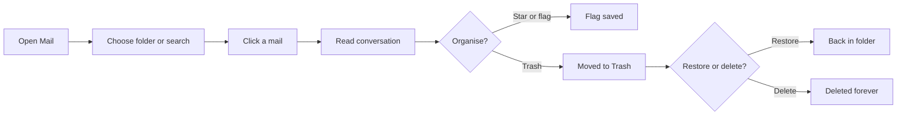
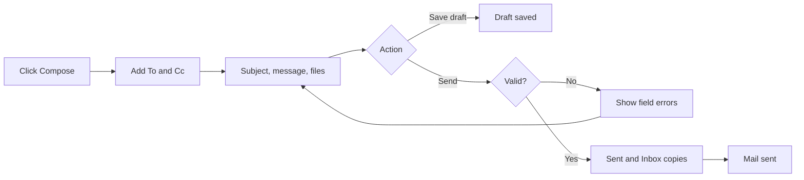
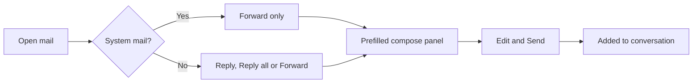
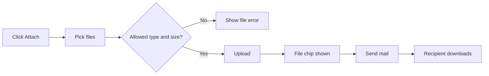

# Mail – Functional Workflow

> **Project:** TaskFlow – Intelligent Task Allocation & Tracking System
> **Parent Module:** Communication  ·  **Child Module:** 05.2 Mail
> **Version:** 1.0  ·  **Last Updated:** 31-Oct-2026
> **Author:** Jojo George (jojogeorge3344@gmail.com)
> © 2026 Jojo George. All rights reserved.

---

## 1. Overview
Mail is a private internal mailbox for messages between TaskFlow users. Users can read, search, write, reply to, forward and organise mail, save drafts, and send and download attachments. It does not send to outside email addresses. TaskFlow itself also delivers deadline reminders and task comment alerts into the Inbox as mails from "TaskFlow".

## 2. Purpose / Business Value
- Staff can write to each other about their work without leaving TaskFlow or using outside email.
- Each mailbox is private to its owner. Read state, stars, flags and trash are personal.
- A badge on the **Mail** menu item shows how many Inbox mails are still unread.
- Reminders and comment alerts can also be kept in the Inbox, alongside personal mail.

## 3. Who Can Access

| Role          | Can See | Can Use | Access Level (Own / Team / Organization) |
|---------------|:-------:|:-------:|------------------------------------------|
| Administrator | ✅ | ✅ | Own mailbox; recipient lookup over all active users (Organization) |
| Manager       | ✅ | ✅ | Own mailbox; recipient lookup over all active users (Organization) |
| Employee      | ✅ | ✅ | Own mailbox; recipient lookup over all active users (Organization) |
| Custom Role   | Configurable (`mail.read`) | Configurable (`mail.compose`, `mail.organize`, `mail.attachments`) | Own, as granted |

> No role, including Administrator, can read another person's mail. Every list and every action works on the signed-in user's own mailbox. If a mail belongs to someone else, the screen reports "not found".

## 4. Screens

| # | Screen Name | Menu Path | Purpose | Visible To |
|---|-------------|-----------|---------|------------|
| 1 | Mail | Communication Management → Mail (shows an unread badge) | Read, write, reply to, forward and organise internal mail, with attachments | Roles holding `mail.read` (Administrator, Manager, Employee by default) |
| – | Compose panel (inside Mail) | Mail → **Compose**, **Reply**, **Reply all**, **Forward**, or open a draft | Write a new mail, reply or forward one, or continue a saved draft | Roles holding `mail.compose` |

> The original BRD Screen 14 "Email Configuration" (SMTP settings) is marked **SUPERSEDED** in the requirements. It was replaced by this internal Mail screen.

---

## 5. Screen & Functionality Details

### 5.1 Screen: Mail
**Purpose:** A private internal mailbox for sending and receiving mail between TaskFlow users. It does not send to outside email addresses.
**Who can see this screen:** Any role with `mail.read`. By default that is Administrator, Manager and Employee.
**Required permission:** `mail.read` to open the screen and read mail. `mail.compose` to write. `mail.organize` to star, flag, trash, restore and delete. `mail.attachments` to upload and download files.

**Screen Elements**
- **Folder rail:** Inbox, Starred, Important, Sent, Drafts and Trash. Counts appear beside Inbox, Starred and Important (unread) and Drafts (total). A **Compose** button is shown with `mail.compose`.
- **Message list:** a search box ("Search inbox", and so on) that searches subject, text, sender and recipients. Each row shows the sender, or "To: …" in Sent and Drafts, and "TaskFlow" for system mail. Rows also show the subject (or "(no subject)"), a preview, the date, an important flag, a paperclip when there are attachments, and a star toggle (with `mail.organize`). There are 25 mails per page with Previous / Next.
- **Reading pane:** the subject and an **Open the task** link when the mail is about a task. Below that is the whole conversation (oldest first), with sender, recipients, Cc, date, body text with clickable web links, and attachment download buttons.
- **Reader actions:** **Reply** and **Reply all** (not shown for system mail or trashed mail), **Forward**, **Star**, **Mark important**, **Mark unread** (Inbox only) and **Move to Trash**. In Trash the actions are **Restore** and **Delete forever**.
- **Compose panel (side drawer)**, titled "New mail", "Reply", "Reply all", "Forward" or "Draft". It has **To** and **Cc** recipient pickers that suggest names as you type and show invalid recipients as "Not a TaskFlow user". It also has **Subject**, **Message**, an **Attach** button, the attached file chips, and the buttons **Discard**, **Save draft** and **Send**.
- **Narrow screens:** one pane at a time, with a folder button to open the folder rail.

### 5.2 Functionalities

| # | Functionality | Purpose | Who Can See | Who Can Use | Permission Required | Scope |
|---|---------------|---------|-------------|-------------|---------------------|-------|
| 1 | Open Mail and browse folders | See Inbox, Starred, Important, Sent, Drafts, Trash and their counts | Administrator, Manager, Employee, Custom (if granted) | Same | `mail.read` | Own |
| 2 | Search mail | Find mail in the current folder by subject, text, sender or recipient | Same | Same | `mail.read` | Own |
| 3 | Read a mail and its conversation | Open a mail. It is marked read automatically. | Same | Same | `mail.read` | Own |
| 4 | Unread badge on Mail menu | See how many Inbox mails are unread | Same | Same | `mail.read` | Own |
| 5 | Compose and send a new mail | Write to one or more TaskFlow users (To/Cc) | Roles with `mail.compose` | Same | `mail.compose` | Own (to any active user) |
| 6 | Reply / Reply all / Forward | Continue a conversation or pass a mail on | Roles with `mail.compose` | Same | `mail.compose` | Own |
| 7 | Save, continue and discard drafts | Finish a mail later | Roles with `mail.compose` | Same | `mail.compose` | Own |
| 8 | Recipient suggestions | Find active users by name or email while typing | Roles with `mail.compose` | Same | `mail.compose` | Organization (active user directory) |
| 9 | Star / Mark important / Mark unread | Personal flags to find mail later | Roles with `mail.organize` | Same | `mail.organize` | Own |
| 10 | Move to Trash / Restore | Remove a mail from folders, or bring it back | Roles with `mail.organize` | Same | `mail.organize` | Own |
| 11 | Delete forever | Permanently remove a mail from Trash, or discard a draft | Roles with `mail.organize` | Same | `mail.organize` | Own |
| 12 | Attach files | Upload up to 5 files to a mail or draft | Everyone who can compose (the button is not hidden by permission) | Roles with `mail.attachments` | `mail.attachments` | Own uploads |
| 13 | Download attachments | Save a file from a mail | Everyone who can read mail (the button is not hidden by permission) | Roles with `mail.attachments` | `mail.attachments` | Own uploads or mails in own mailbox |
| 14 | Receive system mails | Deadline reminders and task comment alerts arrive from "TaskFlow". Reassignment notices are sent as a mail from the person who reassigned. | All mail users | System generated | None. Controlled by the Reminder Settings "Also deliver reminders to Mail" toggle. | Own |

### 5.3 Step-by-Step Workflow – Read and Organise Mail
1. The user opens **Communication Management → Mail**. The Inbox opens by default.
2. The user picks a folder in the rail and can type in the search box.
3. The user clicks a mail. The reading pane shows the conversation and the mail is marked read.
4. The user can **Star**, **Mark important**, **Mark unread** (Inbox), or **Move to Trash**. The system shows *"Moved to Trash"*.
5. In **Trash**, the user can **Restore** (*"Restored"*) or **Delete forever** (*"Deleted forever"*).
6. The folder counts and the Mail menu badge update.

**Flow Diagram**

### 5.4 Step-by-Step Workflow – Compose and Send a Mail
1. The user clicks **Compose**. The compose panel opens with the title "New mail".
2. The user types names or emails in **To** (and **Cc** after clicking **Cc**). Suggestions appear and each recipient is checked.
3. The user enters a **Subject** and/or **Message**, and can click **Attach** to add files.
4. The user clicks **Send**.
5. The system checks: at least one recipient, every recipient is an active TaskFlow user, a subject or message is present, and attachment limits are respected.
6. If any check fails, the field error is shown under To, Cc, Message or the files. Otherwise the mail is saved in the sender's **Sent** folder and in every recipient's **Inbox**, and the system shows *"Mail sent"*.
7. Instead of sending, the user can click **Save draft** (*"Draft saved"*) or **Discard**. Discard also removes any files uploaded in this panel.

**Flow Diagram**

### 5.5 Step-by-Step Workflow – Reply, Reply All or Forward
1. The user opens a mail and clicks **Reply**, **Reply all** or **Forward**.
2. The system pre-fills the compose panel:
   - **Reply:** the original sender (or the original recipients, if you sent it). Subject "Re: …" and the quoted text "On *date*, *name* wrote:".
   - **Reply all:** the sender plus everyone else on To and Cc, except you.
   - **Forward:** no recipients. Subject "Fwd: …", a "---------- Forwarded message ----------" header, and the original attachments.
3. The user edits the panel and clicks **Send**. The new mail joins the same conversation.
4. Mails from TaskFlow (reminders, comment alerts) show only **Forward**. Trying to reply gives *"Mails from TaskFlow cannot be replied to. Forward it instead."*

**Flow Diagram**

### 5.6 Step-by-Step Workflow – Attach and Download Files
1. In the compose panel the user clicks **Attach** and picks one or more files.
2. The browser checks the file type, empty files, the 10 MB per-file limit, the maximum of 5 files and the 25 MB total. The server checks the same limits again.
3. Each accepted file uploads ("Uploading…") and appears as a chip. The user can remove a chip with **x**.
4. When the mail is sent, the files go with it. Forwarded attachments are copied automatically.
5. A reader clicks an attachment in the reading pane to download it. Files are always downloaded, never opened inside the page.

**Flow Diagram**

### 5.7 Business Rules & Validations
- Mail can only be sent to **active TaskFlow users**. Any unknown address blocks the whole send.
- A mail needs **1 to 50 recipients** in total (To + Cc). A person listed in both To and Cc is kept in To only.
- A mail needs a **subject or a message**. The subject can be up to **200 characters** and the message up to **20,000 characters**.
- A mail can carry at most **5 attachments**, each at most **10 MB**, together at most **25 MB**. Forwarded files count towards these limits.
- Blocked file types: `.exe`, `.dll`, `.bat`, `.cmd`, `.com`, `.msi`, `.ps1`, `.sh`, `.js`, `.vbs`, `.scr`. Empty files are refused.
- A user can have at most **20 files (100 MB)** uploaded but not yet attached to any mail or draft.
- Drafts can be saved with incomplete or invalid recipients. Recipients are checked only when the draft is sent.
- Read state, star, important and trash are **personal**. Changing them affects only your own copy.
- **Delete forever** works only on mail that is already in Trash, or on a draft.
- Mail sent by TaskFlow (reminders, comment alerts) cannot be replied to, only forwarded.
- You can download an attachment only if you uploaded it or the mail is in your mailbox.
- Opening a mail marks it read. Old mail from deactivated or deleted users still shows their name.
- Recipient suggestions show at most 10 active users, matched by name or email.

### 5.8 Messages Shown to the User

| Situation | Message |
|-----------|---------|
| Mail sent | Mail sent |
| Draft saved | Draft saved |
| Draft discarded | Draft discarded |
| Moved to Trash / Restored / Deleted forever | Moved to Trash · Restored · Deleted forever |
| No recipients | Add at least one recipient. |
| Recipient not a user (picker) | Not a TaskFlow user: *addresses*. Mail can only go to people in TaskFlow. |
| Recipient not a user (on send) | Remove or fix recipients that are not TaskFlow users. / Not an active TaskFlow user: *addresses*. |
| Recipients still being checked | Checking recipients… |
| Too many recipients | A mail can have at most 50 recipients. / Add between 1 and 50 recipients. |
| Empty mail | Write a subject or a message before sending. |
| Invalid address | '*address*' is not an email address. |
| Too many attachments | A mail can have at most 5 attachments. |
| Attachments too large | Attachments on one mail can total at most 25 MB. |
| File too large | *file* is larger than 10 MB. / A file can be at most 10 MB. |
| Blocked file type | Files of type *.ext* are not allowed. |
| Empty file | *file* is empty. / The file is empty. |
| Upload missing | Choose a file to upload. |
| Too many pending uploads | You have *N* files waiting to be attached. Send or discard a mail before uploading more. |
| Pending uploads over 100 MB | Your files waiting to be attached already total 100 MB. Send or discard a mail before uploading more. |
| Attachment not available | One or more attachments are not available. |
| Reply to system mail | Mails from TaskFlow cannot be replied to. Forward it instead. |
| Delete forever outside Trash | Move the mail to Trash before deleting it forever. |
| Empty folder / no search hits | Nothing in *folder*. · No mail matches your search. |
| Nothing selected | Select a mail to read it. |
| Load / open / action failures | Could not load your mail. · Could not open this mail. · Could not update the mail. · Could not mark as unread. · Could not download the file. · Could not send the mail. · Could not save the draft. · Could not prepare the reply. · Could not open the draft. · Could not discard the draft. · Could not upload *file*. |
| No permission (open screen) | The user is returned to their dashboard; no message is shown. |
| No permission (action) | The action fails with the related "Could not …" message (the server returns 403 Forbidden). |

---

## 6. Permission Summary

| Permission Key | Description | Administrator | Manager | Employee | Custom Role |
|----------------|-------------|:-------------:|:-------:|:--------:|:-----------:|
| `mail.read` | Read mail: open the inbox, folders and messages; Mail menu badge | Granted | Granted | Granted | Configurable |
| `mail.compose` | Write and send mail: compose, save drafts, reply and forward, recipient lookup | Granted | Granted | Granted | Configurable |
| `mail.organize` | Organize mail: star, mark important, move to trash, restore and delete | Granted | Granted | Granted | Configurable |
| `mail.attachments` | Use mail attachments: upload, download and remove attachments | Granted | Granted | Granted | Configurable |

> All four keys are granted by default to Administrator, Manager and Employee, and to every role that existed when the permissions were first seeded. A new custom role starts with none of them, and an administrator can grant them (or copy them from another role) in Role Configuration.

## 7. Related Modules
- **Notifications (05.1, sibling child module)** – the reminder engine delivers deadline, due-today and overdue reminders into the Inbox as mails from "TaskFlow" when "Also deliver reminders to Mail" is on.
- **Monitoring (Task Management, Comments, Reassignment)** – comments create mails from "TaskFlow", and reassignments send a mail from the person who reassigned. A mail about a task shows an **Open the task** link.
- **Settings (Reminder Settings, Application Settings)** – the Reminder Settings "Also deliver reminders to Mail" toggle controls system mails. The application timezone is used for the dates quoted in replies and forwards.
- **TaskFlow Assistant (TFA)** – the assistant can find users by name for a mail and draft a mail that the user reviews and confirms before it is sent.
- **Settings → Role Configuration** – grants or removes the four `mail.*` keys for custom roles.

## 8. Expected Outcome
Users can exchange private mail with colleagues inside TaskFlow, including replies, forwards, drafts and attachments, keep their mailbox organised with personal flags and trash, and see unread mail at a glance, without anyone else being able to read their mailbox.

---
© 2026 Jojo George. All rights reserved. Unauthorized copying or distribution of this document is prohibited.
