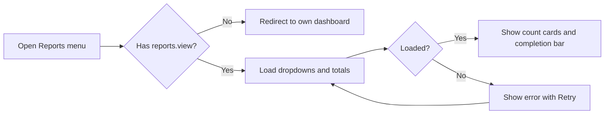
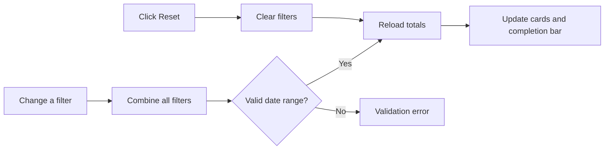
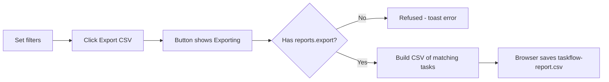

# Reports – Functional Workflow

> **Project:** TaskFlow – Intelligent Task Allocation & Tracking System
> **Parent Module:** Reports  ·  **Child Module:** 06.1 Reports
> **Version:** 1.0  ·  **Last Updated:** 31-Oct-2026
> **Author:** Jojo George (jojogeorge3344@gmail.com)
> © 2026 Jojo George. All rights reserved.

---

## 1. Overview
The Reports child module is the **Task Reports** screen. Users filter the tasks by deadline range, employee, project, status and priority. The screen shows the total, completed, pending and overdue task counts and a completion summary bar. Users with the export permission can download the filtered tasks as a CSV file.

## 2. Purpose / Business Value
- Shows how much work there is and how much is finished, pending or overdue, without counting tasks by hand.
- Managers can narrow the figures to one employee, project, status, priority or deadline period for planning and reviews.
- The CSV export gives a file for office use (spreadsheets, status reports, audits).
- The status and overdue rules are the same ones the dashboards use, so the figures match across screens.

## 3. Who Can Access

| Role          | Can See | Can Use | Can Export CSV | Access Level (Own / Team / Organization) |
|---------------|:-------:|:-------:|:--------------:|------------------------------------------|
| Administrator | ✅ | ✅ | ✅ | Organization |
| Manager       | ✅ | ✅ | ✅ | Organization (the report is not limited to the Manager's team) |
| Employee      | ❌ | ❌ | ❌ | – (no access by default) |
| Custom Role   | Configurable | Configurable | Configurable | Organization, if `reports.view` is granted |

> Note: A Manager sees the report for the **whole organization**, not only their team. The code does this on purpose, to match the dashboards (see section 7 of the technical document `06.1-Reports.md`).

## 4. Screens

| # | Screen Name | Menu Path | Purpose | Visible To |
|---|-------------|-----------|---------|------------|
| 1 | Task Reports | Side menu → **Reports** (`/reports`) | Filtered task totals, completion summary and CSV export | Administrator, Manager, and custom roles with `reports.view` |

---

## 5. Screen & Functionality Details

### 5.1 Screen: Task Reports
**Purpose:** Show task allocation and completion for the selected filters, and export the matching tasks to CSV.
**Who can see this screen:** Administrator, Manager (default grants), and any custom role granted `reports.view`.
**Required permission:** `reports.view` (screen and menu item). The **Export CSV** button also needs `reports.export`.

**Screen Elements**
- Page header **"Task Reports"** with the subtitle *"Task allocation and completion for the selected filters."* While the first load runs, the subtitle reads *"Loading report…"*.
- **Export CSV** button at the top right, shown only to users with `reports.export`. While the download runs, its label changes to *"Exporting…"* and it is disabled.
- Filter toolbar:
  - **Deadline from** (date picker)
  - **Deadline to** (date picker). It cannot be set earlier than "Deadline from".
  - **Employee** dropdown (*"All employees"* or one employee)
  - **Project** dropdown (*"All projects"* or one project)
  - **Status** dropdown (*"All statuses"*, ToDo, InProgress, InQA, Blocked, Completed, Cancelled)
  - **Priority** dropdown (*"All priorities"*, Low, Medium, High, Critical)
  - **Reset** button, which clears every filter
- Four count cards: **Total Tasks**, **Completed**, **Pending**, **Overdue**. The Overdue card is highlighted.
- **Completion summary**: a progress bar and the text *"X of Y completed · Z%"*.
- An error panel *"Something went wrong"* with a **Retry** button, shown if the report cannot be loaded.

### 5.2 Functionalities

| # | Functionality | Purpose | Who Can See | Who Can Use | Permission Required | Scope |
|---|---------------|---------|-------------|-------------|---------------------|-------|
| 1 | Open Reports screen and menu item | Get to the Task Reports screen | Administrator, Manager, Custom (if granted) | Administrator, Manager, Custom (if granted) | `reports.view` | Org |
| 2 | View report totals | Total, completed, pending and overdue task counts | Administrator, Manager, Custom (if granted) | Administrator, Manager, Custom (if granted) | `reports.view` | Org |
| 3 | View completion summary | Completed share of all tasks in the filter, as a bar and a percentage | Administrator, Manager, Custom (if granted) | Administrator, Manager, Custom (if granted) | `reports.view` | Org |
| 4 | Filter by deadline range | Limit to tasks whose deadline falls between two dates (both days included) | Administrator, Manager, Custom (if granted) | Administrator, Manager, Custom (if granted) | `reports.view` | Org |
| 5 | Filter by employee | Limit to tasks assigned to one employee | Administrator, Manager, Custom (if granted) | Administrator, Manager, Custom (if granted) | `reports.view` (the dropdown list comes from the task list's assignee list) | Org (dropdown options follow the user's own task access) |
| 6 | Filter by project | Limit to tasks whose assignee is allocated to the selected project | Administrator, Manager, Custom (if granted) | Administrator, Manager, Custom (if granted) | `reports.view` + `projects.view` (to load the project list) | Org |
| 7 | Filter by status | Limit to one task status | Administrator, Manager, Custom (if granted) | Administrator, Manager, Custom (if granted) | `reports.view` | Org |
| 8 | Filter by priority | Limit to one task priority | Administrator, Manager, Custom (if granted) | Administrator, Manager, Custom (if granted) | `reports.view` | Org |
| 9 | Reset filters | Clear every filter and reload the full report | Anyone who can open the screen | Anyone who can open the screen | none of its own (screen needs `reports.view`) | Org |
| 10 | Export CSV | Download the filtered tasks as `taskflow-report.csv` | Administrator, Manager, Custom (if granted) | Administrator, Manager, Custom (if granted) | `reports.export` (needs `reports.view`) | Org |

### 5.3 Step-by-Step Workflow – View the Report

1. User opens **Side menu → Reports**.
2. The system checks that the user holds `reports.view`. If not, it sends the user to their own dashboard.
3. The system loads the Project and Employee dropdown lists and the report totals, with no filters applied.
4. The screen shows the four count cards and the completion summary, for example *"12 of 40 completed · 30%"*.
5. If the totals cannot be loaded, the screen shows *"Could not load the report. Check your connection and try again."* with a **Retry** button.

**Flow Diagram**

### 5.4 Step-by-Step Workflow – Filter the Report

1. User is on **Reports → Task Reports**.
2. User picks a value in one filter: **Deadline from**, **Deadline to**, **Employee**, **Project**, **Status** or **Priority**.
3. The system reloads the totals at once, with all the selected filters combined. There is no separate "Apply" button.
4. The date pickers stop "Deadline to" from being earlier than "Deadline from". If such a request still reaches the server, it is refused with *"The report 'to' deadline must be on or after the 'from' deadline."*
5. User clicks **Reset** to clear every filter. The report reloads for all tasks.

**Flow Diagram**

### 5.5 Step-by-Step Workflow – Export CSV

1. User sets the filters they want on **Reports → Task Reports**.
2. User clicks **Export CSV**. The button shows only to users with `reports.export`.
3. The button changes to *"Exporting…"* and is disabled.
4. The system collects the tasks that match the same filters, ordered by deadline (at most 50,000 rows).
5. The browser downloads **`taskflow-report.csv`**. Its columns are TaskCode, Title, Assignee, Project, Priority, Status, StartDate, Deadline, EstimatedHours and CompletedAt.
6. If the export fails, a toast shows *"Could not export the report. Please try again."*
7. No notification, email or activity-log entry is created.

**Flow Diagram**

### 5.6 Business Rules & Validations
- **Every filter is optional.** A filter left empty does not restrict that field. All selected filters are combined.
- **Date range filters the task deadline**, and both days are included. "From" covers the whole first day from local midnight. "To" covers the whole last day up to its last millisecond, using the browser's local time zone.
- **"To" must be on or after "From"**: *"The report 'to' deadline must be on or after the 'from' deadline."*
- **Status and Priority** must be valid values (ToDo, InProgress, InQA, Blocked, Completed, Cancelled / Low, Medium, High, Critical).
- **Deleted tasks are left out.** Tasks of a **deleted (removed) employee are kept**, with that person's name, so finished work still counts.
- **Counting rules** (the same rules the dashboards use):
  - **Total** = every task that matches the filters.
  - **Completed** = tasks with status Completed.
  - **Pending** = tasks that are neither Completed nor Cancelled (ToDo, InProgress, InQA, Blocked).
  - **Overdue** = pending tasks whose deadline has already passed at the moment the report runs.
  - Cancelled tasks count in Total but in neither Completed nor Pending.
- **Completion %** = Completed ÷ Total, rounded to a whole number. It shows 0% when there are no tasks.
- **Project filter** keeps a task when its **assignee** is allocated to the chosen project. The task's own project field is not used.
- **Project column in the CSV** lists every project the assignee is allocated to, separated by commas and sorted by name.
- **Export limit:** at most **50,000 rows** per export, the earliest deadlines first.
- **Spreadsheet safety:** a cell that starts with `=`, `+`, `-` or `@` gets a leading `'`, so a spreadsheet does not run it as a formula.
- **Dates in the CSV** use the `yyyy-MM-dd` format. CompletedAt is empty for tasks that are not finished.
- **Organization-wide data:** anyone with `reports.view` sees every task in the organization.

> ⚠️ To be confirmed: The requirement (BRD Screen 17) says reports should "contain only records the user is permitted to access" and lists a **Department** filter and a completion **chart**. The current screen is organization-wide and has a **Project** filter and a progress bar instead.

### 5.7 Messages Shown to the User

| Situation | Message |
|-----------|---------|
| Page loading for the first time | Loading report… |
| Page loaded | Task allocation and completion for the selected filters. |
| Report could not be loaded | Something went wrong – Could not load the report. Check your connection and try again. (with **Retry**) |
| Export in progress | Exporting… (on the button) |
| Export failed | Could not export the report. Please try again. |
| Invalid date range (server check) | The report 'to' deadline must be on or after the 'from' deadline. |
| Completion summary | X of Y completed · Z% |
| No permission to open the screen | No message. The user is sent to their own dashboard and the **Reports** menu item is hidden. |
| No permission to export | No message. The **Export CSV** button is hidden. |

---

## 6. Permission Summary

| Permission Key | Description | Administrator | Manager | Employee | Custom Role |
|----------------|-------------|:-------------:|:-------:|:--------:|:-----------:|
| `reports.view` | View reports – open task reports and filter them | Granted | Granted | Denied | Configurable |
| `reports.export` | Export reports – download a report as a file (requires `reports.view`) | Granted | Granted | Denied | Configurable |
| `projects.view` | View projects – needed only to fill the **Project** filter dropdown (Management module key) | Granted | Granted | Denied | Configurable |

Notes:
- The Administrator is re-granted every permission on every application start.
- The Manager and Employee values above are seed defaults. An Administrator can change them in **Role Configuration**.
- A custom role starts with no keys. Permissions can be copied from another role.

## 7. Related Modules
- **Monitoring (Task Management)** – The report counts the tasks created and updated there. The Employee dropdown comes from the task list's assignee list.
- **Management (Employee / Project Management)** – Project allocations decide the Project filter and the CSV Project column. The Project dropdown needs `projects.view`.
- **Dashboard** – Uses the same status and overdue rules, so the counts match.
- **Settings (Role Configuration)** – Where `reports.view` and `reports.export` are granted to or taken from roles.
- **TaskFlow Assistant (TFA)** – Help knowledge points users to the Reports screen (`/reports`). It does not run reports itself.

## 8. Expected Outcome
Managers and Administrators can see task totals, completion progress and overdue work for any mix of deadline range, employee, project, status and priority. Users with the export permission can download the same tasks as a safe CSV file for office use.

---
© 2026 Jojo George. All rights reserved. Unauthorized copying or distribution of this document is prohibited.
