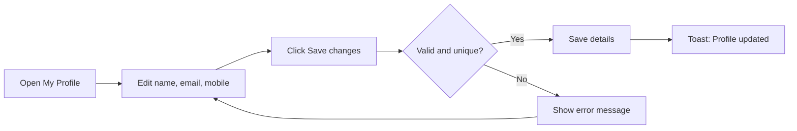
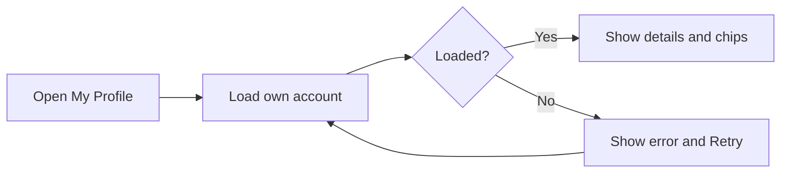
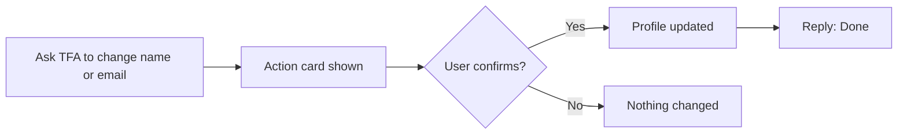

# User Profile – Functional Workflow

> **Project:** TaskFlow – Intelligent Task Allocation & Tracking System
> **Parent Module:** Profile  ·  **Child Module:** 07.1 User Profile
> **Version:** 1.0  ·  **Last Updated:** 31-Oct-2026
> **Author:** Jojo George (jojogeorge3344@gmail.com)
> © 2026 Jojo George. All rights reserved.

---

## 1. Overview
User Profile is the **My Profile** screen. Every signed-in user can see their own account details here (role, projects, departments, managers, two-step status) and update their full name, email address and mobile number. The screen always shows the signed-in user's own account. There is no way to open another user's profile.

## 2. Purpose / Business Value
- Users can keep their own contact details up to date without asking an administrator (BRD Screen 19, "Expected Result").
- Role, project, username, employee code and account status are shown but cannot be edited, so nobody can give themselves more access.
- Fewer routine requests reach administrators, and every user sees the same accurate account information.

## 3. Who Can Access

| Role          | Can See | Can Use | Access Level (Own / Team / Organization) |
|---------------|:-------:|:-------:|------------------------------------------|
| Administrator | ✅ | ✅ | Own |
| Manager       | ✅ (also sees Managed projects and Team rows) | ✅ | Own |
| Employee      | ✅ | ✅ | Own |
| Custom Role   | ✅ (Always On) | ✅ (Always On) | Own |

`profile.view` and `profile.edit` are **Always On** for every role, including custom roles, and cannot be removed in Role Configuration. Even an Administrator can only see and change their own profile here. Other users' accounts are managed in **Employee Management**.

## 4. Screens

| # | Screen Name | Menu Path | Purpose | Visible To |
|---|-------------|-----------|---------|------------|
| 1 | My Profile | Side menu → **My Profile** (or the name/avatar link in the top bar) | View your account details and edit your personal information | All signed-in users |

---

## 5. Screen & Functionality Details

### 5.1 Screen: My Profile
**Purpose:** Show the signed-in user's own account and let them update their personal information.
**Who can see this screen:** All signed-in users (Administrator, Manager, Employee, Custom roles).
**Required permission:** `profile.view` (Always On). `profile.edit` (Always On) covers the Personal information form.

**Screen Elements**
- **Header:** avatar with the user's initials, full name, `@username` and email.
- **Summary chips:** role, Active/Inactive status, one chip for each project allocation, "Two-step on"/"Two-step off", and "Last sign-in …" when there is a last sign-in time.
- **Account details card (read-only):** Username, Employee code, Role, Projects (with the total "% allocated"), Departments, Managers, and Account status. Managers also see **Managed projects** and **Team**. The card says: *"Your role, project and status are managed by an administrator."*
- **Personal information card (editable):**
  - **Full name** (required)
  - **Email address** (required). The user types only the part before `@taskflow.com`, which is shown as a fixed suffix.
  - **Mobile number** (optional, international format such as `+919876543210`)
  - **Save changes** button (shows *"Saving…"* while saving) and a *"Saved"* confirmation
- **Password card:** short explanation and a **Change password** button that opens the Change Password screen (see 07.2 Change Password).
- **Loading and error states:** placeholder bars while the page loads. If loading fails, the page shows *"Something went wrong"* with a **Retry** button.

### 5.2 Functionalities

| # | Functionality | Purpose | Who Can See | Who Can Use | Permission Required | Scope |
|---|---------------|---------|-------------|-------------|---------------------|-------|
| 1 | View my profile | See your account details, allocations, departments, managers and MFA status | All signed-in users | All signed-in users | `profile.view` | Own |
| 2 | Edit personal information | Change your full name, email address and mobile number | All signed-in users | All signed-in users | `profile.edit` | Own |
| 3 | View manager-only rows | Managers also see "Managed projects" and "Team" | Manager | Manager | `profile.view` (shown only when the role is Manager) | Own |
| 4 | Open Change Password | Go to the password change screen | All signed-in users | All signed-in users | `profile.password.change` | Own |
| 5 | Update profile through the Assistant | Ask the TaskFlow Assistant (TFA) to change your name or email. You confirm the change before it is applied. | All signed-in users | All signed-in users | `profile.edit` (no extra Assistant check) | Own |

### 5.3 Step-by-Step Workflow – Edit Personal Information
1. User opens **My Profile** from the side menu.
2. System loads the user's own account and fills in Full name, Email (the part before `@taskflow.com`) and Mobile number.
3. User changes one or more fields.
4. System checks each field while the user types. For example, it shows *"Full name is required."* or *"Use international format, for example +919876543210."*
5. User clicks **Save changes**.
6. System checks the data again on the server: the email must be valid and on `@taskflow.com`, the mobile number must be in international format, the email must not belong to someone else, and the email and mobile number together must not match another user.
7. On success the system saves the change, shows the toast *"Profile updated"* and the *"Saved"* mark, and updates the user's name in the top bar straight away.
8. On failure the system shows the error above the form and next to the field concerned. Nothing is saved.
9. No notification, email or activity-log entry is created.

**Flow Diagram**

### 5.4 Step-by-Step Workflow – View My Profile
1. User opens **My Profile**, or clicks their name or avatar in the top bar.
2. System loads the signed-in user's own record. There is no way to choose another user.
3. System shows the header, the summary chips and the read-only Account details. Managers also see the Managed projects and Team rows.
4. If the record cannot be loaded, the system shows *"Could not load your profile."* with a **Retry** button.

**Flow Diagram**

### 5.5 Step-by-Step Workflow – Update Profile through the Assistant
1. User asks the TaskFlow Assistant (TFA) to change their name or email.
2. The Assistant checks the new values and shows an action card with the proposed change.
3. User confirms the card.
4. System applies the change with the same rules as **Save changes**. The mobile number is left as it is.
5. The Assistant replies *"Done. Your profile was updated."*

**Flow Diagram**

### 5.6 Business Rules & Validations
- A user can only read and change **their own** account. The account is always taken from the sign-in session, never from the screen.
- Only **Full name**, **Email** and **Mobile number** can be edited. Role, project, username, employee code and account status are read-only on this screen. They are changed by an Administrator in Employee Management.
- **Full name** is required, up to 200 characters. Extra spaces at the start and end are removed.
- **Email** is required, up to 256 characters, and must be on the fixed domain `@taskflow.com`. The part before `@` may use only letters, digits, dot, underscore or hyphen (no leading, trailing or double dots), up to 64 characters. It is saved in lower case.
- **Email must be unique.** Two addresses count as the same if the part before `@` matches. Addresses of deleted users stay reserved.
- **Mobile number** is optional. If given, it must be in international format: a plus sign followed by 8 to 15 digits, with no leading zero after the plus. Spaces, dashes, dots and brackets are removed before the number is checked. Leaving the field empty removes the saved number.
- A mobile number may be shared by colleagues. The only thing refused is a second user who has **both** the same email and the same mobile number.
- When the TaskFlow Assistant updates a profile, it can change only the name and email. The mobile number is left as it is, and the user must confirm the change on an action card.
- While a user still has to set up two-step verification, they can still view and save My Profile. Most other screens are blocked until setup is finished.
- The first step of the Security Setup screen (Auth module) uses the same save action to let a new user confirm their name, email and mobile number before connecting an authenticator app. The same rules apply there.

### 5.7 Messages Shown to the User

| Situation | Message |
|-----------|---------|
| Success | Profile updated (toast) · Saved (next to the button) |
| Full name empty | Full name is required. |
| Email empty | Email is required. |
| Email local part invalid (screen check) | Use letters, digits, dot, underscore or hyphen before @taskflow.com. |
| Email invalid (server check) | Email must be a name using letters, digits, dot, underscore or hyphen followed by @taskflow.com. |
| Field too long | This field is too long. |
| Mobile number invalid (screen check) | Use international format, for example +919876543210. |
| Mobile number invalid (server check) | Mobile number must be in international format, for example +919876543210. |
| Email already used | Email already exists. |
| Email and mobile already used together | A user with this email and mobile number already exists. |
| Save failed, no specific reason | Could not update your profile. |
| Profile could not load | Could not load your profile. |
| Unexpected server error | Something went wrong. Please try again. |
| Record changed by someone else at the same time | Someone else changed this record while you were saving. Reload it and try again. |
| Assistant change applied | Done. Your profile was updated. |

---

## 6. Permission Summary

| Permission Key | Description | Administrator | Manager | Employee | Custom Role |
|----------------|-------------|:-------------:|:-------:|:--------:|:-----------:|
| `profile.view` | View my profile – open the user's own profile | Always On | Always On | Always On | Always On |
| `profile.edit` | Edit my personal information – update the user's own contact details | Always On | Always On | Always On | Always On |

These keys are given to every user automatically. They are not stored per role and cannot be assigned or removed in Role Configuration. The **Change password** button on this screen is covered by `profile.password.change` (see 07.2 Change Password).

## 7. Related Modules
- **07.2 Change Password** – Opened from the Password card on this screen.
- **07.3 Two-Step Verification** – The "Two-step on/off" chip shows its status.
- **Management (Employee Management)** – Administrators manage the read-only fields shown here: role, projects, departments, username, employee code and status. Email uniqueness rules are shared.
- **Authentication (Security Setup)** – Its first step saves the user's details through the same profile update.
- **TaskFlow Assistant (TFA)** – Can prepare a name or email change for the user to confirm, and links to My Profile.
- **Dashboard / shell** – The top-bar name updates as soon as the profile is saved. The **My Profile** menu item is always shown.

## 8. Expected Outcome
Every user, whatever their role, can open My Profile and see accurate details about their account. They can fix their own name, email and mobile number without asking an administrator, and they cannot change their own role, projects or account status.

---
© 2026 Jojo George. All rights reserved. Unauthorized copying or distribution of this document is prohibited.
