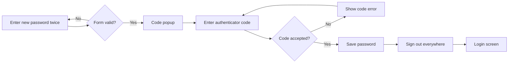
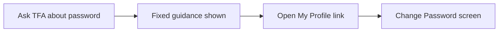

# Change Password – Functional Workflow

> **Project:** TaskFlow – Intelligent Task Allocation & Tracking System
> **Parent Module:** Profile  ·  **Child Module:** 07.2 Change Password
> **Version:** 1.0  ·  **Last Updated:** 31-Oct-2026
> **Author:** Jojo George (jojogeorge3344@gmail.com)
> © 2026 Jojo George. All rights reserved.

---

## 1. Overview
Change Password lets a signed-in user set a new password for their own account. Instead of asking for the current password, the change is confirmed with a code from the user's authenticator app (or a backup code). After a successful change the user is signed out on every device and must sign in again with the new password.

## 2. Purpose / Business Value
- Users can change their password safely without help from an administrator.
- The authenticator code proves who the user is, so a stolen session alone is not enough to take over the account.
- Signing out every session after the change ends any session an attacker may already have.

## 3. Who Can Access

| Role          | Can See | Can Use | Access Level (Own / Team / Organization) |
|---------------|:-------:|:-------:|------------------------------------------|
| Administrator | ✅ | ✅ (needs two-step verification on) | Own |
| Manager       | ✅ | ✅ (needs two-step verification on) | Own |
| Employee      | ✅ | ✅ (needs two-step verification on) | Own |
| Custom Role   | ✅ (Always On) | ✅ (Always On, needs two-step verification on) | Own |

`profile.password.change` is **Always On** for every role and cannot be removed in Role Configuration. Only the user's own password can be changed here.

## 4. Screens

| # | Screen Name | Menu Path | Purpose | Visible To |
|---|-------------|-----------|---------|------------|
| 1 | Change Password | My Profile → **Password** card → **Change password** | Set a new password, confirmed with an authenticator code | All signed-in users |

---

## 5. Screen & Functionality Details

### 5.1 Screen: Change Password
**Purpose:** Let the user set a new password. The change is confirmed with an authenticator code.
**Who can see this screen:** All signed-in users.
**Required permission:** `profile.password.change` (Always On)

**Screen Elements**
- **Back to profile** link.
- **New password** field with a show/hide (eye) button and a strength meter that shows Weak, Fair, Good or Strong.
- **Confirm new password** field with a show/hide button.
- Hint: *"At least 6 and at most 128 characters. Mix upper and lower case, numbers and symbols for a stronger one."*
- **Change password** button.
- **"Confirm it is you" popup:** an **Authenticator code** field (6-digit app code, or a backup code), **Cancel** and **Confirm** buttons. Confirm shows *"Changing…"* while it works.

### 5.2 Functionalities

| # | Functionality | Purpose | Who Can See | Who Can Use | Permission Required | Scope |
|---|---------------|---------|-------------|-------------|---------------------|-------|
| 1 | Change my password | Set a new password, confirmed with an authenticator or backup code | All signed-in users | All signed-in users who have two-step verification on | `profile.password.change` | Own |
| 2 | Password strength hint | Show how strong the new password is while the user types | All signed-in users | All signed-in users | `profile.password.change` | Own |
| 3 | Ask the Assistant about passwords | The TaskFlow Assistant explains how to change a password and links to My Profile. It never accepts a password in chat. | All signed-in users | All signed-in users | None (fixed guidance) | Own |

### 5.3 Step-by-Step Workflow – Change My Password
1. User opens **My Profile → Password → Change password**.
2. User enters the **New password** and types it again in **Confirm new password**.
3. User clicks **Change password**. The system checks the length (6–128 characters) and that the two entries match. Nothing is sent yet.
4. System shows the **"Confirm it is you"** popup.
5. User enters the code from their authenticator app (or a backup code) and clicks **Confirm**.
6. System checks that two-step verification is on and that the code is valid. If so, it saves the new password.
7. System **signs the user out everywhere**, including the current browser, and opens the Login screen with the message *"Your username or password was changed. Sign in again with your new details."*
8. If the code is wrong, the popup stays open with the error and the password is not changed. If the password itself is rejected, the popup closes and the error appears on the form.
9. No notification or email is sent.

**Flow Diagram**

### 5.4 Step-by-Step Workflow – Ask the Assistant about Passwords
1. User asks the TaskFlow Assistant (TFA) how to change their password.
2. The Assistant replies with fixed guidance and a link to **My Profile**.
3. The Assistant never asks for or accepts a password in chat. The change itself is always made on the Change Password screen.

**Flow Diagram**

### 5.5 Business Rules & Validations
- The new password must be **6 to 128 characters**. The server applies the same range as the login screen, so a password outside it could never be used to sign in.
- Both password entries must match. The screen checks this.
- **The current password is not asked for.** The authenticator code proves who the user is.
- **Two-step verification must be on.** Otherwise the change is refused with *"Set up two-step verification before changing your password."* While two-step setup is still pending, the password change is blocked together with most other screens.
- The code can be a 6-digit authenticator code or an unused backup code. A code that has been accepted once cannot be used again.
- After **5 wrong codes in a row**, code checks are locked for **5 minutes**. Sign-in uses the same counter.
- A successful change ends **every session** of the user on every device. The user must sign in again with the new password.
- The strength meter is only a hint. The only rule the server enforces is the length.

### 5.6 Messages Shown to the User

| Situation | Message |
|-----------|---------|
| Success | The user is signed out. Login screen: *Your username or password was changed. Sign in again with your new details.* |
| Field empty | Required. |
| Password too short | Password must be at least 6 characters. |
| Password too long | Password must be at most 128 characters. |
| Passwords differ | Passwords do not match. |
| Code missing | Enter the code from your authenticator app. |
| Code wrong or expired | The code is incorrect or has expired. |
| Too many wrong codes | Too many wrong codes. Try again in a few minutes. |
| MFA not set up | Set up two-step verification before changing your password. |
| Code rejected, no reason given | That code did not work. Try the new code from your app. |
| Password rejected, no reason given | Could not change your password. |

---

## 6. Permission Summary

| Permission Key | Description | Administrator | Manager | Employee | Custom Role |
|----------------|-------------|:-------------:|:-------:|:--------:|:-----------:|
| `profile.password.change` | Change my password – change the user's own password | Always On | Always On | Always On | Always On |

This key is given to every user automatically. It is not stored per role and cannot be assigned or removed in Role Configuration.

## 7. Related Modules
- **07.1 User Profile** – The Change Password screen is opened from the Password card on My Profile, and **Back to profile** returns there.
- **07.3 Two-Step Verification** – Two-step verification must be on before a password can be changed. The same wrong-code lock applies.
- **Authentication** – After a password change the user signs in again on the Login screen. Account Recovery is the route for a forgotten password.
- **TaskFlow Assistant (TFA)** – Explains how to change a password and links to My Profile.

## 8. Expected Outcome
Every user can change their own password safely: the change is confirmed with an authenticator code, and all of their sessions are ended so they sign in again with the new password.

---
© 2026 Jojo George. All rights reserved. Unauthorized copying or distribution of this document is prohibited.
