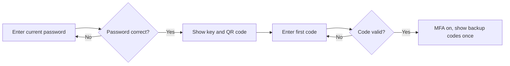
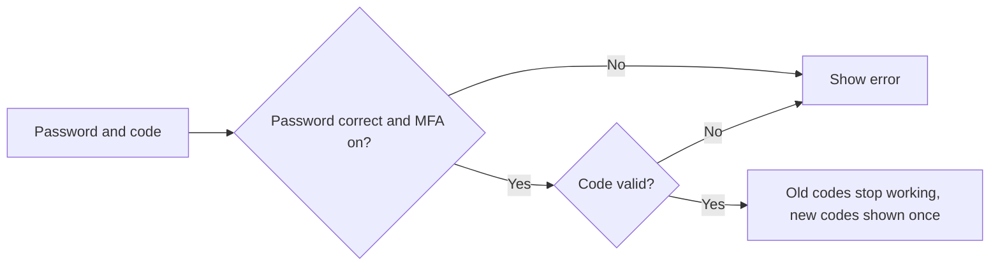

# Two-Step Verification – Functional Workflow

> **Project:** TaskFlow – Intelligent Task Allocation & Tracking System
> **Parent Module:** Profile  ·  **Child Module:** 07.3 Two-Step Verification (self-service)
> **Version:** 1.0  ·  **Last Updated:** 31-Oct-2026
> **Author:** Jojo George (jojogeorge3344@gmail.com)
> © 2026 Jojo George. All rights reserved.

---

## 1. Overview
Two-Step Verification (self-service) covers the account actions a user takes to protect their own sign-in with an authenticator app: start setup, turn two-step verification on, check a code and regenerate backup codes. The screen that uses these actions is **Security Setup**, which belongs to the Authentication module (see 01-Auth). On My Profile itself, two-step verification appears only as the "Two-step on/off" chip.

## 2. Purpose / Business Value
- Every user protects their own account with a second factor, without needing an administrator.
- Backup codes let the user get back in if they lose their phone.
- Two-step verification is also the proof used when the user changes their password (see 07.2 Change Password).

## 3. Who Can Access

| Role          | Can See | Can Use | Access Level (Own / Team / Organization) |
|---------------|:-------:|:-------:|------------------------------------------|
| Administrator | ✅ | ✅ | Own |
| Manager       | ✅ | ✅ | Own |
| Employee      | ✅ | ✅ | Own |
| Custom Role   | ✅ (Always On) | ✅ (Always On) | Own |

`profile.mfa.manage` is **Always On** for every role and cannot be removed in Role Configuration. A user can only set up two-step verification for their own account.

## 4. Screens

| # | Screen Name | Menu Path | Purpose | Visible To |
|---|-------------|-----------|---------|------------|
| 1 | Security Setup (Auth module) | Opened automatically after the first sign-in, before MFA is set up | Set up the authenticator app and get backup codes. The server side of this lives in the Profile module. | All signed-in users who have not set up two-step verification |

---

## 5. Screen & Functionality Details

### 5.1 Screen: Security Setup (shared with the Auth module)
**Purpose:** Set up an authenticator app for the user's own account. This screen belongs to the **Authentication** module (see 01-Auth). The account-side actions it calls are part of the Profile module. On My Profile itself, two-step verification appears only as the "Two-step on/off" chip.
**Who can see this screen:** All signed-in users who have not yet set up two-step verification.
**Required permission:** `profile.mfa.manage` (Always On)

**Screen Elements** (as used by the Profile actions)
- Current password field to start setup.
- Setup key and QR code for the authenticator app.
- Field for the first code to confirm setup.
- List of backup codes shown once, with a download option (`taskflow-backup-codes.txt`).

### 5.2 Functionalities

| # | Functionality | Purpose | Who Can See | Who Can Use | Permission Required | Scope |
|---|---------------|---------|-------------|-------------|---------------------|-------|
| 1 | Start authenticator setup | Confirm the current password and get a new key and QR code | All signed-in users | Users without two-step verification | `profile.mfa.manage` | Own |
| 2 | Turn on two-step verification | Confirm with the first app code and receive the backup codes | All signed-in users | Users with setup started | `profile.mfa.manage` | Own |
| 3 | Check a code | Check a code without using it up, for small screen features | – | All signed-in users with MFA on | `profile.mfa.manage` | Own |
| 4 | Regenerate backup codes | Replace all backup codes after the current password and a valid code | – | All signed-in users with MFA on | `profile.mfa.manage` | Own |

> ⚠️ To be confirmed: functionalities 3 and 4 exist on the server, but no screen calls them yet. Functionality 4 has no screen at all, and the "Check a code" call is in the frontend service but unused.

### 5.3 Step-by-Step Workflow – Turn On Two-Step Verification
1. After the first sign-in, the system opens **Security Setup**. Other screens are blocked until setup is finished.
2. User enters their **current password**.
3. System checks the password and shows a new key and QR code. Two-step verification is still off at this point.
4. User scans the QR code with an authenticator app and enters the first 6-digit code.
5. System checks the code, turns two-step verification on and shows 10 backup codes, **once**.
6. User saves the backup codes. My Profile now shows "Two-step on".

**Flow Diagram**

### 5.4 Step-by-Step Workflow – Regenerate Backup Codes (server only)
> ⚠️ To be confirmed: no screen offers this yet. The steps describe the server action only.

1. User supplies their **current password** and a valid code (authenticator or backup code).
2. System checks the password (5 tries in 5 minutes) and that two-step verification is on.
3. System checks the code and replaces **all** backup codes with 10 new ones, shown once.

**Flow Diagram**

### 5.5 Business Rules & Validations
- Setup starts only after the **current password** is checked. Password attempts are limited to 5 in 5 minutes per account.
- Setup cannot be started again while two-step verification is already on.
- The key and backup codes are shown **once** and never again. The server stores only an encrypted key and hashed backup codes.
- Regenerating backup codes makes **all** old codes stop working.
- Wrong codes count toward the same 5-try / 5-minute lock as sign-in.
- While setup is pending, only My Profile and these two-step actions are open. Every other screen shows *"Set up two-step verification to continue."*

### 5.6 Messages Shown to the User

| Situation | Message |
|-----------|---------|
| Wrong current password | Current password is incorrect. |
| Too many password attempts | Too many attempts. Try again in a few minutes. |
| Already on | Authenticator MFA is already on. Turn it off first to set it up again. |
| Setup not started | Start the setup first to get a key. |
| MFA not on (backup codes) | Authenticator MFA is not on. |
| Wrong code | The code is incorrect or has expired. |
| Locked | Too many wrong codes. Try again in a few minutes. |
| Other screens blocked until setup | Set up two-step verification to continue. |

---

## 6. Permission Summary

| Permission Key | Description | Administrator | Manager | Employee | Custom Role |
|----------------|-------------|:-------------:|:-------:|:--------:|:-----------:|
| `profile.mfa.manage` | Manage my authenticator – set up two-step verification and regenerate backup codes | Always On | Always On | Always On | Always On |

This key is given to every user automatically. It is not stored per role and cannot be assigned or removed in Role Configuration.

## 7. Related Modules
- **Authentication (Security Setup, Sign-in, MFA reset)** – Hosts the Security Setup screen. Sign-in uses the same wrong-code lock. An administrator MFA reset notifies the user and points them to Profile.
- **07.1 User Profile** – Shows the "Two-step on/off" chip.
- **07.2 Change Password** – Requires two-step verification to be on, and uses an authenticator or backup code as proof.

## 8. Expected Outcome
Every user can connect an authenticator app to their own account, receive backup codes once, and from then on sign in and change their password with a second factor.

---
© 2026 Jojo George. All rights reserved. Unauthorized copying or distribution of this document is prohibited.
