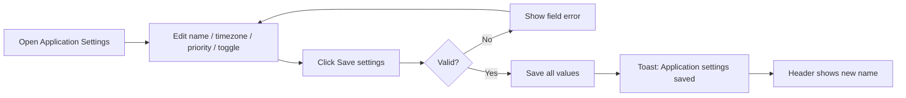

# Application Settings – Functional Workflow

> **Project:** TaskFlow – Intelligent Task Allocation & Tracking System
> **Parent Module:** Settings  ·  **Child Module:** 08.1 Application Settings
> **Version:** 1.0  ·  **Last Updated:** 31-Oct-2026
> **Author:** Jojo George (jojogeorge3344@gmail.com)
> © 2026 Jojo George. All rights reserved.

---

## 1. Overview
Application Settings is the screen where an authorized user maintains the basic application-wide configuration: the brand name shown in the sidebar and header, the single application timezone, the default task priority, and whether in-app (bell) notifications are created at all. It corresponds to BRD Screen 20 "System Settings".

## 2. Purpose / Business Value
- The brand name, timezone and default priority are changed from the screen, not in code (BRD Screen 20 FR-1).
- The whole application uses one timezone to decide which calendar day a deadline falls on, so "due today" and "overdue" mean the same thing for everyone (BRD business rule 17).
- In-app notifications can be switched off for the whole organization with one toggle.
- The settings that every user can read (brand name, default priority) contain nothing secret (BRD Screen 20 FR-5).

## 3. Who Can Access

| Role          | Can See Screen | Can Use Screen | Access Level (Own / Team / Organization) |
|---------------|:--------------:|:--------------:|------------------------------------------|
| Administrator | ✅ | ✅ | Organization |
| Manager       | ❌ | ❌ | – (reads the values behind the scenes only) |
| Employee      | ❌ | ❌ | – (reads the values behind the scenes only) |
| Custom Role   | Configurable | Configurable | Organization, when `settings.application.manage` is granted |

> Note: Any signed-in user can **read** the application settings (the brand name in the header and the default priority on Create Task), but only holders of `settings.application.manage` can open the screen and change them.

## 4. Screens

| # | Screen Name | Menu Path | Purpose | Visible To |
|---|-------------|-----------|---------|------------|
| 1 | Application Settings | Settings → Application Settings | Brand name, default timezone, default task priority, in-app notifications on/off | Administrator; custom roles with `settings.application.manage` |

---

## 5. Screen & Functionality Details

### 5.1 Screen: Application Settings
**Purpose:** Maintain basic application-wide configuration (BRD Screen 20 "System Settings").
**Who can see this screen:** Administrator (and custom roles granted the permission).
**Required permission:** `settings.application.manage`

**Screen Elements**
- Page title **Application settings** with the line "Application-wide configuration: the brand name, timezone, default task priority and in-app notifications."
- **General** group:
  - **Application name** (required). Hint: "Shown in the sidebar and header."
  - **Default timezone** (required). A text box with suggestions (UTC, Asia/Kolkata, Asia/Dubai, Europe/London, Europe/Berlin, America/New_York, America/Chicago, America/Los_Angeles, Australia/Sydney). Any valid timezone id can be typed. Hint: "Decides which calendar day a deadline belongs to. Applied immediately, no restart needed."
  - **Default task priority**: Low, Medium, High or Critical. Hint: "Pre-selected on the Create Task form."
- **Notifications** group: **Enable in-app notifications** toggle. Hint: "When off, no new bell notifications are created for any event. Existing notifications are kept."
- **Reminder defaults** group: a link to the **Reminder Settings** screen, where reminder intervals and Mail delivery are kept.
- **Save settings** button (shows "Saving…" while saving) and a **Saved** tick after a successful save.
- A loading placeholder, and an error card with a **Retry** button if the settings cannot be loaded.

### 5.2 Functionalities

| # | Functionality | Purpose | Who Can See | Who Can Use | Permission Required | Scope |
|---|---------------|---------|-------------|-------------|---------------------|-------|
| 1 | View application settings (screen) | Show the current values on the screen | Administrator | Administrator | `settings.application.manage` | Org |
| 2 | Read application settings (behind the scenes) | Brand name in the header, default priority on Create Task | All signed-in users | All signed-in users | – (signed in only) | Org |
| 3 | Change application name | Rename the product shown in the sidebar and header | Administrator | Administrator | `settings.application.manage` | Org |
| 4 | Change default timezone | Set the single timezone used for deadline days and reminders | Administrator | Administrator | `settings.application.manage` | Org |
| 5 | Change default task priority | Pre-select a priority on Create Task | Administrator | Administrator | `settings.application.manage` | Org |
| 6 | Turn in-app notifications on or off | Stop or resume creating new bell notifications | Administrator | Administrator | `settings.application.manage` | Org |

### 5.3 Step-by-Step Workflow – Save Application Settings
1. User opens **Settings → Application Settings**.
2. System loads and shows the current values. If loading fails, it shows *"Could not load the application settings."* (or the server's message) with a **Retry** button.
3. User changes the application name, timezone, default priority and/or the in-app notifications toggle.
4. User clicks **Save settings**.
5. The screen checks the fields first. A blank or over-long name shows *"Application name is required and must be 100 characters or fewer."* A blank timezone shows *"Timezone is required."*
6. The server checks the data again. An unknown timezone id is refused with *"Unknown timezone."*
7. System saves all four values, then shows the toast *"Application settings saved"* and a **Saved** tick.
8. The new brand name appears in the sidebar and header at once, without reloading the page. The new timezone applies to reminders and deadline checks at once, with no restart.

**Flow Diagram**

### 5.4 Business Rules & Validations
- Application name is required and can be at most 100 characters. Spaces before and after it are removed.
- Timezone is required and must be an id the server recognises (for example `Asia/Kolkata` or `UTC`).
- Default priority must be one of Low, Medium, High or Critical.
- Every field must be sent. A save that leaves a field out is refused; the system does not quietly use a default.
- If a stored value is missing or cannot be read, the system falls back to a default: name "TaskFlow", priority Medium, in-app notifications on, and the timezone from the server configuration (or UTC).
- If the stored timezone is not recognised when reminders run, the system logs the problem and uses UTC, so reminders never stop.
- Turning in-app notifications off stops new bell notifications for every event. Existing notifications are kept.
- Reminder intervals and Mail delivery are **not** changed here. They belong to Reminder Settings.

### 5.5 Messages Shown to the User

| Situation | Message |
|-----------|---------|
| Success | Application settings saved |
| Name blank or too long (screen) | Application name is required and must be 100 characters or fewer. |
| Name blank (server) | Application name cannot be blank. |
| Timezone blank (screen) | Timezone is required. |
| Timezone blank (server) | Timezone cannot be blank. |
| Timezone not recognised | Unknown timezone. |
| Load failed | Could not load the application settings. |
| Save failed | Could not save the application settings. |
| No permission | The menu item is hidden, and opening the address returns the user to their dashboard. A direct save attempt is refused (HTTP 403). |

---

## 6. Permission Summary

| Permission Key | Description | Administrator | Manager | Employee | Custom Role |
|----------------|-------------|:-------------:|:-------:|:--------:|:-----------:|
| `settings.application.manage` | Change application-wide settings | Granted | Denied | Denied | Configurable |
| – (signed in) | Read application settings (brand name, default priority) | Always On | Always On | Always On | Always On |

> Manager and Employee values are the defaults given when the permission is first created. The Administrator role is given every permission again each time the application starts.

## 7. Related Modules
- **08.2 Reminder Settings** – Holds the reminder intervals and Mail delivery; this screen only links to it. Reminder Settings shows the application timezone read-only.
- **Monitoring (Task Management)** – Create Task pre-selects the default priority from this screen.
- **Communication (Notifications)** – The in-app notifications switch decides whether bell notifications are created at all. The reminder engine uses the application timezone.
- **Dashboard and Reports** – Use the application timezone to decide which tasks are due today or overdue.
- **TaskFlow Assistant (TFA)** – Uses the application name as the brand name.

## 8. Expected Outcome
An Administrator can maintain the application name, timezone, default priority and in-app notifications from the screen. Every user sees the new brand name at once, and every deadline calculation uses the one application timezone without a restart.

---
© 2026 Jojo George. All rights reserved. Unauthorized copying or distribution of this document is prohibited.
