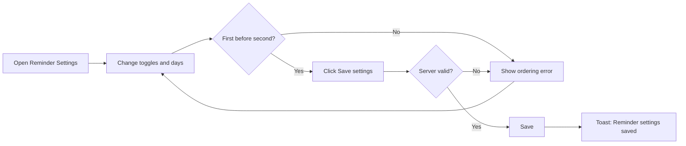

# Reminder Settings – Functional Workflow

> **Project:** TaskFlow – Intelligent Task Allocation & Tracking System
> **Parent Module:** Settings  ·  **Child Module:** 08.2 Reminder Settings
> **Version:** 1.0  ·  **Last Updated:** 31-Oct-2026
> **Author:** Jojo George (jojogeorge3344@gmail.com)
> © 2026 Jojo George. All rights reserved.

---

## 1. Overview
Reminder Settings is the screen that controls the automatic deadline reminders sent to assignees, task creators and selected recipients. It switches reminders and the deadline-day reminder on or off, sets the default reminder days for new tasks and the overdue frequency, and decides whether each reminder is also delivered to TaskFlow Mail. It corresponds to BRD Screen 13 "Deadline Reminder Settings".

## 2. Purpose / Business Value
- Reminder intervals are changed from the screen, not in code (BRD Screen 13 FR-4).
- The organization decides how persistent overdue reminders are (daily or weekly).
- Reminders can be stopped for the whole organization with one toggle.
- Each reminder can also land in the recipient's TaskFlow Mail inbox, so it is not lost among bell notifications.

## 3. Who Can Access

| Role          | Can See Screen | Can Use Screen | Access Level (Own / Team / Organization) |
|---------------|:--------------:|:--------------:|------------------------------------------|
| Administrator | ✅ | ✅ | Organization |
| Manager       | ✅ | ✅ | Organization (seed default) |
| Employee      | ❌ | ❌ | – |
| Custom Role   | Configurable | Configurable | Organization, when `settings.reminders.manage` is granted |

> Note: Every reminder setting applies to the **whole organization**. Existing tasks keep the reminder days they were created with.

## 4. Screens

| # | Screen Name | Menu Path | Purpose | Visible To |
|---|-------------|-----------|---------|------------|
| 1 | Reminder Settings | Settings → Reminder Settings | Turn deadline reminders on/off, default reminder days, overdue frequency, delivery to Mail | Administrator, Manager; custom roles with `settings.reminders.manage` |

---

## 5. Screen & Functionality Details

### 5.1 Screen: Reminder Settings
**Purpose:** Configure the automatic deadline reminders (BRD Screen 13 "Deadline Reminder Settings").
**Who can see this screen:** Administrator, Manager (and custom roles granted the permission).
**Required permission:** `settings.reminders.manage`

**Screen Elements**
- Page title **Reminder settings** with the line "Control the automatic deadline reminders sent to assignees, task creators and selected recipients."
- **Automatic reminders** group:
  - **Send deadline reminders** toggle. Hint: "When off, no reminders are generated for any task."
  - **Remind on the deadline day** toggle. Hint: "Sends a "due today" reminder while the task is still open."
- **Defaults for new tasks** group. Hint: "Create Task starts with these values. Existing tasks keep the intervals they were created with."
  - **First reminder**: 3, 2 or 1 days before the deadline.
  - **Second reminder**: 1 day before the deadline, or on the deadline day.
  - **After the deadline**: Every day or Every week.
- **Delivery** group:
  - **Also deliver reminders to Mail** toggle. Hint: "Each reminder also arrives in the recipient's Mail inbox from "TaskFlow". Bell notifications are always sent."
  - **Application timezone** (read-only). Hint: "Decides which calendar day a reminder belongs to. Changed in Application Settings."
- **Save settings** button and a **Saved** tick. Loading placeholder and error card with **Retry**.

### 5.2 Functionalities

| # | Functionality | Purpose | Who Can See | Who Can Use | Permission Required | Scope |
|---|---------------|---------|-------------|-------------|---------------------|-------|
| 1 | View reminder settings | Show the current reminder configuration (BRD FR-9) | Administrator, Manager | Administrator, Manager | `settings.reminders.manage` | Org |
| 2 | Turn reminders on or off | Stop or resume all automatic deadline reminders | Administrator, Manager | Administrator, Manager | `settings.reminders.manage` | Org |
| 3 | Turn the deadline-day reminder on or off | Send or skip the "due today" reminder | Administrator, Manager | Administrator, Manager | `settings.reminders.manage` | Org |
| 4 | Set default first and second reminder | The values Create Task starts with | Administrator, Manager | Administrator, Manager | `settings.reminders.manage` | Org |
| 5 | Set overdue reminder frequency | How often reminders repeat after the deadline | Administrator, Manager | Administrator, Manager | `settings.reminders.manage` | Org |
| 6 | Turn Mail delivery on or off | Also put each reminder in the recipient's Mail inbox | Administrator, Manager | Administrator, Manager | `settings.reminders.manage` | Org |
| 7 | See application timezone | Read-only display; changed in Application Settings | Administrator, Manager | – (read-only) | `settings.reminders.manage` | Org |

### 5.3 Step-by-Step Workflow – Save Reminder Settings
1. User opens **Settings → Reminder Settings**.
2. System shows the current configuration and the application timezone (read-only).
3. User changes the toggles, the first and second reminder, and the overdue frequency.
4. If the second reminder is not later than the first, the screen shows *"The first reminder must come earlier than the second reminder."* under **Second reminder**.
5. User clicks **Save settings**.
6. The server checks the values again (same rule, and the allowed day ranges).
7. System saves the values and shows the toast *"Reminder settings saved"* and a **Saved** tick.
8. From the next reminder run, the reminder engine uses the new on/off switches and Mail choice. New tasks start with the new default days. Existing tasks keep their own days.

**Flow Diagram**

### 5.4 Business Rules & Validations
- The first reminder must be between 1 and 30 days before the deadline.
- The second reminder must be between 0 and 30 days before the deadline. 0 means "on the deadline day".
- The first reminder must come earlier than the second (more days before the deadline).
- Overdue frequency is Daily or Weekly.
- All six values must be sent. The timezone is never changed on this screen.
- Defaults when nothing is stored: reminders on, deadline-day reminder on, first reminder 2 days, second reminder 1 day, overdue Daily, Mail delivery on. This matches the BRD default schedule (2 days, 1 day, deadline day, then daily).
- When **Send deadline reminders** is off, no reminders are generated for any task.
- Bell (in-app) reminder notifications are always sent when reminders run. The Mail toggle only adds a copy in the recipient's TaskFlow Mail inbox. In-app notifications can still be switched off for the whole application on the Application Settings screen.
- The screen offers 3/2/1 days (first) and 1/0 days (second). A value saved some other way (for example through the API, up to 30) is still shown in the list.

### 5.5 Messages Shown to the User

| Situation | Message |
|-----------|---------|
| Success | Reminder settings saved |
| First not earlier than second | The first reminder must come earlier than the second reminder. |
| Load failed | Could not load the reminder settings. |
| Save failed | Could not save the reminder settings. |
| No permission | The menu item is hidden, and opening the address returns the user to their dashboard. A direct API call is refused (HTTP 403). |

---

## 6. Permission Summary

| Permission Key | Description | Administrator | Manager | Employee | Custom Role |
|----------------|-------------|:-------------:|:-------:|:--------:|:-----------:|
| `settings.reminders.manage` | View and change deadline reminder settings | Granted | Granted | Denied | Configurable |

> Manager and Employee values are the defaults given when the permission is first created. The Administrator role is given every permission again each time the application starts.

## 7. Related Modules
- **08.1 Application Settings** – Owns the application timezone shown read-only here, and the in-app notifications switch that can stop all bell notifications.
- **Monitoring (Task Management)** – Create Task pre-selects the default first and second reminder days and overdue frequency from this screen.
- **Communication (Notifications, Mail)** – The reminder engine reads the on/off switch, the deadline-day reminder and Mail delivery from this screen.

## 8. Expected Outcome
Managers and Administrators can tune deadline reminders without code changes: switch them on or off, choose the default days for new tasks and the overdue frequency, and decide whether reminders also arrive in TaskFlow Mail.

---
© 2026 Jojo George. All rights reserved. Unauthorized copying or distribution of this document is prohibited.
