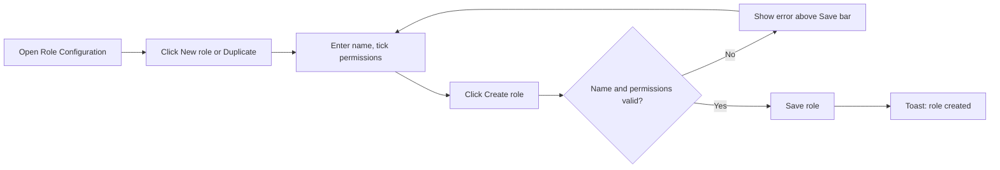
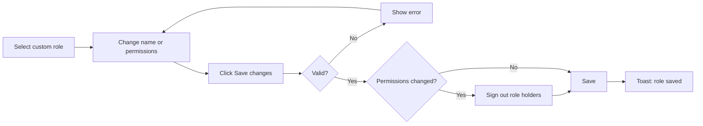
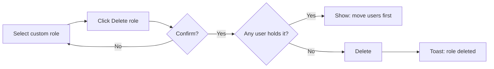

# Role Configuration – Functional Workflow

> **Project:** TaskFlow – Intelligent Task Allocation & Tracking System
> **Parent Module:** Settings  ·  **Child Module:** 08.3 Role Configuration
> **Version:** 1.0  ·  **Last Updated:** 31-Oct-2026
> **Author:** Jojo George (jojogeorge3344@gmail.com)
> © 2026 Jojo George. All rights reserved.

---

## 1. Overview
Role Configuration is the screen where an authorized user chooses exactly what each role can see and do. The three system roles (Administrator, Manager, Employee) are shown read-only; the organization creates, edits, duplicates and deletes its own **custom roles** against a fixed permission catalogue.

## 2. Purpose / Business Value
- Access is controlled by permissions. An organization can create its own custom roles, so a role gets the screens and actions it needs and nothing more.
- The system roles and the permission list stay protected, so nobody can break the built-in access model by mistake.
- Permission changes take effect immediately: holders of a changed role are signed out and sign in again with the new access.

## 3. Who Can Access

| Role          | Can See Screen | Can Use Screen | Access Level (Own / Team / Organization) |
|---------------|:--------------:|:--------------:|------------------------------------------|
| Administrator | ✅ | ✅ | Organization (all roles, can create, edit and delete custom roles) |
| Manager       | ❌ | ❌ | – |
| Employee      | ❌ | ❌ | – |
| Custom Role   | Configurable | Configurable | `roles.manage` opens the screen; `roles.view.all` shows all roles (otherwise only one's own); `roles.modify.access` allows changes (otherwise read-only) |

## 4. Screens

| # | Screen Name | Menu Path | Purpose | Visible To |
|---|-------------|-----------|---------|------------|
| 1 | Role Configuration | Settings → Role Configuration | View roles, and create, edit, copy and delete custom roles and their permissions | Administrator; custom roles with `roles.manage` |

---

## 5. Screen & Functionality Details

### 5.1 Screen: Role Configuration
**Purpose:** Choose exactly what each role can see and do. Create and manage custom roles.
**Who can see this screen:** Administrator (and custom roles granted `roles.manage`).
**Required permission:** `roles.manage` (to open). `roles.view.all` to see every role. `roles.modify.access` to create, edit or delete.

**Screen Elements**
- Page title **Role Configuration**: "Choose exactly what each role can see and do. Administrator, Manager and Employee are protected; create your own roles for anyone else."
- **Roles** panel (left):
  - **New role** button (only with `roles.modify.access`).
  - **Find a role** search box.
  - List of roles (system roles first) with how many users hold each one. Without `roles.view.all`, only the user's own role is listed.
- Role detail (right):
  - Role name box (custom roles), or the name with a **System role** badge.
  - For a system role: the note "… is a system role. Its permissions are read-only and it cannot be changed or deleted. Duplicate it to start a custom role from the same permissions." and a **Duplicate as custom role** button.
  - **Copy permissions from…** dropdown and **Delete role** button (editable roles only).
  - A progress bar: "N of M permissions", "x% enabled".
  - **Search permissions** box, and an **All / Enabled / Disabled** filter.
  - View switch: **Tree** or **Compare roles** (matrix of permissions against every role).
  - Tree view: module list on the side, **Expand all / Collapse all**, **Select all / Deselect all**, tick boxes for each module, screen and permission, and scope selectors (for example Dashboard Own / Team / Organization, Tasks own / all). Tags **Always on** and **Administrator only**.
  - Save bar: "N unsaved changes", **Discard**, and **Create role** / **Save changes**.

### 5.2 Functionalities

| # | Functionality | Purpose | Who Can See | Who Can Use | Permission Required | Scope |
|---|---------------|---------|-------------|-------------|---------------------|-------|
| 1 | Open Role Configuration | See roles and the permission catalogue | Administrator | Administrator | `roles.manage` | Org |
| 2 | See all roles | List every role, not only one's own | Administrator | Administrator | `roles.manage` + `roles.view.all` | Org |
| 3 | View a role's permissions (tree or compare) | Read what a role can do | Administrator | Administrator | `roles.manage` | Org |
| 4 | Create a custom role | Add a new role with chosen permissions | Administrator | Administrator | `roles.manage` + `roles.modify.access` | Org |
| 5 | Duplicate a role / Copy permissions from | Start a custom role from another role's permissions | Administrator | Administrator | `roles.manage` + `roles.modify.access` | Org |
| 6 | Edit a custom role | Rename it and change its permissions | Administrator | Administrator | `roles.manage` + `roles.modify.access` | Org |
| 7 | Delete a custom role | Remove a role nobody holds | Administrator | Administrator | `roles.manage` + `roles.modify.access` | Org |
| 8 | Give "Give the Administrator role" to a role | Not possible: only the Administrator role holds it | Administrator | Nobody | `roles.administrator.assign` (not assignable) | Org |
| 9 | Change the permission catalogue | Not possible: the list of permissions is fixed | – | Nobody | – | – |

### 5.3 Step-by-Step Workflow – Create a Custom Role
1. User opens **Settings → Role Configuration**.
2. User clicks **New role** (or selects a system role and clicks **Duplicate as custom role**, which fills the name "… copy" and its permissions).
3. User types the **Role name** and ticks permissions in the tree. Ticking a permission also ticks the permission it needs (normally the screen's View). Optionally, **Copy permissions from…** another role.
4. User clicks **Create role**.
5. If the name is blank, the screen shows *"Enter a name for the role."*
6. The server checks the name (unique, up to 100 characters) and the permissions (known, needed permissions present, none that only the Administrator may hold).
7. System saves the role and shows the toast *"{Role name} created"*.

**Flow Diagram**

### 5.4 Step-by-Step Workflow – Edit a Custom Role
1. User selects a custom role in the **Roles** list.
2. User renames it and/or ticks and unticks permissions. The save bar counts the unsaved changes.
3. If the user selects another role with unsaved changes, the system asks *"Discard unsaved changes?"* first.
4. User clicks **Save changes**.
5. The server checks the name and permissions, then saves.
6. If the permissions changed, **everyone who holds the role is signed out** and must sign in again. A name-only change does not sign anyone out.
7. System shows the toast *"{Role name} saved"*.

**Flow Diagram**

### 5.5 Step-by-Step Workflow – Delete a Custom Role
1. User selects a custom role and clicks **Delete role**.
2. System asks *"Delete {Role name}?"* – "The role and its permissions are removed. This cannot be undone." – with a **Delete role** button.
3. If any user still holds the role, the system refuses, for example *"2 users still hold this role. Move them to another role first."*
4. Otherwise the role is deleted and the toast *"{Role name} deleted"* is shown.

**Flow Diagram**

### 5.6 Business Rules & Validations
- The three system roles (Administrator, Manager, Employee) are read-only. They cannot be renamed, changed or deleted. The database refuses such changes too.
- The permission catalogue is fixed. Nobody, including an Administrator, can add, change or remove a permission.
- A role name is required, can be at most 100 characters and must be unique. "team lead" counts as the same name as "Team Lead".
- A permission that needs another one (for example "Edit employees" needs "View employees") can only be saved together with it.
- "Give the Administrator role" (`roles.administrator.assign`) can only be held by the Administrator role.
- Always-on features (own profile, own dashboard, own tasks) are on for every user and cannot be switched off. They are not stored as grants.
- Scope selectors are levels. A higher level includes the lower ones: Organization includes Team and Own; View all tasks includes View my tasks.
- A role that some user holds cannot be deleted. Move the users to another role first (in Employee Management).
- When a custom role's permissions change, everyone holding it is signed out, so the new access applies at once.
- A user without `roles.view.all` sees only their own role. A user without `roles.modify.access` sees everything read-only.
- The Administrator role automatically receives every new permission each time the application starts.

### 5.7 Messages Shown to the User

| Situation | Message |
|-----------|---------|
| Role created | {Role name} created |
| Role saved | {Role name} saved |
| Role deleted | {Role name} deleted |
| Name blank | Enter a name for the role. |
| Name too long | The role name can be at most 100 characters. |
| Duplicate name | A role named "{name}" already exists. |
| Unknown permission | Unknown permission: {keys}. |
| Missing needed permission | "{permission}" also needs "{needed permission}". |
| Administrator-only permission | {permission} can only be held by the Administrator role and cannot be given to another role. |
| System role change | {Role name} is a system role and is read-only: it cannot be changed or deleted. |
| Role in use | 1 user still holds this role. Move them to another role first. / {n} users still hold this role. Move them to another role first. |
| Role not found | That role does not exist. |
| Catalogue change attempt | The permission list is fixed and cannot be changed. |
| Leaving with unsaved changes | Discard unsaved changes? – The changes you made to this role have not been saved and will be lost. |
| Load failed | Could not load roles and permissions. |
| Save / delete failed | Could not save the role. / Could not delete the role. |
| No permission | The menu item is hidden, and opening the address returns the user to their dashboard. |

---

## 6. Permission Summary

| Permission Key | Description | Administrator | Manager | Employee | Custom Role |
|----------------|-------------|:-------------:|:-------:|:--------:|:-----------:|
| `roles.manage` | Open Role Configuration and create, edit and delete custom roles | Granted | Denied | Denied | Configurable |
| `roles.view.all` | See all roles (otherwise only one's own) | Granted | Denied | Denied | Configurable |
| `roles.modify.access` | Add or update permissions (otherwise view mode) | Granted | Denied | Denied | Configurable |
| `roles.administrator.assign` | Make an account an Administrator, or take the role away | Granted | Denied | Denied | Denied |

> Manager and Employee values are the defaults given when the permission is first created. The Manager and Employee roles are system roles and cannot be changed on this screen.
> The Administrator role is given every permission again each time the application starts. `roles.administrator.assign` can only be held by the Administrator role, so for a custom role it is shown as Denied.

## 7. Related Modules
- **Management (Employee Management)** – Users are given roles there. A custom role must be emptied there before it can be deleted. Giving the Administrator role needs `roles.administrator.assign`.
- **Authentication** – When a custom role's permissions change, its holders are signed out and must sign in again.
- **All modules** – Every screen and action in TaskFlow is controlled by the permissions granted here (including the other Settings child modules 08.1, 08.2 and 08.4).

## 8. Expected Outcome
The organization can define custom roles that grant exactly the screens and actions each group needs, while the system roles and the permission list stay protected. Permission changes take effect for the role's holders straight away.

---
© 2026 Jojo George. All rights reserved. Unauthorized copying or distribution of this document is prohibited.
