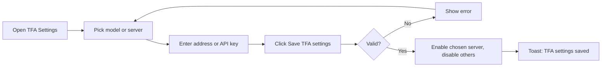
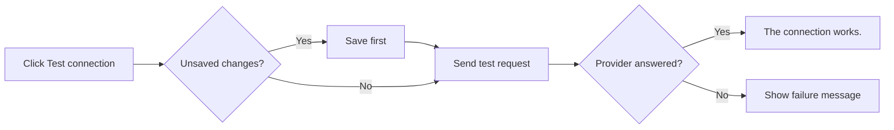
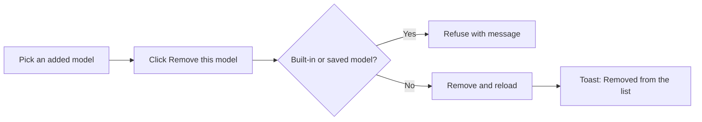

# TFA Settings – Functional Workflow

> **Project:** TaskFlow – Intelligent Task Allocation & Tracking System
> **Parent Module:** Settings  ·  **Child Module:** 08.4 TFA Settings
> **Version:** 1.0  ·  **Last Updated:** 31-Oct-2026
> **Author:** Jojo George (jojogeorge3344@gmail.com)
> © 2026 Jojo George. All rights reserved.

---

## 1. Overview
TFA Settings is the screen where an authorized user chooses the AI model and server behind TFA, the TaskFlow Assistant. It supports a free local server (Ollama) and two cloud services (Google Gemini, OpenAI GPT), lets the user add and remove models, stores API keys encrypted, and runs a connection test.

## 2. Purpose / Business Value
- The organization chooses which AI provider TFA uses: a free local server (Ollama) or a cloud service (Google Gemini, OpenAI GPT).
- API keys are stored encrypted and are never shown again or sent back to the browser.
- A one-click connection test confirms the chosen provider works before users rely on it.
- Only one model is offered to users in the TFA window, so everyone uses the configuration the administrator chose.

## 3. Who Can Access

| Role          | Can See Screen | Can Use Screen | Access Level (Own / Team / Organization) |
|---------------|:--------------:|:--------------:|------------------------------------------|
| Administrator | ✅ | ✅ | Organization |
| Manager       | ❌ | ❌ | – |
| Employee      | ❌ | ❌ | – |
| Custom Role   | Configurable | Configurable | `settings.ai.view` opens the screen; `settings.ai.edit`, `settings.ai.test` and `settings.ai.model.remove` allow the actions |

## 4. Screens

| # | Screen Name | Menu Path | Purpose | Visible To |
|---|-------------|-----------|---------|------------|
| 1 | TFA Settings | Settings → TFA Settings | Choose the AI model and server TFA uses, add/remove models, enter API keys, test the connection | Administrator; custom roles with `settings.ai.view` |

---

## 5. Screen & Functionality Details

### 5.1 Screen: TFA Settings
**Purpose:** Choose the AI model and server behind TFA, the TaskFlow Assistant, add models, and manage the API keys.
**Who can see this screen:** Administrator (and custom roles granted `settings.ai.view`).
**Required permission:** `settings.ai.view` (to open). `settings.ai.edit`, `settings.ai.test` and `settings.ai.model.remove` for the actions.

**Screen Elements**
- Page title **TFA settings**, and a **Model and server** section that explains the choices. Ollama runs on your own server and is free. Google Gemini has a free tier with limits. OpenAI GPT has no free tier. Gemini and OpenAI are cloud services, so a user's question and related task details are sent to them.
- **Model** dropdown, grouped by provider, with **Add new model…** in each group.
- **Server** dropdown: "Ollama · http://localhost:11434", "Google Gemini · generativelanguage.googleapis.com", "OpenAI GPT · api.openai.com". The two dropdowns are linked: choosing a model selects its server, and choosing a server selects its model.
- **New model name** box when **Add new model…** is chosen (placeholder "For example phi3:mini").
- **Remove this model from the list** button (only for a model an administrator added that is not the saved one).
- A line such as "TFA uses **llama3.2:3b** on **Ollama**." (or "After you save, TFA will use …").
- Provider card: name, **Local** / **Cloud** tag, and status (**In use**, **Ready to use**, **Needs an API key**, **Not configured**).
  - Ollama: **Server address** box.
  - Gemini / OpenAI: **API key** box (password field) with the key status ("A key is saved (ends …1234). Leave the box empty to keep it.") and **Remove the key** / **Keep the key** buttons.
- **Test connection** button and its result message.
- **Save TFA settings** button.

### 5.2 Functionalities

| # | Functionality | Purpose | Who Can See | Who Can Use | Permission Required | Scope |
|---|---------------|---------|-------------|-------------|---------------------|-------|
| 1 | View provider settings | See providers, models, status and whether a key is set (never the key) | Administrator | Administrator | `settings.ai.view` | Org |
| 2 | Choose model and server | Pick the one model TFA offers | Administrator | Administrator | `settings.ai.edit` | Org |
| 3 | Add a new model | Type a model name not in the list. It is kept and offered from then on | Administrator | Administrator | `settings.ai.edit` | Org |
| 4 | Set Ollama server address | Point TFA at the Ollama server | Administrator | Administrator | `settings.ai.edit` | Org |
| 5 | Enter, keep or remove an API key | Store or clear the Gemini / OpenAI key | Administrator | Administrator | `settings.ai.edit` | Org |
| 6 | Save TFA settings | Store the choices and switch TFA to the chosen server | Administrator | Administrator | `settings.ai.edit` | Org |
| 7 | Test connection | Send one tiny request to check the provider works | Administrator | Administrator | `settings.ai.test` | Org |
| 8 | Remove a model from the list | Remove a model an administrator added | Administrator | Administrator | `settings.ai.model.remove` | Org |

### 5.3 Step-by-Step Workflow – Choose the Model and Save
1. User opens **Settings → TFA Settings**.
2. System shows the providers and marks the one TFA uses now.
3. User picks a model in **Model** (the **Server** follows), or picks a **Server** (the **Model** follows). To use a new model, the user chooses **Add new model…** and types its name.
4. For Ollama, the user checks the **Server address**. For Gemini or OpenAI, the user pastes the **API key** (or leaves it empty to keep the saved key).
5. User clicks **Save TFA settings**.
6. System checks the fields (model name 1–100 characters, a valid http/https address, no spaces in the key).
7. System saves. Only the chosen server is switched on. The others are switched off, but their keys and models stay stored. The toast *"TFA settings saved"* is shown.
8. From now on, only this model is offered in the TFA window.

**Flow Diagram**

### 5.4 Step-by-Step Workflow – Test Connection
1. User clicks **Test connection** on the provider card.
2. If there are unsaved changes, the system saves them first, then tests.
3. System sends one short request to the provider ("Reply with OK.").
4. The result appears next to the button: *"The connection works."* or a plain message explaining the problem (for example the key was not accepted, or Ollama is not running).

**Flow Diagram**

### 5.5 Step-by-Step Workflow – Remove a Model
1. User picks a model they added earlier in the **Model** dropdown (not the saved one).
2. User clicks **Remove this model from the list**.
3. System removes it and reloads the screen from the server (other unsaved edits are dropped). The toast *"Removed {model} from the list"* is shown.

**Flow Diagram**

### 5.6 Business Rules & Validations
- Three providers are supported: **Ollama** (local, no key), **Google Gemini** and **OpenAI GPT** (cloud, need a key).
- Built-in models: Ollama `llama3.2:3b`, `llama3.2:1b`, `llama3.1:8b`, `qwen2.5:7b`, `mistral:7b`. Gemini `gemini-2.0-flash`, `gemini-2.5-flash`, `gemini-2.5-pro`. OpenAI `gpt-4o-mini`, `gpt-4o`, `gpt-4.1-mini`. The first one is each provider's default.
- On a brand-new installation, Ollama is switched on at `http://localhost:11434`. The cloud providers start switched off and without a key. On an upgraded installation, TFA stays off until an administrator turns it on.
- The model name must be 1–100 characters.
- The Ollama server address must be a valid http or https URL, at most 300 characters. Cloud metadata and link-local addresses (for example 169.254.x.x, `metadata.google.internal`) are refused. `localhost` and private addresses are allowed.
- The API key can be at most 500 characters and cannot contain spaces. Ollama does not use a key.
- A key is write-only. After saving, only "key set" and its last four characters are shown. Leaving the key box empty keeps the saved key.
- You cannot send a new key and ask to remove the key in the same save.
- Each provider can appear only once in a save.
- A built-in model cannot be removed. The model saved for a server cannot be removed until another model is chosen and saved.
- A provider counts as **configured** when it is switched on, has a model, and has either an address (Ollama) or a key that can still be decrypted (cloud).
- If the saved key can no longer be decrypted (for example the server's key ring was lost), the screen says *"The saved key can no longer be read. Enter it again."*

### 5.7 Messages Shown to the User

| Situation | Message |
|-----------|---------|
| Saved | TFA settings saved |
| Model removed | Removed {model} from the list |
| Test OK | The connection works. |
| Test – not configured | {Provider} is not configured. Choose another model, or ask an administrator to set it up. |
| Test – key refused | {Provider} did not accept the API key. Ask an administrator to check the key in TFA Settings, or choose another model. |
| Test – rate limit | {Provider}'s free limit or rate limit has been reached. Try again in about a minute, or choose another model. |
| Test – timeout | {Provider} took too long to answer. You can retry, or choose another model. |
| Test – Ollama not reachable | Ollama is not running or cannot be reached. Ask an administrator to start it, or choose another model. |
| Test – model missing on Ollama | The configured model is not available on Ollama. Ask an administrator to install it, or choose another model. |
| Model name blank | Model name cannot be blank. |
| New model name invalid (screen) | Type the model name (100 characters at most). |
| Bad server address | The server address must be a valid http or https URL, and not a link-local or cloud metadata address. |
| Bad address (screen) | Enter a valid http or https address. |
| Key with spaces | The API key cannot contain spaces. / The key cannot contain spaces. |
| New key and clear together | Provide a new key or clear the key, not both. |
| Key on Ollama | Ollama does not use an API key. |
| Remove built-in model | A built-in model cannot be removed. |
| Remove saved model | That model is the one saved for its server. Choose another model and save before removing it. |
| Model not found | That model is not in the list. |
| Load / save / remove failed | Could not load the TFA settings. / Could not save the TFA settings. / Could not remove the model. |
| No permission | The menu item is hidden, and opening the address returns the user to their dashboard. Buttons for actions the user may not do are hidden. |

---

## 6. Permission Summary

| Permission Key | Description | Administrator | Manager | Employee | Custom Role |
|----------------|-------------|:-------------:|:-------:|:--------:|:-----------:|
| `settings.ai.view` | See which AI providers and models are configured | Granted | Denied | Denied | Configurable |
| `settings.ai.edit` | Configure AI providers, keys and models (needs `settings.ai.view`) | Granted | Denied | Denied | Configurable |
| `settings.ai.test` | Run a connection test against a provider (needs `settings.ai.view`) | Granted | Denied | Denied | Configurable |
| `settings.ai.model.remove` | Remove a configured model from a provider (needs `settings.ai.view`) | Granted | Denied | Denied | Configurable |

> Manager and Employee values are the defaults given when the permission is first created. The Administrator role is given every permission again each time the application starts.

## 7. Related Modules
- **TaskFlow Assistant (TFA)** – Uses the model and server saved here. Only configured providers are offered in the TFA window.
- **08.3 Role Configuration** – Grants the four `settings.ai.*` keys to custom roles.

## 8. Expected Outcome
The Administrator can choose and test the AI model behind TFA and store API keys safely, without exposing them to anyone. Users of TFA are offered only the configured model.

---
© 2026 Jojo George. All rights reserved. Unauthorized copying or distribution of this document is prohibited.
