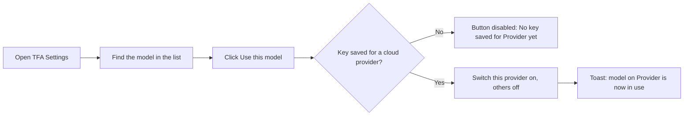
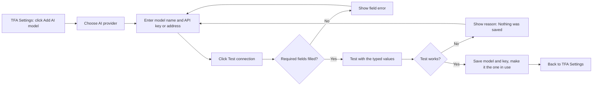
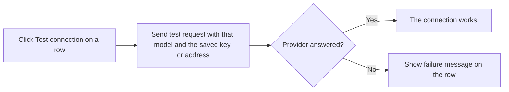
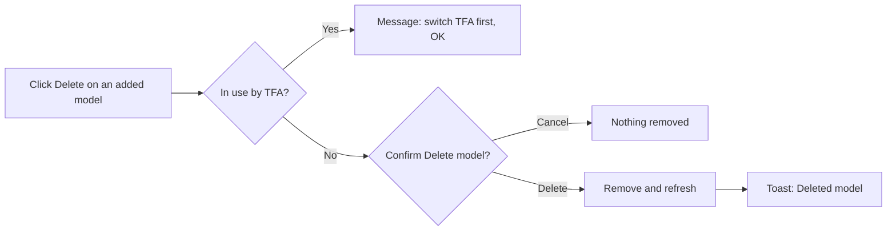
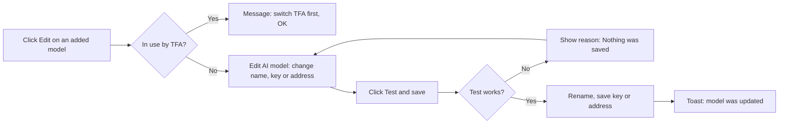

# TFA Settings – Functional Workflow

> **Project:** TaskFlow – Intelligent Task Allocation & Tracking System
> **Parent Module:** Settings  ·  **Child Module:** 08.4 TFA Settings
> **Version:** 1.3  ·  **Last Updated:** 01-Nov-2026
> **Author:** Jojo George (jojogeorge3344@gmail.com)
> © 2026 Jojo George. All rights reserved.

---

## 1. Overview
TFA Settings is the screen where an authorized user chooses the AI model behind TFA, the TaskFlow Assistant. It supports a free local server (Ollama) and two cloud services (Google Gemini, OpenAI GPT). The screen is a read-only list of every model: **Use this model** switches TFA to a model in one click, **Test connection** checks any model, and models an administrator added can be edited or deleted. Model names, API keys and the Ollama address are typed only on the Add AI model screen and its edit mode. API keys are stored encrypted, one per provider.

## 2. Purpose / Business Value
- The organization chooses which AI provider TFA uses: a free local server (Ollama) or a cloud service (Google Gemini, OpenAI GPT).
- API keys are stored encrypted and are never shown again or sent back to the browser.
- A one-click connection test on any listed model confirms it works before users rely on it.
- One list shows every model, which one TFA uses, and whether its provider has a key, so it is clear which settings belong to which model.
- Only one model is offered to users in the TFA window, so everyone uses the configuration the administrator chose.

## 3. Who Can Access

| Role          | Can See Screen | Can Use Screen | Access Level (Own / Team / Organization) |
|---------------|:--------------:|:--------------:|------------------------------------------|
| Administrator | ✅ | ✅ | Organization |
| Manager       | ❌ | ❌ | – |
| Employee      | ❌ | ❌ | – |
| Custom Role   | Configurable | Configurable | `settings.ai.view` opens the screen; `settings.ai.edit`, `settings.ai.test` and `settings.ai.model.remove` allow the actions |

## 4. Screens

| # | Screen Name | Menu Path | Purpose | Visible To |
|---|-------------|-----------|---------|------------|
| 1 | TFA Settings | Settings → TFA Settings | See every model, switch TFA to one (**Use this model**), test a model, open Edit or Delete for models an administrator added | Administrator; custom roles with `settings.ai.view` |
| 2 | Add AI model | Settings → TFA Settings → **Add AI model** (`/settings/tfa/models/new`) | Add a new model: choose the provider, enter the model name and API key (or Ollama address), test it, and make it the one TFA uses | Administrator; custom roles with `settings.ai.edit` **and** `settings.ai.test` |
| 3 | Edit AI model | Settings → TFA Settings → **Edit** on an added model (`/settings/tfa/models/{provider}/{model}/edit`) | The Add AI model screen in edit mode: rename the model, enter a new key or Ollama address, or remove the key; saved only after a passing test | Administrator; custom roles with `settings.ai.edit` **and** `settings.ai.test` |

---

## 5. Screen & Functionality Details

### 5.1 Screen: TFA Settings
**Purpose:** See every AI model TFA can use, switch TFA to one with a click, test any of them, and add, edit or delete the models an administrator added. Keys and addresses are typed only on the Add AI model screen (5.2) and its edit mode.
**Who can see this screen:** Administrator (and custom roles granted `settings.ai.view`).
**Required permission:** `settings.ai.view` (to open). `settings.ai.edit`, `settings.ai.test` and `settings.ai.model.remove` for the actions.

**Screen Elements**
- Page title **TFA settings**, and an **AI models** section that explains the choices. **Use this model** switches TFA to a model; a model is added, or one you added is changed, on the Add AI model screen. Ollama runs on your own server and is free. Google Gemini has a free tier with limits. OpenAI GPT has no free tier. Gemini and OpenAI are cloud services, so a user's question and related task details are sent to them.
- **Add AI model** button next to the **AI models** heading (shown only with both `settings.ai.edit` and `settings.ai.test`). It opens the Add AI model screen (5.2).
- A line such as "TFA uses **llama3.2:3b** on **Ollama**." (or "TFA has no model in use yet. Choose **Use this model** on a model below.").
- A read-only list of every model, grouped by provider: **Ollama**, **Google Gemini**, **OpenAI GPT**, each with its **Local** / **Cloud** tag. Each row shows:
  - the model ID, for example `gemini-3.8-flash`;
  - "{Provider} · Local" or "{Provider} · Cloud";
  - the key status – "Key saved, ends …1234", "No key saved" or "The saved key can no longer be read" – or, for Ollama, its server address. The key belongs to the provider, so every row of that provider shows the same status;
  - **Built-in** or **Added by you**;
  - an **In use** badge on the one model TFA uses.
- Actions on each row:
  - **Use this model** (with `settings.ai.edit`; not on the row in use). It is disabled, with the hint "No key saved for {Provider} yet. Add it on the Add AI model screen.", when a cloud provider has no key that can be read.
  - **Test connection** (with `settings.ai.test`). The result appears on that row.
  - **Edit** (with `settings.ai.edit` and `settings.ai.test`) and **Delete** (with `settings.ai.model.remove`), only on models an administrator added. Built-in models cannot be edited or deleted.
- On a phone, each row is shown as a stacked card with the same details and buttons, without scrolling sideways.
- There is no Model or Server dropdown, no API key or server address box, no **Remove this model from the list** and no **Save TFA settings** button any more (removed in v1.3).

### 5.2 Screen: Add AI model
**Purpose:** Add a model that is not in the list yet, and prove it works before anything is saved.
**Who can see this screen:** Administrator (and custom roles granted both `settings.ai.edit` and `settings.ai.test`).
**Required permission:** `settings.ai.edit` and `settings.ai.test`. A user without `settings.ai.test` who opens the address is sent back to TFA Settings.

**Screen Elements**
- **Back to TFA settings** link at the top, and a **Cancel** link next to the button. Both return to TFA Settings and save nothing.
- **AI provider** * (required, asked first): Google Gemini · Cloud, OpenAI GPT · Cloud, Ollama · Local. The other fields appear once a provider is chosen.
- **Model name** * (required, 1–100 characters, no spaces). It is the provider's model ID; the box shows an example for the chosen provider: `gemini-3.8-flash` (Google Gemini), `gpt-4o-mini` (OpenAI GPT), `llama3.2:3b` (Ollama).
- Gemini / OpenAI: **API key**. It is required (*) when the provider has no saved key. When a readable key is saved, the box may be left empty to keep it, and the hint says "A key is saved (ends …1234). Leave the box empty to keep it. A new key replaces it for every {Provider} model."
- Google Gemini only: a hint "Create a Gemini key in Google AI Studio" with a link to https://aistudio.google.com/apikey. The screen does not judge a key by how it starts (current AI Studio keys start with `AQ.`, older ones with `AIza`; both work).
- Ollama: **Server address** (optional). Left empty, the saved address or `http://localhost:11434` is used.
- **Test connection** button ("Testing…" while it runs) and, after a failure, the reason followed by "Nothing was saved."

**Edit mode – Edit AI model** (opened by **Edit** on a model an administrator added; address `/settings/tfa/models/{provider}/{model}/edit`; same permissions as Add AI model)
- Title **Edit AI model**: "Change the model name, or enter a new key or server address, and test the connection. The changes are saved only when the test works; the model TFA uses does not change."
- **AI provider** is shown but cannot be changed.
- **Model name** is filled in with the current name.
- Gemini / OpenAI: **API key** box, empty. The hint says "A key is saved (ends …1234). Leave the box empty to keep it. A new key replaces it for every {Provider} model."
- Gemini / OpenAI with a saved key: **Remove the key** button.
- Ollama: **Server address** (optional).
- **Test and save** button ("Testing…" while it runs), **Back to TFA settings** and **Cancel**.
- Opening the edit address of a model that is not listed, is built in, or is the one TFA uses returns to TFA Settings with the reason.

### 5.3 Functionalities

| # | Functionality | Purpose | Who Can See | Who Can Use | Permission Required | Scope |
|---|---------------|---------|-------------|-------------|---------------------|-------|
| 1 | View the model list | See every model, its provider, whether a key is set (never the key) or the Ollama address, and which model TFA uses | Administrator | Administrator | `settings.ai.view` | Org |
| 2 | Use this model | Switch TFA to a listed model in one click; the other providers are switched off with their keys and models kept | Administrator | Administrator | `settings.ai.edit` | Org |
| 3 | Add a new model | On the Add AI model screen: test a new model with its key or address, and only if the test works save it and make it the one TFA uses | Administrator | Administrator | `settings.ai.edit` + `settings.ai.test` | Org |
| 4 | Set Ollama server address | Point TFA at the Ollama server, on the Add AI model screen or its edit mode | Administrator | Administrator | `settings.ai.edit` + `settings.ai.test` | Org |
| 5 | Enter, keep or remove an API key | Store or clear the Gemini / OpenAI key, on the Add AI model screen or its edit mode (**Remove the key**) | Administrator | Administrator | `settings.ai.edit` + `settings.ai.test` | Org |
| 6 | Save TFA settings | _Withdrawn in v1.3 – the screen has nothing to save; use **Use this model** (2) or the Add / Edit screens._ | – | – | – | – |
| 7 | Test connection | Send one tiny request with a row's model and the saved key or address; nothing is saved | Administrator | Administrator | `settings.ai.test` | Org |
| 8 | Delete an added model | Delete a model an administrator added, after confirmation (not the one in use) | Administrator | Administrator | `settings.ai.model.remove` | Org |
| 9 | Edit an added model | Rename a model an administrator added, or give its provider a new key or address, saved only after a passing test (not the one in use) | Administrator | Administrator | `settings.ai.edit` + `settings.ai.test` | Org |

### 5.4 Step-by-Step Workflow – Choose the Model TFA Uses
1. User opens **Settings → TFA Settings**.
2. System lists every model, grouped by provider, and marks the one TFA uses now with **In use**.
3. User finds the model to use. To use a model that is not listed, the user adds it on the Add AI model screen instead (5.5).
4. User clicks **Use this model** on that row.
5. System checks that the model is listed and, for Gemini or OpenAI, that a key is saved and can be read.
6. System switches that provider on with this model. The others are switched off, but their keys and models stay stored. The toast *"{model} on {Provider} is now in use"* is shown and the list is refreshed.
7. From now on, only this model is offered in the TFA window.

**Flow Diagram**

### 5.5 Step-by-Step Workflow – Add an AI Model
1. On TFA Settings, the user clicks **Add AI model**. The Add AI model screen opens.
2. User chooses the **AI provider**.
3. User types the **Model name**.
4. For Gemini or OpenAI, the user pastes the **API key** (it may be left empty when a key is already saved). For Ollama, the user may type the **Server address**.
5. User clicks **Test connection**. The screen checks the required fields first and sends nothing if one is missing.
6. The system sends one short request ("Reply with OK.") to the provider with the typed values. **Nothing is saved before this test works.**
7. If the test fails, the reason is shown with "Nothing was saved.", the key box is emptied, and the other values are kept so the user can correct them.
8. If the test works, the system, in one step, adds the model to the list (if it is new), saves the key (or Ollama address) for that provider, switches that provider on with this model, and switches the others off (their keys and models stay stored).
9. The toast *"{model} on {Provider} is now in use"* is shown and the user is returned to TFA Settings, which shows the new model as the one TFA uses.
10. **Back to TFA settings** or **Cancel** at any time returns to TFA Settings without saving.

**Flow Diagram**

### 5.6 Step-by-Step Workflow – Test Connection
1. User clicks **Test connection** on a model's row ("Testing…" while it runs).
2. System sends one short request ("Reply with OK.") to that row's provider, with that row's model and the saved key or address. This also works for a provider TFA does not use right now. Nothing is saved, and the model TFA uses does not change.
3. The result appears on that row: *"The connection works."* or a plain message explaining the problem (for example the key was not accepted, Ollama is not running, or *"No key saved for {Provider} yet. Add it on the Add AI model screen."*).
4. When the model is not available, or the provider gave an error TaskFlow does not recognise, the message also shows the provider's own reason, for example *"Google Gemini said: HTTP 404 - …"* (at most 200 characters; anything that looks like an API key is replaced by `[key]`). Google, for example, names the model to use instead of a retired one. The reason is shown only by **Test connection** here and on the Add AI model screen, which need `settings.ai.test`; TFA users in the chat see only the plain message.

**Flow Diagram**

### 5.7 Step-by-Step Workflow – Delete a Model
1. User clicks **Delete** on the row of a model they added. Built-in models have no **Delete**.
2. If TFA uses this model, a message says *"{model} is in use by TFA. Switch TFA to another model first, then delete it."* with only an **OK** button, and nothing changes.
3. Otherwise the system asks *"Delete {model}?"* ("{model} is removed from the {Provider} models. The {Provider} key stays saved."). **Cancel** removes nothing.
4. After **Delete**, the system removes the model and refreshes the list. If a provider that is switched off still had this model saved, its model goes back to the provider's default (for example `gemini-3.8-flash`). The toast *"Deleted {model}"* is shown.

**Flow Diagram**

### 5.8 Business Rules & Validations
- Three providers are supported: **Ollama** (local, no key), **Google Gemini** and **OpenAI GPT** (cloud, need a key).
- Built-in models: Ollama `llama3.2:3b`, `llama3.2:1b`, `llama3.1:8b`, `qwen2.5:7b`, `mistral:7b`. Gemini `gemini-3.8-flash`, `gemini-3.5-flash`, `gemini-3.5-flash-lite`. OpenAI `gpt-4o-mini`, `gpt-4o`, `gpt-4.1-mini`. The first one is each provider's default.
- Settings saved earlier that still name a Gemini model Google no longer offers to new keys keep that name. **Test connection** then reports that the model is not available (with Google's reason), and the administrator clicks **Use this model** on a current model.
- TFA Settings itself is read-only. Model names, keys and addresses are typed only on the Add AI model screen and its edit mode, and are saved only after the connection test works. Removing a key needs no test.
- On a brand-new installation, Ollama is switched on at `http://localhost:11434`. The cloud providers start switched off and without a key. On an upgraded installation, TFA stays off until an administrator turns it on.
- The model name must be 1–100 characters and contain no spaces: it is the provider's model ID (for example `gemini-3.8-flash`), not a display name. This is checked on the Add AI model screen and its edit mode.
- On the Add AI model screen, the provider and the model name are required. An API key is required for Gemini and OpenAI only when no readable key is saved. A server address is never required.
- A model is added only after its connection test works. A failed test saves nothing: not the model, not the key, and not the provider choice.
- API keys are kept one per provider. A key entered on the Add AI model screen or its edit mode replaces that provider's saved key for all of its models, so every row of that provider shows the same key status.
- **Use this model** needs a readable key for Gemini and OpenAI. Without one it is disabled with "No key saved for {Provider} yet. Add it on the Add AI model screen.", and the server refuses it too.
- "In use" means the model saved on the provider that is switched on. Only that one model is marked **In use**.
- Editing a model saves only after its test works, renames it if the name changed, and never changes which model TFA uses. A new name that is already listed is refused.
- Adding a model that is already in the list does not add it twice; it becomes the model in use.
- The Ollama server address must be a valid http or https URL, at most 300 characters. Cloud metadata and link-local addresses (for example 169.254.x.x, `metadata.google.internal`) are refused. `localhost` and private addresses are allowed.
- The API key can be at most 500 characters and cannot contain spaces. Ollama does not use a key.
- A key is write-only. After saving, only "key set" and its last four characters are shown. Leaving the key box empty keeps the saved key.
- You cannot send a new key and ask to remove the key in the same request. **Remove the key** is done on its own, without other changes.
- Built-in models are read-only: they have no **Edit** or **Delete**, and a request to change or remove one is refused.
- The model TFA uses cannot be edited or deleted. Switch TFA to another model first. A model saved only for a provider that is switched off can be edited (its saved name follows) or deleted (its saved model goes back to the provider's default).
- A provider counts as **configured** when it is switched on, has a model, and has either an address (Ollama) or a key that can still be decrypted (cloud).
- If the saved key can no longer be decrypted (for example the server's key ring was lost), the screen says *"The saved key can no longer be read. Enter it again."*

### 5.9 Messages Shown to the User

| Situation | Message |
|-----------|---------|
| Model in use | {model} on {Provider} is now in use |
| Model deleted | Deleted {model} |
| Delete confirmation | Delete {model}? – {model} is removed from the {Provider} models. The {Provider} key stays saved. |
| Edit or delete the model in use | {model} is in use by TFA. Switch TFA to another model first, then edit it. / … then delete it. (only an **OK** button) |
| No key for Use this model or a test | No key saved for {Provider} yet. Add it on the Add AI model screen. |
| Model edited | {model} was updated |
| Edit – name already listed | That model is already in the list. |
| Edit – test failed | {the test message for the failure}. Nothing was saved. |
| Remove the key confirmation | Remove the {Provider} key? – The key is removed for every {Provider} model. (+ TFA uses {Provider}, so TFA is unavailable until a key is added again.) |
| Key removed | The {Provider} key was removed |
| Remove the key with other changes | Remove the key on its own, without other changes. |
| Test OK | The connection works. |
| Test – not configured | {Provider} is not configured. Choose another model, or ask an administrator to set it up. |
| Test – key refused | {Provider} did not accept the API key. Ask an administrator to check the key in TFA Settings, or choose another model. |
| Test – rate limit | {Provider}'s free limit or rate limit has been reached. Try again in about a minute, or choose another model. |
| Test – timeout | {Provider} took too long to answer. You can retry, or choose another model. |
| Test – Ollama not reachable | Ollama is not running or cannot be reached. Ask an administrator to start it, or choose another model. |
| Test – model missing on Ollama | The configured model is not available on Ollama. Ask an administrator to install it, or choose another model. |
| Test – model not available on Gemini / OpenAI (including a model name Gemini rejects) | The configured model is not available on {Provider}. Ask an administrator to check the model name, or choose another model. {Provider} said: HTTP {status} - {reason} |
| Test – unexpected provider error | {Provider} returned an unexpected error. Please try again, or choose another model. {Provider} said: HTTP {status} - {reason} |
| Model name blank | Model name cannot be blank. |
| Model name with spaces | A model name is the provider's model ID, without spaces, for example gemini-3.8-flash. (On the Add AI model screen the example is the chosen provider's.) |
| Model added | {model} on {Provider} is now in use |
| Add AI model – no provider (screen) | Choose the AI provider. |
| Add AI model – model name missing (screen) | Enter the model name (100 characters at most). |
| Add AI model – key missing | Enter the API key. |
| Add AI model – test failed | {the test message for the failure}. Nothing was saved. |
| Bad server address | The server address must be a valid http or https URL, and not a link-local or cloud metadata address. |
| Bad address (screen) | Enter a valid http or https address. |
| Key with spaces | The API key cannot contain spaces. / The key cannot contain spaces. |
| New key and clear together | Provide a new key or clear the key, not both. |
| Key on Ollama | Ollama does not use an API key. |
| Edit or delete a built-in model | A built-in model cannot be changed or removed. |
| Model not found | That model is not in the list. |
| Load / action failed | Could not load the TFA settings. / Could not switch TFA to that model. / Could not delete the model. / Could not remove the key. / The test could not be run. |
| No permission | The menu item is hidden, and opening the address returns the user to their dashboard. Buttons for actions the user may not do are hidden. |

### 5.10 Step-by-Step Workflow – Edit an Added Model
1. On TFA Settings, the user clicks **Edit** on the row of a model they added. If TFA uses this model, a message says *"{model} is in use by TFA. Switch TFA to another model first, then edit it."* with only an **OK** button, and the edit screen does not open.
2. The **Edit AI model** screen opens with the provider fixed and the model name filled in (5.2, edit mode).
3. The user changes the **Model name**, and/or pastes a new **API key** (Gemini, OpenAI) or types a **Server address** (Ollama). An empty key box keeps the saved key. A new key replaces the key for every model of that provider.
4. The user clicks **Test and save**. If the new name is already in the list, the screen says *"That model is already in the list."* and nothing is tested or saved.
5. The system sends one short request with the typed values. **Nothing is saved before this test works.**
6. If the test fails, the reason is shown with "Nothing was saved.", the key box is emptied, and the typed name is kept.
7. If the test works, the system renames the model and saves the key or address. The model TFA uses does not change. The toast *"{model} was updated"* is shown and the user is returned to TFA Settings.
8. **Remove the key**: the system asks *"Remove the {Provider} key?"* ("The key is removed for every {Provider} model.", and, if TFA uses that provider, "TFA uses {Provider}, so TFA is unavailable until a key is added again."). After confirming, the key is removed without a test, the toast *"The {Provider} key was removed"* is shown, and every row of that provider shows "No key saved".

**Flow Diagram**

---

## 6. Permission Summary

| Permission Key | Description | Administrator | Manager | Employee | Custom Role |
|----------------|-------------|:-------------:|:-------:|:--------:|:-----------:|
| `settings.ai.view` | See which AI providers and models are configured | Granted | Denied | Denied | Configurable |
| `settings.ai.edit` | **Use this model** (needs `settings.ai.view`). Adding or editing a model, its key or address also needs `settings.ai.test` | Granted | Denied | Denied | Configurable |
| `settings.ai.test` | Run **Test connection** on a listed model (needs `settings.ai.view`) | Granted | Denied | Denied | Configurable |
| `settings.ai.model.remove` | **Delete** a model an administrator added (needs `settings.ai.view`) | Granted | Denied | Denied | Configurable |

> Manager and Employee values are the defaults given when the permission is first created. The Administrator role is given every permission again each time the application starts.

## 7. Related Modules
- **TaskFlow Assistant (TFA)** – Uses the model marked **In use** here. Only configured providers are offered in the TFA window. TFA answers questions about TaskFlow from the project documents; that document search runs by itself in the background and has no settings on this screen.
- **08.3 Role Configuration** – Grants the four `settings.ai.*` keys to custom roles.

## 8. Expected Outcome
The Administrator sees every model in one list, switches TFA to one with a single click, tests any of them, and adds, edits or deletes the models an administrator added, storing API keys safely without exposing them to anyone. Users of TFA are offered only the configured model.

## Revision History

| Version | Date | Author | Summary of changes |
|---|---|---|---|
| 1.3 | 01-Nov-2026 | Jojo George | OpenSpec change `tfa-model-list-and-edit`. TFA Settings is a read-only list of every model grouped by provider (heading **AI models**) with **Use this model**, **Test connection** and, on added models, **Edit** and **Delete**; the Model and Server dropdowns, the provider card with the key and address boxes, **Remove this model from the list** and **Save TFA settings** were removed. New Edit AI model screen (edit mode of Add AI model, with **Remove the key**). Updated sections 1, 2, 4, 5.1, 5.2, 5.3, 5.4, 5.6, 5.7, 5.8, 5.9, 6, 7 and 8; new section 5.10. (Earlier versions were not recorded in this table.) |

---
© 2026 Jojo George. All rights reserved. Unauthorized copying or distribution of this document is prohibited.
