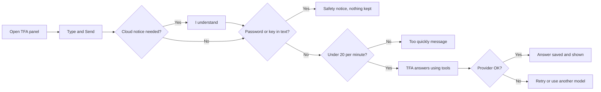
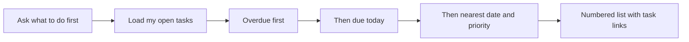
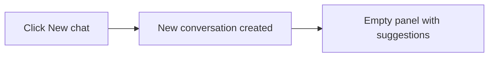

# Chat – Functional Workflow

> **Project:** TaskFlow – Intelligent Task Allocation & Tracking System
> **Parent Module:** TaskFlow Assistant (TFA)  ·  **Child Module:** 09.1 Chat
> **Version:** 1.0  ·  **Last Updated:** 31-Oct-2026
> **Author:** Jojo George (jojogeorge3344@gmail.com)
> © 2026 Jojo George. All rights reserved.

---

## 1. Overview
Chat is the core of TFA: the TFA Panel that opens from the floating **TFA** button on every signed-in screen. The user types (or speaks) a question, TFA answers with the AI model chosen in the panel, and the conversation is kept so it can be reloaded later. From the chat the user can see their upcoming, due-today and overdue tasks, get a ranked "what to do first" list, switch AI model and start a new chat.

## 2. Purpose / Business Value
- One place, on every screen, to ask TFA anything about TaskFlow and the user's own work.
- Gives a clear, repeatable work order calculated by the system (not by the AI), so it is the same whichever model is used.
- Protects users and the organization: passwords and API keys typed into chat are never sent or stored, and the first message to a cloud provider needs the user's acknowledgement.
- Handles AI provider problems gracefully: nothing is lost, and the user can retry or switch to another model.

## 3. Who Can Access

| Role          | Can See | Can Use | Access Level (Own / Team / Organization) |
|---------------|:-------:|:-------:|------------------------------------------|
| Administrator | ✅ | ✅ | Own conversation; task answers follow the user's own task access |
| Manager       | ✅ | ✅ | Own conversation; task answers follow the user's own task access |
| Employee      | ✅ | ✅ | Own conversation; task answers follow the user's own task access |
| Custom Role   | Configurable | Configurable | As granted (`assistant.chat`) |

Notes:
- The TFA button and panel appear only for users who hold `assistant.chat`.
- A user always sees only their **own** conversation.
- When TFA lists tasks it uses the same task rules as the Task Management screens, so it never shows a task the user could not open themselves.

## 4. Screens

| # | Screen Name | Menu Path | Purpose | Visible To |
|---|-------------|-----------|---------|------------|
| 1 | TFA Panel (chat) | Floating **TFA** button at the bottom right of every signed-in screen (no menu item), or say "Hey TF assistant" | Chat with TFA, choose the AI model, start a new chat | Users holding `assistant.chat` (Administrator, Manager, Employee by default) |

---

## 5. Screen & Functionality Details

### 5.1 Screen: TFA Panel
**Purpose:** Ask TFA questions and read its answers in a running conversation.
**Who can see this screen:** Any signed-in user whose role holds `assistant.chat` (Administrator, Manager and Employee by default; custom roles if granted).
**Required permission:** `assistant.chat`

**Screen Elements**
- Floating **TFA** button (bottom right) with a voice hint underneath: *say "Hey TF assistant"*, *Listening… say your command* or *voice is off*.
- Panel header: **TFA – TaskFlow Assistant** title, **New chat** (+) button and **Close** (×) button.
- **Model selector**: shows the chosen AI provider and model with a **Local** or **Cloud** tag. It only lists providers an administrator has configured; the menu opens only when there are two or more.
- **Cloud notice** (first message to a cloud provider): *"{Provider} is a cloud provider. Your message and related task details are sent to it."* with **I understand** and **Cancel**.
- Conversation feed: the user's messages, TFA's answers, a **Permission required** bubble for refusals, notices, a numbered **ranked task list** (each task links to its task page with a tag: Overdue, Today, Tomorrow, *n* days, or Blocked), and link buttons to the relevant screens.
- Welcome bubble when the chat is empty: *"Hi, I'm TFA. I can explain how TaskFlow works, tell you what is coming up and what to do first, and draft mail for you to review."*
- Starter suggestions (empty chat only): *What are my upcoming tasks?*, *What should I prioritise?*, *How do I change a task status?*, *Send a mail to my manager*.
- Message box *"Ask TFA anything about TaskFlow…"*, microphone button, **Send** button. Enter sends; Shift+Enter makes a new line.
- Footer text: *"TFA can make mistakes. Actions always need your confirmation."*
- Provider failure card with **Retry** and **Use {other provider}** buttons.
- Each TFA answer shows which provider answered (*TFA · Gemini*).

> The microphone, wake phrase and voice hint are described in `09.5-Voice-Input.md`; Action Cards shown in the feed are described in `09.2-Actions-and-Tools.md`.

### 5.2 Functionalities

| # | Functionality | Purpose | Who Can See | Who Can Use | Permission Required | Scope |
|---|---------------|---------|-------------|-------------|---------------------|-------|
| 1 | Open / close the panel | Show or hide TFA | Holders of `assistant.chat` | Holders of `assistant.chat` | `assistant.chat` | Own |
| 2 | View the conversation | Reload the latest conversation (up to the last 100 messages) | Holders of `assistant.chat` | Holders of `assistant.chat` | `assistant.chat` | Own |
| 3 | Send a message | Ask a question; TFA answers with the selected model | Holders of `assistant.chat` | Holders of `assistant.chat` | `assistant.chat` | Own |
| 4 | Ask about my tasks | Upcoming, due today, overdue or all open tasks | Holders of `assistant.chat` | Holders of `assistant.chat` | `assistant.chat` (tasks shown follow the user's task access) | Own by default; "every task I may see" on request |
| 5 | Ask what to do first | Ranked list of the user's open tasks | Holders of `assistant.chat` | Holders of `assistant.chat` | `assistant.chat` | Own (tasks assigned to the user) |
| 6 | Choose the AI model | Switch between configured providers for the next message | Holders of `assistant.chat` | Holders of `assistant.chat` (when 2 or more providers are configured) | `assistant.chat` | Own (choice is remembered in the browser) |
| 7 | Acknowledge cloud notice | Agree that a cloud provider receives the message | Holders of `assistant.chat` | Holders of `assistant.chat` | `assistant.chat` | Own (remembered in the browser) |
| 8 | Retry / use another model | Resend a message that a provider failed to answer | Holders of `assistant.chat` | Holders of `assistant.chat` | `assistant.chat` | Own |
| 9 | Start a new chat | Begin a fresh conversation; earlier messages are no longer used as context | Holders of `assistant.chat` | Holders of `assistant.chat` | `assistant.chat` | Own |

### 5.3 Step-by-Step Workflow – Ask TFA a Question

1. User clicks the floating **TFA** button (or says "Hey TF assistant").
2. System opens the panel, loads the configured providers and the user's latest conversation.
3. User types a question (or clicks a suggestion) and presses **Send**.
4. If the selected provider is a **Cloud** provider not yet acknowledged, the system holds the message and shows the cloud notice. User clicks **I understand** (message is sent) or **Cancel** (text goes back into the box).
5. System checks the message: empty or longer than 2000 characters is rejected; a message that looks like it contains a password or API key is **not sent and not stored**, and a safety notice is shown instead.
6. System checks the per-minute limit (20 messages per user per minute – see `09.4-Audit-Log-and-Rate-Limits.md`).
7. TFA reads the help, the user's tasks or the user directory as needed and writes the answer.
8. System saves the question and the answer to the conversation and shows them, with task links or a ranked list where relevant.
9. If the provider fails (limit reached, bad key, timeout, unreachable, model missing), nothing is saved; the user sees a plain message with **Retry** and **Use {other provider}**.

**Flow Diagram**

### 5.4 Step-by-Step Workflow – What Should I Work On First?

1. User asks *"What should I prioritise?"*.
2. TFA fetches the user's open tasks (To Do, In Progress, In QA, Blocked) that are assigned to them.
3. System ranks them: **overdue first** (longest overdue first), then **due today**, then the **nearest due date**, and **higher priority first** on the same day. Completed and cancelled tasks are left out; blocked tasks stay in the list and are tagged **Blocked**.
4. System shows the top 5 (up to 10 if asked) as a numbered list. Each item links to the task page.
5. TFA explains the order in words. The order itself is calculated by the system, not by the AI, so it is the same whichever model is used.

**Flow Diagram**

### 5.5 Step-by-Step Workflow – Start a New Chat

1. User clicks **New chat** (+) in the panel header.
2. System starts a new conversation for the user.
3. The panel empties and shows the welcome bubble and suggestions. Earlier messages stay stored but are no longer sent to the AI as context.

**Flow Diagram**

### 5.6 Business Rules & Validations
- A message must be between 1 and 2000 characters.
- A message that looks like it contains a password (for example "my password is Hunter2!") or an API key / token is never sent to any AI provider and never stored.
- TFA answers using at most 4 rounds of tool lookups per message; after that it must answer in words.
- TFA uses the last 12 messages (up to about 6000 characters) of the current conversation as context. Notices are not used as context.
- Nothing is saved when a provider fails, so the user can simply retry.
- Only configured providers can be chosen. If none is configured the panel shows *"TFA is not available yet"*.
- The first message to each cloud provider needs the user's acknowledgement in that browser.
- Task answers use the same access rules as Task Management: TFA never sees more tasks than the user can.
- Task, comment and mail text that TFA reads is treated as data, never as an instruction.
- Switching model keeps the same conversation.
- When a different person signs in on the same browser, the panel is cleared and loads that person's own conversation.

### 5.7 Messages Shown to the User

| Situation | Message |
|-----------|---------|
| No provider configured (panel) | TFA is not available yet. An administrator needs to choose an AI model in TFA Settings. |
| No provider configured (send) | TFA is not available yet. An administrator needs to configure an AI provider. |
| Chosen provider no longer configured | {Provider} is not configured. Choose another model, or ask an administrator to set it up. |
| Message empty or too long | A message must be between 1 and 2000 characters. |
| Password or key detected | For your safety I did not send or keep that message: it looks like it contains a password or an API key. Please never type passwords into chat. To change your password, open My Profile and use the Change password form. |
| Sending too fast | You are sending messages too quickly. Please wait about {n} seconds and try again. |
| Model gave no answer | I could not come up with an answer. Please try again, or ask in a different way. |
| Provider rate limit | {Provider}'s free limit or rate limit has been reached. Try again in about {n} seconds, or choose another model. |
| Provider rejected key | {Provider} did not accept the API key. Ask an administrator to check the key in TFA Settings, or choose another model. |
| Provider timeout | {Provider} took too long to answer. You can retry, or choose another model. |
| Ollama not running | Ollama is not running or cannot be reached. Ask an administrator to start it, or choose another model. |
| Cloud provider unreachable | {Provider} cannot be reached right now. Check the connection and retry, or choose another model. |
| Model not installed (Ollama) | The configured model is not available on Ollama. Ask an administrator to install it, or choose another model. |
| Model not available (cloud) | The configured model is not available on {Provider}. Ask an administrator to check the model name, or choose another model. |
| Other provider error | {Provider} returned an unexpected error. Please try again, or choose another model. |
| Any other send error | TFA could not answer. Please try again. |
| New chat failed | Could not start a new chat. |
| Cloud notice | {Provider} is a cloud provider. Your message and related task details are sent to it. |
| No permission | You do not have the required permission to perform this action. {Action} can only be performed by {who}. Please contact your system administrator for assistance. |

---

## 6. Permission Summary

| Permission Key | Description | Administrator | Manager | Employee | Custom Role |
|----------------|-------------|:-------------:|:-------:|:--------:|:-----------:|
| `assistant.chat` | Chat with the assistant: open TFA, ask questions, see task lists and the ranked work order, choose a model, start new conversations | Granted | Granted | Granted | Configurable |

`assistant.chat` is also given to every role that existed when it was first added.

## 7. Related Modules
- **09.2 Actions and Tools** – the task, prioritise and lookup tools TFA uses to answer, and the Action Cards that appear in the chat feed.
- **09.3 Help Knowledge** – "how do I…?" answers inside the chat.
- **09.4 Audit Log and Rate Limits** – the 20-messages-per-minute limit applied to every send.
- **09.5 Voice Input** – speaking a question instead of typing it.
- **Settings (TFA Settings)** – configures which providers and models appear in the model selector.
- **Monitoring (Task Management)** – task lists follow the same task access rules; task links open task pages.
- **Settings (Application Settings)** – the application name and time zone are used in answers and in deciding what is due today.
- **Legal** – the Privacy and Terms pages describe how assistant conversations are handled.

## 8. Expected Outcome
Every user holding `assistant.chat` can open TFA from any screen, ask questions with the AI model of their choice, see their upcoming and overdue tasks and a clear "what to do first" list, recover from provider problems with one click, and start a fresh conversation whenever they like – without passwords or keys ever passing through the chat.

---
© 2026 Jojo George. All rights reserved. Unauthorized copying or distribution of this document is prohibited.
