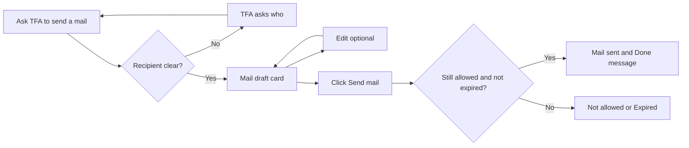
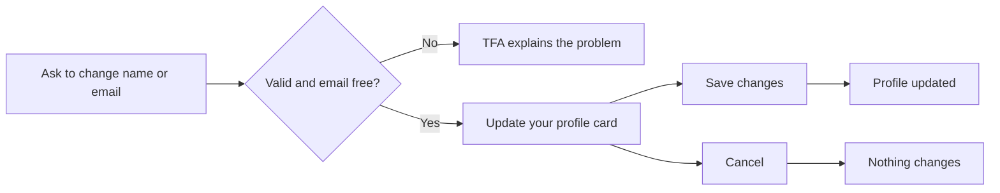
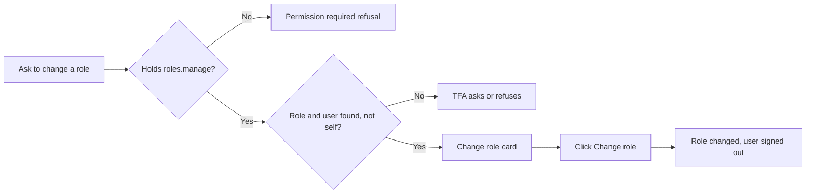

# Actions and Tools – Functional Workflow

> **Project:** TaskFlow – Intelligent Task Allocation & Tracking System
> **Parent Module:** TaskFlow Assistant (TFA)  ·  **Child Module:** 09.2 Actions and Tools
> **Version:** 1.0  ·  **Last Updated:** 31-Oct-2026
> **Author:** Jojo George (jojogeorge3344@gmail.com)
> © 2026 Jojo George. All rights reserved.

---

## 1. Overview
Actions and Tools covers the things TFA can look up or prepare on the user's behalf. TFA can draft an internal mail, propose a change to the user's own name or email, and (for administrators) propose a change to another user's role. It can also find users, explain how to change a password and tell the user when something needs an administrator. Every prepared action is shown on an **Action Card** inside the TFA Panel and only happens when the user clicks Confirm.

## 2. Purpose / Business Value
- Saves time on routine work such as writing a mail to "my manager" about a task or correcting one's own email address.
- Keeps the user in control: TFA can only **prepare** an action; nothing is sent or changed until the user confirms exactly what is shown.
- Keeps the organization safe: TFA can only do what the signed-in user could already do, the permission is checked again at confirm time, and an action runs at most once.

## 3. Who Can Access

| Role          | Can See | Can Use | Access Level (Own / Team / Organization) |
|---------------|:-------:|:-------:|------------------------------------------|
| Administrator | ✅ | ✅ (mail, own profile, role change) | Own actions; role change across the organization |
| Manager       | ✅ | ✅ (mail, own profile) | Own actions |
| Employee      | ✅ | ✅ (mail, own profile) | Own actions |
| Custom Role   | Configurable | Configurable | As granted (`assistant.chat` to see cards, `assistant.actions.confirm` to confirm/edit/cancel, `roles.manage` for role changes) |

Notes:
- A user always works with their **own** prepared actions. Another user's action is reported as "not found".
- The Action Card is shown to every holder of `assistant.chat`; its buttons only succeed for holders of `assistant.actions.confirm`.

## 4. Screens

| # | Screen Name | Menu Path | Purpose | Visible To |
|---|-------------|-----------|---------|------------|
| 1 | Action Card (inside the panel) | Appears in the TFA Panel when TFA prepares something | Review, edit (mail only), confirm or cancel a prepared action | Users holding `assistant.chat`; buttons work only with `assistant.actions.confirm` |

---

## 5. Screen & Functionality Details

### 5.1 Screen: Action Card (inside the TFA Panel)
**Purpose:** Show exactly what TFA has prepared and let the user confirm, edit (mail only) or cancel it.
**Who can see this screen:** Holders of `assistant.chat` (the card appears inside the conversation).
**Required permission:** `assistant.actions.confirm` (to Confirm, Edit or Cancel); `roles.manage` additionally for a role change.

**Screen Elements**
- Card title: **Mail draft**, **Update your profile** or **Change role**, with *"Expires in 10 minutes"* while pending.
- Fields: To and Subject plus the message body (mail); Name and/or Email "old → new" (profile); User and Role "old → new" (role change).
- Buttons while pending: **Send mail** / **Save changes** / **Change role** (confirm), **Edit** (mail only), **Cancel**.
- Text: *"Nothing happens until you confirm."*
- Edit form (mail): **To (email addresses)**, **Subject**, **Message**, **Save changes**, **Back**.
- After the action: status label **Done**, **Cancelled**, **Expired. Ask TFA again.**, **Not allowed** or **Not done**.

### 5.2 Functionalities

| # | Functionality | Purpose | Who Can See | Who Can Use | Permission Required | Scope |
|---|---------------|---------|-------------|-------------|---------------------|-------|
| 1 | Draft a mail | TFA prepares an internal TaskFlow mail (to named people or "my manager") | Holders of `assistant.chat` | Holders of `assistant.chat` | `assistant.chat` | Own (sent from the user's own mailbox) |
| 2 | Edit a mail draft | Change recipients, subject and body before sending | Holders of `assistant.chat` | Holders of `assistant.actions.confirm` | `assistant.actions.confirm` | Own |
| 3 | Propose own profile update | Change the user's own full name and/or email | Holders of `assistant.chat` | Holders of `assistant.chat` | `assistant.chat` | Own |
| 4 | Propose a role change | Change another user's role to an existing role | Holders of `assistant.chat` | Holders of `roles.manage` (Administrator by default) | `roles.manage` | Organization |
| 5 | Confirm an action | Run the prepared action exactly as shown | Holders of `assistant.chat` | Holders of `assistant.actions.confirm` (plus `roles.manage` for a role change) | `assistant.actions.confirm` | Own |
| 6 | Cancel an action | Discard the prepared action | Holders of `assistant.chat` | Holders of `assistant.actions.confirm` | `assistant.actions.confirm` | Own |
| 7 | Password help | Explains how to change a password safely and links to My Profile | Holders of `assistant.chat` | Holders of `assistant.chat` | `assistant.chat` | Own |
| 8 | Administrator help | Tells the user something needs an administrator | Holders of `assistant.chat` | Holders of `assistant.chat` | `assistant.chat` | Own |
| 9 | Find a user | Looks up active users by name or email (to address a mail) | Holders of `assistant.chat` | Holders of `assistant.chat` | `assistant.chat` | Organization (active users only) |

> The task-list and "what to do first" lookups TFA uses are also tools; their user-facing workflow is described in `09.1-Chat.md`, and how-to search in `09.3-Help-Knowledge.md`.

### 5.3 Step-by-Step Workflow – Send a Mail with TFA

1. User asks, for example, *"Send a mail to my manager about task TSK-12"*.
2. TFA works out the recipient: for "my manager" it uses the task's creator (if that is someone else), otherwise the single active Manager of the user's departments. For named people it finds the matching active user.
3. If no one or more than one person matches, TFA asks the user which person they mean.
4. System checks the draft with the normal mail rules and shows a **Mail draft** card with To, Subject and the message. Nothing is sent yet.
5. User may click **Edit**, change the recipients (email addresses of active TaskFlow users), subject or message, and click **Save changes**.
6. User clicks **Send mail**.
7. System checks again that the user may do this, sends the mail through TaskFlow Mail and shows *"Done. Your mail "{subject}" was sent to {names}."*
8. The outcome is recorded in the TFA audit log (see `09.4-Audit-Log-and-Rate-Limits.md`).

**Flow Diagram**

### 5.4 Step-by-Step Workflow – Update My Profile with TFA

1. User asks, for example, *"Change my email to asha@company.com"*.
2. TFA checks the new name/email with the normal profile rules and that the email is not used by another account.
3. System shows an **Update your profile** card with "old → new" values.
4. User clicks **Save changes**; the profile is updated and TFA says *"Done. Your profile was updated."*
5. User can click **Cancel** instead; nothing changes.

**Flow Diagram**

### 5.5 Step-by-Step Workflow – Change a User's Role (Administrator)

1. Administrator asks, for example, *"Make Ravi a Manager"*.
2. System checks that the user holds `roles.manage`. If not, TFA shows the fixed **Permission required** refusal and records it.
3. TFA finds the role by its exact name and the person among active users. It refuses to change the administrator's **own** role.
4. If the person already has that role, TFA says nothing needs to change.
5. System shows a **Change role** card (User, Role old → new).
6. Administrator clicks **Change role**. The permission is checked again; the role is changed and TFA says *"Done. {name} is now a {role}. They were signed out and will use the new role the next time they sign in."*

**Flow Diagram**

### 5.6 Business Rules & Validations
- TFA can only **prepare** an action. Only the user's own click on Confirm runs it; the AI model can never run an action.
- A prepared action expires **10 minutes** after it is created.
- The permission is checked twice: when TFA prepares the action and again, with the user's current sign-in, when it is confirmed.
- An action runs at most once, even if Confirm is clicked several times at the same moment.
- Only a mail draft can be edited. Recipients must be email addresses of **active** TaskFlow users; an unknown address stops the edit and is named.
- Mail rules from TaskFlow Mail apply: a subject or a message is required, 1–50 recipients, subject up to 200 characters, message up to 20,000 characters.
- Profile rules apply: full name required (max 200 characters), a valid email (max 256 characters), and the email must not belong to another account.
- TFA can change only the signed-in user's **own** name and email. It never changes passwords; it points the user to **My Profile → Change password**.
- A role change needs `roles.manage`, targets an existing role by name, and TFA never changes the requester's own role.
- "My manager" means the task's creator (if different from the user) or the single active Manager who manages one of the user's departments; with none or several, TFA asks.
- If the action fails, it is marked **Not done** and TFA explains why; nothing is sent or changed.

### 5.7 Messages Shown to the User

| Situation | Message |
|-----------|---------|
| Action prepared | I have prepared this for you. Please review it. Nothing happens until you confirm. |
| Mail sent | Done. Your mail "{subject}" was sent to {names}. |
| Profile updated | Done. Your profile was updated. |
| Role changed | Done. {name} is now a {role}. They were signed out and will use the new role the next time they sign in. |
| Action failed | I could not do that: {reason}. Nothing was sent. / Nothing was changed. |
| Action expired | This request has expired. Please ask TFA again. |
| Already done | This action has already been done. |
| No longer pending | This action can no longer be confirmed ({status}). Please ask TFA again. |
| Edit after it is no longer pending | This action can no longer be changed. Please ask TFA again. |
| Edit a non-mail action | Only a mail can be edited. |
| Unknown recipient in edit | These are not active TaskFlow users: {addresses}. |
| Mail rule broken | Write a subject or a message before sending. / Add between 1 and 50 recipients. / '{value}' is not an email address. |
| Own role change | For safety I do not change your own role. Please ask another administrator to do it. |
| Password question | You can change your own password yourself: open My Profile and use the Change password form (current password, new password, confirm). For your safety I never ask for or accept passwords in chat. If you have forgotten your current password, please contact your system administrator. |
| Needs an administrator | This needs an administrator. Please contact your system administrator for assistance. |
| No permission (role change) | You do not have the required permission to perform this action. Changing a user's role can only be performed by an authorized administrator. Please contact your system administrator for assistance. |
| Confirm / cancel / save failed (network) | Could not confirm that action. / Could not cancel that action. / Could not save your changes. |

---

## 6. Permission Summary

| Permission Key | Description | Administrator | Manager | Employee | Custom Role |
|----------------|-------------|:-------------:|:-------:|:--------:|:-----------:|
| `assistant.chat` | Ask TFA to draft a mail, propose an own-profile update, find a user, get password or administrator help; see Action Cards | Granted | Granted | Granted | Configurable |
| `assistant.actions.confirm` | Confirm assistant actions: confirm, edit or cancel actions TFA prepares | Granted | Granted | Granted | Configurable |
| `roles.manage` *(Settings module key, checked by TFA for role changes)* | Prepare and confirm a role change through TFA | Granted | Denied | Denied | Configurable |

Both TFA keys are also given to every role that existed when they were first added.

## 7. Related Modules
- **09.1 Chat** – Action Cards appear in the chat feed; actions are requested by chatting.
- **09.4 Audit Log and Rate Limits** – every action outcome (prepared, confirmed, cancelled, expired, refused, failed) is recorded.
- **Communication (Mail)** – mails prepared by TFA are sent as normal TaskFlow internal mail; "find user" uses the mail contact list.
- **Profile** – TFA's profile change uses the My Profile rules; password questions are sent to **My Profile → Change password**.
- **Management (Employee Management)** – TFA's role change uses the employee update; "my manager" uses department managers.
- **Monitoring (Task Management)** – "my manager about task …" reads the task (creator) through the user's task access.
- **Settings (Role Configuration)** – grants `assistant.actions.confirm` and `roles.manage`.

## 8. Expected Outcome
Users can have routine mails and their own profile changes prepared by TFA and carry them out with one confirmation, and administrators can change a user's role from the chat. No action ever happens without the user's confirmation, an action never runs twice, and TFA never does more than the user is allowed to do.

---
© 2026 Jojo George. All rights reserved. Unauthorized copying or distribution of this document is prohibited.
