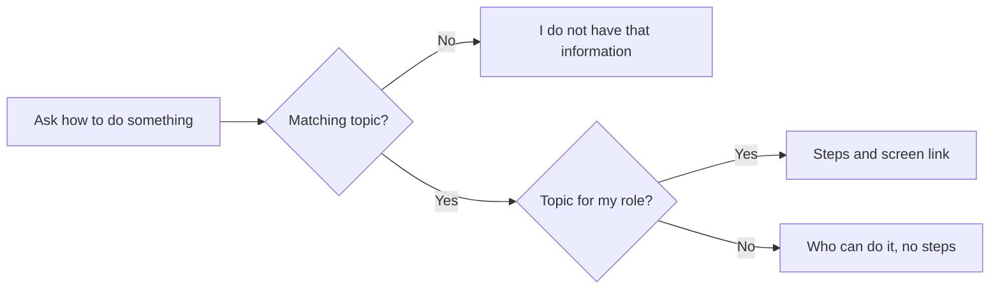

# Help Knowledge – Functional Workflow

> **Project:** TaskFlow – Intelligent Task Allocation & Tracking System
> **Parent Module:** TaskFlow Assistant (TFA)  ·  **Child Module:** 09.3 Help Knowledge
> **Version:** 1.0  ·  **Last Updated:** 31-Oct-2026
> **Author:** Jojo George (jojogeorge3344@gmail.com)
> © 2026 Jojo George. All rights reserved.

---

## 1. Overview
Help Knowledge is TFA's built-in user guide. When a user asks "how do I…?" in the TFA Panel, TFA answers only from 19 written help topics that ship with TaskFlow, and adds a link to the matching screen. Topics that the user's role cannot use only say who can do it.

## 2. Purpose / Business Value
- Gives every user instant, consistent how-to answers without training material or a colleague.
- Prevents made-up answers: TFA never invents screens or features; if no topic matches, it says it does not have that information.
- Avoids confusing users with steps they cannot perform: role-restricted topics only explain who can do it.

## 3. Who Can Access

| Role          | Can See | Can Use | Access Level (Own / Team / Organization) |
|---------------|:-------:|:-------:|------------------------------------------|
| Administrator | ✅ | ✅ | Own; all topics with full steps |
| Manager       | ✅ | ✅ | Own; Administrator-only topics show "who can do it" only |
| Employee      | ✅ | ✅ | Own; Administrator-only and Manager/Administrator topics show "who can do it" only |
| Custom Role   | Configurable | Configurable | As granted (`assistant.chat`); role-restricted topics show "who can do it" only, because topics are matched by role name |

Notes (from the topic files' `roles:` lines):
- Administrator only: Application settings, Change a user's role, Project management, Employee management, TFA settings and AI models.
- Manager and Administrator: Create a task, Reassign a task, Deadline reminder settings, Reports and employee workload.
- All roles: the remaining 10 topics.

## 4. Screens

| # | Screen Name | Menu Path | Purpose | Visible To |
|---|-------------|-----------|---------|------------|
| 1 | TFA Panel (how-to answers) | Floating **TFA** button (see `09.1-Chat.md`) | Answer "how do I…?" questions with steps and a screen link | Users holding `assistant.chat` |

---

## 5. Screen & Functionality Details

### 5.1 Screen: TFA Panel (how-to answers)
**Purpose:** Answer "how do I…?" questions from TaskFlow's built-in help topics only.
**Who can see this screen:** Holders of `assistant.chat`.
**Required permission:** `assistant.chat`

**Screen Elements**
- TFA's written answer in the conversation.
- Link buttons to the matching screen (for example **My Profile**, **Board**, **Mail**).

### 5.2 Functionalities

| # | Functionality | Purpose | Who Can See | Who Can Use | Permission Required | Scope |
|---|---------------|---------|-------------|-------------|---------------------|-------|
| 1 | Ask a how-to question | Get steps for a TaskFlow screen or task | Holders of `assistant.chat` | Holders of `assistant.chat` | `assistant.chat` | Own |
| 2 | Role-aware help | Topics the user's role cannot use show only who can do it, without steps | Holders of `assistant.chat` | Holders of `assistant.chat` | `assistant.chat` | Own |

Built-in help topics (19): What TFA can do; Application settings; Use the Board; Change your password; Change a user's role; Change a task's status; Send a mail; Create a task; Project management; Edit your profile; Employee management; Read and organise mail; Notifications; Reassign a task; Deadline reminder settings; Reports and employee workload; Comment on a task and see its history; Find tasks with the task list and filters; TFA settings and AI models.

### 5.3 Step-by-Step Workflow – Get How-To Help

1. User asks, for example, *"How do I change a task status?"*.
2. TFA searches the help topics by keywords and picks up to 3 best matches.
3. If the topic is for the user's role, TFA answers from its steps and shows a link to the screen.
4. If the topic is not for the user's role (for example "Create a task" for an Employee), TFA only says who can do it, such as *"Tasks are created by Managers and Administrators. If you need a new task, ask your manager to create and assign it to you."*
5. If nothing matches, TFA says it does not have that information. It never invents screens or features.

**Flow Diagram**

### 5.4 Business Rules & Validations
- TFA answers how-to questions only from the built-in help topics.
- A topic is matched only when it scores high enough on its keywords and title; at most 3 topics are used.
- Role-restricted topics (Administrator-only, or Manager and Administrator) are matched by the user's **role name**; other roles get the "who can do it" note only.

### 5.5 Messages Shown to the User

| Situation | Message |
|-----------|---------|
| Restricted topic (default) | {Topic} is not available to your role. |
| Restricted topic (example) | Application settings are managed by an Administrator. Please contact your system administrator. |
| No matching topic | TFA tells the user it does not have that information (worded by the AI model). |

---

## 6. Permission Summary

| Permission Key | Description | Administrator | Manager | Employee | Custom Role |
|----------------|-------------|:-------------:|:-------:|:--------:|:-----------:|
| `assistant.chat` | Ask TFA how-to questions (help needs no other key) | Granted | Granted | Granted | Configurable |

## 7. Related Modules
- **09.1 Chat** – how-to questions are asked and answered in the chat.
- **09.2 Actions and Tools** – the help search is one of TFA's tools; password help is a separate fixed tool.
- **All documented modules** – each help topic describes a screen of another module (Board, Mail, My Profile, Employee Management, Reports, Settings, TFA Settings, etc.) and links to it.

## 8. Expected Outcome
Any user holding `assistant.chat` can ask how to do something in TaskFlow and get steps taken only from the official help, with a link to the right screen, or a clear note on who can do it when their role cannot.

---
© 2026 Jojo George. All rights reserved. Unauthorized copying or distribution of this document is prohibited.
