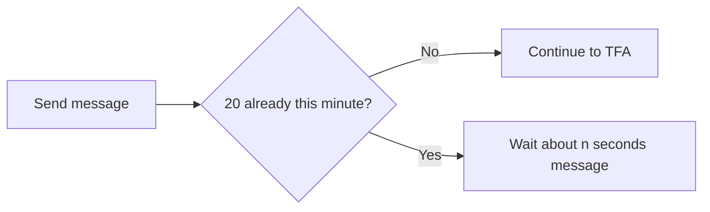

# Audit Log and Rate Limits – Functional Workflow

> **Project:** TaskFlow – Intelligent Task Allocation & Tracking System
> **Parent Module:** TaskFlow Assistant (TFA)  ·  **Child Module:** 09.4 Audit Log and Rate Limits
> **Version:** 1.0  ·  **Last Updated:** 31-Oct-2026
> **Author:** Jojo George (jojogeorge3344@gmail.com)
> © 2026 Jojo George. All rights reserved.

---

## 1. Overview
Audit Log and Rate Limits are TFA's background safeguards. The audit log records what happened to every TFA action (prepared, confirmed, cancelled, expired, refused, failed). The rate limit stops any one user from sending more than 20 messages a minute, so nobody can use up the AI provider's quota. Neither has a screen of its own.

## 2. Purpose / Business Value
- Accountability: every action TFA prepares or carries out leaves a record of who, what kind, the outcome and when.
- Privacy: the record never contains message bodies, passwords or API keys.
- Fair use and cost control: a per-user limit protects the shared AI provider quota.

## 3. Who Can Access

| Role          | Can See | Can Use | Access Level (Own / Team / Organization) |
|---------------|:-------:|:-------:|------------------------------------------|
| Administrator | ❌ (no audit screen) | – (applies automatically) | Limit: own messages; audit: stored for the organization |
| Manager       | ❌ | – (applies automatically) | Limit: own messages |
| Employee      | ❌ | – (applies automatically) | Limit: own messages |
| Custom Role   | ❌ | – (applies automatically) | Limit: own messages |

Notes:
- No permission key controls these safeguards; they apply to everyone using TFA.
- Users only see the effect of the limit: the *"You are sending messages too quickly…"* message.

## 4. Screens

| # | Screen Name | Menu Path | Purpose | Visible To |
|---|-------------|-----------|---------|------------|
| – | (no screen – background safeguards) | – | Record action outcomes; limit messages per minute | Nobody |

---

## 5. Screen & Functionality Details

### 5.1 Screen: (no screen – background safeguards)
**Purpose:** Record what happened to every TFA action and stop any one user from using up the AI provider's quota.
**Who can see this screen:** Nobody – there is no screen to view the audit log.
**Required permission:** None (always applies to everyone using TFA).

**Screen Elements**
- None. The user only sees the effect: the *"You are sending messages too quickly…"* message.

### 5.2 Functionalities

| # | Functionality | Purpose | Who Can See | Who Can Use | Permission Required | Scope |
|---|---------------|---------|-------------|-------------|---------------------|-------|
| 1 | Action audit log | Records each action outcome: prepared, confirmed, cancelled, expired, refused, failed | Nobody (stored only) | System | – | Organization |
| 2 | Per-user message limit | At most 20 messages per user in any one-minute window | All TFA users (message only) | System | – | Own |

### 5.3 Step-by-Step Workflow – Message Limit

1. User sends a message.
2. System counts the user's messages in the last minute.
3. Under 20: the message continues. At 20: the system replies *"You are sending messages too quickly. Please wait about {n} seconds and try again."*

**Flow Diagram**

### 5.4 Business Rules & Validations
- The audit log stores the user, the kind of action (Send mail, Update own profile, Change user role), the outcome and the time. It never stores message bodies, passwords or API keys.
- A refusal is logged both when TFA refuses to prepare an action and when a confirm is refused.
- The limit counts only messages that pass the length and safety checks.
- The limit is kept in memory; restarting the server resets it.

### 5.5 Messages Shown to the User

| Situation | Message |
|-----------|---------|
| Over the limit | You are sending messages too quickly. Please wait about {n} seconds and try again. |

---

## 6. Permission Summary

| Permission Key | Description | Administrator | Manager | Employee | Custom Role |
|----------------|-------------|:-------------:|:-------:|:--------:|:-----------:|
| – (none) | Audit logging and the message limit always apply | Always On | Always On | Always On | Always On |

## 7. Related Modules
- **09.1 Chat** – every send passes through the message limit.
- **09.2 Actions and Tools** – every action outcome is written to the audit log.
- **Settings (TFA Settings)** – configures the AI providers whose quota the limit protects.

## 8. Expected Outcome
Every TFA action outcome is recorded without storing any sensitive content, and no single user can flood TFA with more than 20 messages a minute.

---
© 2026 Jojo George. All rights reserved. Unauthorized copying or distribution of this document is prohibited.
