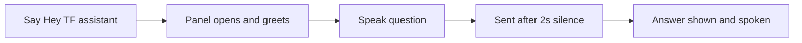

# Voice Input – Functional Workflow

> **Project:** TaskFlow – Intelligent Task Allocation & Tracking System
> **Parent Module:** TaskFlow Assistant (TFA)  ·  **Child Module:** 09.5 Voice Input
> **Version:** 1.0  ·  **Last Updated:** 31-Oct-2026
> **Author:** Jojo George (jojogeorge3344@gmail.com)
> © 2026 Jojo George. All rights reserved.

---

## 1. Overview
Voice Input (hands-free) lets users talk to TFA instead of typing. Saying *"Hey TF assistant"* opens the TFA Panel and greets the user; the spoken question is then sent like a typed message and TFA's answer is read aloud. A microphone button also lets the user dictate a single command.

## 2. Purpose / Business Value
- Hands-free access to TFA while the user is busy with other work.
- Faster input for short questions such as "what are my upcoming tasks".
- Privacy: speech is turned into text by the browser's own speech service; TaskFlow keeps no recording.

## 3. Who Can Access

| Role          | Can See | Can Use | Access Level (Own / Team / Organization) |
|---------------|:-------:|:-------:|------------------------------------------|
| Administrator | ✅ | ✅ (Chrome / Edge) | Own |
| Manager       | ✅ | ✅ (Chrome / Edge) | Own |
| Employee      | ✅ | ✅ (Chrome / Edge) | Own |
| Custom Role   | Configurable | Configurable | As granted (`assistant.chat`) |

Notes:
- Voice controls are part of the TFA Panel, so they appear only for holders of `assistant.chat`.
- Voice works only in browsers with speech recognition (Chrome, Edge). Typing always works.

## 4. Screens

| # | Screen Name | Menu Path | Purpose | Visible To |
|---|-------------|-----------|---------|------------|
| 1 | TFA Panel (voice controls) | Floating **TFA** button, or say "Hey TF assistant" | Talk to TFA and hear answers | Users holding `assistant.chat`, in Chrome or Edge |

---

## 5. Screen & Functionality Details

### 5.1 Screen: TFA Panel (voice controls)
**Purpose:** Talk to TFA instead of typing, and hear the answer read aloud.
**Who can see this screen:** Holders of `assistant.chat`, in browsers with speech recognition (Chrome or Edge).
**Required permission:** `assistant.chat`

**Screen Elements**
- Microphone button in the message box (*"Speak a command (Chrome or Edge)"*).
- Listening bar: *Waiting for "Hey TF assistant"*, *Listening… say your command*, *Hands-free is off*, *Voice is paused*, with **Turn on "Hey TF assistant"** / **Turn on hands-free** / **Turn off**.
- Heard text under the TFA button: *Heard: "…"*.
- Voice hint under the floating **TFA** button: *say "Hey TF assistant"*, *Listening… say your command* or *voice is off*.

### 5.2 Functionalities

| # | Functionality | Purpose | Who Can See | Who Can Use | Permission Required | Scope |
|---|---------------|---------|-------------|-------------|---------------------|-------|
| 1 | Wake phrase | Saying "Hey TF assistant" opens TFA and greets the user by first name | Holders of `assistant.chat` | Holders of `assistant.chat` (Chrome/Edge) | `assistant.chat` | Own |
| 2 | Dictate a command | Mic button listens once and fills the message box | Holders of `assistant.chat` | Holders of `assistant.chat` (Chrome/Edge) | `assistant.chat` | Own |
| 3 | Read answer aloud | Answers to spoken questions are also spoken (up to 500 characters) | Holders of `assistant.chat` | Holders of `assistant.chat` | `assistant.chat` | Own |
| 4 | Turn hands-free on/off | Stop or start listening for the wake phrase | Holders of `assistant.chat` | Holders of `assistant.chat` | `assistant.chat` | Own (remembered in the browser) |

### 5.3 Step-by-Step Workflow – Ask by Voice

1. User says *"Hey TF assistant"*.
2. System opens the panel and says *"Hi {first name}, how can I help you?"*.
3. User speaks a question; the words appear in the message box while speaking.
4. After about 2 seconds of silence, the question is sent like a typed message (the Chat rules in `09.1-Chat.md` apply).
5. TFA's answer is shown and read aloud. The microphone rests while TFA speaks.

**Flow Diagram**

### 5.4 Business Rules & Validations
- Voice works only in browsers with speech recognition (Chrome, Edge). Typing always works.
- Speech is turned into text by the browser's own speech service; TaskFlow keeps no recording.
- Only answers to spoken questions are read aloud; typed questions get text only.
- A deliberate "Turn off" is remembered; an error never turns voice off permanently.

### 5.5 Messages Shown to the User

| Situation | Message |
|-----------|---------|
| Browser without voice | Voice input is not supported in this browser. Try Chrome or Edge, or type your question. |
| Microphone blocked | Microphone access was denied. Allow it in your browser to use voice, or type your question. |
| No microphone | No microphone was found. You can type your question instead. |
| No internet for voice | Voice needs an internet connection in this browser. You can type your question instead. |
| Browser blocked auto start | Click anywhere on the page to turn "Hey TF assistant" back on. |
| Greeting | Hi {first name}, how can I help you? |

---

## 6. Permission Summary

| Permission Key | Description | Administrator | Manager | Employee | Custom Role |
|----------------|-------------|:-------------:|:-------:|:--------:|:-----------:|
| `assistant.chat` | Use the TFA Panel, including its voice controls | Granted | Granted | Granted | Configurable |

## 7. Related Modules
- **09.1 Chat** – spoken questions are sent and answered exactly like typed messages.
- **Legal** – the Privacy and Terms pages describe how voice input is handled.

## 8. Expected Outcome
Users in Chrome or Edge can open TFA by saying "Hey TF assistant", ask their question aloud and hear the answer, with no recording kept by TaskFlow and with typing always available as a fallback.

---
© 2026 Jojo George. All rights reserved. Unauthorized copying or distribution of this document is prohibited.
