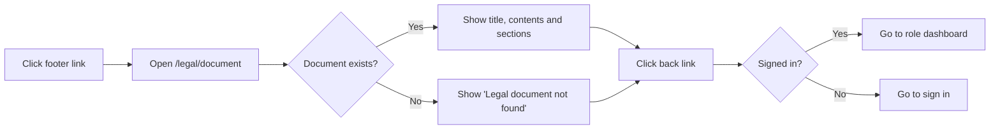

# Legal Documents – Functional Workflow

> **Project:** TaskFlow – Intelligent Task Allocation & Tracking System
> **Parent Module:** Legal  ·  **Child Module:** 10.1 Legal Documents
> **Version:** 1.0  ·  **Last Updated:** 31-Oct-2026
> **Author:** Jojo George (jojogeorge3344@gmail.com)
> © 2026 Jojo George. All rights reserved.

---

## 1. Overview
Legal Documents shows TaskFlow's five legal documents: Copyright Notice, Terms of Use, Privacy Policy, Disclaimer and Third-Party Licence Notices. Each document opens on its own public page with a table of contents and a back link. The pages are read-only.

## 2. Purpose / Business Value
- States who owns TaskFlow and what users may and may not do with it (Copyright Notice, Terms of Use).
- Tells users what data TaskFlow keeps, where it is stored, and when assistant questions are sent to an outside AI provider (Privacy Policy, Terms of Use).
- Makes clear that assistant output and allocation suggestions are advisory only (Disclaimer).
- Credits the open-source components TaskFlow is built on and states their licences (Third-Party Licence Notices).

## 3. Who Can Access

| Role          | Can See | Can Use | Access Level (Own / Team / Organization) |
|---------------|:-------:|:-------:|------------------------------------------|
| Administrator | ✅ | ✅ | Organization (public content, same for everyone) |
| Manager       | ✅ | ✅ | Organization (public content, same for everyone) |
| Employee      | ✅ | ✅ | Organization (public content, same for everyone) |
| Custom Role   | ✅ | ✅ | Organization (public content, same for everyone) |
| Not signed in | ✅ | ✅ | Organization (public content, same for everyone) |

No permission and no sign-in is needed. Only the back-link target depends on who is signed in.

## 4. Screens

| # | Screen Name | Menu Path | Purpose | Visible To |
|---|-------------|-----------|---------|------------|
| 1 | Copyright Notice | Footer → **Copyright** (`/legal/copyright`) | Ownership, what is protected, what you may and may not do, how to ask for permission | Everyone, signed in or not |
| 2 | Terms of Use | Footer → **Terms of Use** (`/legal/terms`) | The conditions for using TaskFlow, including accounts, acceptable use, AI providers, speech input and governing law (India) | Everyone, signed in or not |
| 3 | Privacy Policy | Footer → **Privacy Policy** (`/legal/privacy`) | What data is collected and why, where it is stored, who can see what, security measures, retention and user rights | Everyone, signed in or not |
| 4 | Disclaimer | Footer → **Disclaimer** (`/legal/disclaimer`) | "As is" terms, limits on assistant output and suggestions, availability, limitation of liability | Everyone, signed in or not |
| 5 | Third-Party Licence Notices | Footer → **Licences** (`/legal/licenses`) | TaskFlow's own licence and a table of third-party components with their licences | Everyone, signed in or not |

All five screens use the same page layout. There is no side-menu entry. The pages are reached from the legal footer (see `10.2-Legal-Footer-and-Ownership-Notice.md`) or by typing the address.

---

## 5. Screen & Functionality Details

### 5.1 Screen: Legal Document Page (Copyright / Terms / Privacy / Disclaimer / Licences)
**Purpose:** Show one legal document in a readable layout with a table of contents.
**Who can see this screen:** Everyone, including visitors who are not signed in.
**Required permission:** None (no permission key).

**Screen Elements**
- Top bar: the "TF" mark, the name "TaskFlow — Intelligent Task Allocation & Tracking System", and a back link.
- Back link: **Back to the application** (if signed in, it goes to the user's dashboard) or **Back to sign in** (if not signed in).
- Document heading: title, a one-line summary, and "Last updated: 21 October 2026 · © 2026 Jojo George. All Rights Reserved."
- **Contents** box: a numbered list of the section headings. Clicking one jumps to that section.
- Document body: sections made of paragraphs, bullet lists, highlighted notes and tables. The Privacy Policy has a "What we collect" table and the Licences page has a "Third-party components" table.
- Page foot: the ownership line again.

Section count per document: Copyright Notice 8, Terms of Use 14, Privacy Policy 11, Disclaimer 7, Third-Party Licence Notices 3.

### 5.2 Functionalities

| # | Functionality | Purpose | Who Can See | Who Can Use | Permission Required | Scope |
|---|---------------|---------|-------------|-------------|---------------------|-------|
| 1 | Read a legal document | Show the full text of one of the five documents | Everyone (signed in or not) | Everyone | None | Org (same content for all) |
| 2 | Jump to a section | Use the **Contents** list to go to a section on the same page | Everyone | Everyone | None | Org |
| 3 | Go back | Return to the dashboard (signed in) or to the sign-in screen (not signed in) | Everyone | Everyone | None | Own (target depends on the user's role) |
| 4 | Document not found | Show a friendly message if no document matches the page | Everyone | Everyone | None | Org |

### 5.3 Step-by-Step Workflow – Read a Legal Document
1. The user clicks a link in the footer, for example **Privacy Policy**.
2. The system opens the matching page (`/legal/privacy`) without checking sign-in.
3. The system fills in the owner name, year, rights statement, contact email and application name in the document text.
4. The page shows the title, summary, last-updated date, the **Contents** list and all sections.
5. The user clicks a heading in **Contents** to jump to that section.
6. The user clicks the back link. A signed-in Administrator goes to `/admin`, a Manager to `/manager`, and everyone else (Employee and custom roles) to `/me`. A visitor who is not signed in goes to `/login`.
7. Nothing is saved. No notification, email or activity log entry is created.

**Flow Diagram**

### 5.4 Business Rules & Validations
- Only five documents exist: `copyright`, `terms`, `privacy`, `disclaimer`, `licenses`. Any other `/legal/...` address is sent to the sign-in screen by the application's catch-all route.
- The legal pages are public. They sit outside the signed-in area, so no sign-in and no permission is needed.
- The owner name (Jojo George), year (2026), contact email (jojogeorge3344@gmail.com), rights statement ("All Rights Reserved") and application name are kept in one place and inserted into every document when it is shown.
- The back link goes by the system role only: Administrator → `/admin`, Manager → `/manager`, any other role → `/me`.
- The content is fixed in the application. It cannot be edited from Settings. "Last updated" is set to 21 October 2026 for all five documents.
- Key points stated in the documents (taken from the document text):
  - Terms of Use: governed by the laws of India. Accounts belong to named people and cannot be transferred.
  - Privacy Policy: data is kept on the server machine (SQLite database, mail attachments, encrypted AI key ring). By default this is `C:\TaskFlow` on Windows. Passwords are stored as a salted PBKDF2 hash, and AI provider keys are encrypted.
  - Privacy and Terms: when a cloud AI model is chosen, the question and the task details behind it are sent to that provider. A notice is shown the first time a cloud model is used.
  - Disclaimer: assistant output and allocation suggestions are advisory only and must be checked before you act on them.

### 5.5 Messages Shown to the User

| Situation | Message |
|-----------|---------|
| Success | _Not applicable for this module._ (read-only page, no save action) |
| Validation error | _Not applicable for this module._ |
| Document not found | "Legal document not found" / "The document you requested is not available." / "Choose one of the documents from the footer, or back to sign in." (or "back to the application" when signed in) |
| Back link (signed in) | "Back to the application" |
| Back link (not signed in) | "Back to sign in" |
| No permission | _Not applicable for this module._ (no permission is needed) |

---

## 6. Permission Summary

| Permission Key | Description | Administrator | Manager | Employee | Custom Role |
|----------------|-------------|:-------------:|:-------:|:--------:|:-----------:|
| _(none)_ | The legal document pages are public, so no permission key exists | Always On | Always On | Always On | Always On |

## 7. Related Modules
- **10.2 Legal Footer and Ownership Notice** – the footer links open these pages, and both use the same owner record.
- **Dashboard** – the back link on a legal page returns a signed-in user to their dashboard (`/admin`, `/manager` or `/me`).
- **Authentication** – a visitor who is not signed in is sent back to the Sign in screen.
- **TaskFlow Assistant (TFA)** and **Settings (TFA Settings)** – the Terms and Privacy documents describe how assistant questions go to cloud or local AI models and that provider keys are encrypted.
- **Communication (Mail)** – the Privacy Policy states that each user sees only their own mail.

## 8. Expected Outcome
Anyone, signed in or not, can open and read the Copyright Notice, Terms of Use, Privacy Policy, Disclaimer and Licence Notices, jump between sections, and return to the right place with the back link. Every document shows the same owner name, year and contact email.

---
© 2026 Jojo George. All rights reserved. Unauthorized copying or distribution of this document is prohibited.
