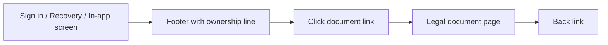

# Legal Footer and Ownership Notice – Functional Workflow

> **Project:** TaskFlow – Intelligent Task Allocation & Tracking System
> **Parent Module:** Legal  ·  **Child Module:** 10.2 Legal Footer and Ownership Notice
> **Version:** 1.0  ·  **Last Updated:** 31-Oct-2026
> **Author:** Jojo George (jojogeorge3344@gmail.com)
> © 2026 Jojo George. All rights reserved.

---

## 1. Overview
The Legal Footer and Ownership Notice shows the copyright line and links to the five legal documents at the bottom of the Sign in screen, the Account Recovery screen and every screen inside the application. It also sets the browser tab title and page details (author, copyright, description) when the application starts.

## 2. Purpose / Business Value
- Shows the ownership statement "© 2026 Jojo George. All Rights Reserved." on every main screen.
- Gives everyone, including visitors who are not signed in, one-click access to the legal documents.
- Uses the same owner record as the documents, so the copyright statement is the same everywhere, including the browser page details.

## 3. Who Can Access

| Role          | Can See | Can Use | Access Level (Own / Team / Organization) |
|---------------|:-------:|:-------:|------------------------------------------|
| Administrator | ✅ | ✅ | Organization (same footer for everyone) |
| Manager       | ✅ | ✅ | Organization (same footer for everyone) |
| Employee      | ✅ | ✅ | Organization (same footer for everyone) |
| Custom Role   | ✅ | ✅ | Organization (same footer for everyone) |
| Not signed in | ✅ | ✅ | Organization (shown on Sign in and Account Recovery) |

## 4. Screens

| # | Screen Name | Menu Path | Purpose | Visible To |
|---|-------------|-----------|---------|------------|
| 1 | Legal footer (part of other screens) | Bottom of Sign in, Account Recovery and all in-app screens | Ownership line plus links to the five documents | Everyone |

The footer has no menu entry of its own. It is part of the Sign in screen, the Account Recovery screen and the application shell.

---

## 5. Screen & Functionality Details

### 5.1 Screen: Legal Footer (shared, part of other screens)
**Purpose:** Show the ownership line and links to the legal documents at the bottom of the main screens.
**Who can see this screen:** Everyone. It appears on the Sign in screen and the Account Recovery screen (dark style) and below every in-app screen (light "surface" style).
**Required permission:** None (no permission key).

**Screen Elements**
- Ownership line: "© 2026 Jojo George. All Rights Reserved. · TaskFlow — Intelligent Task Allocation & Tracking System."
- Links: **Copyright**, **Terms of Use**, **Privacy Policy**, **Disclaimer**, **Licences**.
- Browser tab and page details (set once when the app starts): page title "TaskFlow — Intelligent Task Allocation & Tracking System", author "Jojo George", copyright "© 2026 Jojo George. All Rights Reserved." and a one-line description.

### 5.2 Functionalities

| # | Functionality | Purpose | Who Can See | Who Can Use | Permission Required | Scope |
|---|---------------|---------|-------------|-------------|---------------------|-------|
| 1 | Show ownership line | Show the copyright on every main screen | Everyone | Everyone | None | Org |
| 2 | Open a legal document | Link to any of the five documents | Everyone | Everyone | None | Org |
| 3 | Set browser page details | Set the browser title and the author, copyright and description details | Everyone (browser tab) | Automatic | None | Org |

### 5.3 Step-by-Step Workflow – Open a Document from the Footer
1. The user is on the Sign in screen, the Account Recovery screen or any in-app screen.
2. The user scrolls to the footer and clicks a link, for example **Licences**.
3. The system opens `/legal/licenses` in the same tab.
4. The user reads the document and uses the back link to return.

**Flow Diagram**

### 5.4 Business Rules & Validations
- The footer always shows the same five links, in the same order as the documents: Copyright, Terms of Use, Privacy Policy, Disclaimer, Licences.
- The footer and the legal pages use the same ownership values, so the copyright statement is the same everywhere.
- The footer is not shown on the legal pages. Those pages have their own ownership line at the bottom.

### 5.5 Messages Shown to the User

| Situation | Message |
|-----------|---------|
| Ownership line | "© 2026 Jojo George. All Rights Reserved. · TaskFlow — Intelligent Task Allocation & Tracking System." |
| Success / Validation error / No permission | _Not applicable for this module._ |

---

## 6. Permission Summary

| Permission Key | Description | Administrator | Manager | Employee | Custom Role |
|----------------|-------------|:-------------:|:-------:|:--------:|:-----------:|
| _(none)_ | The legal footer is public, so no permission key exists | Always On | Always On | Always On | Always On |

## 7. Related Modules
- **10.1 Legal Documents** – each footer link opens one of the five document pages.
- **Authentication** – the Sign in and Account Recovery screens show the legal footer (dark style), so visitors can read the documents before they sign in.
- **All in-app modules** – the application shell shows the legal footer below every signed-in screen.

## 8. Expected Outcome
The ownership statement "© 2026 Jojo George. All Rights Reserved." and the five document links appear the same way at the bottom of the Sign in, Account Recovery and in-app screens, and the browser tab shows the TaskFlow title and owner details.

---
© 2026 Jojo George. All rights reserved. Unauthorized copying or distribution of this document is prohibited.
