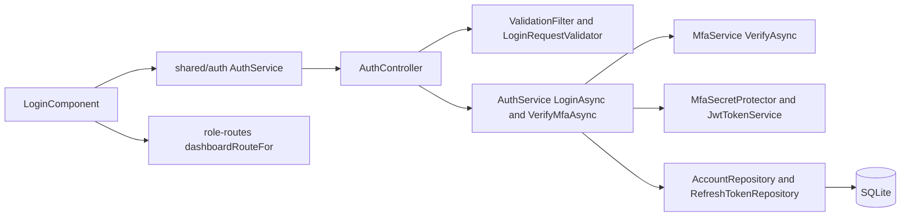
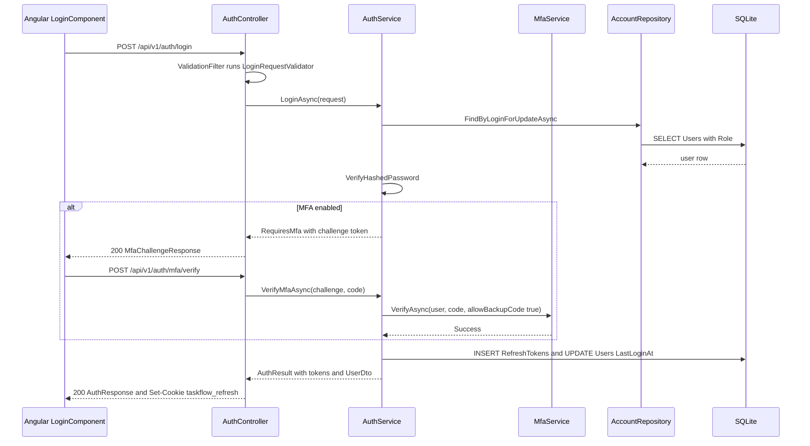

# Login – Technical Documentation

> **Project:** TaskFlow – Intelligent Task Allocation & Tracking System
> **Parent Module:** Authentication  ·  **Child Module:** 01.1 Login
> **Version:** 1.0  ·  **Last Updated:** 31-Oct-2026
> **Backend:** ASP.NET Core Web API (.NET 10)  ·  **Frontend:** Angular  ·  **Database:** SQLite (EF Core)
> **Author:** Jojo George (jojogeorge3344@gmail.com)
> © 2026 Jojo George. All rights reserved.

---

## 1. Technical Overview
Login is the password sign-in and the second MFA step at sign-in. `AuthController` → `AuthService.LoginAsync` checks the password with ASP.NET Core Identity's `PasswordHasher<User>` (PBKDF2). When MFA is off it issues a JWT access token (body) and a refresh token (HttpOnly cookie `taskflow_refresh`, see 01.4 Sessions and Tokens). When MFA is on it returns a Data-Protection-signed **challenge token** bound to the user id and security stamp instead; `POST /auth/mfa/verify` exchanges the challenge and a TOTP or backup code for the session through `IMfaService.VerifyAsync`. `GET /auth/me` returns the current user, role, effective permissions and `mfaSetupRequired`. On the client, `LoginComponent` drives both steps and `dashboardRouteFor(role, permissions)` picks the landing page.

## 2. Architecture Flow


## 3. Backend File Structure
All paths are under `TaskFlow Proj/backend/src/TaskFlow.Api/`.

| Layer | Path | Files |
|-------|------|-------|
| Controller | `Controllers/Auth/` | `AuthController.cs` (actions `Login`, `VerifyMfa`, `Me`; `Refresh`/`Logout` are in 01.4) |
| Service | `Services/Auth/Login/` | `IAuthService.cs`, `AuthService.cs` (`LoginAsync`, `VerifyMfaAsync`, `GetCurrentAsync`, `IssueTokens`, `ToDtoAsync`) |
| Service (used) | `Services/Auth/Mfa/` | `IMfaService.cs`, `MfaService.cs` (`VerifyAsync`, see 01.3) |
| Repository | `Repositories/Auth/Accounts/` | `IAccountRepository.cs`, `AccountRepository.cs` |
| Repository (used) | `Repositories/Auth/RefreshTokens/` | `IRefreshTokenRepository.cs`, `RefreshTokenRepository.cs` (`Add`) |
| DTOs | `Dtos/Auth/` | `LoginRequest.cs`, `AuthResponse.cs` (`AuthResponse`, `AuthenticatedUserResponse`), `AuthResult.cs` (`AuthResult`, `MfaSignInResult`), `AuthTokens.cs`, `UserDto.cs` |
| DTOs | `Dtos/Auth/Mfa/` | `MfaRequests.cs` (`MfaVerifyRequest`, `MfaChallengeResponse`), `MfaResults.cs` (`MfaVerifyOutcome`: Success, Invalid, LockedOut) |
| Validators | `Dtos/Auth/Validators/` | `LoginRequestValidator.cs` |
| Validators | `Dtos/Auth/Mfa/Validators/` | `MfaRequestValidators.cs` (`MfaVerifyRequestValidator`) |
| Integrations | `Integrations/Security/MfaSecrets/` | `IMfaSecretProtector.cs`, `MfaSecretProtector.cs` (`CreateChallenge`, `ReadChallenge`) |
| Integrations | `Integrations/Security/Tokens/` | `ITokenService.cs`, `JwtTokenService.cs` (`CreateAccessToken`, see 01.4) |
| Entities | `Models/Entities/` | `User.cs`, `Role.cs`, `RefreshToken.cs` |
| Common / Security | `Common/Security/` | `RefreshTokenCookie.cs` (`CreateOptions`), `EffectivePermissions.cs` (`Expand`) |
| Config | `Config/` | `MfaOptions.cs` (`ChallengeMinutes`, `Required`) |

## 4. Frontend File Structure
All paths are under `TaskFlow Proj/frontend/src/app/`.

| Type | Path | Purpose |
|------|------|---------|
| Routes | `modules/auth/auth.routes.ts` | `login` route (outside the shell) |
| Page component | `modules/auth/login/pages/login.component.ts` / `.html` | Password step and MFA code step (`challenge` signal) |
| Child component | `modules/auth/login/components/login-background.component.ts` / `.html` | Decorative background |
| Utility | `modules/auth/login/utils/remembered-identifier.ts` | `localStorage` key `taskflow.lastIdentifier` |
| API service | `shared/auth/auth.service.ts` | `login`, `verifyMfa` |
| Models | `shared/auth/auth.models.ts` | `AuthUser`, `LoginRequest`, `AuthResponse`, `MfaChallenge`, `isMfaChallenge()` |
| Routing helper | `shared/auth/role-routes.ts` | `dashboardRouteFor(role, permissions)` |
| Messages | `shared/auth/login-reasons.ts` | `reason` query values and login notices |

> ⚠️ To be confirmed: `login.component.ts` references `styleUrl: './login.component.css'`, but the CSS file is not present in the snapshot.

---

## 5. API & Logic

### 5.1 API Endpoints

| # | Method | Endpoint | Description | Permission (Policy) | Request DTO | Response DTO |
|---|--------|----------|-------------|---------------------|-------------|--------------|
| 1 | POST | `/api/v1/auth/login` | Password sign-in. Returns a session, or an MFA challenge when MFA is on | `[AllowAnonymous]` | `LoginRequest` | `AuthResponse` + `Set-Cookie: taskflow_refresh` / `MfaChallengeResponse` / `401` |
| 2 | POST | `/api/v1/auth/mfa/verify` | Second sign-in step with the challenge and an authenticator or backup code | `[AllowAnonymous]` | `MfaVerifyRequest` | `AuthResponse` + cookie / `400` / `429` (ProblemDetails) |
| 3 | GET | `/api/v1/auth/me` | Current user, role, effective permissions, `mfaSetupRequired` | `[Authorize]` | – | `AuthenticatedUserResponse` |

### 5.2 Request / Response Samples
```json
// POST /api/v1/auth/login
{ "emailOrUsername": "jane.doe@taskflow.com", "password": "S3cret!" }
```
```json
// 200 OK – MFA is on (no cookie, no session yet)
{ "mfaRequired": true, "challengeToken": "CfDJ8...protected..." }
```
```json
// 200 OK – session issued (also Set-Cookie: taskflow_refresh=...; HttpOnly; Secure; SameSite=Strict; Path=/api/v1/auth)
{
  "accessToken": "eyJhbGciOiJIUzI1NiIs...",
  "expiresAt": "2026-10-31T10:30:00Z",
  "user": {
    "id": 7, "fullName": "Jane Doe", "username": "jane", "email": "jane.doe@taskflow.com",
    "role": "Employee", "employeeCode": "EMP007",
    "permissions": ["dashboard.analytics.view", "tasks.status.change"],
    "mfaSetupRequired": false
  }
}
```
```json
// POST /api/v1/auth/mfa/verify
{ "challengeToken": "CfDJ8...protected...", "code": "123456" }
```
```json
// 400 Bad Request (ProblemDetails)
{ "status": 400, "detail": "The code is incorrect, or the sign-in has expired. Try again or sign in again." }
```

### 5.3 Service Layer Logic
**Method:** `AuthService.LoginAsync(LoginRequest request, CancellationToken)`
1. `IAccountRepository.FindByLoginForUpdateAsync(request.EmailOrUsername.Trim())` – matches `Username == identifier || Email == identifier`, includes `Role`; deleted users are excluded by the global query filter.
2. Returns `AuthResult.Failure()` (→ `401`) if the user is null or `!IsActive`.
3. `IPasswordHasher<User>.VerifyHashedPassword`; `Failed` → failure. `SuccessRehashNeeded` → re-hashes and stores the new hash.
4. If `MfaEnabledAt` is set: saves a rehash if needed and returns `AuthResult.RequiresMfa(IMfaSecretProtector.CreateChallenge(user.Id, user.SecurityStamp, Mfa:ChallengeMinutes))`. No token and no `LastLoginAt` update.
5. Otherwise sets `LastLoginAt` and `UpdatedAt`, calls `IssueTokens` (creates the JWT via `ITokenService.CreateAccessToken`, creates a refresh token, adds a `RefreshToken` row with its SHA-256 hash), `SaveChangesAsync`.
6. Maps to `UserDto` via `ToDtoAsync`: permissions = `EffectivePermissions.Expand(GetPermissionKeysAsync(roleId))` ordered ordinally; `MfaSetupRequired = Mfa:Required && MfaEnabledAt == null`.
7. Controller writes the refresh cookie (`RefreshTokenCookie.CreateOptions(expiresAt)`) and returns `AuthResponse`.

**Method:** `AuthService.VerifyMfaAsync(string? challengeToken, string? code, CancellationToken)`
1. `IMfaSecretProtector.ReadChallenge` – null when forged, tampered, malformed or expired → `Invalid`.
2. `FindWithRoleForUpdateAsync(userId)`; invalid if null, inactive, MFA off, or `SecurityStamp` differs from the stamp inside the challenge.
3. `IMfaService.VerifyAsync(user, code, allowBackupCode: true)` – returns `Success`, `Invalid` or `LockedOut` (core logic in 01.3 MFA Security Setup, `VerifyCoreAsync`).
4. On success: `LastLoginAt`/`UpdatedAt`, `IssueTokens`, save; returns `MfaSignInResult(Success)`.
5. Controller: `Success` → cookie + `AuthResponse`; `LockedOut` → `429` with `MfaService.LockedMessage`; anything else → `400`.

**Method:** `AuthService.GetCurrentAsync(int userId)` – loads the user with role and maps with `ToDtoAsync`; the controller returns `401` when the subject claim is not an int or the user is not found.

**Frontend:** after a successful sign-in `LoginComponent` navigates to the `returnUrl` (only when it is a path inside TaskFlow) or to `dashboardRouteFor(role, permissions)`; when `mfaSetupRequired` is true the shell guard sends the user to `/security-setup`.

### 5.4 Repository Layer

| Method | Description | Query Notes |
|--------|-------------|-------------|
| `AccountRepository.FindByLoginForUpdateAsync(identifier)` | User by username or email, with role | Tracked; `Include(Role)`; exact string comparison; soft-deleted excluded by `HasQueryFilter(!IsDeleted)` |
| `AccountRepository.FindWithRoleForUpdateAsync(userId)` | User by id, with role | Tracked |
| `AccountRepository.GetPermissionKeysAsync(roleId)` | Stored permission keys of the role | `AsNoTracking`, `RolePermissions` → `Permission.Key` (not expanded) |
| `RefreshTokenRepository.Add(RefreshToken)` | New refresh-token row | From `BaseRepository` |

### 5.5 Sequence Diagram


---

## 6. Database Design
Full `Users` column list and relationships: parent document section 6. Columns this child reads or writes:

| Table | Column | Type | Constraints | Description |
|-------|--------|------|-------------|-------------|
| `Users` | `Id` | INTEGER | PK, autoincrement | User id (JWT subject, challenge user id) |
| `Users` | `Username` | TEXT(100) | Not Null, Unique (`IX_Users_Username`) | Sign-in name (matched exactly) |
| `Users` | `Email` | TEXT(256) | Not Null, Unique (`IX_Users_Email`) | Sign-in email (stored lower-case, matched exactly) |
| `Users` | `PasswordHash` | TEXT | Not Null | Verified; re-hashed when `SuccessRehashNeeded` |
| `Users` | `SecurityStamp` | TEXT(64) | Not Null | Copied into the challenge and the JWT `sstamp` claim |
| `Users` | `MfaEnabledAt` | TEXT (DateTime) | Nullable | Decides whether a challenge is returned |
| `Users` | `MfaLastUsedStep`, `MfaFailedAttempts`, `MfaLockedUntil` | INTEGER / INTEGER / TEXT | Concurrency tokens (first two) | Updated by `MfaService.VerifyAsync` at the code step |
| `Users` | `IsActive`, `IsDeleted` | INTEGER (bool) | Not Null; global query filter `!IsDeleted` | Inactive or deleted users cannot sign in |
| `Users` | `LastLoginAt`, `UpdatedAt` | TEXT (DateTime) | Nullable / Not Null | Set on successful sign-in |
| `Users` | `FullName`, `EmployeeCode`, `RoleId` | TEXT(200) / TEXT(32) / INTEGER | `RoleId` FK → `Roles.Id` | Mapped into `UserDto` |
| `RefreshTokens` | all columns | – | See 01.4 | One row inserted per successful sign-in |
| `MfaBackupCodes` | `UsedAt` | TEXT (DateTime) | Concurrency token | Set when a backup code is accepted at `/auth/mfa/verify` (see 01.3) |
| `RolePermissions`, `Permissions` | `RoleId`, `Key` | – | Settings module | Read to build the permission list |

## 7. Security & Authorization
- Both sign-in endpoints are `[AllowAnonymous]`; `GET /auth/me` needs a valid bearer token (`[Authorize]`).
- **Anti-enumeration:** login returns a bare `401` for any failure (unknown account, inactive, deleted, wrong password).
- **Challenge:** protected with Data Protection purpose `TaskFlow.MfaChallenge`, 5-minute lifetime (`Mfa:ChallengeMinutes`), bound to the user id and security stamp, so a password change or reset invalidates it.
- **Codes:** TOTP SHA1 / 6 digits / 30 s, ±1 step, single use per step; an unused backup code is also accepted here; lockout after 5 wrong codes for 5 minutes (shared counter, see 01.3).
- **Frontend:** the `returnUrl` is used only when it is an internal path.

| Permission Key | Endpoint(s) | UI Element Controlled |
|----------------|-------------|-----------------------|
| (none – `[AllowAnonymous]`) | `POST /api/v1/auth/login`, `POST /api/v1/auth/mfa/verify` | Login screen (password step and code step) |
| (none – `[Authorize]`) | `GET /api/v1/auth/me` | Current user, role and permission sync (also the session check, 01.4) |

## 8. Validations & Error Handling

| Rule | Layer | HTTP Code | Error Message |
|------|-------|-----------|---------------|
| `EmailOrUsername` required, max 256; `Password` required, max 128 | `LoginRequestValidator` | 400 | FluentValidation default messages (validation ProblemDetails `errors` map) |
| Wrong credentials, inactive or deleted account | `AuthService` / `AuthController` | 401 | (empty body); UI shows "Invalid email or password." |
| `ChallengeToken` required, max 2048; `Code` required, max 32 | `MfaVerifyRequestValidator` | 400 | FluentValidation defaults |
| Wrong code or expired challenge | `AuthController.VerifyMfa` | 400 | The code is incorrect, or the sign-in has expired. Try again or sign in again. |
| MFA locked | `AuthController.VerifyMfa` | 429 | Too many wrong codes. Try again in a few minutes. |
| Subject claim not an int or user not found | `AuthController.Me` | 401 | (empty body) |

## 9. Integrations / Side Effects
- **Session:** a successful sign-in inserts a `RefreshTokens` row and sets the `taskflow_refresh` cookie (lifecycle in 01.4).
- **Audit fields:** `Users.LastLoginAt` and `UpdatedAt` are set; an outdated password hash is upgraded.
- **Notifications / Email / Activity Log / AI Assistant:** none for this child.

## 10. Configuration

| Key (`appsettings.json`) | Purpose | Default |
|--------------------------|---------|---------|
| `Mfa:ChallengeMinutes` | Sign-in challenge lifetime (code default) | `5` |

Token lifetimes and signing (`Jwt:*`) are in 01.4 Sessions and Tokens; `Mfa:Required`, `Mfa:MaxFailedAttempts` and `Mfa:LockoutMinutes` are in the parent document.

## 11. Testing
Paths are relative to `backend/tests`.

| Test Type | File / Location | Covers |
|-----------|-----------------|--------|
| Unit | `TaskFlow.UnitTests/Auth/Login/AuthServiceLoginTests.cs` | `AuthService.LoginAsync` |
| Unit | `TaskFlow.UnitTests/Auth/Mfa/AuthServiceMfaTests.cs` | `VerifyMfaAsync` / challenge |
| Integration | `TaskFlow.IntegrationTests/Auth/Mfa/MfaSignInEndpointsTests.cs` | Two-step sign-in |

Shared: `AuthServiceHarness.cs` and `AuthEndpointsTests.cs` (login, refresh, logout, me endpoints) are listed in the parent document. No frontend spec files were found under `modules/auth/login`.

## 12. Known Limitations / Gaps found
- Password sign-in (`POST /auth/login`) has no attempt limit or lockout; only MFA codes, recovery and password re-entry are throttled.
- **BRD vs UI – username sign-in:** BRD Screen 1 requires "email address or username" and the API accepts both, but `login.component.ts` applies `Validators.email` and labels the field "Email", so a plain username cannot be submitted from the screen.
- **Backup codes at sign-in:** the API accepts an unused backup code at `/auth/mfa/verify`, but the login code input has `maxlength="6"`, so the 11-character `XXXXX-XXXXX` codes cannot be typed there.
- **Hard-coded role routing:** `role-routes.ts` sends Administrator/Manager by role name ahead of permissions (also in permission-gaps.md section E).
- **Case-sensitive identifier:** `FindByLoginForUpdateAsync` compares `Email`/`Username` with `==` without lower-casing the input, while emails are stored lower-case and the columns have no NOCASE collation. > ⚠️ To be confirmed: whether signing in with a mixed-case email fails at runtime on SQLite.
- **Missing style file:** `login.component.css` is referenced but absent from the snapshot.

---
<sub>© 2026 Jojo George. All rights reserved. Unauthorized copying or distribution of this document is prohibited.</sub>
