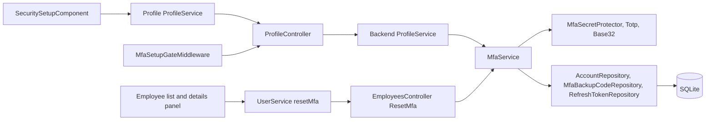
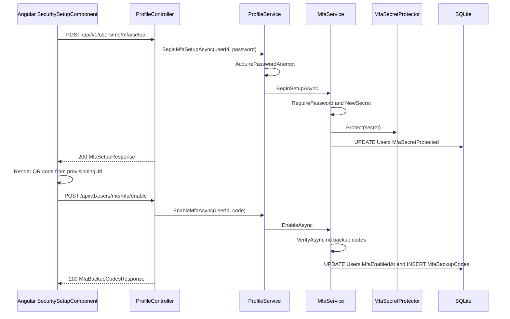
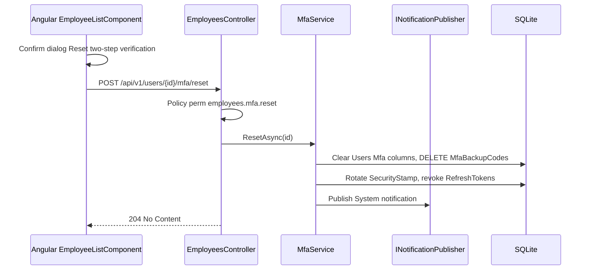

# MFA Security Setup – Technical Documentation

> **Project:** TaskFlow – Intelligent Task Allocation & Tracking System
> **Parent Module:** Authentication  ·  **Child Module:** 01.3 MFA Security Setup
> **Version:** 1.0  ·  **Last Updated:** 31-Oct-2026
> **Backend:** ASP.NET Core Web API (.NET 10)  ·  **Frontend:** Angular  ·  **Database:** SQLite (EF Core)
> **Author:** Jojo George (jojogeorge3344@gmail.com)
> © 2026 Jojo George. All rights reserved.

---

## 1. Technical Overview
This child implements authenticator-app MFA (TOTP, RFC 6238) in-house (`Integrations/Security/OneTimeCodes/Totp.cs`, `Base32.cs`) and makes enrolment mandatory. Self-service endpoints live on `ProfileController` under `/api/v1/users/me/mfa/*` and call `ProfileService` → `MfaService`; the shared key is encrypted with ASP.NET Core Data Protection (`MfaSecretProtector`) and ten single-use backup codes are stored as SHA-256 hashes. `MfaSetupGateMiddleware` returns `403` with code `mfa_setup_required` for every API call except the setup allow-list while `Mfa:Required` is true and the user has no MFA. The administrator reset is `EmployeesController.ResetMfa` → `MfaService.ResetAsync`. `MfaService.VerifyCoreAsync` is also the code check used by 01.1 Login, 01.2 Account Recovery and Profile. On the client, `SecuritySetupComponent` runs details → authenticator → backup codes, guarded by `securitySetupGuard`; the shell is guarded by `mfaSetupGuard`.

## 2. Architecture Flow


## 3. Backend File Structure
All paths are under `TaskFlow Proj/backend/src/TaskFlow.Api/`.

| Layer | Path | Files |
|-------|------|-------|
| Controller (MFA self-service, lives in Profile) | `Controllers/Profile/` | `ProfileController.cs` (actions `SetupMfa`, `EnableMfa`, `CheckMfa`, `RegenerateBackupCodes`) |
| Controller (admin MFA reset, lives in Management) | `Controllers/Management/` | `EmployeesController.cs` (action `ResetMfa`) |
| Service – MFA | `Services/Auth/Mfa/` | `IMfaService.cs`, `MfaService.cs` |
| Service (wrapper used by Profile MFA endpoints) | `Services/Profile/` | `ProfileService.cs` (`BeginMfaSetupAsync`, `EnableMfaAsync`, `CheckMfaCodeAsync`, `RegenerateBackupCodesAsync`) |
| Service (used) | `Services/Auth/AttemptLimits/` | `IAttemptLimiter.cs`, `AttemptLimiter.cs` (password re-entry budget, shared, see parent) |
| Repository | `Repositories/Auth/Mfa/` | `IMfaBackupCodeRepository.cs`, `MfaBackupCodeRepository.cs` |
| Repository (used) | `Repositories/Auth/Accounts/`, `Repositories/Auth/RefreshTokens/` | `AccountRepository.cs`, `RefreshTokenRepository.cs` |
| DTOs | `Dtos/Auth/Mfa/` | `MfaRequests.cs` (`MfaSetupRequest`, `MfaSetupResponse`, `MfaEnableRequest`, `MfaPasswordCodeRequest`, `MfaBackupCodesResponse`), `MfaResults.cs` (`MfaVerifyOutcome`, `MfaSetupResult`) |
| Validators | `Dtos/Auth/Mfa/Validators/` | `MfaRequestValidators.cs` (`MfaSetupRequestValidator`, `MfaEnableRequestValidator`, `MfaPasswordCodeRequestValidator`) |
| Integrations | `Integrations/Security/MfaSecrets/` | `IMfaSecretProtector.cs`, `MfaSecretProtector.cs` (`Protect`) |
| Integrations | `Integrations/Security/OneTimeCodes/` | `Totp.cs`, `Base32.cs` |
| Entities | `Models/Entities/` | `MfaBackupCode.cs`, `User.cs` |
| Enums | `Dtos/Auth/Mfa/MfaResults.cs`, `Models/Enums/` | `MfaVerifyOutcome` (Success, Invalid, LockedOut); `NotificationType` (System) |
| Middleware | `Middleware/` | `MfaSetupGateMiddleware.cs` |
| Authorization (used) | `Authorization/Policies/` | `RequirePermissionAttribute.cs` (`PermissionKeys.EmployeesMfaReset`) |
| Config | `Config/` | `MfaOptions.cs` |

## 4. Frontend File Structure
All paths are under `TaskFlow Proj/frontend/src/app/`.

| Type | Path | Purpose |
|------|------|---------|
| Routes | `modules/auth/auth.routes.ts` | `security-setup` route with `canActivate: [authGuard, securitySetupGuard]` |
| Page component | `modules/auth/security-setup/pages/security-setup.component.ts` | Details → authenticator → backup codes (uses `qrcode` package) |
| Model | `modules/auth/security-setup/pages/security-setup.model.ts` | `SetupStep`, `StepInfo` |
| API service | `modules/profile/services/profile.service.ts` | `get`, `update`, `startMfaSetup`, `enableMfa`, `checkMfa` (calls `/api/v1/users/me…`) |
| Models | `shared/auth/auth.models.ts` | `MfaSetup`, `MfaBackupCodes` |
| Route / Guard | `shared/auth/auth.guard.ts` | `mfaSetupGuard` (shell → `/security-setup` while `mfaSetupRequired`), `securitySetupGuard` (setup page → dashboard once set up) |
| Interceptor | `shared/auth/auth.interceptor.ts` | On `403` with `code` = `mfa_setup_required` calls `markMfaRequired()` and navigates to `/security-setup` |
| Admin reset – page | `modules/management/employee-management/pages/employee-list.component.ts` / `.html` | `canResetMfa()` (`Permissions.EmployeesMfaReset`), `resetMfa()` with confirm dialog and toasts |
| Admin reset – panel | `modules/management/employee-management/components/employee-details-panel.component.ts` | **Two-step** fact and **Reset MFA** button (`canResetMfa` input, `resetMfa` output) |
| Admin reset – API service | `modules/management/employee-management/services/user.service.ts` | `resetMfa(id)` → `POST /api/v1/users/{id}/mfa/reset` |
| Permission keys | `shared/auth/permissions.ts` | `EmployeesMfaReset: 'employees.mfa.reset'` |

> ⚠️ To be confirmed: `security-setup.component.ts` references `./security-setup.component.css`, but the CSS file is not present in the snapshot.

---

## 5. API & Logic

### 5.1 API Endpoints

| # | Method | Endpoint | Description | Permission (Policy) | Request DTO | Response DTO |
|---|--------|----------|-------------|---------------------|-------------|--------------|
| 6 | POST | `/api/v1/users/me/mfa/setup` | Start enrolment after the current password; returns key and `otpauth://` URI once | `[Authorize]` (class-level on `ProfileController`); key `profile.mfa.manage` is Always On, not checked by attribute | `MfaSetupRequest` | `MfaSetupResponse` / `400` / `404` / `429` |
| 7 | POST | `/api/v1/users/me/mfa/enable` | Confirm with the first TOTP code; turns MFA on; returns backup codes once | `[Authorize]`; `profile.mfa.manage` (Always On) | `MfaEnableRequest` | `MfaBackupCodesResponse` / `400` / `404` |
| 8 | POST | `/api/v1/users/me/mfa/check` | Check a TOTP code without spending it (Profile "show password") | `[Authorize]`; `profile.mfa.manage` (Always On) | `MfaEnableRequest` | `204` / `400` / `429` |
| 9 | POST | `/api/v1/users/me/mfa/backup-codes` | Regenerate backup codes (password + code) | `[Authorize]`; `profile.mfa.manage` (Always On) | `MfaPasswordCodeRequest` | `MfaBackupCodesResponse` / `400` / `404` / `429` |
| 10 | POST | `/api/v1/users/{id:int}/mfa/reset` | Administrator reset of another user's MFA; ends their sessions | `[RequirePermission(PermissionKeys.EmployeesMfaReset)]` → policy `perm:employees.mfa.reset` | – | `204` / `404` / `403` |

Security Setup step 1 also calls `GET /api/v1/users/me` and `PUT /api/v1/users/me` (`UpdateOwnProfileRequest`), documented in the Profile module.

### 5.2 Request / Response Samples
```json
// POST /api/v1/users/me/mfa/setup
{ "currentPassword": "S3cret!" }
```
```json
// 200 OK
{
  "key": "JBSWY3DPEHPK3PXPJBSWY3DPEHPK3PXP",
  "provisioningUri": "otpauth://totp/TaskFlow:jane.doe%40taskflow.com?secret=JBSWY3DPEHPK3PXPJBSWY3DPEHPK3PXP&issuer=TaskFlow&algorithm=SHA1&digits=6&period=30"
}
```
```json
// POST /api/v1/users/me/mfa/enable
{ "code": "123456" }
```
```json
// 200 OK – 10 codes, shown once
{ "codes": ["ABCDE-FGHIJ", "KLMNO-PQRST", "..."] }
```
```json
// 400 Bad Request (BusinessRuleException via GlobalExceptionHandler)
{ "status": 400, "detail": "The code is incorrect or has expired." }
```

### 5.3 Service Layer Logic
**Method:** `ProfileService.BeginMfaSetupAsync(int userId, string currentPassword)` → `MfaService.BeginSetupAsync`
1. `AcquirePasswordAttempt(userId)` – `IAttemptLimiter.TryAcquire("pwd:{id}", null)`; refused → `RateLimitedException("Too many attempts. Try again in a few minutes.")` (`429`).
2. `FindLiveForUpdateAsync(userId)`; null → `404`.
3. `RequirePassword` – wrong/empty → `BusinessRuleException("Current password is incorrect.")`.
4. MFA already on → `BusinessRuleException("Authenticator MFA is already on. Turn it off first to set it up again.")`.
5. `Totp.NewSecret()` (20 random bytes), `MfaSecretProtected = IMfaSecretProtector.Protect(secret)`, resets `MfaLastUsedStep`, `MfaFailedAttempts`, `MfaLockedUntil`; save.
6. Returns `MfaSetupResult(Base32.Encode(secret), Totp.ProvisioningUri(Mfa:Issuer, user.Email, secret))`. On success the password budget is reset.

**Method:** `MfaService.EnableAsync(int userId, string code)`
1. Already on → "Authenticator MFA is already on."; no stored key → "Start the setup first to get a key."
2. `VerifyAsync(user, code, allowBackupCode: false)`; `RequireOutcome` throws `LockedMessage` or `InvalidCodeMessage`.
3. Sets `MfaEnabledAt = now`, `ReplaceBackupCodesAsync` (deletes old rows, creates `Mfa:BackupCodeCount` codes: 7 random bytes → Base32 → first 10 chars, shown as `XXXXX-XXXXX`, stored as SHA-256 hex of the 10-char form), save, return codes.

**Method:** `MfaService.RegenerateBackupCodesAsync(userId, currentPassword, code)` – password attempt budget, password check, requires MFA on ("Authenticator MFA is not on."), `VerifyAsync(allowBackupCode: true)`, replaces codes.

**Method:** `MfaService.CheckCodeAsync(userId, code)` – MFA off → `Invalid`; otherwise `VerifyCoreAsync(allowBackupCode: false, consumeCode: false, countFailure: true)`.

**Method:** `MfaService.RequireCodeAsync(userId, code)` – step-up used by Profile password change; no-op if MFA off; empty → "Enter the code from your authenticator app."; otherwise verify with backup codes allowed.

**Core:** `MfaService.VerifyCoreAsync(user, code, allowBackupCode, consumeCode, countFailure)`
1. `MfaLockedUntil > now` → `LockedOut`.
2. 6 ASCII digits → `Totp.TryValidate(secret, code, now, consumeCode ? MfaLastUsedStep : 0)` (window current step ±1, constant-time compare, step must be greater than last used); on success stores the step.
3. Else, if allowed, `NormalizeBackupCode` (upper-case, strip `-` and spaces, 10 Base32 chars) → `FindUnusedForUpdateAsync(userId, hash)` → sets `UsedAt`.
4. Accepted → reset `MfaFailedAttempts` and lock; `TrySaveAsync` (a `ConcurrencyConflictException` turns success into `Invalid`, so a code cannot be spent twice in parallel).
5. Refused → if `countFailure`, increment `MfaFailedAttempts`; at `Mfa:MaxFailedAttempts` set `MfaLockedUntil = now + Mfa:LockoutMinutes` and reset the counter.

**Method:** `MfaService.ResetAsync(int userId)` (admin)
1. `FindLiveForUpdateAsync`; null → `false` (`404`).
2. Clears key, `MfaEnabledAt`, counters, lock; removes all backup codes.
3. Rotates `SecurityStamp`, revokes all active refresh tokens, save.
4. Publishes `NotificationType.System`: "An administrator reset your authenticator MFA. Sign in with your password and set it up again from Profile."

**Gate:** `MfaSetupGateMiddleware.InvokeAsync` – for authenticated requests carrying the `mfa_setup_required` claim on `/api` paths, anything other than `/api/v1/auth/*`, `/api/v1/users/me/mfa/*` and exactly `/api/v1/users/me` returns `403` ProblemDetails with `detail` "Set up two-step verification to continue." and `code` = `mfa_setup_required`. The claim is added by `SessionValidation` (01.4).

**Frontend admin reset:** `EmployeeListComponent.resetMfa(employee)` opens the confirm dialog ("Reset two-step verification?", confirm label "Reset MFA", variant danger), calls `UserService.resetMfa(id)`, then shows the toast "MFA reset for (name)" and sets `mfaEnabled: false`, `backupCodesRemaining: 0` in the panel; on error the toast is `apiErrorMessage(err, 'Could not reset MFA.')`.

### 5.4 Repository Layer

| Method | Description | Query Notes |
|--------|-------------|-------------|
| `AccountRepository.FindLiveForUpdateAsync(userId)` | User by id, not deleted | Tracked |
| `MfaBackupCodeRepository.FindUnusedForUpdateAsync(userId, codeHash)` | Matching unused backup code | Tracked; `UsedAt == null`; uses index `(UserId, CodeHash)` |
| `MfaBackupCodeRepository.GetForUserForUpdateAsync(userId)` | All of the user's codes | Tracked; used to delete before re-creating |
| `RefreshTokenRepository.GetActiveForUsersForUpdateAsync(userIds)` | Active tokens for revocation (admin reset) | Tracked |

### 5.5 Sequence Diagram


**Administrator reset**


---

## 6. Database Design
This child owns `MfaBackupCodes` and the `Users.Mfa*` columns. Full `Users` column list and relationships: parent document section 6.

| Table | Column | Type | Constraints | Description |
|-------|--------|------|-------------|-------------|
| `Users` | `MfaSecretProtected` | TEXT(512) | Nullable | Data-Protection-encrypted TOTP key |
| `Users` | `MfaEnabledAt` | TEXT (DateTime) | Nullable | When MFA was turned on |
| `Users` | `MfaLastUsedStep` | INTEGER (long) | Not Null, concurrency token | Last accepted TOTP step (replay protection) |
| `Users` | `MfaFailedAttempts` | INTEGER | Not Null, default 0, concurrency token | Consecutive wrong codes |
| `Users` | `MfaLockedUntil` | TEXT (DateTime) | Nullable | MFA lockout end |
| `Users` | `PasswordHash` | TEXT | Not Null | Checked before setup and backup-code regeneration |
| `Users` | `SecurityStamp` | TEXT(64) | Not Null | Rotated on admin MFA reset |
| `Users` | `MobileNumber` | TEXT(20) | Nullable | E.164 number (collected on Security Setup step 1 through Profile) |
| `MfaBackupCodes` | `Id` | INTEGER | PK | – |
| `MfaBackupCodes` | `UserId` | INTEGER | FK → `Users.Id` | Owner |
| `MfaBackupCodes` | `CodeHash` | TEXT(64) | Not Null; index `IX_MfaBackupCodes_UserId_CodeHash` | SHA-256 hex of the normalised code |
| `MfaBackupCodes` | `CreatedAt` | TEXT (DateTime) | Not Null | – |
| `MfaBackupCodes` | `UsedAt` | TEXT (DateTime) | Nullable, concurrency token | When spent |
| `RefreshTokens` | `RevokedAt` | TEXT (DateTime) | Nullable | Set for every active token of the user on admin reset (columns in 01.4) |

**Relationships**
- `MfaBackupCodes.UserId → Users.Id` (FK, Cascade)

## 7. Security & Authorization
- **MFA:** TOTP SHA1 / 6 digits / 30 s, ±1 step, single use per step; lockout after 5 wrong codes for 5 minutes; key encrypted with Data Protection (purpose `TaskFlow.MfaSecrets`, key ring under `AiProviders:KeyRingPath`, DPAPI-protected on Windows).
- **Mandatory enrolment:** `MfaSetupGateMiddleware` runs after `UseAuthentication` and before `UseAuthorization`; allow-list `/api/v1/auth/*`, `/api/v1/users/me/mfa/*`, exactly `/api/v1/users/me`.
- **Password re-entry:** setup and backup-code regeneration need the current password, throttled by `AttemptLimiter` key `pwd:{id}` (5 per 5 minutes).
- **Data scope:** Own – every `/users/me` MFA endpoint takes the user id from the token (`ClaimTypes.NameIdentifier`), never from the request. Organization – `employees.mfa.reset` applies to any user id.
- **Frontend:** `mfaSetupGuard` on the shell, `securitySetupGuard` on `/security-setup`; the **Reset MFA** button in Employee Management is shown only with `employees.mfa.reset` and when the employee has MFA on.

| Permission Key | Endpoint(s) | UI Element Controlled |
|----------------|-------------|-----------------------|
| `profile.view` (Always On, not attribute-checked) | `GET /api/v1/users/me` | Security Setup step 1 facts |
| `profile.edit` (Always On, not attribute-checked) | `PUT /api/v1/users/me` | Security Setup step 1 form |
| `profile.mfa.manage` (Always On, not attribute-checked) | `POST /api/v1/users/me/mfa/setup`, `/enable`, `/check`, `/backup-codes` | Security Setup steps 2–3 |
| `employees.mfa.reset` (Administrator Granted; Manager/Employee Denied; Custom Configurable) | `POST /api/v1/users/{id}/mfa/reset` | **Reset MFA** button in the employee details panel |

## 8. Validations & Error Handling

| Rule | Layer | HTTP Code | Error Message |
|------|-------|-----------|---------------|
| `CurrentPassword` required | `MfaSetupRequestValidator`, `MfaPasswordCodeRequestValidator` | 400 | FluentValidation defaults |
| `Code` required, max 32 | `MfaEnableRequestValidator`, `MfaPasswordCodeRequestValidator` | 400 | FluentValidation defaults |
| Wrong current password | `MfaService.RequirePassword` | 400 | Current password is incorrect. |
| Too many password re-entries | `ProfileService.AcquirePasswordAttempt` | 429 | Too many attempts. Try again in a few minutes. |
| MFA already on (setup) | `MfaService.BeginSetupAsync` | 400 | Authenticator MFA is already on. Turn it off first to set it up again. |
| MFA already on (enable) | `MfaService.EnableAsync` | 400 | Authenticator MFA is already on. |
| No pending key | `MfaService.EnableAsync` | 400 | Start the setup first to get a key. |
| MFA not on (backup codes) | `MfaService.RegenerateBackupCodesAsync` | 400 | Authenticator MFA is not on. |
| Wrong TOTP / backup code | `MfaService.RequireOutcome`, `ProfileController.CheckMfa` | 400 | The code is incorrect or has expired. |
| MFA locked | `ProfileController.CheckMfa` / `MfaService` | 429 / 400 | Too many wrong codes. Try again in a few minutes. (shared rule, see parent) |
| Step-up code missing | `MfaService.RequireCodeAsync` | 400 | Enter the code from your authenticator app. |
| MFA setup pending | `MfaSetupGateMiddleware` | 403 | Set up two-step verification to continue. (`code`: `mfa_setup_required`) |
| No permission (`employees.mfa.reset`) | Policy `perm:employees.mfa.reset` | 403 | Forbidden |
| User not found (MFA endpoints / admin reset) | Controller | 404 | (empty body) |

## 9. Integrations / Side Effects
- **Notifications:** `INotificationPublisher.PublishAsync(..., NotificationType.System, ...)` – administrator MFA reset → "An administrator reset your authenticator MFA. Sign in with your password and set it up again from Profile."
- **Email:** none.
- **Activity Log:** none; a denied `employees.mfa.reset` call is logged by `DeniedActionAuditHandler`.
- **Session effects:** admin MFA reset rotates `SecurityStamp` and revokes all refresh tokens (all sessions of the employee end).
- **Profile:** `RequireCodeAsync` is the step-up check for the Profile password change; `CheckCodeAsync` backs the Profile "show password" check.

## 10. Configuration

| Key (`appsettings.json`) | Purpose | Default |
|--------------------------|---------|---------|
| `Mfa:Issuer` | Name shown in the authenticator app | `TaskFlow` |
| `Mfa:BackupCodeCount` | Backup codes per set (code default) | `10` |

`Mfa:Required`, `Mfa:MaxFailedAttempts`, `Mfa:LockoutMinutes` and `AiProviders:KeyRingPath` are shared and listed in the parent document.

## 11. Testing
Paths are relative to `backend/tests`.

| Test Type | File / Location | Covers |
|-----------|-----------------|--------|
| Unit | `TaskFlow.UnitTests/Auth/Mfa/MfaServiceTests.cs` | Enrolment, verification, lockout, backup codes, reset |
| Unit | `TaskFlow.UnitTests/Integrations/Security/OneTimeCodes/TotpTests.cs` | TOTP generation and validation |
| Integration | `TaskFlow.IntegrationTests/Auth/Mfa/MfaEnrolmentEndpointsTests.cs` | `/users/me/mfa/*` enrolment |
| Integration | `TaskFlow.IntegrationTests/Auth/Mfa/MfaSetupGateEndpointsTests.cs` | `MfaSetupGateMiddleware` |
| Integration | `TaskFlow.IntegrationTests/Auth/Mfa/MfaStepUpEndpointsTests.cs` | Step-up code (`RequireCodeAsync`) |
| Integration | `TaskFlow.IntegrationTests/Auth/Mfa/MfaAdminResetEndpointsTests.cs` | `POST /users/{id}/mfa/reset` |

Shared: `MfaTestSupport.cs`, `AcceptingMfaService.cs` and `AttemptLimiterTests.cs` are listed in the parent document. No frontend spec files were found under `modules/auth/security-setup`.

## 12. Known Limitations / Gaps found
- There is no user-facing endpoint to turn MFA off, although `MfaSetupRequest`/`MfaPasswordCodeRequest` comments and the "Turn it off first" message mention it; only the administrator reset removes MFA.
- **Regenerate backup codes:** `POST /api/v1/users/me/mfa/backup-codes` exists but no UI calls it (`ProfileService` frontend has no method for it; the permission audit reports the same). `profile.mfa.manage` describes "regenerate backup codes".
- **Admin-reset texts:** the admin-reset notification says "set it up again from Profile", but setup happens on `/security-setup`; the permission audit notes there is no MFA card on Profile. The confirm dialog in `employee-list.component.ts` also says the employee "can sign in with just their password", while with `Mfa:Required` = true the gate sends them to Security Setup.
- **Post-setup redirect:** `SecuritySetupComponent.finish()` calls `dashboardRouteFor(role)` without permissions, so custom roles with organization/team dashboard permissions land on `/me` (login uses the permissions correctly).
- **Always-on keys not enforced as policies:** `profile.view`, `profile.edit`, `profile.mfa.manage` are Always On and not stored, so `EffectivePermissions.Expand` never adds them as claims; the endpoints rely on `[Authorize]` only. This matches the matrix (`Always On`) but means `RequirePermission(profile.*)` must not be used.
- **Missing style file:** `security-setup.component.css` is referenced but absent from the snapshot.

---
<sub>© 2026 Jojo George. All rights reserved. Unauthorized copying or distribution of this document is prohibited.</sub>
