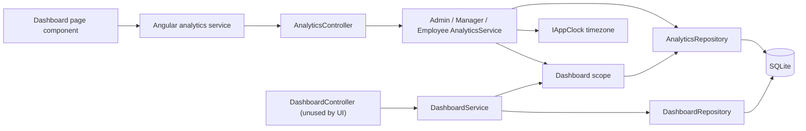

# Dashboard Module – Technical Documentation

> **Project:** TaskFlow – Intelligent Task Allocation & Tracking System
> **Module:** Dashboard  ·  **Child Modules:** Overview (Administrator / Manager / Employee dashboards), Analytics
> **Version:** 1.0  ·  **Last Updated:** 31-Oct-2026
> **Backend:** ASP.NET Core Web API (.NET 10)  ·  **Frontend:** Angular  ·  **Database:** SQLite (EF Core)
> **Author:** Jojo George (jojogeorge3344@gmail.com)
> © 2026 Jojo George. All rights reserved.

---

## 1. Technical Overview
The Dashboard module is read-only. It writes nothing to the database; it aggregates the `Tasks`, `TaskRecipients`, `Users`, `Departments`, `Projects` and link tables into counts for three audiences:

- **Overview** – `DashboardController` + `DashboardService` + `DashboardRepository`: single-query counter endpoints for the Administrator, Manager and Employee (`AdminDashboardDto`, `ManagerDashboardDto`, `EmployeeDashboardDto`). These endpoints exist but no Angular screen calls them today. Details: `02.1-Overview.md`.
- **Analytics** – `AnalyticsController` + `AdminAnalyticsService` / `ManagerAnalyticsService` / `EmployeeAnalyticsService` + `AnalyticsRepository`: the endpoints the three dashboard pages actually use. A **scope** service (`AdminDashboardScope`, `ManagerDashboardScope`, `EmployeeDashboardScope`) turns the caller and filter into an `AnalyticsTaskSet`, and every count runs through one bucket definition (`TaskBucketRules`, `DeadlineBucketRules`) so the dashboards and the Task List drill-down agree. Details: `02.2-Analytics.md`.

Day boundaries ("today", "due today", "next 7 days", date ranges) are computed in the application timezone from `IAppClock.GetTimeZoneAsync` and converted to UTC instants before querying.

## 2. Architecture Flow

## 3. Backend File Structure
Module-level summary; the per-child file lists are in the child documents.

| Layer | Path | Files / Owner |
|-------|------|---------------|
| Controller | `TaskFlow.Api/Controllers/Dashboard/` | `DashboardController.cs` (02.1), `AnalyticsController.cs` (02.2) |
| Service | `TaskFlow.Api/Services/Dashboard/Overview/` | 02.1 |
| Service | `TaskFlow.Api/Services/Dashboard/Analytics/` (`Admin/`, `Manager/`, `Employee/`, `Scopes/`) | 02.2 (`IManagerDashboardScope` is also used by 02.1) |
| Repository | `TaskFlow.Api/Repositories/Dashboard/Overview/` | 02.1 |
| Repository | `TaskFlow.Api/Repositories/Dashboard/Analytics/` | 02.2 |
| DTOs | `TaskFlow.Api/Dtos/Dashboard/` (`DashboardDto.cs`), `TaskFlow.Api/Dtos/Dashboard/Analytics/` | 02.1 / 02.2 |
| Validators | – | No FluentValidation validator; filters are validated in `AnalyticsFilterResolver` and `EmployeeAnalyticsService.ParsePeriod` (02.2) |
| Shared rules | `TaskFlow.Api/Common/Rules/` | `TaskBucketRules.cs`, `DeadlineBucketRules.cs`, `ManagerTeamThresholds.cs` (and `ReminderCalculator` for local-day maths) – shared |
| Exceptions | `TaskFlow.Api/Common/Exceptions/` | `AnalyticsExceptions.cs` (02.2) |
| Entities (read only) | `TaskFlow.Api/Models/Entities/` | `Task.cs`, `TaskRecipient.cs`, `User.cs`, `Department.cs`, `UserDepartment.cs`, `DepartmentManager.cs`, `Project.cs`, `ManagerProject.cs`, `UserProjectAllocation.cs` – shared |
| Enums | `TaskFlow.Api/Models/Enums/` | `TaskStatus.cs`, `TaskPriority.cs`; `AnalyticsDateBasis` and `EmployeeAnalyticsPeriod` are declared in the DTO files |
| Authorization | `TaskFlow.Api/Authorization/Policies/`, `TaskFlow.Api/Common/Security/` | `RequirePermissionAttribute.cs`, `PermissionPolicy.cs`, `PermissionKeys.cs`, `PermissionCatalog.cs`, `EffectivePermissions.cs` – shared |
| DI registration | `TaskFlow.Api/Config/` | `ServiceRegistration.cs`, `RepositoryRegistration.cs` (all scoped) – shared |

## 4. Frontend File Structure
Module-level summary; the per-child file lists are in the child documents.

| Type | Path | Purpose / Owner |
|------|------|-----------------|
| Page components | `src/app/modules/dashboard/pages/` | `admin-dashboard`, `manager-dashboard`, `employee-dashboard` (02.1; they load data through the 02.2 services) |
| Route / Guard | `src/app/modules/dashboard/dashboard.routes.ts` | `admin` – `permissionGuard` with `dashboard.view.organization`; `manager` – `permissionGuard` with `dashboard.view.team`; `me` – no guard (shell `authGuard` + `mfaSetupGuard` only) (02.1) |
| Landing route / Menu | `src/app/shared/auth/role-routes.ts`, `src/app/layouts/nav-items.ts` | `dashboardRouteFor(role, permissions)`; single "Dashboard" item (02.1) |
| Analytics components, filter bar, charts | `src/app/modules/dashboard/analytics/components/`, `src/app/modules/dashboard/components/` | 02.2 |
| API services | `src/app/modules/dashboard/analytics/services/` (02.2); `src/app/modules/dashboard/services/dashboard.service.ts` (02.1, unused) | – |
| Models / Utilities | `src/app/modules/dashboard/analytics/models/`, `src/app/modules/dashboard/models/`, `src/app/shared/utils/analytics-filter.ts`, `src/app/shared/utils/drill-down.ts`, `src/app/modules/dashboard/utils/` | 02.2 (`dashboard.model.ts` is 02.1) |
| Permission constants | `src/app/shared/auth/permissions.ts` | `DashboardViewTeam`, `DashboardViewOrganization`, `DashboardAnalytics`, `DashboardFilters` – shared |

## 5. Child Modules

| # | Child Module | Main endpoints (count) | Key permissions | Document |
|---|--------------|------------------------|-----------------|----------|
| 02.1 | Overview | `GET /api/v1/dashboard/admin`, `/manager`, `/employee` (3) | `dashboard.view.organization`, `dashboard.view.team`, `dashboard.view.own` | `02.1-Overview.md` |
| 02.2 | Analytics | `GET /api/v1/dashboard/admin/analytics`, `/admin/analytics/filters`, `/manager/analytics`, `/manager/analytics/filters`, `/employee/analytics` (5) | `dashboard.analytics.view`, `dashboard.filters.use` (with `dashboard.view.organization` / `dashboard.view.team`) | `02.2-Analytics.md` |

The child documents are in the `02-Dashboard/` folder next to this file.

## 6. Database Design
The module owns no table and runs no migration; it reads the tables below (SQLite, configured in `Persistence/AppDbContext.cs`). Column details are in each child document.

| Table | Used by | Purpose in the module |
|-------|---------|-----------------------|
| `Tasks` | 02.1, 02.2 | Every count, list and trend |
| `TaskRecipients` | 02.1, 02.2 | A recipient counts as an owner of the task |
| `Users` | 02.1, 02.2 | People, names, active flag, managers (`RoleId = 2`) |
| `Departments` | 02.2 | Department rows and names |
| `UserDepartments` | 02.1 (team resolution), 02.2 | Department membership |
| `DepartmentManagers` | 02.1 (team resolution), 02.2 | Departments a manager runs |
| `Projects` | 02.1, 02.2 | Project rows and names |
| `ManagerProjects` | 02.2 | Projects assigned to a manager |
| `UserProjectAllocations` | 02.1 (team resolution), 02.2 | Project membership; project-manager flag widens a manager's team |
| `RolePermissions` / `Permissions` | 02.2 | Used to exclude roles holding `tasks.view.all` from the "Employees" count |

**Relationships**
- `Tasks.AssignedToUserId → Users.Id` (FK, Restrict)
- `Tasks.ProjectId → Projects.Id` (FK, Restrict)
- `TaskRecipients.TaskId → Tasks.Id`, `TaskRecipients.UserId → Users.Id` (FK, Cascade)
- `UserDepartments.UserId → Users.Id`, `UserDepartments.DepartmentId → Departments.Id` (FK, Cascade)
- `DepartmentManagers.ManagerUserId → Users.Id`, `DepartmentManagers.DepartmentId → Departments.Id` (FK, Cascade)
- `ManagerProjects.ManagerUserId → Users.Id`, `ManagerProjects.ProjectId → Projects.Id` (FK, Cascade)
- `UserProjectAllocations.UserId → Users.Id`, `UserProjectAllocations.ProjectId → Projects.Id` (FK, Cascade)

## 7. Security & Authorization
- **Authentication:** JWT bearer token + refresh-token cookie; the caller id is read from `ClaimTypes.NameIdentifier`.
- **Authorization:** one policy per catalogue key named `perm:<key>` (`PermissionPolicy.NameFor`), registered in `Config/CrossCuttingRegistration.cs` as `RequireClaim(AuthClaims.Permission, key)`; permission claims are refreshed from the database on every request. Keys are defined in `PermissionKeys.cs` / `PermissionCatalog.cs`. `EffectivePermissions.Expand` adds lower scope levels (`dashboard.view.organization` ⇒ `dashboard.view.team`) and maps legacy keys (`dashboard.admin` ⇒ `dashboard.view.organization`, `dashboard.manager` ⇒ `dashboard.view.team`).
- **Data scope:** Organization – `AdminDashboardScope`; Team – `ManagerDashboardScope` (team + project scope checks, 403 outside scope); Own – `EmployeeDashboardScope` (session user only, no subject parameter accepted).
- **Frontend:** `permissionGuard` on `/admin` and `/manager` redirects to `dashboardRouteFor(...)` when the key is missing; `canFilter()` hides the filter bar without `dashboard.filters.use`. There is no permission directive on the dashboard cards.
- **Denied actions:** `DeniedActionAuditHandler` logs a warning (user id, method, path, policy) for every 403 from a policy.

| Permission Key | Endpoint(s) | UI Element Controlled |
|----------------|-------------|-----------------------|
| `dashboard.view.own` | – (Always On, not stored) | `/me` route has no guard; default landing page |
| `dashboard.view.team` | `GET /api/v1/dashboard/manager`, `GET .../manager/analytics`, `GET .../manager/analytics/filters` | `/manager` route guard; landing for custom roles |
| `dashboard.view.organization` | `GET /api/v1/dashboard/admin`, `GET .../admin/analytics`, `GET .../admin/analytics/filters` | `/admin` route guard; landing for custom roles; "Administrator" note on Manager Dashboard |
| `dashboard.analytics.view` | `GET .../admin/analytics`, `GET .../manager/analytics`, `GET .../employee/analytics` | None in the UI (missing key shows the load-error banner) |
| `dashboard.filters.use` | `GET .../admin/analytics/filters`, `GET .../manager/analytics/filters` | Filter bar on Administrator and Manager dashboards |

## 8. Validations & Error Handling
Shared rules only; filter and period validations are in `02.2-Analytics.md`.

| Rule | Layer | HTTP Code | Error Message |
|------|-------|-----------|---------------|
| Caller id claim missing or not numeric | Controller | 401 | – |
| No permission | Policy | 403 | Forbidden |
| Unhandled error | `GlobalExceptionHandler` | 500 | Something went wrong. Please try again. |

Errors are returned by `Middleware/GlobalExceptionHandler.cs` as `application/problem+json` (`ProblemDetails`, message in `detail`).

## 9. Integrations / Side Effects
- **Notifications:** None – the module only reads.
- **Email:** None.
- **Activity Log:** None written. Refused requests are logged by `DeniedActionAuditHandler`.
- **Task List drill-down:** from the Analytics charts – see `02.2-Analytics.md`.
- **Timezone:** `IAppClock` (Settings module) – stored application setting, falling back to `Application:Timezone`; unknown ids fall back to UTC.
- **AI Assistant:** No Assistant tool or knowledge file references the dashboard.

## 10. Configuration

| Key (`appsettings.json`) | Purpose | Default |
|--------------------------|---------|---------|
| `Application:Timezone` | Fallback application timezone for "today" and date ranges (overridden by the stored application setting) | `Asia/Kolkata` |
| `ConnectionStrings:Default` | SQLite database the queries run against | `<secret>` |
| `Jwt:AccessTokenMinutes` / `Jwt:RefreshTokenDays` | Session lifetime for dashboard calls | `30` / `7` |

Code constants (not configurable): default range 30 days, maximum range 3660 days, daily trend up to 31 days, top 10 employees, attention list 5, upcoming list 10, deadline window 7 days, high-workload factor 1.5 and minimum 5 open tasks, department breakdown minimum 3 active members. Each child document lists the constants it uses.

## 11. Testing
Paths are relative to `backend/tests`. Shared tests only; child-specific tests are in the child documents.

| Test Type | File / Location | Covers |
|-----------|-----------------|--------|
| Unit | `TaskFlow.UnitTests/Common/TaskBucketRulesTests.cs` | Bucket classification and completion percent (shared rules) |

## 12. Known Limitations / Future Enhancements
- Custom roles cannot have per-card or per-chart permissions; only the five dashboard keys exist.
- .NET target version: confirmed as `net10.0` in `TaskFlow.Api.csproj`.

**Gaps found (module-wide)**
- **Counting inconsistency:** Overview counters count Cancelled tasks in `Total` (only `IsDeleted` is excluded), while Analytics excludes Cancelled tasks. Overview "Pending" means all open tasks (including in-progress and overdue), whereas Analytics "Pending" excludes them.
- **Team definition mismatch:** the Manager Dashboard team (`GetTeamMemberIdsAsync`: managed departments + projects where the manager is flagged project manager, active users only) differs from the Admin dashboard's Manager filter and "Manager-wise teams" (`DashboardTaskFilters.TeamUserIds` / `DepartmentManagerTeams`: department membership only, inactive users included). Comments and UI text mention "direct reports", but no direct-report relation exists in the code.
- **Permission matrix vs code:** the matrix lists `dashboard.view.team` as Granted for Administrator; in code the Administrator gets it by scope expansion from `dashboard.view.organization`. The Administrator is routed to `/admin` by role name (`ROLE_ROUTES` in `role-routes.ts`) before permissions are considered.
- **Permission audit files are out of date:** `Artifacts/permission-audit/*.csv` still point to old paths (`features/dashboard/...`, `core/services/dashboard.service.ts`, `backend/src/TaskFlow.Domain/...`); the current code lives in `modules/dashboard/...` and `TaskFlow.Api/...`.

Child-specific gaps are listed in each child document.

---
© 2026 Jojo George. All rights reserved. Unauthorized copying or distribution of this document is prohibited.
