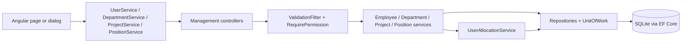
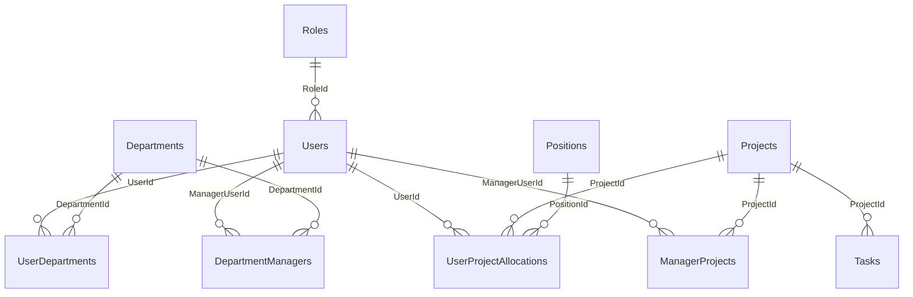

# Management Module – Technical Documentation

> **Project:** TaskFlow – Intelligent Task Allocation & Tracking System
> **Module:** Management  ·  **Child Modules:** Employee Management, Department Management, Project Management (incl. Positions)
> **Version:** 1.0  ·  **Last Updated:** 31-Oct-2026
> **Backend:** ASP.NET Core Web API (.NET 10)  ·  **Frontend:** Angular 19 (standalone)  ·  **Database:** SQLite (EF Core)
> **Author:** Jojo George (jojogeorge3344@gmail.com)
> © 2026 Jojo George. All rights reserved.

> ✅ Target framework confirmed: `net10.0` (.NET 10), from `backend/src/TaskFlow.Api/TaskFlow.Api.csproj`.

---

## 1. Technical Overview
The Management module owns the master data that every other module reads: user accounts (`Users`), departments, projects, positions, and the link tables between them. These are `UserDepartments`, `DepartmentManagers`, `UserProjectAllocations` and `ManagerProjects`.

- **Backend:** four controllers under `Controllers/Management` (`EmployeesController`, `DepartmentsController`, `ProjectsController`, `PositionsController`) on the routes `api/v1/users`, `api/v1/departments`, `api/v1/projects` and `api/v1/positions`. Every endpoint is protected by `[RequirePermission(PermissionKeys.X)]` or `[Authorize]` plus inline claim checks.
- **Services:** `EmployeeService`, `UserAllocationService` (the single place that enforces the allocation rules: 1–100 per row, at most 100% per user, one row per project, at least one project manager), `DepartmentService`, `ProjectService` and `PositionService`.
- **Persistence:** repositories built on `BaseRepository<T>`, with saves through `IUnitOfWork`. A project-team replacement runs inside `ExecuteInTransactionAsync`. Users, departments and projects are **soft-deleted** (`IsDeleted`), and global query filters hide them, along with the link rows that point at them.
- **Frontend:** lazy routes in `modules/management/management.routes.ts`. Pages use Angular signals, `AuthService.hasPermission` computed flags to show or hide actions, and HTTP services under each child folder.

## 2. Architecture Flow

## 3. Backend File Structure
Child-specific controllers, services, repositories, DTOs and validators are listed in each child document. The files below are shared by the whole module.

| Layer | Path | Files |
|-------|------|-------|
| Controller | `TaskFlow.Api/Controllers/Management/` | `EmployeesController.cs` (03.1), `DepartmentsController.cs` (03.2), `ProjectsController.cs` and `PositionsController.cs` (03.3) |
| Service | `TaskFlow.Api/Services/Management/` | `EmployeeManagement/Employees/` (03.1), `EmployeeManagement/Allocations/` (shared by 03.1 and 03.3), `DepartmentManagement/` (03.2), `ProjectManagement/Projects/` and `ProjectManagement/Positions/` (03.3) |
| Repository | `TaskFlow.Api/Repositories/Management/` | Same folder split as the services |
| DTOs / Validators | `TaskFlow.Api/Dtos/Management/` | `EmployeeManagement/`, `DepartmentManagement/`, `ProjectManagement/` (each with a `Validators/` folder) |
| Entities | `TaskFlow.Api/Models/Entities/` | `User.cs`, `Department.cs`, `DepartmentManager.cs`, `UserDepartment.cs`, `Project.cs`, `ManagerProject.cs`, `UserProjectAllocation.cs`, `Position.cs` |
| Security | `TaskFlow.Api/Common/Security/` | `PermissionKeys.cs`, `PermissionCatalog.cs`, `EffectivePermissions.cs` (legacy key expansion), `SystemRoles.cs` (`AdministratorId = 1`, `ManagerId = 2`, `EmployeeId = 3`) |
| Authorization | `TaskFlow.Api/Authorization/Policies/` | `RequirePermissionAttribute.cs`, `AuthPolicies.cs` |
| Cross-cutting | `TaskFlow.Api/Filters/`, `TaskFlow.Api/Middleware/` | `ValidationFilter.cs`, `GlobalExceptionHandler.cs`, `MfaSetupGateMiddleware.cs` |
| Persistence | `TaskFlow.Api/Persistence/` | `AppDbContext.cs`. Migrations: `20261012104823_AddDepartmentsAndUserDepartment`, `20261019174259_AddManagerAssignments`, `20261020173455_RenameDepartmentsToProjectsAndAddDepartments`, `20261021070943_FixDepartmentFollowUps`, `20261023160825_UserProjectAllocationsAndDepartments`, `20261023173211_AddProjectManagerFlag` |

## 4. Frontend File Structure
Each child's pages, components, services and models are listed in its child document. Shared files:

| Type | Path | Purpose |
|------|------|---------|
| Routes | `src/app/modules/management/management.routes.ts` | `/projects`, `/projects/:id`, `/departments`, `/employees`, each with `permissionGuard`. Mounted from `src/app/routes/app.routes.ts` |
| Menu | `src/app/layouts/nav-items.ts` | "TaskFlow Management" group: Employee Management (`EmployeeScreenPermissions.some(has)`), Project Management (`projects.view`), Department Management (`DepartmentScreenPermissions.some(has)`) |
| Permission constants | `src/app/shared/auth/permissions.ts` | `Permissions.*`, `EmployeeScreenPermissions` (create, edit, status, delete, role.assign, mfa.reset), `DepartmentScreenPermissions` (create, edit, delete, members) |
| Route guard | `src/app/shared/auth/auth.guard.ts` | `permissionGuard`: passes when the user holds any listed key, otherwise redirects to the role's dashboard |
| Shared component | `src/app/modules/management/components/position-combobox.component.ts` | Pick or type a position, calling `PositionService.getOrCreate`. Used by the employee form (03.1) and the project team dialog (03.3) |
| Child folders | `src/app/modules/management/employee-management/`, `department-management/`, `project-management/` | One folder per child, each with `pages/`, `components/`, `services/` and `models/` |

---

## 5. Child Modules

| # | Child Module | Main endpoints (count) | Key permissions | Document |
|---|--------------|------------------------|-----------------|----------|
| 03.1 | Employee Management | `/api/v1/users` (8) | `employees.view`, `employees.create`, `employees.edit`, `employees.status.change`, `employees.role.assign`, `employees.mfa.reset`, `employees.delete`, `roles.administrator.assign` | `03.1-Employee-Management.md` |
| 03.2 | Department Management | `/api/v1/departments` (7) | `departments.view`, `departments.create`, `departments.edit`, `departments.delete`, `departments.members.manage` | `03.2-Department-Management.md` |
| 03.3 | Project Management (incl. Positions) | `/api/v1/projects` (9), `/api/v1/positions` (2) | `projects.view`, `projects.create`, `projects.edit`, `projects.delete`, `projects.members.manage`, `positions.create` | `03.3-Project-Management.md` |

The child documents are in the folder `03-Management/`. Module total: 26 endpoints and 19 permission keys (18 Management keys plus the Settings key `roles.administrator.assign`).

## 6. Database Design
Column-level detail for each table is in the child document that owns it.

| Table | Owning child | Also written by | Purpose |
|-------|--------------|-----------------|---------|
| `Users` | 03.1 Employee Management | – | Accounts, role, status, soft delete, MFA state |
| `Departments` | 03.2 Department Management | – | Departments |
| `DepartmentManagers` | 03.2 Department Management | 03.1 (`ClearManagerDutiesAsync`) | Who manages a department |
| `UserDepartments` | 03.2 Department Management | 03.1 (on create, `StageForUserAsync`) | Department membership |
| `Projects` | 03.3 Project Management | – | Projects |
| `Positions` | 03.3 Project Management | – | Position labels |
| `UserProjectAllocations` | 03.3 Project Management | 03.1 (on create, `StageForUserAsync`; `ClearManagerDutiesAsync` clears `IsProjectManager`) | Person, project, position, percent and project-manager flag |
| `ManagerProjects` | 03.3 Project Management | 03.1 (`StageForUserAsync`, `ClearManagerDutiesAsync`) | Kept in step with `IsProjectManager` |

**Relationships**
- `Users.RoleId → Roles.Id` (FK, Restrict)
- `DepartmentManagers.ManagerUserId → Users.Id` (FK, Cascade) and `DepartmentManagers.DepartmentId → Departments.Id` (FK, Cascade)
- `UserDepartments.UserId → Users.Id` (FK, Cascade) and `UserDepartments.DepartmentId → Departments.Id` (FK, Cascade)
- `UserProjectAllocations.UserId → Users.Id` (FK, Cascade), `.ProjectId → Projects.Id` (FK, Cascade), `.PositionId → Positions.Id` (FK, Restrict)
- `ManagerProjects.ManagerUserId → Users.Id` (FK, Cascade) and `ManagerProjects.ProjectId → Projects.Id` (FK, Cascade)
- `Tasks.ProjectId → Projects.Id` (FK, Restrict; Monitoring module)
- Because rows are soft-deleted, the Cascade rules rarely fire. The services remove the link rows themselves: `DepartmentService.DeleteAsync` removes the manager links, `ProjectRepository.RemoveTeamAsync` removes the team, and `ClearManagerDutiesAsync` removes manager duties.

## 7. Security & Authorization
- **Authentication:** JWT bearer access token plus a refresh-token cookie. `SessionValidation` rejects tokens whose `SecurityStamp` no longer matches, which is how `EndSessionsAsync` and the MFA reset sign people out. `MfaSetupGateMiddleware` returns 403 (`mfa_setup_required`) on these endpoints until the caller has set up MFA.
- **Authorization:** `[RequirePermission(PermissionKeys.X)]` maps to the policy `PermissionPolicy.NameFor(key)`. Permission claims are refreshed from the database on every request. The keys and role defaults are in `Common/Security/PermissionCatalog.cs` (module "TaskFlow Management", screens "Employee Management", "Project Management" and "Department Management"). The legacy keys `employees.manage`, `projects.manage` and `departments.manage` expand to their finer keys through `EffectivePermissions.LegacyChildren`.
- **Data scope:** none. Every Management endpoint returns **Organization**-wide data to anyone holding the key. There is no Own or Team selector.
- **Frontend:** `permissionGuard` on the routes. The menu is built in `nav-items.ts`. Buttons are shown or hidden through `computed(() => authService.hasPermission(...))` flags in each page. No permission directive is used.
- **Key → endpoint → UI tables:** see section 7 of each child document.

## 8. Validations & Error Handling
Shared rules only. Child-specific validation rows are in each child document.

| Rule | Layer | HTTP Code | Error Message |
|------|-------|-----------|---------------|
| Unique index race | `UnitOfWork.SaveChangesAsync`, `UniqueConstraintException` | 409 | That value is already in use. |
| Concurrent update | `UnitOfWork`, `ConcurrencyConflictException` | 409 | Someone else changed this record while you were saving. Reload it and try again. |
| No permission | Policy / inline `Forbid()` | 403 | Empty body (the frontend shows its fallback, for example "Could not add the employee.") |
| MFA not set up | `MfaSetupGateMiddleware` | 403 | Set up two-step verification to continue. (`code: mfa_setup_required`) |
| Record not found / soft-deleted | Controller (null or false from service) | 404 | Empty body |
| Unhandled fault | `GlobalExceptionHandler` | 500 | Something went wrong. Please try again. |

`BusinessRuleException` (an `AppException` with status 400) and the conflict exceptions are written by `GlobalExceptionHandler` as `application/problem+json`, with the message in `detail`. The Angular helper `apiErrorMessage` reads `detail` first.

## 9. Integrations / Side Effects
- **Email:** none.
- **Activity Log:** none. Management changes are not written to the task activity history or an audit table. ⚠️ To be confirmed whether request logging (`RequestLoggingMiddleware`) is meant to serve as the audit trail.
- **Manager oversight:** spans all three children. `ClearManagerDutiesAsync` (03.1) runs on a role change away from Manager and on delete. Project deletion (03.3) removes the `ManagerProjects` links, and department deletion (03.2) removes the `DepartmentManagers` links.
- **Manager's team:** `IEmployeeRepository.GetTeamMemberIdsAsync` combines department managers (03.2) and project-manager flags (03.3). It is used by `TaskService` (task visibility) and `ManagerDashboardScope`.
- **Sessions, notifications and the AI Assistant:** only Employee Management has these side effects (session ending, the MFA reset notification, `propose_role_change`). See 03.1 section 9.

## 10. Configuration

| Key (`appsettings.json`) | Purpose | Default |
|--------------------------|---------|---------|
| `ConnectionStrings:Default` | SQLite database holding every Management table | `<secret>` |
| Code constant `IUserAllocationService.MaxTotalPercent` | Allocation cap per person (used by 03.1 and 03.3) | 100 |

Child-specific settings (JWT, MFA, seed accounts, email domain) are in 03.1 section 10.

## 11. Testing
Shared tests (used by more than one child):

| Test Type | File / Location | Covers |
|-----------|-----------------|--------|
| Unit | `tests/TaskFlow.UnitTests/Management/EmployeeManagement/Allocations/UserAllocationServiceTests.cs` | Allocation rules and the 100% cap (employee create and project team) |
| Unit | `tests/TaskFlow.UnitTests/Persistence/UserProjectAllocationsMigrationTests.cs` | Allocation migration (allocation and department tables) |

Other tests are listed in each child document.

⚠️ To be confirmed: the test contents were not available (file names only). The "Covers" column is inferred from the file names. No project or position validator unit tests are listed.

## 12. Known Limitations / Future Enhancements
- There is no audit or activity log for employee, department, project or position changes.
- Lists are not paged. `GET /api/v1/users`, `/departments` and `/projects` return every row. Department and project search happens on the client.
- Management endpoints have no Team scope, so a Manager with `employees.view` or `projects.view` sees organization-wide data.
- **BRD 05/06 vs matrix – access:** the BRD lists access as "Administrator". The matrix and catalog grant `employees.view`, `departments.view` and `projects.view` to Manager. Managers cannot open the Employee or Department screens, because the routes need action keys (`EmployeeScreenPermissions` / `DepartmentScreenPermissions`), but they can call the APIs.
- **Hard-coded manager role:** only the Manager system role (`ManagerId = 2`) can be a project or department manager.

Child-specific gaps are listed in each child document.

---
© 2026 Jojo George. All rights reserved. Unauthorized copying or distribution of this document is prohibited.
