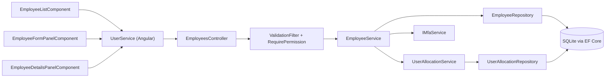
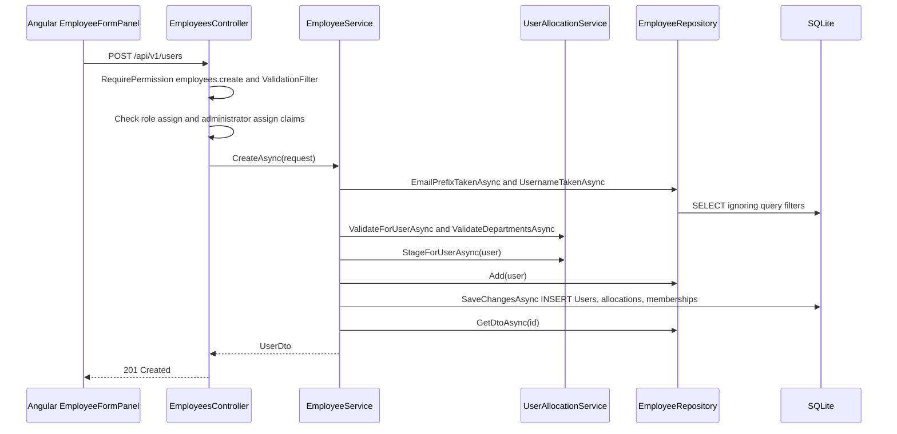
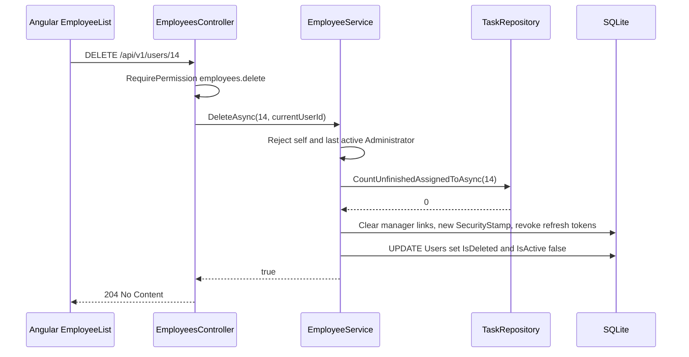

# Employee Management – Technical Documentation

> **Project:** TaskFlow – Intelligent Task Allocation & Tracking System
> **Parent Module:** Management  ·  **Child Module:** 03.1 Employee Management
> **Version:** 1.0  ·  **Last Updated:** 31-Oct-2026
> **Backend:** ASP.NET Core Web API (.NET 10)  ·  **Frontend:** Angular  ·  **Database:** SQLite (EF Core)
> **Author:** Jojo George (jojogeorge3344@gmail.com)
> © 2026 Jojo George. All rights reserved.

---

## 1. Technical Overview
Employee Management owns the `Users` table: sign-in accounts, roles, active status, soft delete and the MFA reset. It is served by `EmployeesController` on `api/v1/users` and implemented by `EmployeeService`, which uses `UserAllocationService` to validate and stage the project allocations and department memberships given when an employee is created.

- Every endpoint is protected by `[RequirePermission(PermissionKeys.X)]` or `[Authorize]` plus inline claim checks (`CanManageRoles()`, `CanAssignAdministrator()`).
- Users are soft-deleted (`IsDeleted`). A global query filter hides them, along with the allocation and membership rows that point at them.
- Changing a username or role, deactivating, deleting and resetting MFA all end the person's sessions by rotating `SecurityStamp` and revoking refresh tokens.
- The frontend is the lazy route `/employees` with `EmployeeListComponent`, the add/edit drawer `EmployeeFormPanelComponent` and the read-only drawer `EmployeeDetailsPanelComponent`, calling the Angular `UserService`.

## 2. Architecture Flow


## 3. Backend File Structure

| Layer | Path | Files |
|-------|------|-------|
| Controller | `TaskFlow.Api/Controllers/Management/` | `EmployeesController.cs` |
| Service | `TaskFlow.Api/Services/Management/EmployeeManagement/Employees/` | `IEmployeeService.cs`, `EmployeeService.cs` |
| Service | `TaskFlow.Api/Services/Management/EmployeeManagement/Allocations/` | `IUserAllocationService.cs`, `UserAllocationService.cs` (shared with 03.3) |
| Repository | `TaskFlow.Api/Repositories/Management/EmployeeManagement/Employees/` | `IEmployeeRepository.cs`, `EmployeeRepository.cs` |
| Repository | `TaskFlow.Api/Repositories/Management/EmployeeManagement/Allocations/` | `IUserAllocationRepository.cs`, `UserAllocationRepository.cs` (shared with 03.3) |
| DTOs | `TaskFlow.Api/Dtos/Management/EmployeeManagement/` | `UserDto.cs` (`UserDto`, `ProjectAllocationDto`, `UserDepartmentDto`, `UserManagerDto`, `ProjectAllocationInput`, `ManagerProjectDto`, `ManagerReportDto`, `CreateUserRequest`, `UpdateUserRequest`, `UserStatusRequest`, `UserListFilter`) |
| Validators | `TaskFlow.Api/Dtos/Management/EmployeeManagement/Validators/` | `CreateUserRequestValidator.cs`, `UpdateUserRequestValidator.cs`, `UserStatusRequestValidator.cs` |
| Entities | `TaskFlow.Api/Models/Entities/` | `User.cs` (plus `UserProjectAllocation.cs` and `UserDepartment.cs`, staged on create) |
| Shared rules | `TaskFlow.Api/Common/Rules/` | `EmailPolicy.cs` (fixed domain `taskflow.com`) |
| Security | `TaskFlow.Api/Common/Security/` | `PermissionKeys.cs`, `PermissionCatalog.cs`, `EffectivePermissions.cs`, `SystemRoles.cs` (shared, see the parent document) |

## 4. Frontend File Structure

| Type | Path | Purpose |
|------|------|---------|
| Route / Guard | `src/app/modules/management/management.routes.ts`, `src/app/shared/auth/auth.guard.ts` | `/employees` with `permissionGuard` on `EmployeeScreenPermissions` |
| Menu | `src/app/layouts/nav-items.ts` | Employee Management item, shown when `EmployeeScreenPermissions.some(has)` |
| Permission constants | `src/app/shared/auth/permissions.ts` | `EmployeeScreenPermissions` (create, edit, status, delete, role.assign, mfa.reset) |
| Page component | `src/app/modules/management/employee-management/pages/` | `employee-list.component.ts/.html`, `employee-list.model.ts` (`StatusFilter`, `Panel`) |
| Child components | `src/app/modules/management/employee-management/components/` | `employee-form-panel.component.ts/.html` (add/edit drawer), `employee-details-panel.component.ts` (read-only drawer), `employee-form-panel.model.ts` (`AllocationRow`) |
| API service | `src/app/modules/management/employee-management/services/user.service.ts` | `getAll`, `getById`, `create`, `update`, `updateStatus`, `resetMfa`, `delete` on `/api/v1/users` |
| Models | `src/app/modules/management/employee-management/models/user.model.ts` | `User`, `ProjectAllocation`, `CreateUserRequest`, `UpdateUserRequest`, `UserStatusRequest`, `MAX_TOTAL_PERCENT = 100` |
| Shared component | `src/app/modules/management/components/position-combobox.component.ts` | Position picker in the allocation rows (owned by 03.3) |
| Role options | `src/app/modules/settings/role-configuration/services/role.service.ts` | `assignable()` calls `GET /api/v1/users/roles` |

---

## 5. API & Logic

### 5.1 API Endpoints

| # | Method | Endpoint | Description | Permission (Policy) | Request DTO | Response DTO |
|---|--------|----------|-------------|---------------------|-------------|--------------|
| 1 | GET | `/api/v1/users` | Live users, ordered by name. Query: `search`, `projectId`, `role`, `isActive`, `departmentId` | `employees.view` | Query params (`UserListFilter`) | `IReadOnlyCollection<UserDto>` |
| 2 | GET | `/api/v1/users/roles` | Roles for the employee form and filter. Administrator (id 1) is omitted unless the caller holds `roles.administrator.assign` | `[Authorize]` + inline: `employees.role.assign` **or** `roles.manage`, else 403 | – | `IReadOnlyList<RoleOptionDto>` |
| 3 | GET | `/api/v1/users/{id}` | One live user | `[Authorize]` + inline: the caller's own id, or the `employees.edit` claim, else 403 | – | `UserDto` |
| 4 | POST | `/api/v1/users` | Create a user (201 + Location) | `employees.create`. Inline: `RoleId != 3` needs `employees.role.assign`, and `RoleId == 1` needs `roles.administrator.assign` | `CreateUserRequest` | `UserDto` |
| 5 | PUT | `/api/v1/users/{id}` | Update a user. A role change needs `employees.role.assign`, plus `roles.administrator.assign` if the old or new role is Administrator | `employees.edit` | `UpdateUserRequest` | `UserDto` |
| 6 | PATCH | `/api/v1/users/{id}/status` | Activate / deactivate | `employees.status.change` | `UserStatusRequest` | `UserDto` |
| 7 | DELETE | `/api/v1/users/{id}` | Soft-delete a user | `employees.delete` | – | `204 No Content` |
| 8 | POST | `/api/v1/users/{id:int}/mfa/reset` | Reset the authenticator MFA and end sessions (calls `IMfaService.ResetAsync`) | `employees.mfa.reset` | – | `204 No Content` |

### 5.2 Request / Response Samples
```json
// POST /api/v1/users
{
  "employeeCode": "EMP-050",
  "fullName": "Anu Thomas",
  "username": "anu",
  "email": "anu.thomas@taskflow.com",
  "password": "Temp#123",
  "roleId": 3,
  "isActive": true,
  "projectAllocations": [ { "projectId": 2, "positionId": 4, "percent": 60 } ],
  "departmentIds": [1]
}
```
```json
// 201 Created (UserDto)
{
  "id": 14, "employeeCode": "EMP-050", "fullName": "Anu Thomas", "username": "anu",
  "email": "anu.thomas@taskflow.com", "roleId": 3, "role": "Employee", "isActive": true,
  "createdAt": "2026-10-31T10:00:00Z", "updatedAt": "2026-10-31T10:00:00Z", "lastLoginAt": null,
  "projectAllocations": [ { "projectId": 2, "projectName": "Website", "positionId": 4, "positionName": "Developer", "percent": 60 } ],
  "departments": [ { "id": 1, "name": "Engineering" } ],
  "managers": [ { "id": 5, "fullName": "Ravi Menon" } ],
  "managerProjects": [], "reports": [],
  "mfaEnabled": false, "backupCodesRemaining": 0, "mobileNumber": null,
  "totalAllocatedPercent": 60, "remainingPercent": 40
}
```
```json
// PATCH /api/v1/users/14/status
{ "isActive": false }
```
```json
// 400 Bad Request (BusinessRuleException as ProblemDetails)
{ "status": 400, "detail": "The only active Administrator cannot be deactivated." }
```

### 5.3 Service Layer Logic
**Class:** `EmployeeService` (`IEmployeeService`). Its dependencies are `IEmployeeRepository`, `IRoleRepository`, `IRefreshTokenRepository`, `ITaskRepository`, `IUnitOfWork`, `IPasswordHasher<User>` and `IUserAllocationService`.

**Method:** `GetAllAsync(UserListFilter? filter, CancellationToken)` and `GetByIdAsync(int id, ...)` delegate to `EmployeeRepository.GetListAsync` and `GetDtoAsync`.

**Method:** `CreateAsync(CreateUserRequest request, CancellationToken)`
1. `ValidationFilter` has already run `CreateUserRequestValidator`.
2. `RequireValidEmail` normalizes the email (trim, lower-case) using `EmailPolicy`, and throws `EmailPolicy.InvalidMessage` if it is invalid.
3. `EmailTakenAsync` runs `EmailPrefixTakenAsync(localPart + "@")`, which includes deleted users. If taken, it throws "Email already exists.".
4. `UsernameTakenAsync` (case-insensitive, deleted users included) throws "Email or username already exists." if taken.
5. If `ProjectAllocations` is not null, calls `UserAllocationService.ValidateForUserAsync`. If `DepartmentIds` is not null, calls `ValidateDepartmentsAsync`.
6. `RequireRoleAsync` throws "Role does not exist." if the role is missing.
7. Builds the `User` (trimmed fields, new `SecurityStamp` GUID, `CreatedAt` and `UpdatedAt` set to UTC now) and hashes the password with `IPasswordHasher<User>`.
8. `StageForUserAsync` adds the `UserProjectAllocation` and `UserDepartment` rows. Then `_employees.Add` and `SaveChangesAsync`.
9. Returns `GetByIdAsync(user.Id)`.

**Method:** `UpdateAsync(int id, UpdateUserRequest request, CancellationToken)`
1. Loads the user with `GetActiveWithRoleForUpdateAsync`. Returns null (404) if not found.
2. Runs the same email and username uniqueness checks as create, excluding this id, plus allocation and department validation when the lists are provided.
3. **The password is ignored** (`const bool passwordChanged = false`).
4. If the role changed, `EnsureAnotherActiveAdministratorAsync` throws "The only active Administrator cannot be moved to another role.". If the old role was Manager, `ClearManagerDutiesAsync` removes the `ManagerProjects` and `DepartmentManagers` links and clears the `IsProjectManager` flags.
5. Applies the fields and calls `StageForUserAsync` (null leaves a list unchanged, empty clears it).
6. If the username or role changed, `EndSessionsAsync` sets a new `SecurityStamp` and sets `RevokedAt` on the active refresh tokens.
7. `SaveChangesAsync` and returns the DTO.

**Method:** `UpdateStatusAsync(int id, UserStatusRequest request, ...)`. On an active-to-inactive change it calls `EnsureAnotherActiveAdministratorAsync` ("The only active Administrator cannot be deactivated.") and `EndSessionsAsync`. It then sets `IsActive` and `UpdatedAt` and saves.

**Method:** `DeleteAsync(int id, int currentUserId, ...)`
1. `GetForUpdateAsync` returns false (404) if the user is not found.
2. Self-delete throws "You cannot delete your own account.".
3. Last active Administrator throws "The only active Administrator cannot be deleted.".
4. `ITaskRepository.CountUnfinishedAssignedToAsync(id)` > 0 throws "{FullName} still has {n} unfinished task(s). Reassign it/them before deleting this employee.".
5. `ClearManagerDutiesAsync` and `EndSessionsAsync`, then `IsActive = false`, `IsDeleted = true` and save. Allocations and memberships stay on the row, and query filters hide them.

**Class:** `UserAllocationService` (`IUserAllocationService`, `MaxTotalPercent = 100`) – the methods used by this child:
- `ValidateForUserAsync(inputs)`: each `Percent` is between 1 and 100, there are no duplicate `ProjectId`s, the sum is at most 100, and the projects exist (`CountActiveAsync`) and positions exist (`CountAsync`).
- `ValidateDepartmentsAsync(ids)`: the distinct ids must all be live departments, otherwise "Department does not exist.".
- `StageForUserAsync(user, allocations, departmentIds)`: diffs the existing rows against the input. It removes rows that are gone, and also the `ManagerProjects` link for a removed row that was flagged `IsProjectManager`. It updates the position and percent on kept rows and adds new rows. The same diff is done for `UserDepartment`.
- `ReplaceProjectMembersAsync(projectId, members)` belongs to 03.3 Project Management (see that document, section 5.3).

### 5.4 Repository Layer

| Method | Description | Query Notes |
|--------|-------------|-------------|
| `GetListAsync(UserListFilter?)` | Live users matching the filters | `AsNoTracking`, `!IsDeleted`. `Search` is lower-case `Contains` on FullName, Email and Username. `ProjectId` and `DepartmentId` use `Any()` on the link collections. `Role` is an exact match on `Role.Name`. Ordered by FullName, then `LoadDtosAsync` |
| `GetDtoAsync(id)` | One live user as `UserDto` | Uses `LoadDtosAsync` |
| `LoadDtosAsync` (private) | Projects users to `UserDto` | Projects allocations, departments, `ManagerProjects`, MFA state and unused backup-code count. **Managers** and **Reports** are loaded in separate batched join queries (department links plus project-manager flags), because correlated subqueries are not translatable on SQLite |
| `GetActiveWithRoleForUpdateAsync(id)` | Tracked live user with `Role` | `Include(u => u.Role)` |
| `GetForUpdateAsync(id)` | Tracked user | Hidden if deleted (query filter) |
| `EmailPrefixTakenAsync(prefix, exceptUserId)` | Email uniqueness by local part | `IgnoreQueryFilters()`, `Email.ToLower().StartsWith(prefix)` |
| `UsernameTakenAsync(username, exceptUserId)` | Username uniqueness | `IgnoreQueryFilters()`, case-insensitive |
| `CountOtherActiveAdministratorsAsync(userId)` | Last-admin guard | `RoleId == SystemRoles.AdministratorId && IsActive && !IsDeleted` |
| `ClearManagerDutiesAsync(managerUserId)` | Removes manager oversight | Removes `ManagerProjects` and `DepartmentManagers` links and sets `IsProjectManager = false` |
| `GetByIdsAsync(ids)` / `GetActiveByIdsAsync(ids)` | Bulk lookups for the member dialogs (used by 03.2 and 03.3) | `AsNoTracking` |
| `GetDepartmentMembershipsForUpdateAsync(userId)` / `RemoveDepartmentMemberships` | Department diff | Tracked |
| `GetTeamMemberIdsAsync(managerId)` | A manager's team (used by Monitoring and Dashboard) | Active users in managed departments, or on projects where the manager has `IsProjectManager` |
| `UserAllocationRepository.GetForUserForUpdateAsync` / `GetForProjectForUpdateAsync` | Tracked allocation rows | – |
| `UserAllocationRepository.GetTotalsOnOtherProjectsAsync(userIds, projectId)` | Sum of percents on other projects | `GroupBy(UserId)`, `Sum(AllocationPercent)` |
| `UserAllocationRepository.GetManagerLinksForProjectForUpdateAsync` / `GetManagerLinksForUserForUpdateAsync` / `AddManagerLink` / `RemoveManagerLinks` | `ManagerProjects` maintenance | Tracked |

### 5.5 Sequence Diagrams

**Create an employee**


**Delete an employee**


---

## 6. Database Design
This child owns `Users`.

| Table | Column | Type | Constraints | Description |
|-------|--------|------|-------------|-------------|
| `Users` | `Id` | int | PK, Identity | User id |
| `Users` | `EmployeeCode` | string(32) | Nullable | Optional HR code |
| `Users` | `FullName` | string(200) | Not Null | Display name |
| `Users` | `Username` | string(100) | Not Null, Unique index | Sign-in name (deleted rows keep it) |
| `Users` | `Email` | string(256) | Not Null, Unique index | `@taskflow.com` address (deleted rows keep it) |
| `Users` | `MobileNumber` | string(20) | Nullable | Set from Profile |
| `Users` | `PasswordHash` | string | Not Null | `IPasswordHasher<User>` hash |
| `Users` | `SecurityStamp` | string(64) | Not Null | Rotated to end sessions |
| `Users` | `RoleId` | int | FK → `Roles.Id` (Restrict) | Role |
| `Users` | `IsActive` | bool | Default true | Can sign in |
| `Users` | `IsDeleted` | bool | Global query filter `!IsDeleted` | Soft delete |
| `Users` | `CreatedAt`, `UpdatedAt`, `LastLoginAt` | DateTime | `LastLoginAt` nullable | Audit times |
| `Users` | `MfaSecretProtected`, `MfaEnabledAt`, `MfaLastUsedStep`, `MfaFailedAttempts`, `MfaLockedUntil` | – | Concurrency tokens on `MfaLastUsedStep` and `MfaFailedAttempts` | MFA state (Auth module) |

**Other tables this child reads or writes**

| Table | Owner | How this child uses it |
|-------|-------|------------------------|
| `UserProjectAllocations` | 03.3 | Rows added on create (`StageForUserAsync`). `IsProjectManager` cleared by `ClearManagerDutiesAsync`. Read into `UserDto.projectAllocations` |
| `ManagerProjects` | 03.3 | Removed by `StageForUserAsync` (removed flagged rows) and `ClearManagerDutiesAsync`. Read into `managerProjects` |
| `UserDepartments` | 03.2 | Rows added on create (`StageForUserAsync`). Read into `departments` |
| `DepartmentManagers` | 03.2 | Removed by `ClearManagerDutiesAsync`. Read to derive `managers` and `reports` |
| `Roles` | Settings | `RoleId` FK and the role list (`GET /api/v1/users/roles`) |
| `RefreshTokens` | Authentication | `RevokedAt` set by `EndSessionsAsync` |
| `Tasks` | Monitoring | Unfinished tasks counted by `CountUnfinishedAssignedToAsync` before delete |

**Relationships**
- `Users.RoleId → Roles.Id` (FK, Restrict)
- `UserProjectAllocations.UserId`, `UserDepartments.UserId`, `DepartmentManagers.ManagerUserId` and `ManagerProjects.ManagerUserId → Users.Id` (FK, Cascade). Because users are soft-deleted, the cascade rarely fires. `ClearManagerDutiesAsync` removes manager links on delete, and query filters hide the remaining rows.

## 7. Security & Authorization
- **Inline checks in `EmployeesController`:** `CanManageRoles()` checks `employees.role.assign`, and `CanAssignAdministrator()` checks `roles.administrator.assign` (`IsAssignable: false`, so only the Administrator role holds it). `GetById` allows the caller themself or the `employees.edit` claim.
- **Sessions:** `EndSessionsAsync` rotates `SecurityStamp`, so `SessionValidation` rejects the person's existing tokens.
- **Data scope:** none. The list returns Organization-wide data to anyone holding `employees.view`.
- Authentication, the permission policy, the MFA setup gate and legacy key expansion (`employees.manage`) are described in the parent document, section 7.

| Permission Key | Endpoint(s) | UI Element Controlled |
|----------------|-------------|-----------------------|
| `employees.view` | `GET /api/v1/users` | Employee table data. Also used by the assignee pickers in other modules, the department members dialog and the project team picker. Does not open the menu or route |
| `employees.create` | `POST /api/v1/users` | "Add employee" button. Opens the menu and route |
| `employees.edit` | `PUT /api/v1/users/{id}`, `GET /api/v1/users/{id}` (others) | Row "Edit" icon. Opens the menu and route |
| `employees.status.change` | `PATCH /api/v1/users/{id}/status` | Row "Activate/Deactivate" icon. Opens the menu and route |
| `employees.delete` | `DELETE /api/v1/users/{id}` | Row "Delete" icon (not on own row). Opens the menu and route |
| `employees.role.assign` | `GET /api/v1/users/roles`. Role change on POST and PUT | Role select in the form, custom roles in the role filter. Opens the menu and route |
| `employees.mfa.reset` | `POST /api/v1/users/{id}/mfa/reset` | "Reset MFA" in the details drawer. Opens the menu and route |
| `roles.administrator.assign` | POST and PUT `/api/v1/users` (role id 1), `GET /api/v1/users/roles` (lists Administrator) | Administrator option in the role select |

## 8. Validations & Error Handling

| Rule | Layer | HTTP Code | Error Message |
|------|-------|-----------|---------------|
| `FullName` / `Username` / `Email` empty or too long (200 / 100 / 256), `Password` empty or under 6 (create) | `CreateUserRequestValidator`, `UpdateUserRequestValidator` via `ValidationFilter` | 400 (ValidationProblemDetails `errors`) | FluentValidation default messages. Email: `EmailPolicy.InvalidMessage` |
| Invalid email | `EmployeeService.RequireValidEmail` | 400 | Email must be a name using letters, digits, dot, underscore or hyphen followed by @taskflow.com. |
| Duplicate email / username | `EmployeeService` | 400 | Email already exists. / Email or username already exists. |
| Unknown role / department / project / position | `EmployeeService`, `UserAllocationService` | 400 | Role does not exist. / Department does not exist. / Project does not exist. / Position does not exist. |
| Allocation rules | `UserAllocationService` | 400 | Allocation percentage must be a whole number from 1 to 100. / A project can only appear once for a person. / Allocations total {n}%, which is over 100%. A person can be allocated at most 100% in total. |
| Last active Administrator | `EmployeeService` | 400 | The only active Administrator cannot be moved to another role. / … cannot be deactivated. / … cannot be deleted. |
| Self delete / unfinished tasks | `EmployeeService.DeleteAsync` | 400 | You cannot delete your own account. / {name} still has {n} unfinished task(s). Reassign it/them before deleting this employee. |
| Missing or invalid user id claim | `EmployeesController.GetById` / `Delete` | 401 | – |
| Role or Administrator change without the key | `EmployeesController` inline checks | 403 | Empty body |

Shared errors (409 unique race and concurrency, 403 policy and MFA gate, 404, 500) are in the parent document, section 8.

## 9. Integrations / Side Effects
- **Sessions (Auth):** `EmployeeService.EndSessionsAsync` sets a new `SecurityStamp` and revokes the active `RefreshTokens`. It runs on a username or role change, on deactivation and on delete. `MfaService.ResetAsync` does the same.
- **Notifications:** only the MFA reset publishes one: `NotificationType.System` with "An administrator reset your authenticator MFA. Sign in with your password and set it up again from Profile.". The other employee actions publish no notifications.
- **Email:** none.
- **Activity Log:** none (see the parent document).
- **Manager oversight:** `ClearManagerDutiesAsync` runs on a role change away from Manager and on delete.
- **Consumers:** `IEmployeeRepository.GetTeamMemberIdsAsync` is used by `TaskService` (task visibility) and `ManagerDashboardScope`. `IEmployeeService` is used by `AssistantActionService`. `IEmployeeRepository` is also used by `ProfileService`, `RoleService`, `TaskCommentService` and `ReminderService`.
- **AI Assistant:** the tool `propose_role_change` (policy `AssistantPolicies.RolesManage` = `roles.manage`) prepares a role change. After the administrator confirms it, `AssistantActionService` calls `EmployeeService.UpdateAsync` with the person's current allocations and departments and the new role id. It refuses to change the caller's own role. The help topics `employee-management.md` and `change-role.md` describe this screen.

## 10. Configuration

| Key (`appsettings.json`) | Purpose | Default |
|--------------------------|---------|---------|
| `Jwt:AccessTokenMinutes` | Lifetime of the access token that a stamp rotation invalidates | 30 |
| `Jwt:RefreshTokenDays` | Lifetime of the refresh tokens revoked by `EndSessionsAsync` | 7 |
| `Mfa:Required` | Whether new users must set up MFA (affects the reset flow and the setup gate) | true |
| `Seed:Enabled` (`SeedOptions`, not in `appsettings.json`) | Creates the Administrator, Manager and Employee sign-ins on first start | false |
| `Seed:AdministratorPassword`, `Seed:ManagerPassword`, `Seed:EmployeePassword` | Seed passwords | `<secret>` |
| Code constant `EmailPolicy.Domain` | Fixed employee email domain | `taskflow.com` |
| Code constant `IUserAllocationService.MaxTotalPercent` | Allocation cap per person | 100 |

`ConnectionStrings:Default` is shared by the whole module (see the parent document).

## 11. Testing

| Test Type | File / Location | Covers |
|-----------|-----------------|--------|
| Integration | `tests/TaskFlow.IntegrationTests/Management/EmployeeManagement/UsersEndpointsTests.cs` | `/api/v1/users` endpoints and authorization |
| Integration | `tests/TaskFlow.IntegrationTests/Management/EmployeeManagement/AdminDeleteEndpointsTests.cs` | `DELETE /api/v1/users/{id}` |
| Integration | `tests/TaskFlow.IntegrationTests/Management/EmployeeManagement/LastAdministratorTests.cs` | Last-administrator role and delete protection |
| Integration | `tests/TaskFlow.IntegrationTests/Management/EmployeeManagement/LastAdministratorStatusTests.cs` | Last-administrator deactivation protection |
| Integration | `tests/TaskFlow.IntegrationTests/Management/EmployeeManagement/ManagerAssignmentEndpointsTests.cs` | Manager links through the endpoints |
| Unit | `tests/TaskFlow.UnitTests/Management/EmployeeManagement/Employees/ManagerAssignmentTests.cs` | Managers and reports derivation |
| Unit | `tests/TaskFlow.UnitTests/Management/EmployeeManagement/Employees/UserDeletionTests.cs` | Soft delete rules |
| Unit | `tests/TaskFlow.UnitTests/Management/EmployeeManagement/Employees/UserServiceSelfServiceTests.cs` | User service self-service paths |
| Unit | `tests/TaskFlow.UnitTests/Management/EmployeeManagement/Allocations/UserAllocationServiceTests.cs` | Allocation rules and the 100% cap (shared with 03.3) |

⚠️ To be confirmed: the test contents were not available (file names only). The "Covers" column is inferred from the file names.

## 12. Known Limitations / Gaps found
- **BRD 05 vs code – department filter:** the BRD asks for a *Department filter* on the employee list. The API supports `departmentId`, but the screen offers a **Project** filter, not a Department filter.
- **BRD 05 vs code – deletion rule:** the BRD says "prevent accidental deletion of employees who have related task records". The code blocks deletion only while the person has **unfinished** assigned tasks, then soft-deletes.
- **Frontend gating gap:** the employee details drawer always shows **Edit**.
- **Hard-coded roles:** the role filter falls back to the fixed list Employee/Manager/Administrator.
- **Extra permissions needed silently:**
  - The Employee screen loads `/projects` and `/departments`, so it needs `projects.view` and `departments.view`. Errors are swallowed and the dropdowns are left empty.
  - Employee-form allocations and departments need only `employees.create`, not `projects.members.manage` or `departments.members.manage`.
- **Assistant role change:** `propose_role_change` requires only `roles.manage` (assignable to custom roles), and neither the tool nor `AssistantActionService` checks `employees.role.assign` or `roles.administrator.assign`. So the Assistant path could grant or remove the Administrator role without the Administrator-only key that `EmployeesController` enforces. ⚠️ To be confirmed whether that is intended.
- **Audit items now fixed in code:** `permission-gaps.md` items 2 (no target-role check) and 3 (`Password` accepted on update) are fixed. `EmployeesController` now checks `roles.administrator.assign`, and `EmployeeService.UpdateAsync` ignores the password. The audit still refers to the old file names (`UsersController.cs`, `features/...`).
- **`GET /api/v1/users/{id}`** is not gated by `employees.view`. Other users need `employees.edit`, even though the list endpoint returns the same data with `employees.view`.
- **Search placeholder:** the employee search says "Name or email", but the API also matches the username.
- **Outdated help knowledge:**
  - `employee-management.md` says an admin can "set a new password" and change projects when editing. The code ignores the password on update and shows allocations read-only on edit.
  - `change-role.md` says "Only Administrators change roles", but `employees.role.assign` is a configurable key.
- **Matrix vs catalog:** `role-permission-matrix.csv` lists `roles.administrator.assign` as "CONFIGURABLE" for custom roles, but `PermissionCatalog.cs` marks it `IsAssignable: false`. ⚠️ To be confirmed which is intended.
- The employee form imports `PositionService` from the missing file `position.service.ts` (see 03.3 section 12).

---
<sub>© 2026 Jojo George. All rights reserved. Unauthorized copying or distribution of this document is prohibited.</sub>
