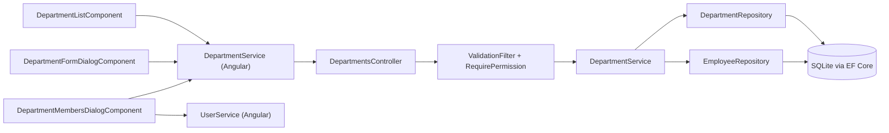
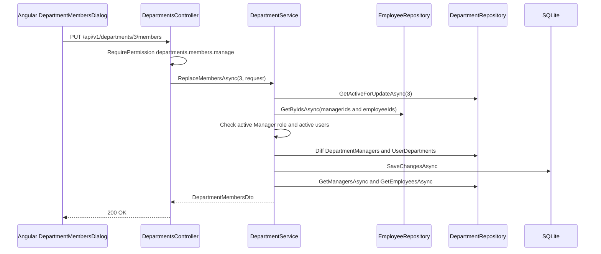

# Department Management – Technical Documentation

> **Project:** TaskFlow – Intelligent Task Allocation & Tracking System
> **Parent Module:** Management  ·  **Child Module:** 03.2 Department Management
> **Version:** 1.0  ·  **Last Updated:** 31-Oct-2026
> **Backend:** ASP.NET Core Web API (.NET 10)  ·  **Frontend:** Angular  ·  **Database:** SQLite (EF Core)
> **Author:** Jojo George (jojogeorge3344@gmail.com)
> © 2026 Jojo George. All rights reserved.

---

## 1. Technical Overview
Department Management owns the `Departments`, `DepartmentManagers` and `UserDepartments` tables. It is served by `DepartmentsController` on `api/v1/departments` and implemented by `DepartmentService`, which uses `DepartmentRepository` for the department rows and `EmployeeRepository` to check the people picked as members.

- Every endpoint is protected by `[RequirePermission(PermissionKeys.X)]`.
- Departments are soft-deleted (`IsDeleted`) and only when they have no members. A global query filter hides deleted departments and the membership rows that point at them.
- The members endpoint replaces all managers and employees of one department in one call, diffing only that department's link rows.
- The frontend is the lazy route `/departments` with `DepartmentListComponent`, `DepartmentFormDialogComponent` and `DepartmentMembersDialogComponent`, calling the Angular `DepartmentService`.

## 2. Architecture Flow


## 3. Backend File Structure

| Layer | Path | Files |
|-------|------|-------|
| Controller | `TaskFlow.Api/Controllers/Management/` | `DepartmentsController.cs` |
| Service | `TaskFlow.Api/Services/Management/DepartmentManagement/` | `IDepartmentService.cs`, `DepartmentService.cs` |
| Repository | `TaskFlow.Api/Repositories/Management/DepartmentManagement/` | `IDepartmentRepository.cs`, `DepartmentRepository.cs` |
| Repository (used) | `TaskFlow.Api/Repositories/Management/EmployeeManagement/Employees/` | `IEmployeeRepository.cs` (`GetByIdsAsync`, owned by 03.1) |
| DTOs | `TaskFlow.Api/Dtos/Management/DepartmentManagement/` | `DepartmentDto.cs` (`DepartmentDto`, `DepartmentWithCountsDto`, `CreateDepartmentRequest`, `UpdateDepartmentRequest`, `MemberRefDto`, `DepartmentMembersDto`, `UpdateDepartmentMembersRequest`) |
| Validators | `TaskFlow.Api/Dtos/Management/DepartmentManagement/Validators/` | `CreateDepartmentRequestValidator.cs`, `UpdateDepartmentRequestValidator.cs` |
| Entities | `TaskFlow.Api/Models/Entities/` | `Department.cs`, `DepartmentManager.cs`, `UserDepartment.cs` |
| Migrations | `TaskFlow.Api/Persistence/` | `20261012104823_AddDepartmentsAndUserDepartment`, `20261021070943_FixDepartmentFollowUps` (others shared, see the parent document) |

## 4. Frontend File Structure

| Type | Path | Purpose |
|------|------|---------|
| Route / Guard | `src/app/modules/management/management.routes.ts`, `src/app/shared/auth/auth.guard.ts` | `/departments` with `permissionGuard` on `DepartmentScreenPermissions` |
| Menu | `src/app/layouts/nav-items.ts` | Department Management item, shown when `DepartmentScreenPermissions.some(has)` |
| Permission constants | `src/app/shared/auth/permissions.ts` | `DepartmentScreenPermissions` (create, edit, delete, members) |
| Page component | `src/app/modules/management/department-management/pages/` | `department-list.component.ts/.html` |
| Child components | `src/app/modules/management/department-management/components/` | `department-form-dialog.component.ts`, `department-members-dialog.component.ts/.html`, `department-members-dialog.model.ts` (`MemberSort`, `MemberOption`) |
| API service | `src/app/modules/management/department-management/services/department.service.ts` | CRUD and members on `/api/v1/departments` |
| Models | `src/app/modules/management/department-management/models/department.model.ts` | `Department`, `DepartmentWithCount`, `DepartmentMembers`, `MemberRef` |
| API service (used) | `src/app/modules/management/employee-management/services/user.service.ts` | People list for the members dialog (03.1) |

---

## 5. API & Logic

### 5.1 API Endpoints

| # | Method | Endpoint | Description | Permission (Policy) | Request DTO | Response DTO |
|---|--------|----------|-------------|---------------------|-------------|--------------|
| 1 | GET | `/api/v1/departments` | All live departments with manager and employee counts | `departments.view` | – | `IReadOnlyCollection<DepartmentWithCountsDto>` |
| 2 | GET | `/api/v1/departments/{id}` | One department | `departments.view` | – | `DepartmentDto` |
| 3 | GET | `/api/v1/departments/{id}/members` | Managers and employees of the department | `departments.view` | – | `DepartmentMembersDto` |
| 4 | POST | `/api/v1/departments` | Create (201 + Location) | `departments.create` | `CreateDepartmentRequest` | `DepartmentDto` |
| 5 | PUT | `/api/v1/departments/{id}` | Rename / change description | `departments.edit` | `UpdateDepartmentRequest` | `DepartmentDto` |
| 6 | PUT | `/api/v1/departments/{id}/members` | Replace all managers and employees in one call | `departments.members.manage` | `UpdateDepartmentMembersRequest` | `DepartmentMembersDto` |
| 7 | DELETE | `/api/v1/departments/{id}` | Soft delete (only when empty) | `departments.delete` | – | `204 No Content` |

### 5.2 Request / Response Samples
```json
// POST /api/v1/departments
{ "name": "Engineering", "description": "Product engineering team" }
```
```json
// 201 Created (DepartmentDto)
{ "id": 3, "name": "Engineering", "description": "Product engineering team", "createdAt": "2026-10-31T10:00:00Z" }
```
```json
// PUT /api/v1/departments/3/members
{ "managerIds": [5], "employeeIds": [14, 15] }
```
```json
// 200 OK (DepartmentMembersDto)
{
  "departmentId": 3,
  "managers": [ { "id": 5, "fullName": "Ravi Menon", "username": "ravi", "email": "ravi@taskflow.com", "isActive": true } ],
  "employees": [ { "id": 14, "fullName": "Anu Thomas", "username": "anu", "email": "anu.thomas@taskflow.com", "isActive": true } ]
}
```

### 5.3 Service Layer Logic
**Class:** `DepartmentService` (`IDepartmentRepository`, `IEmployeeRepository`, `IUnitOfWork`)

- `GetAllAsync` returns `GetAllWithCountsAsync`. `GetByIdAsync` maps with `ToDto`.
- `CreateAsync(CreateDepartmentRequest)` trims the name. If `NameTakenAsync(name, null)` is true it throws "Department name already exists.". Otherwise it adds the `Department` (`CreatedAt` = UTC now) and saves.
- `UpdateAsync(id, UpdateDepartmentRequest)` loads with `GetActiveForUpdateAsync` (null gives 404) and runs the uniqueness check excluding this id. It updates the name and description and saves.
- `DeleteAsync(id)`: `HasMembersAsync` true throws "Department cannot be deleted because it still has members. Remove them first.". Otherwise it removes the `DepartmentManagers` links, sets `IsDeleted = true` and saves.
- `GetMembersAsync(departmentId)`: returns null if the department is not live, otherwise `DepartmentMembersDto(managers, employees)`.
- `ReplaceMembersAsync(departmentId, UpdateDepartmentMembersRequest)`
  1. Returns null when the department is not live.
  2. De-duplicates the ids. Every manager id must be an existing, active user with `RoleId == SystemRoles.ManagerId`, otherwise "User {id} is not an active manager.". Every employee id must be an existing, active user, otherwise "User {id} is not an active user.".
  3. Diffs the `DepartmentManager` links and the `UserDepartment` rows for this department only.
  4. Saves and returns `GetMembersAsync`.

### 5.4 Repository Layer

| Method | Description | Query Notes |
|--------|-------------|-------------|
| `GetAllWithCountsAsync()` | List with counts | `AsNoTracking`. `ManagerCount` counts `DepartmentManagers` whose user is live. `EmployeeCount` counts `UserDepartments` (filtered) |
| `GetAsync(id)` | Read one | `AsNoTracking` (query filter hides deleted rows) |
| `GetActiveForUpdateAsync(id)` / `ExistsActiveAsync(id)` / `CountActiveAsync(ids)` | Live checks | `!IsDeleted` |
| `NameTakenAsync(name, exceptId)` | Unique name | `Name.ToLower() == name.ToLower()` among live rows |
| `HasMembersAsync(id)` | Delete guard | Any live manager link or any membership |
| `GetManagersAsync(id)` / `GetEmployeesAsync(id)` | Members as `MemberRefDto` | Ordered by FullName, including the `IsActive` flag |
| `GetManagerLinksForUpdateAsync` / `GetMembershipsForUpdateAsync` | Tracked rows for the diff | – |
| `AddManagerLink` / `RemoveManagerLinks` / `AddMembership` / `RemoveMemberships` | Stage changes | Saved by the service |
| `EmployeeRepository.GetByIdsAsync(ids)` (03.1) | Look up the picked people | `AsNoTracking` |

### 5.5 Sequence Diagram


---

## 6. Database Design
This child owns `Departments`, `DepartmentManagers` and `UserDepartments`.

| Table | Column | Type | Constraints | Description |
|-------|--------|------|-------------|-------------|
| `Departments` | `Id` | int | PK, Identity | – |
| `Departments` | `Name` | string(200) | Not Null, Unique filtered index (`"IsDeleted" = 0`) | Department name |
| `Departments` | `Description` | string(500) | Nullable | – |
| `Departments` | `CreatedAt` | DateTime | – | – |
| `Departments` | `IsDeleted` | bool | Global query filter | Soft delete |
| `DepartmentManagers` | `ManagerUserId`, `DepartmentId` | int, int | Composite PK. FKs Cascade. Index on `DepartmentId` | Who manages the department |
| `UserDepartments` | `UserId`, `DepartmentId` | int, int | Composite PK. FKs Cascade. Index on `DepartmentId`. Filter hides deleted user or department | Department membership |

**Other tables this child reads**

| Table | Owner | How this child uses it |
|-------|-------|------------------------|
| `Users` | 03.1 | Members are checked for `IsActive` and, for managers, `RoleId == ManagerId`. Names, usernames and emails are read into `MemberRefDto` |

**Relationships**
- `DepartmentManagers.ManagerUserId → Users.Id` (FK, Cascade) and `DepartmentManagers.DepartmentId → Departments.Id` (FK, Cascade)
- `UserDepartments.UserId → Users.Id` (FK, Cascade) and `UserDepartments.DepartmentId → Departments.Id` (FK, Cascade)
- Because departments are soft-deleted, the cascade rarely fires. `DepartmentService.DeleteAsync` removes the manager links itself, and deletion is refused while any membership exists.

## 7. Security & Authorization
- Every endpoint uses `[RequirePermission(PermissionKeys.X)]`. There are no inline checks.
- **Data scope:** none. The list returns Organization-wide data to anyone holding `departments.view`.
- Authentication, the permission policy, the MFA setup gate and legacy key expansion (`departments.manage`) are described in the parent document, section 7.

| Permission Key | Endpoint(s) | UI Element Controlled |
|----------------|-------------|-----------------------|
| `departments.view` | `GET /api/v1/departments*` | Department data (also in the employee form). Does not open the menu or route |
| `departments.create` | `POST /api/v1/departments` | "Add department" header button. Opens the menu and route |
| `departments.edit` | `PUT /api/v1/departments/{id}` | Card "Edit". Opens the menu and route |
| `departments.delete` | `DELETE /api/v1/departments/{id}` | Card "Delete". Opens the menu and route |
| `departments.members.manage` | `PUT /api/v1/departments/{id}/members` | Card "Manage members". Opens the menu and route |

## 8. Validations & Error Handling

| Rule | Layer | HTTP Code | Error Message |
|------|-------|-----------|---------------|
| Department `Name` empty or over 200, `Description` over 500 | `CreateDepartmentRequestValidator`, `UpdateDepartmentRequestValidator` via `ValidationFilter` | 400 | FluentValidation default messages |
| Duplicate department name | `DepartmentService` | 400 | Department name already exists. |
| Department has members | `DepartmentService.DeleteAsync` | 400 | Department cannot be deleted because it still has members. Remove them first. |
| Bad department member | `DepartmentService.ReplaceMembersAsync` | 400 | User {id} is not an active manager. / User {id} is not an active user. |
| Department not live | Controller (null from service) | 404 | Empty body |

Shared errors (409 unique race and concurrency, 403 policy and MFA gate, 500) are in the parent document, section 8.

## 9. Integrations / Side Effects
- **Notifications / Email:** none.
- **Activity Log:** none (see the parent document).
- **Manager oversight:** department deletion removes the `DepartmentManagers` links. Department managers feed `IEmployeeRepository.GetTeamMemberIdsAsync` (manager's team for task visibility and the manager dashboard) and the `managers` / `reports` shown in `UserDto`.
- **AI Assistant:** no tools. The help topic `department-management.md` describes this screen (see section 12).

## 10. Configuration
_Not applicable – Department Management has no settings of its own. The shared `ConnectionStrings:Default` is in the parent document._

## 11. Testing

| Test Type | File / Location | Covers |
|-----------|-----------------|--------|
| Integration | `tests/TaskFlow.IntegrationTests/Management/DepartmentManagement/DepartmentsEndpointsTests.cs` | `/api/v1/departments` endpoints |
| Unit | `tests/TaskFlow.UnitTests/Management/DepartmentManagement/DepartmentRequestValidatorsTests.cs` | Department validators |
| Unit | `tests/TaskFlow.UnitTests/Persistence/DepartmentFollowUpMigrationTests.cs` | Department migration |

⚠️ To be confirmed: the test contents were not available (file names only). The "Covers" column is inferred from the file names.

## 12. Known Limitations / Gaps found
- **BRD 06 item 3:** "Display employees associated with each department" is met only through counts and the Manage members dialog. There is no read-only member view for users without `departments.members.manage`.
- **Frontend gating gaps (confirmed in code):**
  - The department empty-state **Add department** button is shown without checking `departments.create`.
  - `departments.view` has no frontend reference.
- **Hard-coded roles:** the department members dialog lists only the `Manager` and `Employee` roles, so custom-role users and Administrators can never be picked, although the API accepts any active user as an employee. Only the Manager system role can be a department manager (see the parent document).
- **Extra permission needed silently:** the department members dialog needs `employees.view` to list people.
- Department search happens on the client and the list is not paged (see the parent document).
- **Outdated help knowledge:** `Services/Assistant/Knowledge/department-management.md` is titled "Project management" and links to `/departments`.

---
<sub>© 2026 Jojo George. All rights reserved. Unauthorized copying or distribution of this document is prohibited.</sub>
