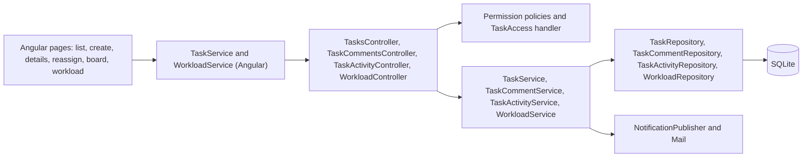
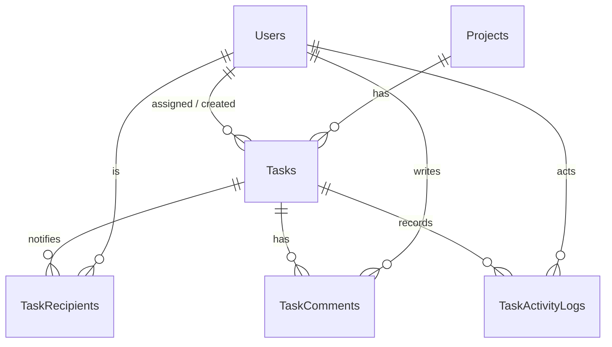

# Monitoring Module – Technical Documentation

> **Project:** TaskFlow – Intelligent Task Allocation & Tracking System
> **Module:** Monitoring (catalog module "TaskFlow Monitoring")  ·  **Child Modules:** Task Management, Comments & Activity History, Kanban Board, Employee Workload
> **Version:** 1.0  ·  **Last Updated:** 31-Oct-2026
> **Backend:** ASP.NET Core Web API (.NET 10)  ·  **Frontend:** Angular  ·  **Database:** SQLite (EF Core)
> **Author:** Jojo George (jojogeorge3344@gmail.com)
> © 2026 Jojo George. All rights reserved.

> ✅ Target framework confirmed: `net10.0` (.NET 10), from `backend/src/TaskFlow.Api/TaskFlow.Api.csproj`.

---

## 1. Technical Overview
Monitoring has four controllers under `Controllers/Monitoring/`, which share two route prefixes: `api/v1/tasks` and `api/v1/workload`. They expose 20 endpoints.

**Layers**
- Controllers stay thin. They read the user id (`ClaimTypes.NameIdentifier`) and the role name (`ClaimTypes.Role`) from the JWT and pass them to the services.
- `TaskService` enforces the business rules:
  - task scope (Own, Team or Organization)
  - the status-transition table
  - create, edit and reassign validation
  - worked-hours tracking
  - notifications and internal mail
- `TaskCommentService` handles discussion comments. `TaskActivityService` handles the append-only history and the Administrator's hours corrections. `WorkloadService` builds the per-employee counts.
- Repositories use EF Core over SQLite. Tasks are soft-deleted (`IsDeleted`).

**Authorization works at two levels**
1. Permission policies (`perm:<key>`, through `[RequirePermission]` or `[Authorize(Policy = PermissionPolicy.Prefix + key)]`).
2. A resource policy, `TaskAccess` (`TaskAccessHandler`). It passes for the assignee, the creator, any recipient, and any caller with `tasks.view.all`.

`TaskService` adds a third check on top: a role that holds `tasks.view.all` and `dashboard.view.team`, but not `dashboard.view.organization` (the Manager by default), is limited to its team's tasks plus its own.

**Frontend**
- Angular standalone components, lazy-loaded from `modules/monitoring/monitoring.routes.ts`.
- Two API services: `TaskService` and `WorkloadService`.
- Board drag-and-drop uses `@angular/cdk/drag-drop`.

## 2. Architecture Flow

## 3. Backend File Structure
Module-level summary. Each child document lists its own files in detail.

| Layer | Path | Files | Owning child |
|-------|------|-------|--------------|
| Controller | `TaskFlow.Api/Controllers/Monitoring/` | `TasksController.cs`, `TaskCommentsController.cs`, `TaskActivityController.cs`, `WorkloadController.cs` | 04.1 + 04.3 / 04.2 / 04.2 / 04.4 |
| Service | `TaskFlow.Api/Services/Monitoring/TaskManagement/` | `Tasks/`, `Discussion/`, `Activity/`, `Access/`, `Rules/` | 04.1, 04.2, 04.2, shared, 04.1 + 04.3 |
| Service | `TaskFlow.Api/Services/Monitoring/EmployeeWorkload/` | `IWorkloadService.cs`, `WorkloadService.cs` | 04.4 |
| Repository | `TaskFlow.Api/Repositories/Monitoring/TaskManagement/` | `Tasks/`, `Discussion/`, `Activity/` | 04.1 + 04.3, 04.2, 04.2 |
| Repository | `TaskFlow.Api/Repositories/Monitoring/EmployeeWorkload/` | `IWorkloadRepository.cs`, `WorkloadRepository.cs`, `WorkloadEmployee.cs`, `WorkloadCounts.cs` | 04.4 |
| DTOs / Validators | `TaskFlow.Api/Dtos/Monitoring/` | `TaskManagement/` (+ `Validators/`, `Discussion/`, `Activity/`), `EmployeeWorkload/` | per child |
| Entities | `TaskFlow.Api/Models/Entities/` | `Task.cs`, `TaskRecipient.cs` (04.1), `TaskComment.cs`, `TaskActivityLog.cs` (04.2) | per child |
| Enums | `TaskFlow.Api/Models/Enums/` | `TaskStatus.cs`, `TaskPriority.cs`, `ReminderFrequency.cs` (04.1), `TaskActivityEventType.cs` (04.2), `NotificationType.cs` (shared) | per child |
| Shared rules | `TaskFlow.Api/Common/Rules/` | `TaskStageCalculator.cs`, `TaskBucketRules.cs`, `ReminderIntervals.cs` | 04.1 |
| Service (shared) | `TaskFlow.Api/Services/Monitoring/TaskManagement/Access/` | `ITaskAccessService.cs`, `TaskAccessService.cs` | shared (used by `TaskAccessHandler`) |
| Authorization | `TaskFlow.Api/Authorization/TaskAccess/` | `TaskAccessRequirement.cs`, `TaskAccessHandler.cs` | shared (04.1, 04.2, 04.3) |
| Authorization | `TaskFlow.Api/Authorization/Policies/` | `AuthPolicies.cs` (`TaskAccess`), `RequirePermissionAttribute.cs` | shared |
| Permissions | `TaskFlow.Api/Common/Security/` | `PermissionKeys.cs`, `PermissionCatalog.cs`, `PermissionPolicy.cs` (prefix `perm:`) | shared |
| Registration | `TaskFlow.Api/Config/CrossCuttingRegistration.cs` | Registers one policy per catalog key, the `TaskAccess` policy and `TaskAccessHandler` | shared |

## 4. Frontend File Structure

| Type | Path | Purpose |
|------|------|---------|
| Routes | `src/app/modules/monitoring/monitoring.routes.ts` | `/workload`, `/board`, `/tasks`, `/tasks/new`, `/tasks/:id`, `/tasks/:id/discussion`, `/tasks/:id/activity`, `/tasks/:id/reassign` |
| Child folders | `src/app/modules/monitoring/task-management/`, `board/`, `employee-workload/` | Pages, services, models and utils of 04.1 / 04.2, 04.3 and 04.4 (see each child document) |
| Route / Guard | `src/app/shared/auth/auth.guard.ts` (`permissionGuard`) | Lets the user through if they hold any key in `data.permissions`, otherwise redirects to `dashboardRouteFor(...)` |
| Menu | `src/app/layouts/nav-items.ts` | "TaskFlow Monitoring" (with `tasks.view.all`) or "Task Management → My Tasks"; Workload item needs `workload.view`; Board item needs `board.view` |
| Permission constants | `src/app/shared/auth/permissions.ts` | `Permissions.Tasks*`, `WorkloadView/Filters/TasksOpen`, `BoardView/Filters` |

| Route | Guard permission | Child |
|-------|------------------|-------|
| `/tasks`, `/tasks/:id` | none (signed-in only) | 04.1 |
| `/tasks/:id/discussion` | none (signed-in only) | 04.2 |
| `/tasks/new` | `tasks.create` | 04.1 |
| `/tasks/:id/activity` | `tasks.activity.view` | 04.2 |
| `/tasks/:id/reassign` | `tasks.reassign` | 04.1 |
| `/board` | `board.view` | 04.3 |
| `/workload` | `workload.view` | 04.4 |

---

## 5. Child Modules

| # | Child Module | Main endpoints (count) | Key permissions | Document |
|---|--------------|------------------------|-----------------|----------|
| 04.1 | Task Management | `GET/POST /api/v1/tasks`, `GET/PUT/DELETE /tasks/{id}`, `/hours`, `/status`, `/reassign`, `/recipients`, `/assignees`, `/board` (12) | `tasks.view.own`, `tasks.view.all`, `tasks.create`, `tasks.update`, `tasks.delete`, `tasks.reassign`, `tasks.recipients.manage`, `tasks.status.change` | `04.1-Task-Management.md` |
| 04.2 | Comments & Activity History | `/tasks/{id}/comments` (4), `/tasks/{id}/activity` (1), `/activity/{entryId}/hours` (2) (7) | `tasks.comment.create`, `tasks.comment.edit`, `tasks.comment.delete`, `tasks.activity.view`, Administrator role | `04.2-Comments-and-Activity-History.md` |
| 04.3 | Kanban Board | `GET /tasks/board`, `PATCH /tasks/{id}/status`, `GET /tasks/assignees` (3, all shared with 04.1) | `board.view`, `board.filters.use`, `tasks.status.change` | `04.3-Kanban-Board.md` |
| 04.4 | Employee Workload | `GET /api/v1/workload` (1) | `workload.view`, `workload.filters.use`, `workload.tasks.open` | `04.4-Employee-Workload.md` |

Unique endpoints: 12 + 7 + 1 = 20 (the 3 board endpoints are counted once, under 04.1). The child documents are in the folder `04-Monitoring/`.

---

## 6. Database Design

Table names come from the `AppDbContext` `DbSet` properties (`Tasks`, `TaskRecipients`, `TaskComments`, `TaskActivityLogs`). SQLite storage types come from the migrations: int and bool are stored as INTEGER, and string, DateTime and decimal as TEXT. Full column lists are in the owning child document.

| Table | Owned by | Also used by |
|-------|----------|--------------|
| `Tasks` | 04.1 Task Management | 04.2 (task checks, `ActualHours` rebuild), 04.3 (board cards, status), 04.4 (counts) |
| `TaskRecipients` | 04.1 Task Management | 04.2 (notification targets), `TaskAccessHandler` |
| `TaskComments` | 04.2 Comments & Activity History | – |
| `TaskActivityLogs` | 04.2 Comments & Activity History | 04.1 and 04.3 (append history entries) |
| `Users`, `Roles`, `RolePermissions`, `Permissions`, `UserProjectAllocations`, `Projects`, `Positions`, `DepartmentManagers` | Management / Settings modules | 04.1 (assignee, project, manager team), 04.4 (employee set, allocations) |

**Relationships**
- `Tasks.AssignedToUserId → Users.Id` (FK, Restrict)
- `Tasks.CreatedByUserId → Users.Id` (FK, Restrict)
- `Tasks.ProjectId → Projects.Id` (FK, Restrict)
- `TaskRecipients.TaskId → Tasks.Id` (FK, Cascade); `TaskRecipients.UserId → Users.Id` (FK, Cascade)
- `TaskComments.TaskId → Tasks.Id` (FK, Cascade); `TaskComments.AuthorUserId → Users.Id` (FK, Restrict)
- `TaskActivityLogs.TaskId → Tasks.Id` (FK, Cascade); `TaskActivityLogs.ActorUserId → Users.Id` (FK, Restrict)
- Other tables that point at `Tasks`: `Notifications.TaskId`, reminder rows and `MailMessages.TaskId` (owned by the Communication module).
- Migrations: `20261012124843_AddTasks`, `20261013075057_AddTaskTracking`, `20261013104629_AddTaskReminderSettings`, `20261024074305_AddTaskActualHours`, `20261024122725_AddTaskCommentEditDelete`.

## 7. Security & Authorization
- **Authentication:** JWT bearer token plus a refresh-token cookie. `SessionValidation` refreshes the permission claims (`AuthClaims.Permission`) from the database on every request.
- **Authorization:**
  - Each key in `PermissionCatalog.All` is registered as the policy `perm:<key>` (`RequireClaim(AuthClaims.Permission, key)`) in `CrossCuttingRegistration`.
  - The `TaskAccess` policy runs `TaskAccessHandler`, which calls `ITaskAccessService.CanAccessAsync` (task live, and view-all, assignee, creator or recipient).
  - Refused authorizations are logged by `DeniedActionAuditHandler`.
- **Data scope:**
  - Organization = `tasks.view.all` without manager scoping.
  - Team = `tasks.view.all` + `dashboard.view.team` without `dashboard.view.organization`. The team plus own tasks come from `TaskService.VisibilityForCallerAsync` and `CanAccessTaskAsync`.
  - Own = assignee, creator or recipient (`TaskRepository.Scoped`).
- **Frontend:**
  - `permissionGuard` with `data.permissions` on routes.
  - Menu items built in `nav-items.ts`.
  - Buttons are shown or hidden with `AuthService.hasPermission(...)` computed signals (`canCreate`, `canEdit`, `canDelete`, `canReassign`, `canViewActivity`, `canMove`, `canFilter`, `canOpenTasks`, `canManage`).

The key → endpoint → UI element table is split by child (section 7 of each child document).

**Seed defaults** (from `PermissionCatalog.cs`, matching `role-permission-matrix.csv`):
- The Administrator holds every assignable key, re-granted on every start.
- Manager: every Monitoring key except `tasks.delete`.
- Employee: `tasks.comment.*`, `tasks.activity.view`, `board.view`, `board.filters.use` and `tasks.status.change`.
- `tasks.view.own` is Always On and not assignable.

## 8. Validations & Error Handling
Shared rules that apply to every child. Child-specific rules are in each child document.

| Rule | Layer | HTTP Code | Error Message |
|------|-------|-----------|---------------|
| No permission (policy) | Policy | 403 | Forbidden (empty body) |
| Task / comment / entry not found, or outside a manager's team on read | Controller (`null` / `false` result) | 404 | Not Found (empty body) |
| Other concurrency conflict | `UnitOfWork` / `GlobalExceptionHandler` | 409 | Someone else changed this record while you were saving. Reload it and try again. |
| Unhandled fault | `GlobalExceptionHandler` | 500 | Something went wrong. Please try again. |

Errors are returned by `GlobalExceptionHandler` (`Middleware/GlobalExceptionHandler.cs`) as `application/problem+json`. An `AppException` uses its own status code, and its message becomes `detail`. `RequestValidationException` and `ValidationFilter` failures return a `ValidationProblemDetails` with an `errors` map. Validators run automatically through `Filters/ValidationFilter.cs`, before the action. On the frontend, `apiErrorMessage` shows `detail`, then `error`, then `message`, then the first `errors` entry, and otherwise the screen's fallback text.

## 9. Integrations / Side Effects
- **Notifications:** all go through `INotificationPublisher.PublishAsync` and are skipped when in-app notifications are switched off in Application Settings. Events: create and reassign and worked hours (04.1), comment add, edit or delete (04.2).
- **Email / internal mail:** reassign and hours changes use `IMailService.SendAsync` (04.1); comments write a system `MailMessage` directly (04.2). All of these are best effort (logged, never rolled back).
- **Activity Log:** every task and comment action is appended through `TaskActivityService.AppendAsync`. The full action → event-type table is in 04.2.
- **AI Assistant:** task reading tools are described in 04.1. The Monitoring help topics are in `Services/Assistant/Knowledge/` (`task-list-and-filters.md`, `create-task.md`, `change-task-status.md`, `reassign-task.md`, `task-comments-and-activity.md`, `reports-and-workload.md`) and span all four children.
- **Dashboard:** drill-down into the Task List (04.1).

## 10. Configuration

| Key (`appsettings.json`) | Purpose | Default |
|--------------------------|---------|---------|
| `ConnectionStrings:Default` | SQLite database used for all Monitoring tables | `<secret>` |
| `Jwt:AccessTokenMinutes` | Access token lifetime for API calls | `30` |
| `Jwt:RefreshTokenDays` | Refresh cookie lifetime | `7` |

Settings stored in the database that apply to the whole module:
- In-app notifications enabled (`SettingKeys.NotificationInAppEnabled`)

Child-specific configuration (time zone, reminder engine, reminder defaults, default priority, mail switch) is in 04.1 and 04.2.

## 11. Testing

Paths are relative to `backend/tests`.

| Test Type | File / Location | Covers |
|-----------|-----------------|--------|
| Integration | `TaskFlow.IntegrationTests/Common/ModuleBasedPermissionEndpointsTests.cs`, `PermissionAuthorizationTests.cs` | Permission policies on endpoints |
| Unit | `TaskFlow.UnitTests/Settings/RoleConfiguration/PermissionCatalogTests.cs` | Catalog entries |

Child-specific test files are listed in each child document. Only the test file names are available. What each file covers is inferred from its name.

## 12. Known Limitations / Future Enhancements
Module-wide items only. Child-specific gaps are listed in each child document.

- **Missing frontend style files:** the component `.css` files referenced by `styleUrl` are absent from the snapshot (all children).
- **Hidden dependency on `projects.view`:** the list, board and workload Project filters need `projects.view`; without it the filters are hidden or empty (audit D).
- **Audit artifacts are stale:** `permission-inventory.csv` and `permission-gaps.md` cite old paths (`TaskFlow.Infrastructure/Services/TaskService.cs`, `features/tasks/...`) and older findings. For example, "Board has no view permission" is now fixed by `board.view`, and "`/tasks/:id/activity` has no guard" is now fixed by a `tasks.activity.view` guard. The audit artifacts should be regenerated.
- **`GET /tasks`, `/tasks/assignees`, `/tasks/{id}`, `/tasks/{id}/recipients` and `/tasks/{id}/comments` use `[Authorize]` and data rules only.** Task list and details viewing cannot be switched off for a role (by design: `tasks.view.own` is Always On).

---
© 2026 Jojo George. All rights reserved. Unauthorized copying or distribution of this document is prohibited.
