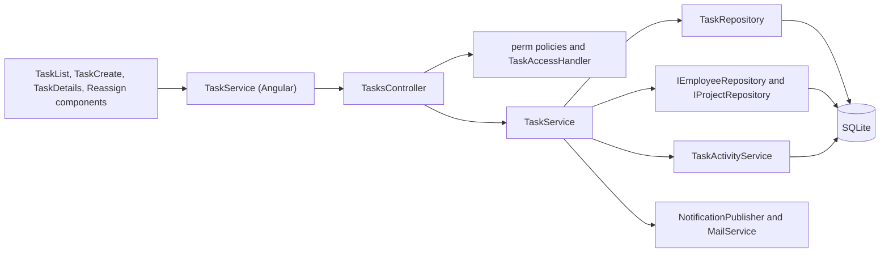
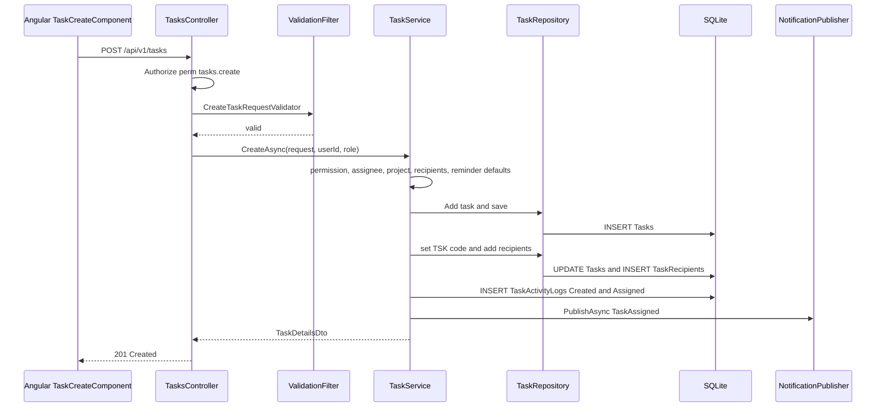
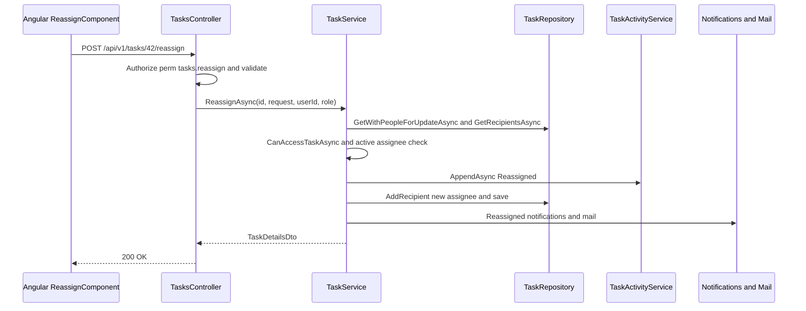

# Task Management – Technical Documentation

> **Project:** TaskFlow – Intelligent Task Allocation & Tracking System
> **Parent Module:** Monitoring  ·  **Child Module:** 04.1 Task Management
> **Version:** 1.0  ·  **Last Updated:** 31-Oct-2026
> **Backend:** ASP.NET Core Web API (.NET 10)  ·  **Frontend:** Angular  ·  **Database:** SQLite (EF Core)
> **Author:** Jojo George (jojogeorge3344@gmail.com)
> © 2026 Jojo George. All rights reserved.

---

## 1. Technical Overview
Task Management is served by `TasksController` (`[Route("api/v1/tasks")]`, class-level `[Authorize]`), which exposes 12 endpoints. Three of them (`/board`, `/{id}/status`, `/assignees`) are also used by 04.3 Kanban Board.

- The controller reads the user id (`ClaimTypes.NameIdentifier`) and role name (`ClaimTypes.Role`) from the JWT and passes them to `TaskService`.
- `TaskService` enforces the task scope (Own, Team or Organization), the status-transition table, create / edit / reassign validation, worked-hours tracking, and notifications and internal mail.
- `TaskRepository` uses EF Core over SQLite. Tasks are soft-deleted (`IsDeleted`).
- Authorization: permission policies (`perm:<key>`), the `TaskAccess` resource policy on details, status and recipients, and the service-level team check for Manager-scoped roles.
- Frontend: standalone pages `TaskListComponent`, `TaskCreateComponent`, `TaskDetailsComponent` and `ReassignComponent`, calling the Angular `TaskService`.

## 2. Architecture Flow


## 3. Backend File Structure

| Layer | Path | Files |
|-------|------|-------|
| Controller | `TaskFlow.Api/Controllers/Monitoring/` | `TasksController.cs` |
| Service | `TaskFlow.Api/Services/Monitoring/TaskManagement/Tasks/` | `ITaskService.cs`, `TaskService.cs` |
| Service rules | `TaskFlow.Api/Services/Monitoring/TaskManagement/Rules/` | `TaskAccessScope.cs`, `TaskStatusTransitions.cs` |
| Service (shared) | `TaskFlow.Api/Services/Monitoring/TaskManagement/Access/` | `ITaskAccessService.cs`, `TaskAccessService.cs` |
| Repository | `TaskFlow.Api/Repositories/Monitoring/TaskManagement/Tasks/` | `ITaskRepository.cs`, `TaskRepository.cs`, `TaskListCriteria.cs`, `TaskVisibility.cs`, `TaskDateRange.cs`, `TaskBucketSelection.cs` |
| DTOs | `TaskFlow.Api/Dtos/Monitoring/TaskManagement/` | `TaskDtos.cs` (`TaskRecipientDto`, `TaskCardDto`, `TaskDetailsDto`, `TaskListItemDto`), `TaskRequests.cs` (`CreateTaskRequest`, `UpdateTaskRequest`, `UpdateTaskStatusRequest`, `ReassignTaskRequest`, `LogHoursRequest`, `SetRecipientsRequest`, `TaskListFilter`, `TaskBucketFilter`) |
| Validators | `TaskFlow.Api/Dtos/Monitoring/TaskManagement/Validators/` | `CreateTaskRequestValidator.cs`, `UpdateTaskRequestValidator.cs`, `UpdateTaskStatusRequestValidator.cs`, `ReassignTaskRequestValidator.cs`, `SetRecipientsRequestValidator.cs` |
| Entities | `TaskFlow.Api/Models/Entities/` | `Task.cs`, `TaskRecipient.cs` |
| Enums | `TaskFlow.Api/Models/Enums/` | `TaskStatus.cs`, `TaskPriority.cs`, `ReminderFrequency.cs`, `NotificationType.cs` |
| Shared rules | `TaskFlow.Api/Common/Rules/` | `TaskStageCalculator.cs`, `TaskBucketRules.cs`, `ReminderIntervals.cs` |
| Authorization | `TaskFlow.Api/Authorization/TaskAccess/` | `TaskAccessRequirement.cs`, `TaskAccessHandler.cs` (shared with 04.2 and 04.3) |

## 4. Frontend File Structure

| Type | Path | Purpose |
|------|------|---------|
| Page component | `src/app/modules/monitoring/task-management/pages/` | `task-list.component.*` (Screen 7), `task-create.component.*` (Screen 8, including copy), `task-details.component.*` (Screen 9, with the 04.2 summary tabs for Screens 11/18), `reassign.component.*` (Screen 15) |
| Page model | `src/app/modules/monitoring/task-management/pages/task-create.model.ts` | Create-form field names (`FieldName`) |
| API service | `src/app/modules/monitoring/task-management/services/task.service.ts` | `list`, `getAssignees`, `create`, `getBoard`, `getById`, `update`, `logHours`, `changeStatus`, `delete`, `reassign`, `getRecipients`, `setRecipients` (the comment and activity calls belong to 04.2) |
| Models | `src/app/modules/monitoring/task-management/models/task.model.ts` | `TaskCard`, `TaskDetails`, `TaskListItem`, `PagedResult`, `TaskListFilter`, request types, `TASK_STATUSES`, `TASK_PRIORITIES` |
| Utils | `src/app/modules/monitoring/task-management/utils/return-url.ts` | `safeReturnUrl`, `backTarget` (Back to tasks / board / project) |
| Route / Guard | `src/app/modules/monitoring/monitoring.routes.ts` + `permissionGuard` | See the table below |

| Route | Guard permission |
|-------|------------------|
| `/tasks`, `/tasks/:id` | none (signed-in only) |
| `/tasks/new` | `tasks.create` |
| `/tasks/:id/reassign` | `tasks.reassign` |

---

## 5. API & Logic

### 5.1 API Endpoints

All routes are under `[Route("api/v1/tasks")]` with class-level `[Authorize]` (controller `TasksController`).

| # | Method | Endpoint | Description | Permission (Policy) | Request DTO | Response DTO |
|---|--------|----------|-------------|---------------------|-------------|--------------|
| 1 | GET | `/api/v1/tasks` | Paged, filtered, searched list scoped to the caller | `[Authorize]` only (scope applied in service) | `TaskListFilter` (query) | `PagedResult<TaskListItemDto>` |
| 2 | POST | `/api/v1/tasks` | Create task | `perm:tasks.create` + service check | `CreateTaskRequest` | `201 Created` + `TaskDetailsDto` (Location → GetById) |
| 3 | GET | `/api/v1/tasks/assignees` | Distinct assignees of accessible tasks (list/board filter) | `[Authorize]` only | – | `IReadOnlyCollection<TaskRecipientDto>` |
| 4 | GET | `/api/v1/tasks/board` | Flat list of accessible tasks for the board | `perm:board.view` | – | `IReadOnlyCollection<TaskCardDto>` |
| 5 | GET | `/api/v1/tasks/{id:int}` | Task details | `TaskAccess` + service team check | – | `TaskDetailsDto` (404 when outside the manager's team) |
| 6 | PUT | `/api/v1/tasks/{id:int}` | Edit task | `perm:tasks.update` + service scope | `UpdateTaskRequest` | `TaskDetailsDto` |
| 7 | POST | `/api/v1/tasks/{id:int}/hours` | Add worked hours | `[Authorize]` only; service: assignee or `tasks.update` + scope | `LogHoursRequest` | `TaskDetailsDto` |
| 8 | DELETE | `/api/v1/tasks/{id:int}` | Soft-delete task | `perm:tasks.delete` | – | `204 No Content` |
| 9 | PATCH | `/api/v1/tasks/{id:int}/status` | Change status (transition table) | `perm:tasks.status.change` + `TaskAccess` + service scope | `UpdateTaskStatusRequest` | `TaskCardDto` |
| 10 | POST | `/api/v1/tasks/{id:int}/reassign` | Reassign with reason | `perm:tasks.reassign` + service check and scope | `ReassignTaskRequest` | `TaskDetailsDto` |
| 11 | GET | `/api/v1/tasks/{id:int}/recipients` | Task recipients | `TaskAccess` + service scope | – | `IReadOnlyCollection<TaskRecipientDto>` |
| 12 | PUT | `/api/v1/tasks/{id:int}/recipients` | Replace additional recipients | `perm:tasks.recipients.manage` + service check | `SetRecipientsRequest` | `204 No Content` |

Rows 3, 4 and 9 are also the endpoints of 04.3 Kanban Board.

**`TaskListFilter` query parameters:**
- `assignedToUserId`, `status`, `priority`, `deadlineFrom`, `deadlineTo`, `search`, `page` (default 1), `pageSize` (default 20; values outside 1–100 become 20).
- Dashboard drill-down parameters: `bucket` (`All`, `Pending`, `InProgress`, `Completed`, `Overdue`), `deadlineBucket`, `departmentId`, `projectId`, `employeeId`, `managerId`, `from`, `to` (`DateOnly`), `basis` (`AnalyticsDateBasis`, default `Created`).
- Enums travel as their names (`JsonStringEnumConverter`).

### 5.2 Request / Response Samples
```json
// POST /api/v1/tasks
{
  "title": "Prepare Q4 release notes",
  "description": "Collect changes from all teams",
  "assignedToUserId": 12,
  "projectId": 3,
  "priority": "High",
  "startDate": "2026-10-31T04:30:00Z",
  "deadline": "2026-11-03T12:30:00Z",
  "estimatedHours": 6,
  "additionalRecipientUserIds": [7, 9],
  "firstReminderDays": 2,
  "secondReminderDays": 1,
  "overdueReminderFrequency": "Daily"
}
```
```json
// 201 Created
{
  "id": 42, "taskCode": "TSK-000042", "title": "Prepare Q4 release notes",
  "description": "Collect changes from all teams",
  "assignedToUserId": 12, "assignedToName": "Asha Nair",
  "createdByUserId": 4, "createdByName": "Ravi Menon",
  "priority": "High", "startDate": "2026-10-31T04:30:00Z", "deadline": "2026-11-03T12:30:00Z",
  "estimatedHours": 6, "actualHours": null, "status": "ToDo", "stage": "Upcoming",
  "recipients": [ { "userId": 7, "fullName": "Divya K" }, { "userId": 9, "fullName": "John P" }, { "userId": 12, "fullName": "Asha Nair" } ],
  "createdAt": "2026-10-31T10:00:00Z", "updatedAt": "2026-10-31T10:00:00Z",
  "projectId": 3, "projectName": "Website Revamp",
  "firstReminderDays": 2, "secondReminderDays": 1, "overdueReminderFrequency": "Daily"
}
```
```json
// GET /api/v1/tasks?status=InProgress&search=release&page=1&pageSize=20  -> 200 OK
{ "items": [ { "id": 42, "taskCode": "TSK-000042", "title": "Prepare Q4 release notes", "assignedToUserId": 12,
  "assignedToName": "Asha Nair", "createdByUserId": 4, "createdByName": "Ravi Menon", "priority": "High",
  "startDate": "2026-10-31T04:30:00Z", "deadline": "2026-11-03T12:30:00Z", "estimatedHours": 6,
  "status": "InProgress", "stage": "Upcoming", "isOverdue": false, "projectId": 3, "projectName": "Website Revamp" } ],
  "total": 1, "page": 1, "pageSize": 20 }
```
```json
// PATCH /api/v1/tasks/42/status
{ "status": "InQA" }
// POST /api/v1/tasks/42/reassign
{ "newAssigneeUserId": 15, "reason": "Asha is on leave next week" }
// POST /api/v1/tasks/42/hours
{ "hours": 2.5 }
// PUT /api/v1/tasks/42/recipients
{ "recipientUserIds": [7, 9] }
```
> The `PagedResult` property names (`items`, `total`, `page`, `pageSize`) are taken from the frontend `PagedResult<T>` model and from the constructor `new PagedResult<TaskListItemDto>(items, result.Total, page, pageSize)`. The sample values are illustrative.

### 5.3 Service Layer Logic
`TaskService` (`Services/Monitoring/TaskManagement/Tasks/TaskService.cs`).

**Shared helpers**
- `HasPermissionAsync(role, key)` reads the role's keys from the database (`IRoleRepository.GetPermissionKeysByRoleNameAsync`) and expands legacy keys (`EffectivePermissions.Expand`). Role changes therefore apply at once.
- `IsManagerScopedAsync(role)` = holds `dashboard.view.team` and does not hold `dashboard.view.organization`.
- `VisibilityForCallerAsync(userId, role)`:
  - No `tasks.view.all`, or not manager-scoped → `TaskVisibility(userId, canViewAll)`.
  - Manager-scoped with `tasks.view.all` → `TaskVisibility(userId, ViewAll: true, TeamUserIds: GetTeamMemberIdsAsync(userId), OrOwn: true)`.
  - The team is the active users, other than the manager, in a department the manager manages (`DepartmentManagers`) or on a project where the manager has `IsProjectManager`.
- `CanAccessTaskAsync(task, recipientIds, userId, role)`:
  1. `TaskAccessScope.CanAccess` (view-all, assignee, creator or recipient).
  2. For a manager-scoped view-all caller who is not personally on the task, also `ITaskRepository.IsTeamTaskAsync` (assigned to, or notifying, a team member).

**`ListAsync(TaskListFilter filter, int currentUserId, string currentUserRole, ...)`**
1. Clamp `page` (minimum 1). A `pageSize` outside 1–100 becomes 20.
2. Build the visibility. If the filter is a drill-down (`Bucket`, `DeadlineBucket`, `DepartmentId`, `ProjectId`, `EmployeeId`, `ManagerId`, `From` or `To` is set) and the caller is manager-scoped, set `OrOwn = false`, so only the team's tasks are listed.
3. `DrillDownCriteriaAsync` converts:
   - the bucket to a `TaskBucketSelection`
   - the deadline bucket to `DeadlineBucketRules.BoundsFor(now, timeZone)`
   - `From`/`To` to UTC local-midnight bounds (`ReminderCalculator.LocalMidnightUtc`); if `From > To` it throws `AnalyticsFilterException("The end date cannot be before the start date.")` (400).
4. `ITaskRepository.ListAsync(criteria, page, pageSize)`. Each row is mapped to `TaskListItemDto`. The stage comes from `TaskStageCalculator.Calculate(status, deadline, now, appTimeZone)`, and `IsOverdue = stage == Overdue`.

**`GetBoardAsync` / `GetAssigneesAsync`** both use `VisibilityForCallerAsync`. The board maps each task to `TaskCardDto`, with `IsOverdue = Deadline < UtcNow` and status not Completed or Cancelled (see 04.3).

**`GetDetailsAsync(taskId, ...)`**
1. Load with `GetWithPeopleForUpdateAsync` (includes people even when soft-deleted).
2. Load the recipients.
3. `CanAccessTaskAsync`. If it fails, return `null` (the controller returns 404).
4. `ToDetails`, which includes the stage.

**`CreateAsync(CreateTaskRequest request, int currentUserId, string currentUserRole, ...)`**
1. `tasks.create` check → `ForbiddenException("Your role is not allowed to create tasks.")`.
2. `ValidateCreate` (title, assignee > 0, project > 0, deadline after start, estimated hours > 0). This repeats the FluentValidation rules.
3. The assignee must be live and active (`IEmployeeRepository.GetLiveAsync`) → `"The assigned employee does not exist or is not active."`.
4. The project must exist and be active (`IProjectRepository.ExistsActiveAsync`) → `"The selected project does not exist."`.
5. Recipients are de-duplicated, and every one must be live (`CountLiveAsync`) → `"One or more recipients do not exist."`.
6. Reminder fields that are null take the defaults from `IReminderSettingsService.GetAsync` (`DefaultFirstDays`, `DefaultSecondDays`, `DefaultOverdueFrequency`). The order is checked with `ReminderIntervals.AreOrdered`.
7. In one `IUnitOfWork.ExecuteInTransactionAsync`:
   1. Insert the task with a placeholder `TaskCode` `P-{guid}`, `Status = ToDo` and `CreatedByUserId = caller`, and save.
   2. Set `TaskCode = "TSK-{Id:D6}"`.
   3. Add one `TaskRecipient` per user in `{assignee} ∪ additional` (BR-5), and save.
   4. Append the activity entries `Created` ("Task created", new value = title) and `Assigned` ("Assigned to {name}", new value = assignee id).
   5. Publish the notification `TaskAssigned` "A task was assigned to you: {title}". This is inside the transaction, so if it fails nothing is left behind.
8. Reload the task and return `TaskDetailsDto`.

**`UpdateAsync(taskId, UpdateTaskRequest request, ...)`**
1. `tasks.update` check → `"Your role is not allowed to edit tasks."`.
2. `ValidateUpdate`.
3. Load the task; not found → `null` (404). `CanAccessTaskAsync` fails → `ForbiddenException("You do not have access to this task.")`.
4. Append history entries for the fields that changed:
   - `DeadlineChanged` "Deadline updated" (old/new as ISO `O`)
   - `PriorityChanged` "Priority updated"
   - `HoursLogged` "Worked hours logged: {X}h (total)", when `ActualHours` is given and differs
5. Overwrite Title (trimmed), Description, Priority, StartDate, Deadline, EstimatedHours and UpdatedAt, then save.
6. If the hours changed, run `NotifyHoursChangedAsync`.

**`LogHoursAsync(taskId, LogHoursRequest request, ...)`**
1. `Hours` must be > 0 and ≤ 24 → `BusinessRuleException("Hours must be greater than 0 and at most 24 per entry.")`.
2. Load the task and check `CanAccessTaskAsync`.
3. The caller must be the assignee or hold `tasks.update` → `"Only the assignee can log hours on this task."`.
4. `ActualHours = previous + hours`. Append `HoursLogged` (old/new totals, written with `InvariantCulture` `0.##`) and save.
5. `ActualHours` is a concurrency token. A `ConcurrencyConflictException` becomes `ConflictException("The task's worked hours changed while you were saving. Please try again.")` (409).
6. `NotifyHoursChangedAsync`.

**`NotifyHoursChangedAsync`** (best effort; a failure is only logged)
- Targets: the recipients plus the assignee, de-duplicated.
- Message: `"{actor} added Xh of worked time (was Yh) on task {title}. Total worked now: …h of …h estimated (…h remaining | over by …h)."` The wording changes to "cleared the worked hours" or "updated the worked hours" for those cases.
- Publishes `NotificationType.System` to each target, then sends internal mail through `IMailService.SendAsync(actorId, SendMailRequest(emails, null, "Worked hours changed: {title}", message, null))`.

**`ChangeStatusAsync(taskId, UpdateTaskStatusRequest request, ...)`**
1. Load the task and check `CanAccessTaskAsync`.
2. `TaskStatusTransitions.Can(from, to)`, otherwise `BusinessRuleException("Cannot move a task from {from} to {to}.")`.
3. Set Status and UpdatedAt. Set `CompletedAt` on Completed and `CancelledAt` on Cancelled.
4. Append `StatusChanged` ("Status changed from X to Y"), plus `Completed` ("Task completed") on completion. Save.
5. Return `TaskCardDto`.

**`ReassignAsync(taskId, ReassignTaskRequest request, ...)`**
1. `tasks.reassign` check → `"Your role is not allowed to reassign tasks."`.
2. A blank reason → `"A reassignment reason is required."`.
3. Load the task and check the scope.
4. The new assignee must be live and active → `"The target employee does not exist or is not active."`.
5. Set `AssignedToUserId`. Append `Reassigned` "Reassigned from {old} to {new}. Reason: {reason}" with old/new names.
6. Add the new assignee as a recipient if missing (BR-5), and save.
7. `NotifyReassignedAsync` (best effort):
   - Targets: recipients ∪ new assignee ∪ old assignee ∪ actor.
   - The new assignee gets "A task was reassigned to you: {title}. Reason: {reason}". Everyone else gets `"{actor} reassigned task "{title}" ({code}) from A to B. Reason: …"`. The type is `NotificationType.Reassigned`.
   - Mail subject: "Task reassigned: {title}".
   - The previous assignee **stays** a recipient.

**`GetRecipientsAsync`** returns the recipients, or null when the task is not found or out of scope (404).

**`SetRecipientsAsync(taskId, SetRecipientsRequest request, ...)`**
1. `tasks.recipients.manage` check → `"Your role is not allowed to manage task recipients."`.
2. Task not found → `false` (404).
3. Desired = request ids ∪ {assignee}. Add the missing ones and remove the extra ones (never the assignee). Save.
4. Append `Assigned` "Task recipients updated".

There is **no** task-scope check and **no** check that the users exist (see section 12).

**`DeleteAsync(taskId, currentUserId, ...)`**
1. Load the live task (`GetLiveForUpdateAsync`). Not found → `false` (404).
2. In a transaction: set `IsDeleted = true` and UpdatedAt, save, and append `Deleted` "Task deleted" (old value = title). Comments and history are kept.

There is no scope check (see section 12).

**Rules classes**
- `TaskAccessScope.CanAccess(userId, canViewAll, task, recipientIds)`.
- `TaskStatusTransitions.Can(from, to)`:
  - same → same is always allowed
  - ToDo → InProgress, Blocked or Cancelled
  - InProgress → InQA, Blocked, Completed or Cancelled
  - Blocked → InProgress or Cancelled
  - InQA → InProgress, Completed, Blocked or Cancelled
  - Completed and Cancelled are terminal
- `TaskStageCalculator.Calculate`: Completed or Cancelled → `Completed`; otherwise it compares the deadline's calendar day with today in the application time zone and returns `Overdue`, `DueToday` or `Upcoming`.

### 5.4 Repository Layer
`TaskRepository : BaseRepository<Task>, ITaskRepository`

| Method | Description | Query Notes |
|--------|-------------|-------------|
| `ListAsync(TaskListCriteria, page, pageSize)` | One page of tasks | `Visible(visibility)`, then the filters: assignee, status, priority, deadline from/to, `LIKE` search on Title or TaskCode (with `%` `_` `\` escaped), bucket (`TaskBucketRules`), deadline bucket, date range (`ApplyDateRange`), entity filters (`ApplyEntityFilters`: department, project, employee, manager). `CountAsync`, then `IgnoreQueryFilters` + Include AssignedTo, CreatedBy, Project; ordered by Deadline then Id; Skip/Take |
| `GetBoardAsync(TaskVisibility)` | Every visible task | Include AssignedTo, Project; ordered by Deadline |
| `GetAssigneesAsync(TaskVisibility)` | Distinct assignees | Projection plus `Distinct`, ordered by name in memory |
| `IsTeamTaskAsync(taskId, teamUserIds)` | Is the task assigned to, or notifying, a team member | `TeamTasks` + `AnyAsync` |
| `GetWithPeopleForUpdateAsync(taskId)` | Tracked live task with people | `IgnoreQueryFilters` so soft-deleted users still show |
| `GetLiveForUpdateAsync(taskId)` | Tracked live task | `!IsDeleted` |
| `GetLiveAsync(taskId)` | Read-only live task | `AsNoTracking` |
| `GetRecipientsAsync(taskId)` | Recipients with names | `AsNoTracking`, ordered by UserId |
| `GetRecipientRowsForUpdateAsync(taskId)` | Tracked recipient rows | For replacing them |
| `GetRecipientIdsAsync(taskId)` | Recipient user ids | `AsNoTracking` |
| `AddRecipient` / `RemoveRecipients` | Stage inserts and deletes | – |
| `CountUnfinishedAssignedToAsync(userId)` | Live tasks not Completed or Cancelled | Used outside this module (employee management) |
| `Visible(TaskVisibility)` (private) | `Scoped(userId, viewAll)`; with `TeamUserIds`, limit to team tasks, or team plus own when `OrOwn` | `Scoped` = `!IsDeleted` and, without view-all, assignee, creator or recipient |

### 5.5 Sequence Diagrams




---

## 6. Database Design

SQLite storage types come from the migrations: int and bool are stored as INTEGER, and string, DateTime and decimal as TEXT.

| Table | Column | Type | Constraints | Description |
|-------|--------|------|-------------|-------------|
| `Tasks` | `Id` | int | PK, Identity | Task id |
| `Tasks` | `TaskCode` | string(32) | Not Null, Unique index | `TSK-000042` (placeholder `P-…` during the insert) |
| `Tasks` | `Title` | string(200) | Not Null | Title |
| `Tasks` | `Description` | string(4000) | Nullable | Description |
| `Tasks` | `AssignedToUserId` | int | FK → Users.Id, Not Null, Index | Assignee |
| `Tasks` | `CreatedByUserId` | int | FK → Users.Id, Not Null | Creator |
| `Tasks` | `ProjectId` | int | FK → Projects.Id, Nullable column (the API requires it on create) | Project |
| `Tasks` | `Priority` | enum `TaskPriority` (int) | Not Null | Low=0, Medium=1, High=2, Critical=3 |
| `Tasks` | `StartDate` | datetime (UTC) | Not Null | Start |
| `Tasks` | `Deadline` | datetime (UTC) | Not Null, Index | Deadline |
| `Tasks` | `EstimatedHours` | decimal | Not Null | Estimate (> 0) |
| `Tasks` | `ActualHours` | decimal | Nullable, **concurrency token** | Worked total |
| `Tasks` | `Status` | enum `TaskStatus` (int) | Not Null | ToDo=0, InProgress=1, Blocked=2, Completed=3, Cancelled=4, InQA=5 |
| `Tasks` | `FirstReminderDays` | int | Default 2 (entity) | First reminder interval |
| `Tasks` | `SecondReminderDays` | int | Default 1 (entity) | Second reminder interval |
| `Tasks` | `OverdueReminderFrequency` | enum `ReminderFrequency` (int) | Default Daily (entity) | Daily / Weekly |
| `Tasks` | `CreatedAt` / `UpdatedAt` | datetime | Not Null | Audit times |
| `Tasks` | `CompletedAt` / `CancelledAt` | datetime | Nullable | Set on those transitions |
| `Tasks` | `IsDeleted` | bool | Not Null | Soft delete |
| `TaskRecipients` | `Id` | int | PK | – |
| `TaskRecipients` | `TaskId` | int | FK → Tasks.Id; unique (`TaskId`, `UserId`) | Task |
| `TaskRecipients` | `UserId` | int | FK → Users.Id | Notified user (the assignee is always included) |

Tables read but not owned: `Users` (assignee, creator, recipients), `Projects` (task project), `DepartmentManagers` and `UserProjectAllocations.IsProjectManager` (a Manager's team, through `IEmployeeRepository.GetTeamMemberIdsAsync`), `Roles` / `RolePermissions` (permission checks). Writes `TaskActivityLogs` (owned by 04.2).

**Relationships**
- `Tasks.AssignedToUserId → Users.Id` (FK, Restrict)
- `Tasks.CreatedByUserId → Users.Id` (FK, Restrict)
- `Tasks.ProjectId → Projects.Id` (FK, Restrict)
- `TaskRecipients.TaskId → Tasks.Id` (FK, Cascade); `TaskRecipients.UserId → Users.Id` (FK, Cascade)

## 7. Security & Authorization
- **Authorization:** `perm:<key>` policies on create, edit, delete, status, reassign and set-recipients; the `TaskAccess` policy on details, status and get-recipients; `TaskService` re-checks the key and applies the Manager team scope.
- **Data scope:** Organization / Team / Own as resolved by `TaskService.VisibilityForCallerAsync` and `CanAccessTaskAsync` (see the parent document, section 7).
- **Frontend:** `permissionGuard` on `/tasks/new` and `/tasks/:id/reassign`; buttons gated by `canCreate`, `canEdit`, `canDelete`, `canReassign`.

| Permission Key | Endpoint(s) | UI Element Controlled |
|----------------|-------------|-----------------------|
| `tasks.view.own` (Always On) | `GET /tasks`, `/tasks/board`, `/tasks/{id}`, `/tasks/assignees` (data scope) | Task List "My Tasks" |
| `tasks.view.all` | Scope in `TaskService`; `TaskAccessHandler` claim | "TaskFlow Monitoring" menu, "Task Management" title, Employee filter (list), Assignee filter (board), `getAssignees()` call |
| `tasks.create` | `POST /tasks` | Create task button, empty-state CTA, Copy (list row and details), `/tasks/new` guard |
| `tasks.update` | `PUT /tasks/{id}`; allows `POST /tasks/{id}/hours` for non-assignees | Edit task button, Time tracking panel (with the assignee) |
| `tasks.delete` | `DELETE /tasks/{id}` | Delete (list row and details) |
| `tasks.status.change` | `PATCH /tasks/{id}/status` | Board drag-and-drop (`canMove`). The details "Move to" buttons are **not** gated |
| `tasks.reassign` | `POST /tasks/{id}/reassign` | Reassign task tab, `/tasks/:id/reassign` guard |
| `tasks.recipients.manage` | `PUT /tasks/{id}/recipients` | none (no UI caller) |

## 8. Validations & Error Handling

| Rule | Layer | HTTP Code | Error Message |
|------|-------|-----------|---------------|
| Title empty / over 200 characters (create, update) | `CreateTaskRequestValidator` / `UpdateTaskRequestValidator` | 400 (validation problem) | FluentValidation default for `Title` |
| Description over 4000 characters | Validators | 400 | FluentValidation default |
| Assignee missing | `CreateTaskRequestValidator` / `TaskService` | 400 | An assigned employee is required. |
| Project missing | `CreateTaskRequestValidator` / `TaskService` | 400 | A project is required. |
| Deadline not after start | Validators / `TaskService` | 400 | Deadline must be after the start date. |
| Estimated hours ≤ 0 | Validators / `TaskService` | 400 | Estimated hours must be a positive number. |
| More than 50 additional recipients | `CreateTaskRequestValidator` | 400 | A task can have at most 50 additional recipients. |
| Reminder days outside 0–30 / wrong order | `CreateTaskRequestValidator` / `TaskService` | 400 | The second reminder cannot come before the first reminder. |
| Priority / status / frequency not in enum | Validators | 400 | FluentValidation default |
| Assignee inactive or missing | `TaskService.CreateAsync` | 400 | The assigned employee does not exist or is not active. |
| Project missing | `TaskService.CreateAsync` | 400 | The selected project does not exist. |
| Recipient missing | `TaskService.CreateAsync` | 400 | One or more recipients do not exist. |
| Status transition not allowed | `TaskService.ChangeStatusAsync` | 400 | Cannot move a task from {from} to {to}. |
| Reason missing / over 500 characters | `ReassignTaskRequestValidator` / `TaskService` | 400 | A reassignment reason is required. |
| New assignee inactive | `TaskService.ReassignAsync` | 400 | The target employee does not exist or is not active. |
| Hours outside 0–24 (log hours) | `TaskService.LogHoursAsync` | 400 | Hours must be greater than 0 and at most 24 per entry. |
| Recipients list null, more than 50, or id ≤ 0 | `SetRecipientsRequestValidator` | 400 | FluentValidation default |
| Dashboard drill-down dates reversed | `TaskService.DrillDownCriteriaAsync` | 400 | The end date cannot be before the start date. |
| Role lacks the key (service re-check) | `TaskService` | 403 | Your role is not allowed to create tasks. / … edit tasks. / … reassign tasks. / … manage task recipients. |
| Out of scope (mutations) | `TaskService` | 403 | You do not have access to this task. |
| Not the assignee and no `tasks.update` | `TaskService.LogHoursAsync` | 403 | Only the assignee can log hours on this task. |
| Concurrent worked-hours change | `TaskService.LogHoursAsync` | 409 | The task's worked hours changed while you were saving. Please try again. |

Shared rows (policy 403, 404 not found, generic 409 and 500) and the error format are in the parent document, section 8.

## 9. Integrations / Side Effects
- **Notifications** (`INotificationPublisher.PublishAsync`; skipped when in-app notifications are switched off in Application Settings):
  - Create → `TaskAssigned` to the assignee (inside the create transaction).
  - Reassign → `Reassigned` to the new assignee, previous assignee, recipients and actor.
  - Worked hours changed (log hours or edit) → `System` to the assignee and recipients.
- **Email / internal mail:** reassign and hours changes use `IMailService.SendAsync(actorId, SendMailRequest(...))`, with subjects "Task reassigned: {title}" and "Worked hours changed: {title}". Best effort (logged, never rolled back).
- **Activity Log** (`TaskActivityService.AppendAsync`, owned by 04.2):

  | Action | Event type(s) |
  |--------|---------------|
  | Create | `Created`, `Assigned` |
  | Edit | `DeadlineChanged`, `PriorityChanged`, `HoursLogged` |
  | Log hours | `HoursLogged` |
  | Change status | `StatusChanged`, `Completed` |
  | Reassign | `Reassigned` |
  | Set recipients | `Assigned` ("Task recipients updated") |
  | Delete | `Deleted` |

- **Deadline reminders:** each task stores `FirstReminderDays`, `SecondReminderDays` and `OverdueReminderFrequency`. The reminder engine (Communication module) uses them.
  > ⚠️ To be confirmed: that reminders stop for Completed or Cancelled tasks (BRD Screen 9 rule 9). This is implemented outside this module.
- **AI Assistant:**
  - `AssistantReadTools` (`get_my_tasks`, `prioritise_tasks`) call `ITaskService.ListAsync` with the caller's id and role, so they respect the task scope.
  - `AssistantManagerResolver` (used by `draft_mail`) calls `ITaskService.GetDetailsAsync` to find a task's creator.
- **Dashboard:** the drill-down filters reuse `TaskBucketRules`, `DeadlineBucketRules`, `ApplyDateRange` and `ApplyEntityFilters` from `Repositories/Dashboard/Analytics`, so a list opened from a chart holds exactly the tasks the chart counted.

## 10. Configuration

| Key (`appsettings.json`) | Purpose | Default |
|--------------------------|---------|---------|
| `Application:Timezone` | Fallback application time zone. Stage (Due today / Overdue), drill-down date bounds and deadline buckets use `IAppClock.GetTimeZoneAsync` | `Asia/Kolkata` |
| `Reminders:SchedulerEnabled` / `Reminders:TickSeconds` | Reminder engine that uses the task reminder fields | `true` / `60` |

Settings stored in the database that this child reads:
- Reminder defaults (`IReminderSettingsService`)
- Default priority (frontend reads Application Settings)

> ⚠️ To be confirmed: whether `IAppClock` prefers the stored application-settings time zone over `Application:Timezone`.

The connection string, JWT lifetimes and the in-app notification switch are module-wide (parent document, section 10).

## 11. Testing

Paths are relative to `backend/tests`.

| Test Type | File / Location | Covers |
|-----------|-----------------|--------|
| Integration | `TaskFlow.IntegrationTests/Monitoring/TaskManagement/TasksEndpointsTests.cs` | Task endpoints and authorization |
| Unit | `TaskFlow.UnitTests/Monitoring/TaskManagement/Tasks/TaskServiceTests.cs`, `TaskManagementServiceTests.cs` | Task service rules |
| Unit | `TaskFlow.UnitTests/Monitoring/TaskManagement/Tasks/CreateTaskRequestValidatorTests.cs`, `TaskValidatorsTests.cs` | Validators |
| Unit | `TaskFlow.UnitTests/Monitoring/TaskManagement/Tasks/CustomRolePermissionTests.cs` | Custom role permissions |
| Unit | `TaskFlow.UnitTests/Monitoring/TaskManagement/Tasks/ProjectTaskTests.cs` | Project on tasks |
| Unit | `TaskFlow.UnitTests/Monitoring/TaskManagement/Tasks/TaskDeletionTests.cs` | Soft delete |
| Unit | `TaskFlow.UnitTests/Monitoring/TaskManagement/Tasks/TaskLogHoursTests.cs`, `TaskWorkedHoursNotificationTests.cs` | Worked hours and notifications |
| Unit | `TaskFlow.UnitTests/Monitoring/TaskManagement/Rules/TaskTrackingDomainTests.cs` | Transitions, access scope, stage |
| Unit | `TaskFlow.UnitTests/Common/TaskBucketRulesTests.cs` | Bucket rules used by drill-down |
| Support | `TaskFlow.UnitTests/TestSupport/TaskTrackingServiceHarness.cs` | Test harness |

Only the test file names are available. What each file covers is inferred from its name.

## 12. Known Limitations / Gaps found
- The list's `projectId` filter is treated as a dashboard drill-down (`IsDrillDown`). For a Manager, picking a project in the normal list filter therefore removes the manager's own non-team tasks from the result (`OrOwn = false`).
- `task-list.component.ts` applies `Object.assign(request, this.drill()?.request)` twice. This is harmless duplicate code.
- The edit form sends `actualHours: 0` when the field is cleared, which records a worked-hours change. There is no validator rule against negative `ActualHours` in `UpdateTaskRequestValidator`.
- `UpdateTaskRequest` has no reminder fields, so reminders cannot be edited after creation.
- **`DELETE /tasks/{id}` has no task-scope check.** Any `tasks.delete` holder can delete any live task id (also listed in `permission-gaps.md` B4).
- **`PUT /tasks/{id}/recipients` has no task-scope check and does not check that the user ids exist.** `SetRecipientsAsync` checks only the permission and that the task exists. The audit (B6) says SetRecipients "relies on the service check", but none exists. There is no UI caller (B8).
  > ⚠️ To be confirmed: the HTTP result when a recipient id does not exist (FK failure on SQLite).
- **The Task Details "Move to" buttons are not gated by `tasks.status.change`** on the frontend (audit C). The API refuses the call with 403.
- **The Task List "Board view" button is not gated by `board.view`.** The route guard sends users without it back to the dashboard.
- **Hidden dependencies (audit D):**
  - Create Task needs `employees.view` (`UserService.getAll`), `projects.view` and Reminder Settings read access.
  - Reassign needs `employees.view`.
- **The Create Task assignee list is limited to `user.role === 'Employee'`** in `task-create.component.ts`, so custom-role users and Managers can never be picked in the UI (the API accepts any active user). The audit's same finding for `reassign.component.ts` is **stale**: reassign now lists any active user except the current assignee.
- **BRD vs code:** Screen 8 lists "Initial status". The code always creates tasks as To Do, with no field for it.
- **`tasks.update` catalog description** mentions "reminders", but the edit API and form do not change reminders (audit D, still valid).
- **Unreachable service messages:** the duplicated `ValidateCreate` / `ValidateUpdate` checks are normally pre-empted by FluentValidation (`ValidationFilter`), so users see the validator's message instead.

---
<sub>© 2026 Jojo George. All rights reserved. Unauthorized copying or distribution of this document is prohibited.</sub>
