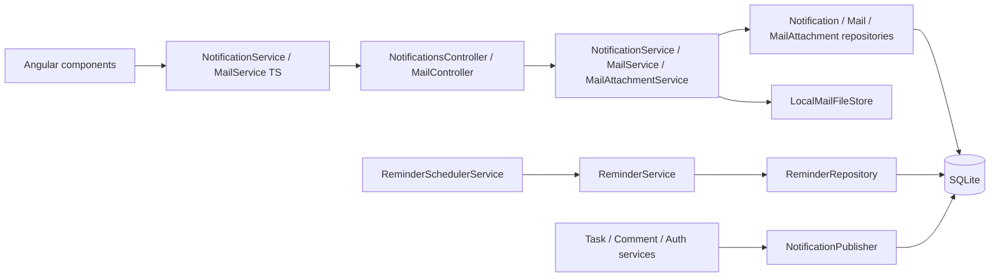
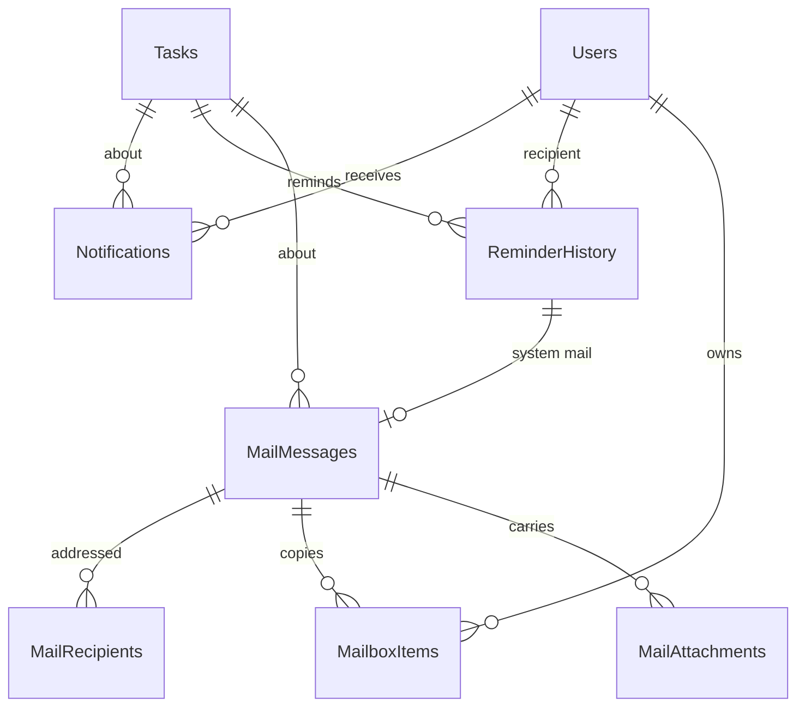

# Communication Module – Technical Documentation

> **Project:** TaskFlow – Intelligent Task Allocation & Tracking System
> **Module:** Communication  ·  **Child Modules:** Notifications (incl. deadline reminders engine), Mail
> **Version:** 1.0  ·  **Last Updated:** 31-Oct-2026
> **Backend:** ASP.NET Core Web API (.NET 10)  ·  **Frontend:** Angular  ·  **Database:** SQLite (EF Core)
> **Author:** Jojo George (jojogeorge3344@gmail.com)
> © 2026 Jojo George. All rights reserved.

> ✅ Target framework confirmed: `net10.0` (.NET 10), from `backend/src/TaskFlow.Api/TaskFlow.Api.csproj`.

---

## 1. Technical Overview
The Communication module has these parts, split over two child modules:

- **Notifications (read side)** – child 05.1: `NotificationsController` → `NotificationService` → `NotificationRepository`. It serves the caller's own rows from the `Notifications` table for the Notification Center (BRD Screen 12).
- **Notification publishing (write side)** – child 05.1: `INotificationPublisher` / `NotificationPublisher` is an append-only seam that other modules call (Monitoring, Auth). It skips writes while the `Notification.InAppEnabled` application setting is `false`.
- **Deadline reminder engine** – child 05.1: `ReminderSchedulerService` is a `BackgroundService` running a `PeriodicTimer`. On each tick it calls `ReminderService.GenerateDueAsync()`, which records each due reminder once in `ReminderHistory` and then writes a `Notification` and, optionally, a system `MailMessage`.
- **Internal mail** – child 05.2: `MailController` → `MailService` / `MailAttachmentService` → `MailRepository` / `MailAttachmentRepository`. Each user has their own copy of a mail (`MailboxItem`), so read state, flags and trash are personal. Attachment bytes are stored on disk by `LocalMailFileStore`.

Every endpoint is under `/api/v1/…`, requires a JWT (`[Authorize]`) and a permission policy `perm:<key>`, and resolves the caller from the `ClaimTypes.NameIdentifier` claim.

## 2. Architecture Flow

## 3. Backend File Structure
Module-level summary. The full file lists are in each child document.

| Layer | Path | Child |
|-------|------|-------|
| Controller | `TaskFlow.Api/Controllers/Communication/` | `NotificationsController.cs` (05.1), `MailController.cs` (05.2) |
| Services | `TaskFlow.Api/Services/Communication/Notification/` (`Notifications/`, `Publishing/`, `Reminders/`) | 05.1 |
| Services | `TaskFlow.Api/Services/Communication/Mail/` (`Messages/`, `Attachments/`) | 05.2 |
| Repositories | `TaskFlow.Api/Repositories/Communication/Notification/` (`Notifications/`, `Reminders/`) | 05.1 |
| Repositories | `TaskFlow.Api/Repositories/Communication/Mail/` (`Messages/`, `Attachments/`) | 05.2 |
| DTOs | `TaskFlow.Api/Dtos/Communication/Notification/`, `TaskFlow.Api/Dtos/Communication/Mail/` (+ `Validators/`) | 05.1, 05.2 |
| Rules | `TaskFlow.Api/Common/Rules/` | `ReminderCalculator.cs` (05.1); `MailRules.cs`, `EmailPolicy.cs` (05.2) |
| Exceptions | `TaskFlow.Api/Common/Exceptions/` | `MailValidationException.cs` (05.2); `AppException.cs` (`ConflictException`, shared) |
| Entities / Enums | `TaskFlow.Api/Models/Entities/`, `TaskFlow.Api/Models/Enums/` | Listed per child |
| Integration | `TaskFlow.Api/Integrations/Storage/` | `IMailFileStore.cs`, `LocalMailFileStore.cs` (05.2) |
| Config | `TaskFlow.Api/Config/` | `ReminderEngineOptions.cs` (05.1); `MailOptions.cs` (05.1 and 05.2); `ServiceRegistration.cs`, `IntegrationRegistration.cs` (shared) |
| Authorization | `TaskFlow.Api/Common/Security/` | `PermissionKeys.cs`, `PermissionCatalog.cs`, `PermissionPolicy.cs` (prefix `perm:`) – shared |
| Authorization (audit) | `TaskFlow.Api/Authorization/Auditing/` | `DeniedActionAuditHandler.cs` (logs every 403) – shared |
| Persistence | `TaskFlow.Api/Persistence/` | `AppDbContext.cs` (shared); migrations `20261013075057_AddTaskTracking` (creates `Notifications`), `20261017062735_AddReminderEngine` (creates `ReminderHistory`, `ApplicationSettings`), `20261017074817_AddEmailDelivery` (creates `EmailDeliveryLogs`), `20261017090431_AddInternalMail` (creates the four Mail tables, drops `EmailDeliveryLogs`) |
| Cross-cutting | `TaskFlow.Api/Middleware/`, `TaskFlow.Api/Filters/`, `TaskFlow.Api/Common/Models/` | `GlobalExceptionHandler.cs`, `ValidationFilter.cs`, `PagedResult.cs` – shared |

## 4. Frontend File Structure
Module-level summary. The component, service and model files are listed in each child document.

| Type | Path | Purpose |
|------|------|---------|
| Routes | `src/app/modules/communication/communication.routes.ts` | `/mail` (requires `mail.read`), `/notifications` (requires `notifications.view`), both lazy-loaded with `permissionGuard` |
| Child folder | `src/app/modules/communication/notification/` | Notification Center (05.1) |
| Child folder | `src/app/modules/communication/mail/` | Mail screen and compose panel (05.2) |
| Route / Guard | `src/app/shared/auth/auth.guard.ts` (`permissionGuard`) | If the user lacks the key, redirects to their dashboard |
| Permission constants | `src/app/shared/auth/permissions.ts` | `MailRead`, `MailCompose`, `MailOrganize`, `MailAttachments`, `NotificationsView`, `NotificationsManage` |
| Menu | `src/app/layouts/nav-items.ts` | "Communication Management" group: Mail (`mail.read`, badge `mail`), Notifications (`notifications.view`) |
| Shell | `src/app/layouts/shell.component.ts/.html` | Header bell (`canSeeNotifications`) with unread dot; Mail badge. Counts refresh on navigation and on a 15 s interval (`SESSION_CHECK_INTERVAL_MS`). |

---

## 5. Child Modules

| # | Child Module | Main endpoints (count) | Key permissions | Document |
|---|--------------|------------------------|-----------------|----------|
| 5.1 | Notifications (incl. deadline reminders engine) | `GET /api/v1/notifications`, `GET …/unread-count`, `POST …/{id}/read`, `POST …/read-all` (4). The reminder engine has no endpoint. | `notifications.view`, `notifications.manage` | `05.1-Notifications.md` |
| 5.2 | Mail | `GET /api/v1/mail`, `/summary`, `/unread-count`, `/items/{id}` (open, flags, trash, restore, delete, compose), `/send`, `/drafts`, `/contacts`, `/attachments` (16) | `mail.read`, `mail.compose`, `mail.organize`, `mail.attachments` | `05.2-Mail.md` |

The child documents are in the `05-Communication/` folder next to this file.

---

## 6. Database Design

Column types are given as C# type → SQLite storage. Enums that use `HasConversion<string>()` are stored as TEXT. Column-level detail is in each child document.

| Table | Owning child | Purpose |
|-------|--------------|---------|
| `Notifications` | 05.1 Notifications | One in-app alert per user |
| `ReminderHistory` | 05.1 Notifications | One row per delivered reminder; unique key prevents duplicates |
| `MailMessages` | 05.2 Mail | Mail content, conversation, draft fields; system mails link to `ReminderHistory` |
| `MailRecipients` | 05.2 Mail | To / Cc of each message |
| `MailboxItems` | 05.2 Mail | Each user's personal copy of a message (folder, flags, trash) |
| `MailAttachments` | 05.2 Mail | File metadata; bytes are on disk |

**Cross-child relationship:** `MailMessages.ReminderHistoryId → ReminderHistory.Id` (FK, Restrict, unique filtered index) – one system mail per reminder. The reminder engine (05.1) writes `MailMessages`, `MailRecipients` and `MailboxItems` rows owned by Mail (05.2).

**Shared reads (owned by other modules):** `Tasks` (`Status`, `Deadline`, `FirstReminderDays`, `SecondReminderDays`, `OverdueReminderFrequency`, `CreatedByUserId`, `IsDeleted`) and `TaskRecipients` (Monitoring module); `Users`; `ApplicationSettings` keys `Reminder.*`, `Notification.MailEnabled`, `Notification.InAppEnabled`, `Application.Timezone` (Settings module).

## 7. Security & Authorization
- **Authentication:** JWT bearer token plus refresh-token cookie. The class-level `[Authorize]` on both controllers requires a signed-in user. If the `NameIdentifier` claim is not an integer, the endpoint returns `401`.
- **Authorization:** each action carries `[Authorize(Policy = PermissionPolicy.Prefix + PermissionKeys.X)]`, which resolves to the `perm:<key>` policy. The keys and the role defaults are defined in `PermissionCatalog.cs` (section "Communication Management"). Refusals are logged by `DeniedActionAuditHandler` ("Denied action: user … attempted …").
- **Data scope:** always **Own**. A record belonging to someone else returns **404, never 403**. The one exception is `GET /mail/contacts`, which searches the whole directory of active users (see 05.2).
- **Frontend:** `permissionGuard` on `/mail` and `/notifications`. Menu entries and the header bell are built from `has(Permissions.X)`. Components hide buttons with computed signals from `AuthService.hasPermission`.

| Permission Key | Child | Detail |
|----------------|-------|--------|
| `notifications.view` | 05.1 | Key → endpoints → UI elements in `05.1-Notifications.md` §7 |
| `notifications.manage` | 05.1 | Same |
| `mail.read` | 05.2 | Key → endpoints → UI elements in `05.2-Mail.md` §7 |
| `mail.compose` | 05.2 | Same |
| `mail.organize` | 05.2 | Same |
| `mail.attachments` | 05.2 | Same |

## 8. Validations & Error Handling
Shared rules that apply to every endpoint in the module. Child-specific rules are in each child document.

| Rule | Layer | HTTP Code | Error Message |
|------|-------|-----------|---------------|
| Not signed in, or bad subject claim | `[Authorize]` / controller | 401 | – |
| No permission | Policy `perm:<key>` | 403 | Forbidden (empty body; logged by `DeniedActionAuditHandler`) |
| Notification, mail item, draft, parent or attachment not owned or not found | Service / Controller | 404 | – (empty `NotFound()`) |
| Concurrent update of the same row | `GlobalExceptionHandler` (`DbUpdateConcurrencyException`) | 409 | Someone else changed this record while you were saving. Reload it and try again. |
| Unhandled error | `GlobalExceptionHandler` | 500 | Something went wrong. Please try again. |

Errors are returned by `GlobalExceptionHandler` (`Middleware/GlobalExceptionHandler.cs`) as RFC 7807 problem details. `ValidationFilter` runs the FluentValidation validators before each action.

## 9. Integrations / Side Effects
- **Between the children:** the reminder engine (05.1) and the comment service write system mails (`IsSystem = true`) into Mail (05.2) when the `Notification.MailEnabled` setting ("Also deliver reminders to Mail") is on.
- **Other modules → Notifications:** Monitoring (`TaskService`, `TaskCommentService`) and Auth (`MfaService`, `PasswordRecoveryService`) publish notifications through `INotificationPublisher` (see 05.1 §9).
- **Other modules → Mail:** `TaskService` sends reassignment mails as the actor; the TaskFlow Assistant uses mail contacts and drafts (see 05.2 §9).
- **Activity Log:** this module writes no task activity entries. The reminder history (`ReminderHistory`) is the audit record for reminders. Denied requests are logged by `DeniedActionAuditHandler`.

## 10. Configuration
Shared settings. Child-specific keys are in each child document.

| Key (`appsettings.json`) | Purpose | Default |
|--------------------------|---------|---------|
| `Storage:Root` | Storage root for the database and attachments | `""` (the platform default from `StorageOptions.DefaultRoot`) |
| `Application:Timezone` | Fallback application timezone for reminder days and mail dates | `Asia/Kolkata` |
| `ConnectionStrings:Default` | SQLite database | `<secret>` |

Runtime settings held in the `ApplicationSettings` table, which are edited in the Settings module:

| Key | Purpose |
|---|---|
| `Notification.MailEnabled` | Also delivers reminders and comment alerts to Mail |
| `Application.Timezone` | Application timezone |

## 11. Testing
Module-wide and cross-module tests. Child-specific test files are listed in each child document.

| Test Type | File / Location | Covers |
|-----------|-----------------|--------|
| Unit | `tests/TaskFlow.UnitTests/Monitoring/TaskManagement/Discussion/TaskCommentActivityNotificationTests.cs` | Comment notifications and mail (cross-module, both children) |

> ⚠️ To be confirmed: the "Covers" column is inferred from file names only, because the test sources were not available.

## 12. Known Limitations / Future Enhancements
- Reminders are only in-app plus internal Mail. Outbound email (SMTP) was removed by design in the `AddInternalMail` migration.

**Gaps found (module-wide)**
1. **The TDD `email_delivery_logs`, §11.3 SMTP channel and the `/api/v1/settings/email*` endpoints no longer exist.** The `EmailDeliveryLogs` table was dropped by `20261017090431_AddInternalMail`. BRD Screen 14 is marked SUPERSEDED, so its FRs 1–4, 6 and 8 (SMTP config, secure credentials, test email, delivery attempt logging, config errors) are intentionally not implemented.
2. **Permission audit paths are stale.** `permission-inventory.csv` and `dashboard-feature-inventory.csv` reference old paths (`features/mail/...`, `features/notifications/...`, `core/layout/...`, `TaskFlow.Infrastructure/...`). The code now lives in `modules/communication/...` and `layouts/...`. The keys and behaviour they record are still accurate.

Child-specific gaps are listed in each child document.

---
© 2026 Jojo George. All rights reserved. Unauthorized copying or distribution of this document is prohibited.
