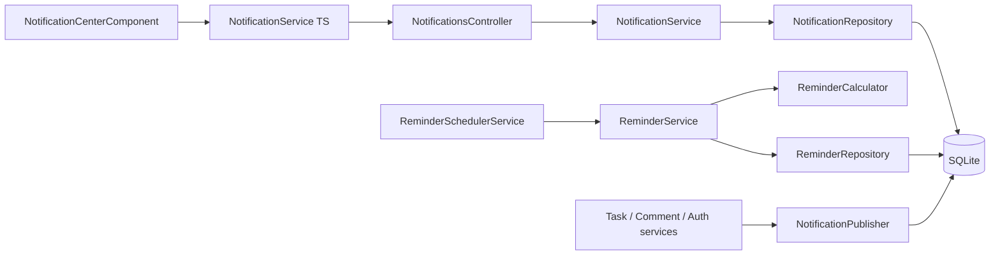
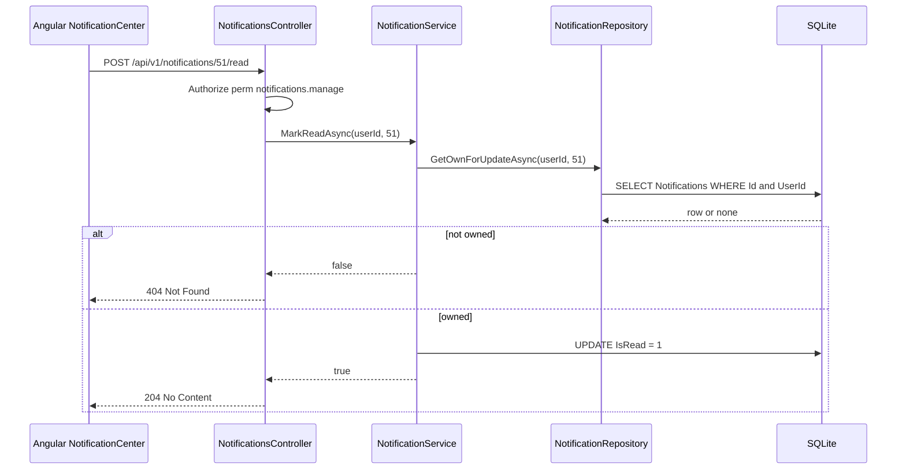
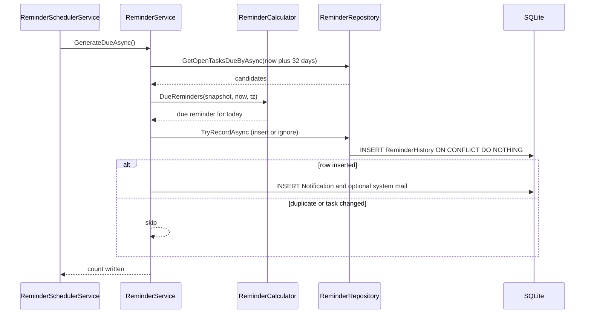

# Notifications – Technical Documentation

> **Project:** TaskFlow – Intelligent Task Allocation & Tracking System
> **Parent Module:** Communication  ·  **Child Module:** 05.1 Notifications (incl. deadline reminders engine)
> **Version:** 1.0  ·  **Last Updated:** 31-Oct-2026
> **Backend:** ASP.NET Core Web API (.NET 10)  ·  **Frontend:** Angular  ·  **Database:** SQLite (EF Core)
> **Author:** Jojo George (jojogeorge3344@gmail.com)
> © 2026 Jojo George. All rights reserved.

---

## 1. Technical Overview
The Notifications child module has three parts:

- **Notifications (read side)**: `NotificationsController` → `NotificationService` → `NotificationRepository`. It serves the caller's own rows from the `Notifications` table for the Notification Center (BRD Screen 12).
- **Notification publishing (write side)**: `INotificationPublisher` / `NotificationPublisher` is an append-only seam that other modules call (Monitoring, Auth). It skips writes while the `Notification.InAppEnabled` application setting is `false`.
- **Deadline reminder engine**: `ReminderSchedulerService` is a `BackgroundService` running a `PeriodicTimer`. On each tick it calls `ReminderService.GenerateDueAsync()`. That method uses the pure `ReminderCalculator` to decide which reminders are due today. It then inserts into `ReminderHistory` with an insert-or-ignore on a unique index, and only when a row was added does it write a `Notification` and, optionally, a system `MailMessage` (Mail child module tables).

Every endpoint is under `/api/v1/notifications`, requires a JWT (`[Authorize]`) and a permission policy `perm:<key>`, and resolves the caller from the `ClaimTypes.NameIdentifier` claim.

## 2. Architecture Flow


## 3. Backend File Structure

| Layer | Path | Files |
|-------|------|-------|
| Controller | `TaskFlow.Api/Controllers/Communication/` | `NotificationsController.cs` |
| Service – Notifications | `TaskFlow.Api/Services/Communication/Notification/Notifications/` | `INotificationService.cs`, `NotificationService.cs` |
| Service – Publishing | `TaskFlow.Api/Services/Communication/Notification/Publishing/` | `INotificationPublisher.cs`, `NotificationPublisher.cs` |
| Service – Reminders | `TaskFlow.Api/Services/Communication/Notification/Reminders/` | `IReminderService.cs`, `ReminderService.cs`, `ReminderSchedulerService.cs` |
| Repository – Notifications | `TaskFlow.Api/Repositories/Communication/Notification/Notifications/` | `INotificationRepository.cs`, `NotificationRepository.cs` |
| Repository – Reminders | `TaskFlow.Api/Repositories/Communication/Notification/Reminders/` | `IReminderRepository.cs`, `ReminderRepository.cs`, `ReminderCandidate.cs`, `DeliveredReminder.cs`, `TaskRecipientLink.cs` |
| DTOs | `TaskFlow.Api/Dtos/Communication/Notification/` | `NotificationDtos.cs` (`NotificationDto`, `NotificationFilter`, `UnreadCountDto`) |
| Rules | `TaskFlow.Api/Common/Rules/` | `ReminderCalculator.cs` (`ReminderTaskSnapshot`, `DueReminder`) |
| Entities | `TaskFlow.Api/Models/Entities/` | `Notification.cs`, `ReminderHistory.cs` |
| Enums | `TaskFlow.Api/Models/Enums/` | `NotificationType.cs`, `ReminderType.cs`, `ReminderStatus.cs`, `ReminderFrequency.cs` |
| Config | `TaskFlow.Api/Config/` | `ReminderEngineOptions.cs`, `MailOptions.cs` (`AppBaseUrl` used in reminder mails) |
| Clock (Settings module) | `TaskFlow.Api/Services/Settings/ApplicationSettings/Clock/` | `IAppClock.cs`, `AppClock.cs` (application timezone) |
| Persistence | `TaskFlow.Api/Persistence/` | migrations `20261013075057_AddTaskTracking` (creates `Notifications`), `20261017062735_AddReminderEngine` (creates `ReminderHistory`) |

## 4. Frontend File Structure

| Type | Path | Purpose |
|------|------|---------|
| Route | `src/app/modules/communication/communication.routes.ts` | `/notifications` (requires `notifications.view`), lazy-loaded with `permissionGuard` |
| Page component | `src/app/modules/communication/notification/pages/notification-center.component.ts/.html` | Notification Center: filters, list, paging, mark read / mark all |
| Page model | `src/app/modules/communication/notification/pages/notification-center.model.ts` | `ReadState` type |
| API service | `src/app/modules/communication/notification/services/notification.service.ts` | HTTP calls plus the shared `unreadCount` signal used by the header bell |
| Models | `src/app/modules/communication/notification/models/notification.model.ts` | `NotificationType`, `NOTIFICATION_TYPES`, `NotificationItem`, `NotificationFilter`, `UnreadCount` |
| Permission constants | `src/app/shared/auth/permissions.ts` | `NotificationsView`, `NotificationsManage` |
| Menu | `src/app/layouts/nav-items.ts` | "Communication Management" → Notifications (`notifications.view`) |
| Shell | `src/app/layouts/shell.component.ts/.html` | Header bell (`canSeeNotifications`) with unread dot. The count refreshes on navigation and on a 15 s interval (`SESSION_CHECK_INTERVAL_MS`). |

---

## 5. API & Logic

### 5.1 API Endpoints

| # | Method | Endpoint | Description | Permission (Policy) | Request DTO | Response DTO |
|---|--------|----------|-------------|---------------------|-------------|--------------|
| 1 | GET | `/api/v1/notifications` | Caller's notifications, newest first, filter by `type`, `isRead`; paged (`page`, `pageSize`) | `notifications.view` | `NotificationFilter` (query) | `PagedResult<NotificationDto>` |
| 2 | GET | `/api/v1/notifications/unread-count` | Unread count for the header badge | `notifications.view` | – | `UnreadCountDto` |
| 3 | POST | `/api/v1/notifications/{id:int}/read` | Mark one owned notification read (idempotent) | `notifications.manage` | – | `204 No Content` / `404` |
| 4 | POST | `/api/v1/notifications/read-all` | Mark all of the caller's notifications read | `notifications.manage` | – | `204 No Content` |

No endpoint exists for the reminder engine. It runs in-process (see 5.3).

### 5.2 Request / Response Samples
```json
// GET /api/v1/notifications?type=Overdue&isRead=false&page=1&pageSize=20
{
  "items": [
    {
      "id": 51,
      "type": "Overdue",
      "message": "Overdue: \"Prepare Q3 report\" was due on 29 Oct 2026, 17:00.",
      "isRead": false,
      "createdAt": "2026-10-31T00:01:00Z",
      "taskId": 12,
      "taskCode": "TSK-0012"
    }
  ],
  "total": 1,
  "page": 1,
  "pageSize": 20
}
```
```json
// GET /api/v1/notifications/unread-count  ->  200 OK
{ "count": 3 }
```
`PagedResult<T>` is `record PagedResult<T>(Items, Total, Page, PageSize)` in `Common/Models/PagedResult.cs`. The id, title and task-code values in the sample are illustrative.

### 5.3 Service Layer Logic

**`NotificationService.ListAsync(int userId, NotificationFilter filter, CancellationToken)`**
1. Clamps `Page` to at least 1. If `PageSize` is below 1 or above 100, it uses 20.
2. Calls `INotificationRepository.ListAsync(userId, filter.Type, filter.IsRead, page, pageSize)`.

**`GetUnreadCountAsync(userId)`** calls `CountUnreadAsync`.

**`MarkReadAsync(userId, notificationId)`**
1. Calls `GetOwnForUpdateAsync`, which matches on Id and UserId. It returns `false` (404) when the row is not found.
2. If the row is unread, it sets `IsRead = true` and saves. It returns `true`, so repeat calls are idempotent.

**`MarkAllReadAsync(userId)`** loads `GetUnreadForUpdateAsync`, sets `IsRead = true` on each row and saves once. When there are no unread rows it does nothing.

**`NotificationPublisher.PublishAsync(int userId, int? taskId, NotificationType type, string message)`**
1. Reads the application setting `Notification.InAppEnabled`. If it is missing or cannot be parsed, it is treated as enabled.
2. If the setting is disabled, it returns without writing anything.
3. Otherwise it adds a `Notification` (`IsRead = false`, `CreatedAt = TimeProvider` UTC now) and calls `SaveChangesAsync`.

Callers of the publisher (side effects from other modules):

| Caller | Type | Message |
|---|---|---|
| `TaskService` (create, inside the transaction) | `TaskAssigned` | `A task was assigned to you: {title}` |
| `TaskService` (reassign) | `Reassigned` | `A task was reassigned to you: {title}. Reason: {reason}` for the new assignee, otherwise `{actor} reassigned task "{title}" ({code}) from {old} to {new}. Reason: {reason}` |
| `TaskService` (worked hours) | `System` | `{actor} added/updated/cleared … on task {title}. Total worked now: …` |
| `TaskCommentService` | `TaskComment` | `{who} {verb} a comment on "{title}": {detail}` |
| `MfaService` (admin reset) | `System` | `An administrator reset your authenticator MFA. …` |
| `PasswordRecoveryService` | `System` | `Your password was reset with your authenticator app. …` |

**Reminder engine: `ReminderSchedulerService.ExecuteAsync`**
1. If `Reminders:SchedulerEnabled` is false, it logs "Reminder scheduler is disabled by configuration." and exits.
2. Runs one pass straight away, then one per `PeriodicTimer` tick of `Max(1, Reminders:TickSeconds)` seconds.
3. `RunPassAsync` creates a DI scope and resolves `IReminderService`. Any exception is logged as "Reminder pass failed." and swallowed, so the next tick retries.

**`ReminderService.GenerateDueAsync()`**
1. Reads the settings from `IReminderSettingsService.GetAsync()`. If `Enabled` is false, it returns 0.
2. Gets the timezone from `IAppClock.GetTimeZoneAsync()` (the `Application.Timezone` setting, falling back to `Application:Timezone` in config, then UTC) and the current UTC time.
3. Calls `IReminderRepository.GetOpenTasksDueByAsync(now + 32 days)`. This returns tasks that are not deleted, not Completed or Cancelled, and have a deadline no later than that date. There is no lower bound, so overdue tasks are included.
4. For each task, calls `ReminderCalculator.DueReminders(snapshot, nowUtc, tz, settings.DeadlineDayEnabled)`, which returns zero or one `DueReminder` for **today**:
   - `daysUntilDeadline > 0`: `SecondReminder` if it equals `SecondReminderDays` (when that is above 0), otherwise `FirstReminder` if it equals `FirstReminderDays`. Equal intervals collapse to one reminder.
   - `daysUntilDeadline = 0`: `DueToday` if `now < deadline` and either the global deadline-day setting is on or the task's first or second interval is 0.
   - `daysUntilDeadline < 0`: `Overdue` when `daysOverdue % step == 0`, where the step is 1 for Daily and 7 for Weekly.
   - `ScheduledForUtc` = local midnight of today, converted to UTC. The calculation handles DST gaps and ambiguous times.
5. `LoadRecipientsAsync` takes `TaskRecipients.UserId` plus `Task.CreatedByUserId`, removes duplicates, and keeps only users returned by `IEmployeeRepository.GetActiveByIdsAsync`.
6. `LoadDeliveredAsync` pre-reads `ReminderHistory` rows for today's slots, so that already-delivered reminders are skipped without taking the SQLite write lock.
7. Builds the message with `BuildMessage`. If `settings.MailEnabled` is on, it also builds a mail with `BuildMail`: the subject is `Overdue task: `, `Task due today: ` or `Task reminder: ` plus the title, truncated to 200 characters. The body is the message, then `Open the task: {AppBaseUrl}/tasks/{id}` when `Mail:AppBaseUrl` is set, then "This is an automatic reminder from TaskFlow."
8. `TryDeliverAsync` runs one transaction per recipient and reminder (`IUnitOfWork.ExecuteInTransactionAsync`):
   - `ReminderRepository.TryRecordAsync` runs a raw `INSERT … SELECT … WHERE EXISTS (task still live, open, same Deadline) ON CONFLICT (TaskId, RecipientUserId, ReminderType, ScheduledFor) DO NOTHING`. When it inserts no row, nothing else is written.
   - It adds a `Notification` directly through the repository. The type is `Overdue` or `DeadlineReminder`.
   - When mail is enabled, it adds a `MailMessage` (`IsSystem = true`, `SenderUserId = null`, `TaskId`, and `ReminderHistoryId` from `GetIdAsync`), plus a `MailRecipient` (To) and a `MailboxItem` (Inbox) for the recipient.
   - It saves and commits, then calls `DetachAll()`.
9. Logs "Generated {Count} deadline reminder notification(s)." and returns the number of rows written.

### 5.4 Repository Layer

| Method | Description | Query Notes |
|--------|-------------|-------------|
| `NotificationRepository.ListAsync(userId, type, isRead, page, pageSize)` | One page of the user's notifications | `AsNoTracking`, `Where UserId`, optional `Type` and `IsRead`, `Include(Task)`, order by `CreatedAt` desc then `Id` desc. `ToDto` drops `TaskId`/`TaskCode` when the task is missing or `IsDeleted`. |
| `CountUnreadAsync(userId)` | Unread count | `CountAsync(UserId && !IsRead)`, served by index `(UserId, IsRead)` |
| `GetOwnForUpdateAsync(userId, id)` | Tracked own row | `FirstOrDefault(Id && UserId)` |
| `GetUnreadForUpdateAsync(userId)` | Tracked unread rows | `Where(UserId && !IsRead)` |
| `ReminderRepository.GetOpenTasksDueByAsync(dueBy)` | Reminder candidates | `Db.Tasks`, `AsNoTracking`, projects into `ReminderCandidate` and `ReminderTaskSnapshot` |
| `GetDeliveredAsync(taskIds, earliestSlot)` | Already-recorded reminders | `ScheduledFor >= earliestSlot` |
| `GetTaskRecipientsAsync(taskIds)` | Task notification recipients | `Db.TaskRecipients` projected into `TaskRecipientLink` |
| `TryRecordAsync(...)` | Idempotent history insert | Raw SQL `ExecuteSqlInterpolatedAsync`. Writes `Status = 'Sent'`, `ProcessedAt = now`, `DeliveryAttempts = 0`. |
| `GetIdAsync(...)` | Id of the history row just inserted | `SingleAsync` on the unique key |

### 5.5 Sequence Diagrams




---

## 6. Database Design

Column types are given as C# type → SQLite storage. Enums that use `HasConversion<string>()` are stored as TEXT.

| Table | Column | Type | Constraints | Description |
|-------|--------|------|-------------|-------------|
| `Notifications` | `Id` | int → INTEGER | PK, autoincrement | – |
| `Notifications` | `UserId` | int → INTEGER | FK → `Users.Id`, Not Null | Recipient |
| `Notifications` | `TaskId` | int? → INTEGER | FK → `Tasks.Id`, nullable | Related task |
| `Notifications` | `Type` | `NotificationType` → TEXT(32) | Not Null | TaskAssigned, Reassigned, DeadlineReminder, Overdue, System, TaskComment |
| `Notifications` | `Message` | string → TEXT | Required | Display text |
| `Notifications` | `IsRead` | bool → INTEGER | Not Null | – |
| `Notifications` | `CreatedAt` | DateTime → TEXT | Not Null | UTC |
| `Notifications` | – | – | Index `(UserId, IsRead)` | Unread count / filter |
| `ReminderHistory` | `Id` | int → INTEGER | PK | – |
| `ReminderHistory` | `TaskId` | int → INTEGER | FK → `Tasks.Id` | – |
| `ReminderHistory` | `RecipientUserId` | int → INTEGER | FK → `Users.Id` | – |
| `ReminderHistory` | `ReminderType` | `ReminderType` → TEXT(32) | Not Null | FirstReminder, SecondReminder, DueToday, Overdue |
| `ReminderHistory` | `ScheduledFor` | DateTime → TEXT | Not Null | UTC instant of local midnight of the reminder day |
| `ReminderHistory` | `Status` | `ReminderStatus` → TEXT(32) | Not Null | The engine writes only `Sent` (Pending/Failed/Skipped are reserved) |
| `ReminderHistory` | `ProcessedAt` | DateTime? → TEXT | nullable | – |
| `ReminderHistory` | `DeliveryAttempts` | int → INTEGER | Not Null | Always 0 from the engine |
| `ReminderHistory` | – | – | **Unique** `(TaskId, RecipientUserId, ReminderType, ScheduledFor)` | Duplicate prevention |

**Relationships**
- `Notifications.UserId → Users.Id` (FK, Cascade)
- `Notifications.TaskId → Tasks.Id` (FK, Cascade)
- `ReminderHistory.TaskId → Tasks.Id` (FK, Restrict)
- `ReminderHistory.RecipientUserId → Users.Id` (FK, Restrict)
- Referenced by Mail: `MailMessages.ReminderHistoryId → ReminderHistory.Id` (FK, Restrict, unique filtered index) – see `05.2-Mail.md`.
- Writes (reminder mails, owned by Mail): `MailMessages`, `MailRecipients`, `MailboxItems`.
- Reads: `Tasks` (`Status`, `Deadline`, `FirstReminderDays`, `SecondReminderDays`, `OverdueReminderFrequency`, `CreatedByUserId`, `IsDeleted`) and `TaskRecipients` (owned by the Monitoring module). `ApplicationSettings` keys: `Reminder.*`, `Notification.MailEnabled`, `Notification.InAppEnabled`, `Application.Timezone`.

## 7. Security & Authorization
- **Authentication and authorization:** as described in the parent document (`[Authorize]`, `perm:<key>` policies, `DeniedActionAuditHandler`).
- **Data scope:** always **Own**. Notification queries filter on `UserId == caller`. A notification belonging to someone else returns **404, never 403**.
- **Reminder engine:** runs in-process with no user context and no permission. Its runtime switches are edited in the Settings module under `settings.reminders.manage`.
- **Frontend:** `permissionGuard` on `/notifications`. The menu entry and the header bell are built from `has(Permissions.NotificationsView)`. The Notification Center hides **Mark all as read** with `canManage()`, computed from `AuthService.hasPermission`.

| Permission Key | Endpoint(s) | UI Element Controlled |
|----------------|-------------|-----------------------|
| `notifications.view` | `GET /api/v1/notifications`, `GET /api/v1/notifications/unread-count` | Menu "Notifications", route `/notifications`, header bell and unread dot |
| `notifications.manage` | `POST /api/v1/notifications/{id}/read`, `POST /api/v1/notifications/read-all` | "Mark all as read" button (gated). Per-row "Mark as read" is **not** gated. |

## 8. Validations & Error Handling

| Rule | Layer | HTTP Code | Error Message |
|------|-------|-----------|---------------|
| `page` below 1 | `NotificationService` | – | Clamped to 1 (no error) |
| `pageSize` below 1 or above 100 | `NotificationService` | – | Replaced by 20 (no error) |
| Notification not owned or not found | `NotificationService` / `NotificationsController` | 404 | – (empty `NotFound()`) |
| Reminder pass throws | `ReminderSchedulerService.RunPassAsync` | – | Logged as "Reminder pass failed."; the next tick retries |

The shared 401 / 403 / 409 / 500 rules are in the parent document §8.

## 9. Integrations / Side Effects
- **Reminder engine:** writes `DeadlineReminder` or `Overdue` for each active recipient (the task's recipients plus the creator), once per `(task, recipient, type, day)`.
- **Reminder mails (into Mail):** `IsSystem = true` mails linked to `ReminderHistoryId` are written when the `Notification.MailEnabled` setting is on. That setting is the "Also deliver reminders to Mail" toggle on the Reminder Settings screen.
- **Other modules,** through `INotificationPublisher`:
  - `TaskAssigned` on task create
  - `Reassigned` on reassignment
  - `TaskComment` on comment add, edit or delete
  - `System` on worked-hours change, admin MFA reset and password recovery
- **Audit:** the reminder history (`ReminderHistory`) is the audit record for reminders.
- **AI Assistant:** the help article `notifications.md` in `Services/Assistant/Knowledge/` describes this child module.

## 10. Configuration

| Key (`appsettings.json`) | Purpose | Default |
|--------------------------|---------|---------|
| `Reminders:SchedulerEnabled` | Turns the background reminder scheduler on or off | `true` |
| `Reminders:TickSeconds` | Seconds between reminder passes (minimum 1) | `60` |
| `Mail:AppBaseUrl` | Base web address for the "Open the task:" link in reminder mails | Not set in `appsettings.json` (the link is omitted) |

Runtime settings held in the `ApplicationSettings` table, which are edited in the Settings module:

| Key | Purpose |
|---|---|
| `Reminder.Enabled` | Turns the reminder engine on or off |
| `Reminder.DeadlineDayEnabled` | Sends the due-today reminder |
| `Reminder.DefaultFirstDays`, `Reminder.DefaultSecondDays`, `Reminder.DefaultOverdueFrequency` | Defaults for new tasks |
| `Notification.InAppEnabled` | In-app notifications for published events |

The shared keys (`Application:Timezone`, `Application.Timezone`, `Notification.MailEnabled`, `Storage:Root`, `ConnectionStrings:Default`) are in the parent document §10.

## 11. Testing

| Test Type | File / Location | Covers |
|-----------|-----------------|--------|
| Unit | `tests/TaskFlow.UnitTests/Communication/Notification/Notifications/NotificationServiceTests.cs` | List, paging, mark read, mark all |
| Unit | `tests/TaskFlow.UnitTests/Communication/Notification/Reminders/ReminderCalculatorTests.cs` | Due-today, first/second, overdue daily/weekly, DST slots |
| Unit | `tests/TaskFlow.UnitTests/Communication/Notification/Reminders/ReminderServiceTests.cs` | Generation, recipients, mail delivery |
| Unit | `tests/TaskFlow.UnitTests/Communication/Notification/Reminders/ReminderIdempotencyTests.cs` | Duplicate prevention on repeated passes |
| Unit | `tests/TaskFlow.UnitTests/Communication/Notification/Reminders/ReminderSchedulerServiceTests.cs` | Scheduler pass and error handling |
| Unit | `tests/TaskFlow.UnitTests/Monitoring/TaskManagement/Tasks/TaskWorkedHoursNotificationTests.cs` | Worked-hours notifications (cross-module) |
| Integration | `tests/TaskFlow.IntegrationTests/Communication/Notification/NotificationsEndpointsTests.cs` | Notification endpoints + authorization |
| Integration | `tests/TaskFlow.IntegrationTests/Settings/ReminderSettings/SettingsEndpointsTests.cs` | Reminder settings that drive the engine |

> ⚠️ To be confirmed: the "Covers" column is inferred from file names only, because the test sources were not available. No test file for `NotificationPublisher` appears in `tests-filelist.json`. The cross-module comment test is listed in the parent document §11.

## 12. Known Limitations / Gaps found
- Notifications are never deleted or archived, and the read time is not stored (no `ReadAt`).
- `ReminderHistory.Status` is always `Sent` and `DeliveryAttempts` is always 0. Retry and failure tracking is not implemented.
- The reminder engine does not push notifications live. The UI picks up new counts on navigation and every 15 seconds.
- `Mail:AppBaseUrl` is not set in `appsettings.json`, so reminder mails carry no task link by default (the reader still shows "Open the task" via `TaskId`).

**Gaps found**
1. **Reminder notifications bypass the in-app toggle.** `ReminderService.TryDeliverAsync` adds `Notification` rows directly through `INotificationRepository`, not through `NotificationPublisher`. Reminder notifications are therefore still written when `Notification.InAppEnabled` is `false`.
2. **Frontend misses the `TaskComment` type.** `notification.model.ts` `NotificationType` / `NOTIFICATION_TYPES` and `NOTIFICATION_TYPE_LABELS` list only TaskAssigned, Reassigned, DeadlineReminder, Overdue and System. The backend enum also has `TaskComment`, so comment notifications render an empty type chip and cannot be selected in the Type filter.
3. **Per-row "Mark as read" is not gated.** It is shown to every user with `notifications.view`, but the endpoint requires `notifications.manage` (403). This matches permission-gaps.md, and the code is unchanged.
4. **TDD §8.5 and code differ on mark read.** The TDD lists `PATCH /api/v1/notifications/{id}/read`, but the code uses `POST`. The TDD marks the notification endpoints "Authenticated/Owner", but the code requires the `notifications.view` and `notifications.manage` keys.
5. **The TDD `notifications` table is out of date.** The TDD shows `DedupKey` and `ReadAt` columns and types Reminder/DueToday/Comment. The code has neither column, uses the types `DeadlineReminder`/`TaskComment`, and has no `DueToday` notification type (due-today reminders are written as `DeadlineReminder`).
6. **The TDD `reminder_history` types are out of date.** The TDD names TwoDaysBefore/OneDayBefore. The code uses `FirstReminder`/`SecondReminder` with per-task intervals (`FirstReminderDays`, `SecondReminderDays`) and a Daily/Weekly overdue frequency.
7. **TDD §11.5 recalculation is not implemented as written.** The TDD describes marking `Pending` rows `Skipped`. The code writes no Pending rows. `ReminderCalculator` reads the task's current status and deadline on every pass, and `TryRecordAsync` re-checks the deadline, which gives the same effect.
8. **Reminder recipients differ from TDD and BR-5.** The TDD (§11.5) and BR-5 say `task_recipients` only. The code also adds the task **creator**.
9. **BRD Screen 12 says "Access: All registered users".** In code, access depends on configurable keys, so a custom role without `notifications.view` has no Notification Center. The Administrator, Manager and Employee defaults do match the BRD.
10. **Help knowledge claims status-change notifications.** `notifications.md` says users are notified about "status changes", but no `PublishAsync` call exists for status changes. The help also says "Click a notification to open the task", whereas only the task-code link opens it.

---
<sub>© 2026 Jojo George. All rights reserved. Unauthorized copying or distribution of this document is prohibited.</sub>
