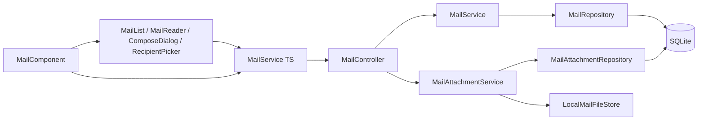
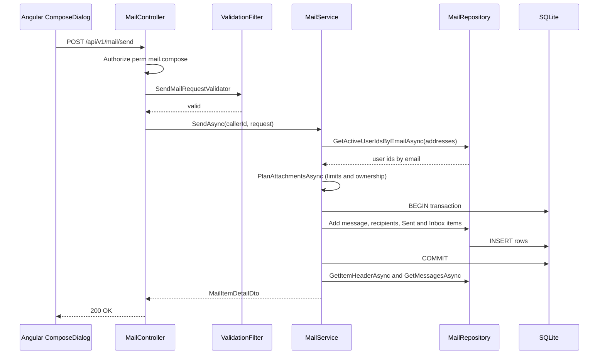

# Mail – Technical Documentation

> **Project:** TaskFlow – Intelligent Task Allocation & Tracking System
> **Parent Module:** Communication  ·  **Child Module:** 05.2 Mail
> **Version:** 1.0  ·  **Last Updated:** 31-Oct-2026
> **Backend:** ASP.NET Core Web API (.NET 10)  ·  **Frontend:** Angular  ·  **Database:** SQLite (EF Core)
> **Author:** Jojo George (jojogeorge3344@gmail.com)
> © 2026 Jojo George. All rights reserved.

---

## 1. Technical Overview
Internal mail: `MailController` → `MailService` / `MailAttachmentService` → `MailRepository` / `MailAttachmentRepository`. Data lives in `MailMessages`, `MailRecipients`, `MailboxItems` and `MailAttachments`. Each user has their own copy of a mail (`MailboxItem`), so read state, flags and trash are personal. Any query that is not rooted in the caller's own items returns *not found*, never *forbidden*. Attachment bytes are stored on disk by `LocalMailFileStore` under a GUID key.

Every endpoint is under `/api/v1/mail`, requires a JWT (`[Authorize]`) and a permission policy `perm:<key>`, and resolves the caller from the `ClaimTypes.NameIdentifier` claim.

## 2. Architecture Flow


## 3. Backend File Structure

| Layer | Path | Files |
|-------|------|-------|
| Controller | `TaskFlow.Api/Controllers/Communication/` | `MailController.cs` |
| Service – Mail | `TaskFlow.Api/Services/Communication/Mail/Messages/` | `IMailService.cs`, `MailService.cs` |
| Service – Attachments | `TaskFlow.Api/Services/Communication/Mail/Attachments/` | `IMailAttachmentService.cs`, `MailAttachmentService.cs`, `MailAttachmentDownload.cs` |
| Repository – Mail | `TaskFlow.Api/Repositories/Communication/Mail/Messages/` | `IMailRepository.cs`, `MailRepository.cs`, `MailItemHeader.cs` |
| Repository – Attachments | `TaskFlow.Api/Repositories/Communication/Mail/Attachments/` | `IMailAttachmentRepository.cs`, `MailAttachmentRepository.cs`, `AttachmentFile.cs`, `PendingUploads.cs` |
| DTOs | `TaskFlow.Api/Dtos/Communication/Mail/` | `MailDtos.cs` (`MailView`, `MailComposeMode`, `MailAddressDto`, `MailAttachmentDto`, `MailListItemDto`, `MailMessageDto`, `MailItemDetailDto`, `MailSummaryDto`, `MailUnreadCountDto`, `MailContactDto`, `MailComposeDto`, `SendMailRequest`, `SaveDraftRequest`, `UpdateMailFlagsRequest`, `MailListQuery`) |
| Validators | `TaskFlow.Api/Dtos/Communication/Mail/Validators/` | `MailRequestValidators.cs` (`SendMailRequestValidator`, `SaveDraftRequestValidator`) |
| Rules | `TaskFlow.Api/Common/Rules/` | `MailRules.cs`, `EmailPolicy.cs` |
| Exceptions | `TaskFlow.Api/Common/Exceptions/` | `MailValidationException.cs` (derives `RequestValidationException`), `AppException.cs` (`ConflictException`) |
| Entities | `TaskFlow.Api/Models/Entities/` | `MailMessage.cs`, `MailRecipient.cs`, `MailboxItem.cs`, `MailAttachment.cs` |
| Enums | `TaskFlow.Api/Models/Enums/` | `MailFolder.cs`, `MailRecipientKind.cs` |
| Integration | `TaskFlow.Api/Integrations/Storage/` | `IMailFileStore.cs`, `LocalMailFileStore.cs` |
| Config | `TaskFlow.Api/Config/` | `MailOptions.cs` |
| Assistant tools (TFA module) | `TaskFlow.Api/Services/Assistant/Tools/` | `AssistantReadTools.cs` (`FindUserTool`), `AssistantActionTools.cs` (`DraftMailTool`) |
| Persistence | `TaskFlow.Api/Persistence/` | migration `20261017090431_AddInternalMail` (creates `MailMessages`, `MailRecipients`, `MailboxItems`, `MailAttachments`) |

## 4. Frontend File Structure

| Type | Path | Purpose |
|------|------|---------|
| Route | `src/app/modules/communication/communication.routes.ts` | `/mail` (requires `mail.read`), lazy-loaded with `permissionGuard` |
| Page component | `src/app/modules/communication/mail/pages/mail.component.ts/.html` | Mail shell: folder rail, counts, URL state (`?folder=&item=`), narrow-screen panes |
| Child components | `src/app/modules/communication/mail/components/` | `mail-list.component` (search, paging, star), `mail-reader.component` (thread, actions, downloads), `compose-dialog.component` (drawer: new/reply/forward/draft, uploads), `recipient-picker.component` (chips, suggestions, validation) |
| Component models | `src/app/modules/communication/mail/components/compose-dialog.model.ts`, `recipient-picker.model.ts` | `ComposeRequest`, `ComposeResult`, `ComposeField` (server error keys); `RecipientChip` |
| API service | `src/app/modules/communication/mail/services/mail.service.ts` | All `/api/v1/mail` calls plus the shared `unreadCount` signal for the Mail menu badge |
| Models | `src/app/modules/communication/mail/models/mail.model.ts` | Mail interfaces and `MAIL_LIMITS` |
| Utils | `src/app/modules/communication/mail/utils/mail-format.ts`, `linkify.ts` | `MAIL_FOLDERS`, date/size formatting; safe http(s) link splitting (no HTML injection) |
| Permission constants | `src/app/shared/auth/permissions.ts` | `MailRead`, `MailCompose`, `MailOrganize`, `MailAttachments` |
| Menu | `src/app/layouts/nav-items.ts` | "Communication Management" → Mail (`mail.read`, badge `mail`) |
| Shell | `src/app/layouts/shell.component.ts/.html` | Mail badge. The count refreshes on navigation and on a 15 s interval (`SESSION_CHECK_INTERVAL_MS`). |

---

## 5. API & Logic

### 5.1 API Endpoints
Route prefix: `api/v1/mail` (class-level `[Authorize]`).

| # | Method | Endpoint | Description | Permission (Policy) | Request DTO | Response DTO |
|---|--------|----------|-------------|---------------------|-------------|--------------|
| 1 | GET | `/api/v1/mail` | One page of a folder view. Query: `folder` (`MailView`, default Inbox), `search`, `page` (1), `pageSize` (25, max 50) | `mail.read` | Query params (`MailListQuery`) | `PagedResult<MailListItemDto>` |
| 2 | GET | `/api/v1/mail/summary` | Folder rail counts | `mail.read` | – | `MailSummaryDto` |
| 3 | GET | `/api/v1/mail/unread-count` | Unread Inbox count for the menu badge | `mail.read` | – | `MailUnreadCountDto` |
| 4 | GET | `/api/v1/mail/items/{itemId:int}` | Open an item with its conversation; marks it read | `mail.read` | – | `MailItemDetailDto` / `404` |
| 5 | PATCH | `/api/v1/mail/items/{itemId:int}` | Change personal flags (`isRead`, `isStarred`, `isImportant`; null = unchanged) | `mail.organize` | `UpdateMailFlagsRequest` | `204` / `404` |
| 6 | POST | `/api/v1/mail/items/{itemId:int}/trash` | Move to Trash (sets `TrashedAt` if not set) | `mail.organize` | – | `204` / `404` |
| 7 | POST | `/api/v1/mail/items/{itemId:int}/restore` | Restore from Trash | `mail.organize` | – | `204` / `404` |
| 8 | DELETE | `/api/v1/mail/items/{itemId:int}` | Delete forever (trashed item) or discard a draft | `mail.organize` | – | `204` / `404` / `409` |
| 9 | GET | `/api/v1/mail/items/{itemId:int}/compose?mode=` | Prefilled reply / reply all / forward | `mail.compose` | Query `mode` (`MailComposeMode`) | `MailComposeDto` / `404` |
| 10 | POST | `/api/v1/mail/send` | Send a new mail, a reply or forward, or a saved draft | `mail.compose` | `SendMailRequest` | `MailItemDetailDto` (sender's Sent item) / `404` |
| 11 | POST | `/api/v1/mail/drafts` | Create a draft | `mail.compose` | `SaveDraftRequest` | `MailItemDetailDto` |
| 12 | PUT | `/api/v1/mail/drafts/{messageId:int}` | Update a draft (by **message** id) | `mail.compose` | `SaveDraftRequest` | `MailItemDetailDto` / `404` |
| 13 | GET | `/api/v1/mail/contacts?search=` | Up to 10 active users matching name or email | `mail.compose` | Query `search` | `IReadOnlyList<MailContactDto>` |
| 14 | POST | `/api/v1/mail/attachments` | Upload one file (multipart `file`). Request limit: 10 MB + 1 MB. | `mail.attachments` | `IFormFile file` | `MailAttachmentDto` |
| 15 | GET | `/api/v1/mail/attachments/{attachmentId:int}` | Download as a file (`X-Content-Type-Options: nosniff`) | `mail.attachments` | – | File stream / `404` |
| 16 | DELETE | `/api/v1/mail/attachments/{attachmentId:int}` | Remove your own upload that is not yet on any mail | `mail.attachments` | – | `204` / `404` |

### 5.2 Request / Response Samples
```json
// POST /api/v1/mail/send
{
  "to": ["anita.k@taskflow.com"],
  "cc": ["ravi.m@taskflow.com"],
  "subject": "Q3 report",
  "body": "Please review the attached draft.",
  "attachmentIds": [7],
  "draftId": null,
  "parentItemId": null,
  "mode": null
}
```
```json
// 200 OK  (MailItemDetailDto, the sender's Sent item)
{
  "itemId": 120,
  "folder": "Sent",
  "isRead": true,
  "isStarred": false,
  "isImportant": false,
  "isTrashed": false,
  "draftTo": null,
  "draftCc": null,
  "message": {
    "messageId": 88,
    "from": { "userId": 4, "name": "Jojo George", "email": "jojo.george@taskflow.com" },
    "to": [{ "userId": 9, "name": "Anita K", "email": "anita.k@taskflow.com" }],
    "cc": [{ "userId": 11, "name": "Ravi M", "email": "ravi.m@taskflow.com" }],
    "subject": "Q3 report",
    "body": "Please review the attached draft.",
    "sentAt": "2026-10-31T10:00:00Z",
    "isSystem": false,
    "taskId": null,
    "attachments": [{ "id": 7, "fileName": "q3.pdf", "contentType": "application/pdf", "sizeBytes": 245760 }]
  },
  "thread": [ "…same MailMessageDto shape, oldest first…" ]
}
```
```json
// 400 Bad Request (MailValidationException -> validation problem details)
{ "status": 400, "errors": { "To": ["Not an active TaskFlow user: someone@taskflow.com."] } }
```
Enums are serialized as strings: `JsonStringEnumConverter` is registered in `Config/CrossCuttingRegistration.cs`. The names and addresses in the sample are illustrative.

### 5.3 Service Layer Logic

**`MailService.SendAsync(int callerId, SendMailRequest request)`**
1. If `DraftId` is set, it loads the draft with `GetDraftForUpdateAsync(callerId, draftId)`. If the draft is missing or already sent, it returns `null` (404). Otherwise, if `ParentItemId` is set, it calls `LoadParentAsync`. That returns `null` when the item is not the caller's, and throws `MailValidationException("Mode", "Mails from TaskFlow cannot be replied to. Forward it instead.")` for Reply or ReplyAll on a system mail.
2. Subject and body come from the request, falling back to the draft. If both are empty it throws "Write a subject or a message before sending."
3. `ResolveRecipientsAsync`: normalises the addresses (trim, lower-case, remove duplicates) and removes Cc entries already in To. There must be 1 to 50 addresses. `GetActiveUserIdsByEmailAsync` then resolves them, and any unknown address produces `Not an active TaskFlow user: …` per field (To/Cc).
4. A draft sent with only its id keeps its saved `DraftTo`/`DraftCc` and its attachments.
5. `PlanAttachmentsAsync` validates everything before writing. The ids must be the caller's own uploads, either unattached or already on this draft. The total must be 5 files or fewer and 25 MB or less, counting forwarded copies. Uploads previously on the draft but no longer listed are detached.
6. `InTransactionAsync` (with `DetachAll` in a `finally` block): creates or reuses the `MailMessage` (`ConversationId` is the parent's id or a new GUID, `ParentMessageId`, `SentAt = now`, draft fields cleared). It applies the attachments; forwarded files become new `MailAttachment` rows that share the same `StorageKey`. It adds `MailRecipient` rows (To/Cc), one Sent `MailboxItem` for the sender (`IsRead = true`) and one Inbox `MailboxItem` per recipient, and removes the draft's Drafts item.
7. Returns `BuildDetailAsync(callerId, sentItemId)`: the item header plus the conversation (messages in the caller's mailbox that are not drafts), ordered by `SentAt`.

**`CreateDraftAsync` / `UpdateDraftAsync`**: validate the parent (on create) and the attachments. `ApplyDraftFields` stores the trimmed subject, the body, and raw `DraftTo`/`DraftCc` joined with ", ". Create adds a Drafts `MailboxItem` (`IsRead = true`). Update sets `SortAt = now`.

**`ListAsync`**: page at least 1, page size clamped to 1–50, then `MailRepository.ListAsync`. **`GetSummaryAsync`**: unread counts for Inbox, Starred and Important, plus the total Drafts count. **`GetUnreadCountAsync`**: unread Inbox count.

**`OpenAsync`**: `GetItemForUpdateAsync`. If the item is unread, sets `IsRead = true` and saves, then returns the detail.

**`UpdateFlagsAsync` / `TrashAsync` (`TrashedAt ??= now`) / `RestoreAsync` (`TrashedAt = null`)** each return `false` (404) when the item is not the caller's.

**`DeleteForeverAsync`**: if the item is neither trashed nor in Drafts it throws `ConflictException("Move the mail to Trash before deleting it forever.")` (409). Otherwise it sets `PurgedAt = now`, a soft purge that keeps the row.

**`GetComposeAsync(callerId, itemId, mode)`**:
- **Reply:** To = the sender, or the original To if the caller sent it.
- **ReplyAll:** the sender plus To and Cc, minus the caller.
- **Forward:** no recipients and `ForwardedAttachments` = the original attachments.
- **Subject:** `MailRules.WithPrefix("Re: " / "Fwd: ")`, max 200.
- **Body:** a quoted `> ` reply with "On {dd MMM yyyy, HH:mm}, {name} wrote:", or a "---------- Forwarded message ----------" header. Both use the application timezone and are truncated to 20,000 characters.

**`GetContactsAsync(search)`**: an empty or blank term returns `[]`. Otherwise it calls `SearchContactsAsync(term, 10)`.

**`MailAttachmentService.UploadAsync(callerId, stream, fileName)`**
1. `MailRules.SanitizeFileName`: keeps the last path segment, removes invalid and control characters, allows at most 255 characters, and falls back to "file".
2. Rejects `BlockedExtensions`.
3. Checks pending uploads (`GetPendingUploadsAsync`): at most 20 files and 100 MB per user.
4. `IMailFileStore.SaveAsync(stream, min(10 MB, remaining room))`. This throws "A file can be at most {n} MB." when the file is over the limit, and that is re-worded when it was the pending room that was exceeded. A size of 0 gives "The file is empty."
5. Content type comes from the extension allow-list (`SafeTypes`: images, pdf, txt, csv, Office formats, zip), otherwise `application/octet-stream`. It is never taken from the client.
6. Adds a `MailAttachment` with no `MessageId` (pending) and saves.

**`OpenAsync(callerId, attachmentId)`**: `GetDownloadableAsync` succeeds when the caller is the uploader, or the message is in one of the caller's mailbox items that is not purged. It then calls `_store.OpenRead(key)`. A missing record or file returns 404.

**`DeleteAsync`**: only the caller's own pending upload. It removes the record only, because the stored file may be shared by a forwarded copy.

### 5.4 Repository Layer

| Method | Description | Query Notes |
|--------|-------------|-------------|
| `Mine(ownerId)` (private) | Base of every mailbox query | `MailboxItems.Where(OwnerUserId == owner && PurgedAt == null)` |
| `ListAsync(owner, view, search, page, size)` | Folder page | `InView` filter (Inbox/Sent/Drafts by `Folder` and not trashed; Starred/Important by flag, excluding Drafts; Trash = `TrashedAt != null`). Search: escaped `LIKE` on Subject, Body, DraftTo, the "TaskFlow" system sender, and sender or recipient FullName/Email (`IgnoreQueryFilters` so deleted users still match). Order by `SortAt` desc, `Id` desc. Body preview uses the first 300 characters, reduced to 120 by `MailRules.Preview`. |
| `CountAsync(owner, view, unreadOnly)` | Folder counts | Same `InView` filter |
| `GetItemForUpdateAsync` / `GetItemHeaderAsync` | Own item (tracked / projected `MailItemHeader`) | – |
| `GetDraftForUpdateAsync(owner, draftMessageId)` | Own Drafts item by **message** id | `Include(Message)` |
| `GetMessageOfItemAsync` / `GetMessageIdOfItemAsync` | Parent message, excluding drafts | – |
| `GetConversationMessageIdsAsync(owner, conversationId)` | Thread in the caller's mailbox | Excludes Drafts, `Distinct` |
| `GetMessagesAsync(ids)` | Full `MailMessageDto` list | Loads people with `IgnoreQueryFilters`. The system sender is shown as `MailAddressDto(null, "TaskFlow", "")`, and a user id that is not found as "Unknown user". |
| `GetActiveUserIdsByEmailAsync(emails)` | Resolve recipients | `IsActive` and lower-case email match. The global query filter already hides deleted users. |
| `SearchContactsAsync(term, max)` | Recipient picker | Active users, `LIKE` on FullName or Email, order by FullName, `Take(max)` |
| `AddRecipient` / `AddMailboxItem` / `RemoveMailboxItem` / `DiscardStagedMail` | Change-tracker helpers | `DiscardStagedMail` detaches mail entities that were added but not saved (used by `TaskCommentService` on failure) |
| `MailAttachmentRepository.GetOwnAvailableForUpdateAsync(uploader, ids, messageId)` | Attachments the caller may use | Uploader matches, and `MessageId` is null or the same message |
| `GetOnMessageAsync` / `GetIdsOnMessageAsync` / `GetOthersOnMessageForUpdateAsync` | Attachment sets on a message | – |
| `GetPendingUploadsAsync(uploader)` | Count and bytes of unattached uploads | `GroupBy` then `Count`/`Sum` into `PendingUploads` |
| `GetDownloadableAsync(caller, id)` | Download permission check | Uploader, **or** a `MailboxItems` row for the message owned by the caller with `PurgedAt == null` |
| `GetOwnPendingForUpdateAsync(uploader, id)` | Deletable upload | Uploader matches and `MessageId == null` |

### 5.5 Sequence Diagram


---

## 6. Database Design

Column types are given as C# type → SQLite storage. Enums that use `HasConversion<string>()` are stored as TEXT.

| Table | Column | Type | Constraints | Description |
|-------|--------|------|-------------|-------------|
| `MailMessages` | `Id` | int → INTEGER | PK | – |
| `MailMessages` | `ConversationId` | Guid → TEXT | Index | Thread key |
| `MailMessages` | `ParentMessageId` | int? → INTEGER | FK → `MailMessages.Id` | Reply/forward source |
| `MailMessages` | `SenderUserId` | int? → INTEGER | FK → `Users.Id`, nullable | Null for system mail |
| `MailMessages` | `IsSystem` | bool → INTEGER | – | TaskFlow sender |
| `MailMessages` | `Subject` | string → TEXT(200) | Required | – |
| `MailMessages` | `Body` | string → TEXT(20000) | Required | Plain text |
| `MailMessages` | `TaskId` | int? → INTEGER | FK → `Tasks.Id` | "Open the task" link |
| `MailMessages` | `ReminderHistoryId` | int? → INTEGER | FK → `ReminderHistory.Id`; **unique filtered index** (`IS NOT NULL`) | One mail per reminder |
| `MailMessages` | `DraftTo` / `DraftCc` | string? → TEXT(4000) | nullable | Raw draft recipients |
| `MailMessages` | `CreatedAt` / `UpdatedAt` / `SentAt` | DateTime → TEXT (`SentAt` nullable) | – | `SentAt` null = draft |
| `MailRecipients` | `Id` | int → INTEGER | PK | – |
| `MailRecipients` | `MessageId` | int → INTEGER | FK → `MailMessages.Id` | – |
| `MailRecipients` | `UserId` | int → INTEGER | FK → `Users.Id` | – |
| `MailRecipients` | `Kind` | `MailRecipientKind` → TEXT(8) | Not Null | To / Cc |
| `MailRecipients` | – | – | **Unique** `(MessageId, UserId)` | – |
| `MailboxItems` | `Id` | int → INTEGER | PK | Item id used by the API |
| `MailboxItems` | `MessageId` | int → INTEGER | FK → `MailMessages.Id` | – |
| `MailboxItems` | `OwnerUserId` | int → INTEGER | FK → `Users.Id` | Mailbox owner |
| `MailboxItems` | `Folder` | `MailFolder` → TEXT(16) | Not Null | Inbox / Sent / Drafts |
| `MailboxItems` | `IsRead` / `IsStarred` / `IsImportant` | bool → INTEGER | – | Personal flags |
| `MailboxItems` | `TrashedAt` / `PurgedAt` | DateTime? → TEXT | nullable | Trash / deleted forever (soft) |
| `MailboxItems` | `SortAt` | DateTime → TEXT | – | Sent time or last draft save |
| `MailboxItems` | – | – | **Unique** `(MessageId, OwnerUserId, Folder)`; Index `(OwnerUserId, Folder, PurgedAt, TrashedAt, SortAt)` | – |
| `MailAttachments` | `Id` | int → INTEGER | PK | – |
| `MailAttachments` | `MessageId` | int? → INTEGER | FK → `MailMessages.Id`, Index | Null = pending upload |
| `MailAttachments` | `UploadedByUserId` | int → INTEGER | FK → `Users.Id` | – |
| `MailAttachments` | `FileName` | string → TEXT(255) | Required | Sanitised |
| `MailAttachments` | `ContentType` | string → TEXT(128) | Required | From the extension allow-list |
| `MailAttachments` | `SizeBytes` | long → INTEGER | – | – |
| `MailAttachments` | `StorageKey` | Guid → TEXT | – | File name in the store; shared by forwarded copies |
| `MailAttachments` | `CreatedAt` | DateTime → TEXT | – | – |

**Relationships**
- `MailMessages.ParentMessageId → MailMessages.Id` (FK, Restrict)
- `MailMessages.SenderUserId → Users.Id` (FK, Restrict)
- `MailMessages.TaskId → Tasks.Id` (FK, Restrict)
- `MailMessages.ReminderHistoryId → ReminderHistory.Id` (FK, Restrict) – `ReminderHistory` is owned by Notifications (05.1)
- `MailRecipients.MessageId → MailMessages.Id` (FK, Cascade); `MailRecipients.UserId → Users.Id` (FK, Restrict)
- `MailboxItems.MessageId → MailMessages.Id` (FK, Cascade); `MailboxItems.OwnerUserId → Users.Id` (FK, Restrict)
- `MailAttachments.MessageId → MailMessages.Id` (FK, Cascade); `MailAttachments.UploadedByUserId → Users.Id` (FK, Restrict)
- Reads: `Users` (`FullName`, `Email`, `IsActive`) for recipients and contacts; `ApplicationSettings` key `Application.Timezone` for quoted dates.

## 7. Security & Authorization
- **Authentication and authorization:** as described in the parent document (`[Authorize]`, `perm:<key>` policies, `DeniedActionAuditHandler`).
- **Data scope:** always **Own**. Mail queries start from `MailRepository.Mine(caller)`, and attachment downloads require the caller to be the uploader or to have a non-purged mailbox item for the message. A record belonging to someone else returns **404, never 403**. The one exception is `GET /mail/contacts`, which searches the whole directory of active users.
- **Content safety:** attachments are always served as downloads with a server-chosen content type and `X-Content-Type-Options: nosniff`. Mail bodies are plain text, and the frontend `linkify` turns only http(s) URLs into links through Angular bindings. Upload request size is capped at 11 MB.
- **Frontend:** `permissionGuard` on `/mail`. The menu entry and badge are built from `has(Permissions.MailRead)`. Components hide buttons with `canCompose()` and `canOrganize()` computed from `AuthService.hasPermission`.

| Permission Key | Endpoint(s) | UI Element Controlled |
|----------------|-------------|-----------------------|
| `mail.read` | `GET /api/v1/mail`, `/summary`, `/unread-count`, `/items/{id}` | Menu "Mail" and badge, route `/mail`, folder rail, list, reader |
| `mail.compose` | `GET /items/{id}/compose`, `POST /send`, `POST /drafts`, `PUT /drafts/{id}`, `GET /contacts` | Compose buttons (rail and narrow), Reply / Reply all / Forward |
| `mail.organize` | `PATCH /items/{id}`, `POST /items/{id}/trash`, `POST /items/{id}/restore`, `DELETE /items/{id}` | Star toggle in list, Star / Important / Mark unread / Trash / Restore / Delete forever in reader. **Draft Discard** in the compose panel calls `DELETE /items/{id}` but is not gated by this key. |
| `mail.attachments` | `POST /attachments`, `GET /attachments/{id}`, `DELETE /attachments/{id}` | Attach button, attachment chips, download buttons (**none of them gated in the UI**) |

## 8. Validations & Error Handling

| Rule | Layer | HTTP Code | Error Message |
|------|-------|-----------|---------------|
| Subject over 200 / body over 20,000 characters | `SendMailRequestValidator`, `SaveDraftRequestValidator` | 400 | FluentValidation default maximum-length message |
| No subject and no body (new send) | Validator and `MailService` | 400 | Write a subject or a message before sending. |
| Recipient count not 1–50 (new send) | Validator | 400 | Add between 1 and 50 recipients. |
| Address shape (needs @, no spaces, at most 320 characters) | Validator | 400 | '{PropertyValue}' is not an email address. |
| More than 5 distinct attachment ids | Validator and `MailService` | 400 | A mail can have at most 5 attachments. |
| `Mode` missing or invalid when `ParentItemId` is set | Validator | 400 | FluentValidation default NotNull/IsInEnum message |
| Draft: more than 50 To/Cc, or address over 320 characters | `SaveDraftRequestValidator` | 400 | FluentValidation default message |
| No recipients after normalising | `MailService` | 400 | Add at least one recipient. |
| Over 50 recipients | `MailService` | 400 | A mail can have at most 50 recipients. |
| Unknown or inactive recipient | `MailService` | 400 | Not an active TaskFlow user: {addresses}. (field `To` or `Cc`) |
| Attachment not the caller's or already used | `MailService` | 400 | One or more attachments are not available. |
| Attachments over 25 MB total | `MailService` | 400 | Attachments on one mail can total at most 25 MB. |
| Reply / Reply all to a system mail | `MailService` | 400 | Mails from TaskFlow cannot be replied to. Forward it instead. |
| Delete forever on an item that is not trashed and not a draft | `MailService` (`ConflictException`) | 409 | Move the mail to Trash before deleting it forever. |
| No file in upload | `MailController` | 400 | Choose a file to upload. |
| Blocked extension | `MailAttachmentService` | 400 | Files of type {ext} are not allowed. |
| File over 10 MB | `LocalMailFileStore` | 400 | A file can be at most 10 MB. |
| Empty file | `MailAttachmentService` | 400 | The file is empty. |
| More than 20 pending uploads | `MailAttachmentService` | 400 | You have {n} files waiting to be attached. Send or discard a mail before uploading more. |
| Pending uploads at or over 100 MB | `MailAttachmentService` | 400 | Your files waiting to be attached already total 100 MB. Send or discard a mail before uploading more. / This file would take your files waiting to be attached past 100 MB. Send or discard a mail first. |

`MailValidationException` derives from `RequestValidationException`, so `GlobalExceptionHandler` turns it into a 400 validation problem with an `errors` map keyed by field (`To`, `Cc`, `Body`, `AttachmentIds`, `Mode`, `File`). The compose panel maps these keys onto its field errors (`ComposeField` in `compose-dialog.model.ts`). The shared 401 / 403 / 404 / 409 concurrency / 500 rules are in the parent document §8.

## 9. Integrations / Side Effects
- **Reminder mails (from Notifications 05.1):** `IsSystem = true`, linked to `ReminderHistoryId`, sent when the `Notification.MailEnabled` setting is on. That setting is the "Also deliver reminders to Mail" toggle on the Reminder Settings screen.
- **Comment mails** from `TaskCommentService.AddInboxMail` (`IsSystem = true`, subject "Comment {verb}: {title}") follow the same setting.
- **Reassignment mails:** `TaskService` calls `IMailService.SendAsync` **as the actor** (not as a system mail), with subject "Task reassigned: {title}".
- **File storage:** `LocalMailFileStore` writes each attachment once under `{Storage:Root}/{Mail:AttachmentsPath}/{guid}`. Files are never changed and are never deleted by `DeleteAsync`.
- **AI Assistant:** `FindUserTool` (read tool) calls `IMailService.GetContactsAsync`. `DraftMailTool` ("draft_mail") prepares a `SendMailRequest`, validates it with `IValidator<SendMailRequest>`, and records a `SendMail` pending action that the user must confirm. The help articles `mail-folders.md` and `compose-mail.md` in `Services/Assistant/Knowledge/` describe this child module.
- **Activity Log:** Mail writes no task activity entries.

## 10. Configuration

| Key (`appsettings.json`) | Purpose | Default |
|--------------------------|---------|---------|
| `Mail:AttachmentsPath` | Attachment folder. A relative path resolves against `Storage:Root`. | `mail-attachments` |

`Mail:AppBaseUrl` (also in `MailOptions`) is used only by reminder mails and is documented in `05.1-Notifications.md` §10. The shared keys (`Storage:Root`, `Application:Timezone`, `ConnectionStrings:Default`, `Notification.MailEnabled`, `Application.Timezone`) are in the parent document §10.

## 11. Testing

| Test Type | File / Location | Covers |
|-----------|-----------------|--------|
| Unit | `tests/TaskFlow.UnitTests/Communication/Mail/Messages/MailSendTests.cs` | Send rules and recipients |
| Unit | `tests/TaskFlow.UnitTests/Communication/Mail/Messages/MailDraftAndThreadTests.cs` | Drafts and conversations |
| Unit | `tests/TaskFlow.UnitTests/Communication/Mail/Messages/MailboxTests.cs` | Folders, flags, trash, delete |
| Unit | `tests/TaskFlow.UnitTests/Communication/Mail/Messages/MailTestHarness.cs` | Shared test harness |
| Unit | `tests/TaskFlow.UnitTests/Communication/Mail/Attachments/MailAttachmentTests.cs` | Upload limits, download access |
| Unit | `tests/TaskFlow.UnitTests/Common/EmailDomainTests.cs` | `EmailPolicy` |
| Integration | `tests/TaskFlow.IntegrationTests/Communication/Mail/MailEndpointsTests.cs` | Mail endpoints + authorization |

> ⚠️ To be confirmed: the "Covers" column is inferred from file names only, because the test sources were not available. The cross-module comment test is listed in the parent document §11.

## 12. Known Limitations / Gaps found
- "Delete forever" is a soft purge (`PurgedAt`). Rows and attachment files are never physically removed, and there is no clean-up job for orphaned files or abandoned uploads.

**Gaps found**
1. **`mail.attachments` is not checked in the UI.** The Attach button, chip removal and download buttons are shown regardless of the key, so users without it get 403.
2. **Draft "Discard" is not gated.** In `compose-dialog.component.ts` it calls `DELETE /api/v1/mail/items/{id}`, which requires `mail.organize`, but it is only implicitly gated by `mail.compose` (the panel opening). A role with compose but not organize cannot discard a saved draft.
3. **Contacts endpoint exposes the directory.** `GET /api/v1/mail/contacts` returns the organization-wide active-user directory (name and email) to anyone with `mail.compose`.
4. **`IMailService.DeleteForeverAsync` has an inaccurate doc comment.** It says it throws `InvalidOperationException`, but the implementation throws `ConflictException` (409).

---
<sub>© 2026 Jojo George. All rights reserved. Unauthorized copying or distribution of this document is prohibited.</sub>
