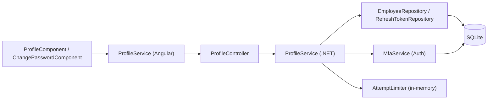
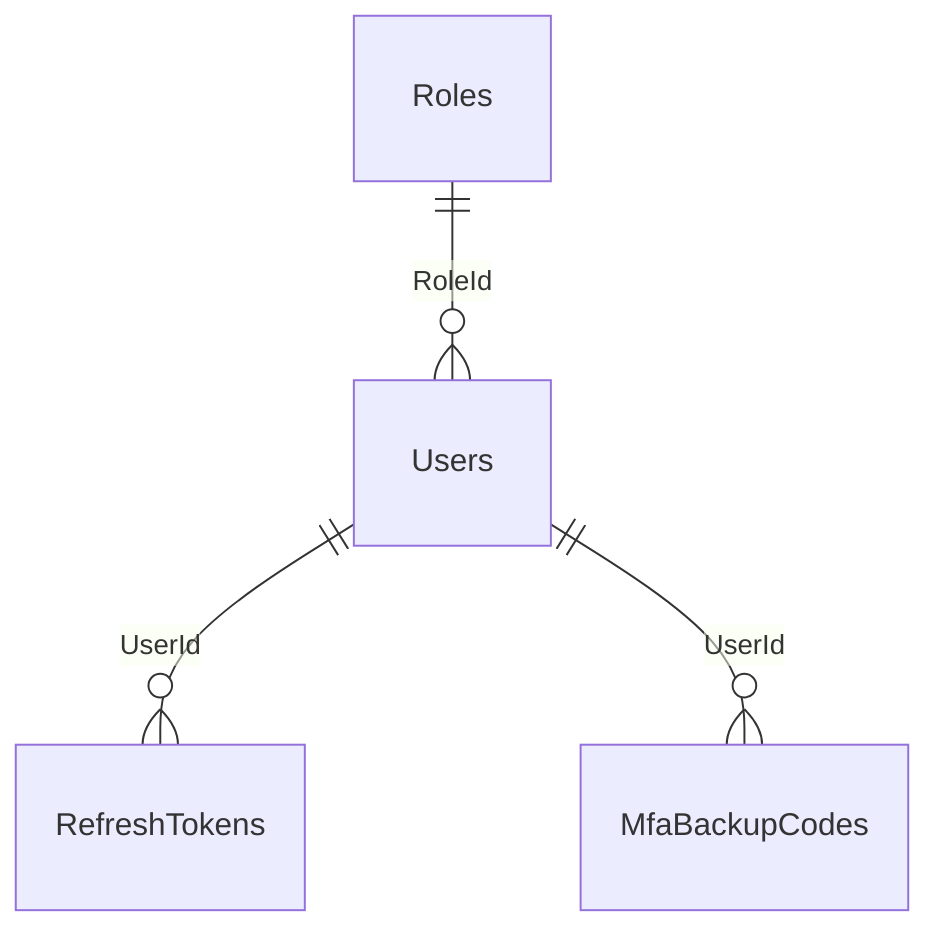

# Profile Module – Technical Documentation

> **Project:** TaskFlow – Intelligent Task Allocation & Tracking System
> **Module:** Profile  ·  **Child Modules:** User Profile, Change Password, Two-Step Verification (self-service MFA endpoints)
> **Version:** 1.0  ·  **Last Updated:** 31-Oct-2026
> **Backend:** ASP.NET Core Web API (.NET 10)  ·  **Frontend:** Angular  ·  **Database:** SQLite (EF Core)
> **Author:** Jojo George (jojogeorge3344@gmail.com)
> © 2026 Jojo George. All rights reserved.

> ✅ Target framework confirmed: `net10.0` (.NET 10), from `backend/src/TaskFlow.Api/TaskFlow.Api.csproj`.

---

## 1. Technical Overview
The Profile module is the self-service API and UI for the signed-in user's own account (BRD Screen 19). One controller, `ProfileController`, mounted at `api/v1/users/me`, provides:
- reading and updating the caller's own details (full name, email, mobile number) – **07.1 User Profile**;
- changing the caller's own password, with step-up through the authenticator code. This revokes every session – **07.2 Change Password**;
- the authenticator-MFA self-service endpoints (setup, enable, check, regenerate backup codes). The Auth module's Security Setup screen calls these – **07.3 Two-Step Verification**.

The user id is **always** read from the JWT `ClaimTypes.NameIdentifier` claim. No route or body field carries a user id. The class has only `[Authorize]`, with no permission policy. The four `profile.*` permission keys are **always-on** catalog entries and are never checked on the server. The module has no repository of its own. `ProfileService` reuses `IEmployeeRepository` (Management), `IRefreshTokenRepository` (Auth), `IUnitOfWork`, `IMfaService` (Auth) and `IAttemptLimiter` (Auth).

## 2. Architecture Flow

## 3. Backend File Structure (module summary)

| Layer | Path | Files | Used by |
|-------|------|-------|---------|
| Controller | `TaskFlow.Api/Controllers/Profile/` | `ProfileController.cs` | All children |
| Service | `TaskFlow.Api/Services/Profile/` | `IProfileService.cs`, `ProfileService.cs` | All children |
| Repository (reused) | `TaskFlow.Api/Repositories/Management/EmployeeManagement/Employees/` | `IEmployeeRepository.cs`, `EmployeeRepository.cs` | 07.1, 07.2 |
| Repository (reused) | `TaskFlow.Api/Repositories/Auth/RefreshTokens/` | `IRefreshTokenRepository` / implementation | 07.2 |
| DTOs | `TaskFlow.Api/Dtos/Profile/` | `ProfileRequests.cs` (`UpdateOwnProfileRequest`, `ChangePasswordRequest`) | 07.1, 07.2 |
| DTOs (reused) | `TaskFlow.Api/Dtos/Management/EmployeeManagement/` | `UserDto.cs` (`UserDto`, `ProjectAllocationDto`, `UserDepartmentDto`, `UserManagerDto`) | 07.1, 07.2 |
| DTOs (reused) | `TaskFlow.Api/Dtos/Auth/Mfa/` | `MfaRequests.cs`, `MfaResults.cs` | 07.3 |
| Validators | `TaskFlow.Api/Dtos/Profile/Validators/` | `UpdateOwnProfileRequestValidator.cs` (also holds `ChangePasswordRequestValidator`) | 07.1, 07.2 |
| Validators (reused) | `TaskFlow.Api/Dtos/Auth/Mfa/Validators/` | `MfaRequestValidators.cs` | 07.3 |
| Rules | `TaskFlow.Api/Common/Rules/` | `EmailPolicy.cs`, `MobileNumberPolicy.cs` | 07.1 |
| Entities | `TaskFlow.Api/Models/Entities/` | `User.cs`, `RefreshToken.cs`, `MfaBackupCode.cs` | All children |
| Security | `TaskFlow.Api/Common/Security/` | `PermissionKeys.cs`, `PermissionCatalog.cs` (the `profile.*` keys) | All children |
| Middleware | `TaskFlow.Api/Middleware/` | `MfaSetupGateMiddleware.cs`, `SessionValidation.cs`, `GlobalExceptionHandler.cs` | All children |
| Filters | `TaskFlow.Api/Filters/` | `ValidationFilter.cs` (runs FluentValidation) | All children |
| DI | `TaskFlow.Api/Config/` | `ServiceRegistration.cs` (`IProfileService` → `ProfileService`, scoped), `MfaOptions.cs` | All children |

## 4. Frontend File Structure (module summary)

| Type | Path | Purpose | Used by |
|------|------|---------|---------|
| Routes | `src/app/modules/profile/profile.routes.ts` | `PROFILE_ROUTES`: `profile` → `ProfileComponent`, `profile/change-password` → `ChangePasswordComponent` (lazy `loadComponent`) | 07.1, 07.2 |
| Page components | `src/app/modules/profile/pages/` | `profile.component.*` (My Profile), `change-password.component.*` (Change Password) | 07.1, 07.2 |
| Models | `src/app/modules/profile/pages/profile.model.ts`, `change-password.model.ts`; shared `modules/management/employee-management/models/user.model.ts` | Form field models; `User`, `UpdateOwnProfile`, `ChangePassword` | 07.1, 07.2 |
| API service | `src/app/modules/profile/services/profile.service.ts` | `get`, `update`, `changePassword`, `startMfaSetup`, `enableMfa`, `checkMfaCode` | All children |
| Route / Guard | `src/app/routes/app.routes.ts` | Profile routes are children of the shell route guarded by `authGuard` and `mfaSetupGuard`. There is no `permissionGuard`. | 07.1, 07.2 |
| Menu | `src/app/layouts/nav-items.ts`, `layouts/shell.component.html` | My Profile menu item and account link, always shown | 07.1 |
| Shared utils | `src/app/shared/utils/api-error.ts` (and others, see each child) | `apiErrorMessage()` error text extraction | All children |
| Consumer | `src/app/modules/auth/security-setup/pages/security-setup.component.ts` | Calls `ProfileService.get`, `update`, `startMfaSetup` and `enableMfa` | 07.1, 07.3 |

---

## 5. Child Modules

| # | Child Module | Main endpoints (count) | Key permissions | Document |
|---|--------------|------------------------|-----------------|----------|
| 07.1 | User Profile | `GET /api/v1/users/me`, `PUT /api/v1/users/me` (2) | `profile.view`, `profile.edit` | `07.1-User-Profile.md` |
| 07.2 | Change Password | `POST /api/v1/users/me/password` (1) | `profile.password.change` | `07.2-Change-Password.md` |
| 07.3 | Two-Step Verification (self-service MFA endpoints) | `POST /api/v1/users/me/mfa/setup`, `/enable`, `/check`, `/backup-codes` (4) | `profile.mfa.manage` | `07.3-Two-Step-Verification.md` |

Total: 7 endpoints, 4 permission keys. The child documents are in the `07-Profile/` folder next to this file.

## 6. Database Design
The module has no tables of its own. It reads and writes these (default EF table names from the `DbSet` properties). Full column lists are in each child document.

| Table | Columns used | Owning child |
|-------|--------------|--------------|
| `Users` | `Id`, `EmployeeCode`, `FullName`, `Username`, `Email`, `MobileNumber`, `RoleId`, `IsActive`, `CreatedAt`, `UpdatedAt`, `LastLoginAt`, `IsDeleted` | 07.1 User Profile |
| `Users` | `PasswordHash`, `SecurityStamp` | 07.2 Change Password |
| `Users` | `MfaSecretProtected`, `MfaEnabledAt` | 07.3 Two-Step Verification |
| `Users` | `MfaLastUsedStep`, `MfaFailedAttempts`, `MfaLockedUntil` (code verification and lockout) | Shared by 07.2 and 07.3 |
| `RefreshTokens` | `Id`, `UserId`, `TokenHash`, `ExpiresAt`, `CreatedAt`, `RevokedAt` | 07.2 Change Password |
| `MfaBackupCodes` | `Id`, `UserId`, `CodeHash`, `CreatedAt`, `UsedAt` | 07.3 (create / replace); 07.2 (spend a code) |
| `UserProjectAllocations`, `Projects`, `Positions`, `UserDepartments`, `Departments`, `DepartmentManagers`, `ManagerProjects` | Read-only joins used by `UserDto` | 07.1 User Profile |

**Relationships (module-wide)**
- `Users.RoleId → Roles.Id` (FK, Restrict)
- `RefreshTokens.UserId → Users.Id` (FK, Cascade)
- `MfaBackupCodes.UserId → Users.Id` (FK, Cascade)

## 7. Security & Authorization
- **Authentication:** JWT bearer token plus a refresh-token cookie. `SessionValidation` rejects tokens whose `SecurityStamp` no longer matches, and tokens of inactive users.
- **Authorization:** `[Authorize]` on the controller only. The id comes from `ClaimTypes.NameIdentifier`. If the claim cannot be parsed, the action returns `401`. Users cannot reach another user's record by design. The four `profile.*` keys in `PermissionCatalog.cs` have `AlwaysGranted: true, IsAssignable: false`. They are given to every user and never stored or checked.
- **Data scope:** Own only. It is fixed by the token claim, so no scope selector is involved.
- **MFA gate:** `MfaSetupGateMiddleware` (with `Mfa:Required = true`) leaves only `GET/PUT /api/v1/users/me` (exact path) and `/api/v1/users/me/mfa/*` open while the token carries the `MfaSetupRequired` claim. Every other API path, including `POST /users/me/password`, returns 403 with `code = "mfa_setup_required"`.
- **Code lockout (shared by 07.2 and 07.3):** 5 wrong codes in a row → 5 minutes (`MfaOptions`), shared with sign-in.
- **Frontend:** the shell route uses `authGuard` and `mfaSetupGuard`. The profile routes have no permission guard. The My Profile menu item and the shell account link are always shown.

| Permission Key | Endpoint(s) | UI Element Controlled | Child |
|----------------|-------------|-----------------------|-------|
| `profile.view` | `GET /api/v1/users/me` | My Profile menu item and page (always shown) | 07.1 |
| `profile.edit` | `PUT /api/v1/users/me` | Personal information form and Save changes | 07.1 |
| `profile.password.change` | `POST /api/v1/users/me/password` | Password card, Change password screen | 07.2 |
| `profile.mfa.manage` | `POST /api/v1/users/me/mfa/setup`, `/enable`, `/check`, `/backup-codes` | Security Setup screen (Auth module), "Two-step on/off" chip | 07.3 |

## 8. Validations & Error Handling (shared)

| Rule | Layer | HTTP Code | Error Message |
|------|-------|-----------|---------------|
| Code missing (password change, step-up) | `MfaService.RequireCodeAsync` | 400 | Enter the code from your authenticator app. |
| Code wrong or expired | `MfaService` | 400 | The code is incorrect or has expired. |
| Code lockout (password change, enable, backup codes) | `MfaService` | 400 | Too many wrong codes. Try again in a few minutes. |
| MFA setup pending | `MfaSetupGateMiddleware` | 403 (`code: mfa_setup_required`) | Set up two-step verification to continue. |
| No or invalid token, or unparseable id claim | Auth / Controller | 401 | – |
| User not found or deleted | Controller | 404 | – (empty `NotFound()`) |
| Concurrent edit of the same row | `GlobalExceptionHandler` | 409 | Someone else changed this record while you were saving. Reload it and try again. |
| Unhandled fault | `GlobalExceptionHandler` | 500 | Something went wrong. Please try again. |

`GlobalExceptionHandler` turns errors into `application/problem+json` responses. `AppException` subclasses supply their status and message as `detail`. `RequestValidationException` and the `ValidationFilter` produce a `ValidationProblemDetails` with an `errors` map. On the client, `apiErrorMessage()` reads `detail`, `error`, `message` and then the first `errors` entry. `ProfileComponent` and `ChangePasswordComponent` map 400 `errors` keys onto their form controls.

Child-specific rules are in each child document.

## 9. Integrations / Side Effects
- **Notifications:** none raised by the Profile endpoints. (The admin MFA reset in the Auth module notifies the user and points them to Profile.)
- **Email:** none.
- **Activity Log:** none. The Profile service writes no audit or activity entry.
- **Sessions, shell and AI Assistant (TFA):** see 07.1 (shell re-sync, `ProposeProfileUpdateTool`) and 07.2 (session revocation, `ExplainPasswordChangeTool`).

## 10. Configuration

| Key (`appsettings.json`) | Purpose | Default |
|--------------------------|---------|---------|
| `Mfa:Required` | Enforce MFA setup before any other API use. This makes the password change possible. | `true` |
| `Mfa:MaxFailedAttempts` | Wrong codes before lockout (code default, not in the JSON) – used by 07.2 and 07.3 | `5` |
| `Mfa:LockoutMinutes` | Lockout length (code default) – used by 07.2 and 07.3 | `5` |
| `ConnectionStrings:Default` | SQLite database | `<secret>` |

Child-specific keys (`Mfa:Issuer`, `Mfa:BackupCodeCount`, `Jwt:*`, `AttemptLimiter` constants) are in 07.2 and 07.3.

## 11. Testing

| Test Type | File / Location | Covers | Child |
|-----------|-----------------|--------|-------|
| Unit | `tests/TaskFlow.UnitTests/Profile/UpdateOwnProfileRequestValidatorTests.cs` | Profile update validation rules | 07.1 |
| Integration | `tests/TaskFlow.IntegrationTests/Profile/UserProfileEndpointsTests.cs` | `/api/v1/users/me` endpoints | 07.1 |
| Integration | `tests/TaskFlow.IntegrationTests/Auth/Mfa/MfaStepUpEndpointsTests.cs` | Step-up code (e.g. password change) | 07.2 |
| Integration | `tests/TaskFlow.IntegrationTests/Auth/Mfa/MfaEnrolmentEndpointsTests.cs` | `mfa/setup` and `mfa/enable` | 07.3 |
| Integration | `tests/TaskFlow.IntegrationTests/Auth/Mfa/MfaSetupGateEndpointsTests.cs` | Setup gate allow-list (`/users/me`, `/users/me/mfa/*`) | Module-wide (gate) |
| Unit | `tests/TaskFlow.UnitTests/Auth/Mfa/MfaServiceTests.cs` | `MfaService` code verification, lockout, backup codes | 07.2, 07.3 |
| Support | `tests/TaskFlow.IntegrationTests/TestSupport/MfaTestSupport.cs`, `tests/TaskFlow.UnitTests/TestSupport/AcceptingMfaService.cs` | MFA test helpers | 07.2, 07.3 |

> Frontend specs: `profile.component.spec.ts`, `profile.component.layout.spec.ts`, `change-password.component.spec.ts`, `profile.service.spec.ts`, `mfa-services.spec.ts`. Backend coverage in the table is inferred from file names.

## 12. Known Limitations / Future Enhancements
- No audit or activity entry is written for profile edits or password changes.
- **Permission keys not enforced:** the `profile.*` keys exist in `PermissionCatalog.cs` (always on, not assignable), but no endpoint or UI element checks them. The controller uses `[Authorize]` only, and `nav-items.ts` always shows My Profile. This is by design: the permission documents list them as always on.
- **Inconsistent lockout status:** a locked-out code returns 429 from `mfa/check` (07.3) but 400 from password change (07.2), enable and backup-codes (`BusinessRuleException(LockedMessage)`).
- **Method naming:** `GetActiveWithRoleForUpdateAsync` (used by 07.1 and 07.2) does not filter on `IsActive` (only `!IsDeleted`). Inactive users are stopped earlier by `SessionValidation`.

Child-specific gaps are listed in each child document.

---
© 2026 Jojo George. All rights reserved. Unauthorized copying or distribution of this document is prohibited.
