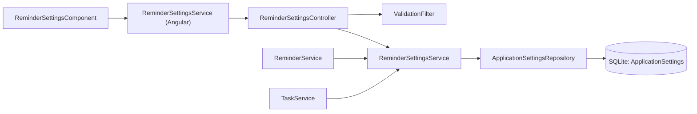
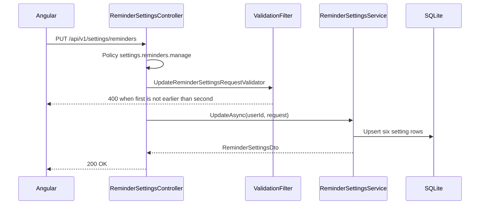

# Reminder Settings – Technical Documentation

> **Project:** TaskFlow – Intelligent Task Allocation & Tracking System
> **Parent Module:** Settings  ·  **Child Module:** 08.2 Reminder Settings
> **Version:** 1.0  ·  **Last Updated:** 31-Oct-2026
> **Backend:** ASP.NET Core Web API (.NET 10)  ·  **Frontend:** Angular  ·  **Database:** SQLite (EF Core)
> **Author:** Jojo George (jojogeorge3344@gmail.com)
> © 2026 Jojo George. All rights reserved.

---

## 1. Technical Overview
Reminder Settings is `ReminderSettingsController` (class-level `settings.reminders.manage`) over `ReminderSettingsService` and the shared `ApplicationSettingsRepository`. It reads and writes five `Reminder.*` keys and `Notification.MailEnabled` in the `ApplicationSettings` table, and returns the application timezone read-only. The reminder engine (`ReminderService`, Communication module) and `TaskService` (Monitoring module) consume these values.

## 2. Architecture Flow


## 3. Backend File Structure

| Layer | Path | Files |
|-------|------|-------|
| Controller | `TaskFlow.Api/Controllers/Settings/` | `ReminderSettingsController.cs` |
| Service | `TaskFlow.Api/Services/Settings/ReminderSettings/` | `IReminderSettingsService.cs`, `ReminderSettingsService.cs` |
| Repository (shared with 08.1) | `TaskFlow.Api/Repositories/Settings/ApplicationSettings/` | `IApplicationSettingsRepository.cs`, `ApplicationSettingsRepository.cs` |
| DTOs | `TaskFlow.Api/Dtos/Settings/ReminderSettings/` | `ReminderSettingsDtos.cs` (`ReminderSettingsDto`, `UpdateReminderSettingsRequest`) |
| Validators | `TaskFlow.Api/Dtos/Settings/ReminderSettings/Validators/` | `UpdateReminderSettingsRequestValidator.cs` |
| Entities | `TaskFlow.Api/Models/Entities/` | `ApplicationSetting.cs` |
| Enums | `TaskFlow.Api/Models/Enums/` | `ReminderFrequency.cs` |
| Constants | `TaskFlow.Api/Common/Constants/` | `SettingKeys.cs` |
| Seeders | `TaskFlow.Api/Persistence/Seeders/` | `SettingsInitializer.cs` |
| Config | `TaskFlow.Api/Config/` | `ApplicationOptions.cs` (timezone fallback) |
| Migrations | `TaskFlow.Api/Persistence/Migrations/` | `20261013104629_AddTaskReminderSettings.cs` (per-task reminder columns on `Tasks`) |

## 4. Frontend File Structure

| Type | Path | Purpose |
|------|------|---------|
| Page component | `src/app/modules/settings/reminder-settings/pages/reminder-settings.component.{ts,html}` | `ReminderSettingsComponent` (Screen 13) |
| Models | `src/app/modules/settings/reminder-settings/pages/reminder-settings.model.ts`, `src/app/modules/settings/models/settings.model.ts` | `ReminderSettings` interface |
| API service | `src/app/modules/settings/reminder-settings/services/reminder-settings.service.ts` | `ReminderSettingsService.get()/save()` |
| Shared options | `src/app/shared/utils/reminder-options.ts` | `FIRST_REMINDER_OPTIONS`, `SECOND_REMINDER_OPTIONS`, `OVERDUE_FREQUENCY_OPTIONS`, `withReminderDay()` |
| Route / Guard | `src/app/modules/settings/settings.routes.ts` (`settings/reminders`), `src/app/shared/auth/auth.guard.ts` | `permissionGuard` with `SettingsReminders` |
| Menu | `src/app/layouts/nav-items.ts` | "Reminder Settings" item when `SettingsReminders` is held |

---

## 5. API & Logic

### 5.1 API Endpoints

| # | Method | Endpoint | Description | Permission (Policy) | Request DTO | Response DTO |
|---|--------|----------|-------------|---------------------|-------------|--------------|
| 1 | GET | `/api/v1/settings/reminders` | Current reminder configuration plus read-only timezone | `settings.reminders.manage` (class level) | – | `ReminderSettingsDto` |
| 2 | PUT | `/api/v1/settings/reminders` | Save reminder configuration (no timezone field) | `settings.reminders.manage` (class level) | `UpdateReminderSettingsRequest` | `ReminderSettingsDto` |

### 5.2 Request / Response Samples
```json
// PUT /api/v1/settings/reminders
{ "enabled": true, "deadlineDayEnabled": true, "defaultFirstDays": 2, "defaultSecondDays": 1, "defaultOverdueFrequency": "Daily", "mailEnabled": true }
```
```json
// 200 OK
{ "enabled": true, "deadlineDayEnabled": true, "defaultFirstDays": 2, "defaultSecondDays": 1, "defaultOverdueFrequency": "Daily", "mailEnabled": true, "timezone": "Asia/Kolkata" }
```

### 5.3 Service Layer Logic
**Method:** `ReminderSettingsService.GetAsync(CancellationToken)`
1. Reads `Application.Timezone`, `Reminder.Enabled`, `Reminder.DeadlineDayEnabled`, `Reminder.DefaultFirstDays`, `Reminder.DefaultSecondDays`, `Reminder.DefaultOverdueFrequency` and `Notification.MailEnabled`.
2. Falls back to the defaults `true`, `true`, `2`, `1`, `Daily`, `true`. The timezone falls back to `ApplicationOptions.Timezone`.

**Method:** `ReminderSettingsService.UpdateAsync(int userId, UpdateReminderSettingsRequest request, CancellationToken)`
1. Throws `ArgumentException("Every reminder setting must be provided.")` if any field is null.
2. Upserts the five `Reminder` keys (category `Reminder`) and `Notification.MailEnabled` (category `Notification`). It sets `UpdatedByUserId` and `UpdatedAt`. Ints use invariant culture.
3. Saves and returns `GetAsync()`. `Application.Timezone` is never written here.

**Consumers:** `ReminderService` (Communication) skips the whole run when `Enabled` is false. It passes `DeadlineDayEnabled` to `ReminderCalculator.DueReminders` and builds a Mail copy only when `MailEnabled` is true. `TaskService` (Monitoring) reads the defaults for new tasks.

### 5.4 Repository Layer
Same `IApplicationSettingsRepository` as 08.1 Application Settings:

| Method | Description | Query Notes |
|--------|-------------|-------------|
| `GetValuesAsync(keys)` | Values of the given keys | `AsNoTracking`, `ToDictionaryAsync(Key, Value)` |
| `GetForUpdateAsync(keys)` | Tracked rows for update | Tracked, `ToDictionaryAsync(Key)` |
| `Add(entity)` (base) | Stage a new row | From `BaseRepository` |

### 5.5 Sequence Diagram


---

## 6. Database Design

| Table | Column | Type | Constraints | Description |
|-------|--------|------|-------------|-------------|
| `ApplicationSettings` | `Id` | int | PK, Identity | Row id |
| `ApplicationSettings` | `Key` | string(128) | Not Null, Unique | This child writes `Reminder.Enabled`, `Reminder.DeadlineDayEnabled`, `Reminder.DefaultFirstDays`, `Reminder.DefaultSecondDays`, `Reminder.DefaultOverdueFrequency`, `Notification.MailEnabled`; reads `Application.Timezone` |
| `ApplicationSettings` | `Value` | string(1024) | Not Null | Invariant-culture string value |
| `ApplicationSettings` | `Category` | string(64) | Not Null | `Reminder` or `Notification` for this child |
| `ApplicationSettings` | `UpdatedByUserId` | int? | – (no FK) | Last editor |
| `ApplicationSettings` | `UpdatedAt` | DateTime | Not Null | UTC |

**Relationships:** none (key/value table, no FK). The table is shared with 08.1 Application Settings.

**Seed data:** `SettingsInitializer` inserts missing setting rows at every start and never overwrites existing ones.

> The per-task reminder columns (`FirstReminderDays`, `SecondReminderDays`, `OverdueReminderFrequency` on `Tasks`, migration `20261013104629_AddTaskReminderSettings`) belong to the Monitoring module; this child only supplies their defaults for new tasks.

## 7. Security & Authorization
- **Authorization:** class-level `[RequirePermission(settings.reminders.manage)]` on `ReminderSettingsController`, so both GET and PUT need it.
- **Data scope:** None. The settings are organization-wide.
- **Frontend:** `permissionGuard` on `settings/reminders` and the menu item in `buildNavigation()`.

| Permission Key | Endpoint(s) | UI Element Controlled |
|----------------|-------------|-----------------------|
| `settings.reminders.manage` | `GET`, `PUT /api/v1/settings/reminders` | Menu "Reminder Settings", route `/settings/reminders` |

## 8. Validations & Error Handling

| Rule | Layer | HTTP Code | Error Message |
|------|-------|-----------|---------------|
| Reminder field missing, first not 1–30, second not 0–30 | `UpdateReminderSettingsRequestValidator` | 400 | FluentValidation default |
| Second reminder not less than first | Validator | 400 | The first reminder must come earlier than the second reminder. |

Shared rules (403, 401, 409 concurrency, 500) are in the parent document. The screen maps the `errors` keys onto the form controls.

## 9. Integrations / Side Effects
- **Reminders:** `ReminderService` uses `Reminder.Enabled`, `Reminder.DeadlineDayEnabled` and `Notification.MailEnabled` (Mail copy of each reminder). `IAppClock` (08.1) gives the local calendar day.
- **Email / Mail:** No mail is sent by this module. `Notification.MailEnabled` only controls the reminder copies in internal Mail.
- **Tasks:** `TaskService` reads the default first/second days and overdue frequency for new tasks.
- **AI Assistant:** knowledge page `Services/Assistant/Knowledge/reminder-settings.md`.
- **Activity Log:** none (only `UpdatedByUserId` / `UpdatedAt`).

## 10. Configuration

| Key (`appsettings.json`) | Purpose | Default |
|--------------------------|---------|---------|
| `Reminders:SchedulerEnabled`, `Reminders:TickSeconds` | Reminder engine that consumes these settings (Communication module) | `true`, `60` |
| `Application:Timezone` | Fallback for the read-only timezone while the row is missing (owned by 08.1) | `Asia/Kolkata` (code default `UTC`) |

Runtime-editable keys in the `ApplicationSettings` table (`SettingKeys`):
- `Reminder.Enabled` (`true`), `Reminder.DeadlineDayEnabled` (`true`), `Reminder.DefaultFirstDays` (`2`), `Reminder.DefaultSecondDays` (`1`), `Reminder.DefaultOverdueFrequency` (`Daily`)
- `Notification.MailEnabled` (`true`)

## 11. Testing

| Test Type | File / Location | Covers |
|-----------|-----------------|--------|
| Unit | `tests/TaskFlow.UnitTests/Settings/ReminderSettings/ReminderSettingsServiceTests.cs` | Reminder defaults and save |
| Unit | `tests/TaskFlow.UnitTests/Settings/ReminderSettings/ReminderSettingsValidatorTests.cs` | Ranges and first-before-second rule |
| Integration | `tests/TaskFlow.IntegrationTests/Settings/ReminderSettings/SettingsEndpointsTests.cs` | Reminder settings endpoints |
| Unit (consumer) | `tests/TaskFlow.UnitTests/Communication/Notification/Reminders/ReminderServiceTests.cs`, `ReminderCalculatorTests.cs` | Reminder engine that reads these settings (Communication module; by name) |

> Test paths are taken from `tests-filelist.json`. Test contents were not read. Shared tests (`SettingsInitializerTests.cs`) are in the parent document.

## 12. Known Limitations / Gaps found
- The reminder screen offers fixed choices (3/2/1 days and 1/0 days) while the API accepts 1–30 and 0–30.
- **BRD Screen 13 "Email notification setting"**: the code's toggle `Notification.MailEnabled` delivers reminder copies to the internal TaskFlow Mail inbox.
  > ⚠️ To be confirmed: whether any SMTP email channel is tied to this setting (not found in the Settings code).
- **BRD Screen 13 access "Administrator or authorized Manager"** matches the seed defaults (Manager granted `settings.reminders.manage`).
  > ⚠️ To be confirmed: live database grants were not inspected.
- Module-wide limitations (no audit log, no reset to defaults) are in the parent document.

---
<sub>© 2026 Jojo George. All rights reserved. Unauthorized copying or distribution of this document is prohibited.</sub>
