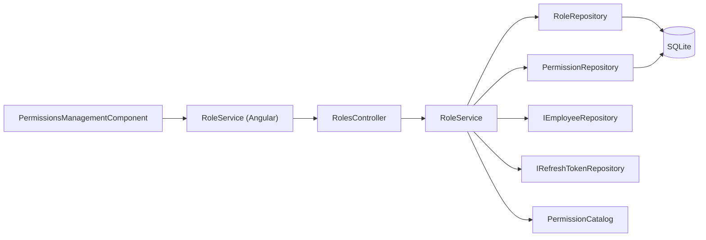
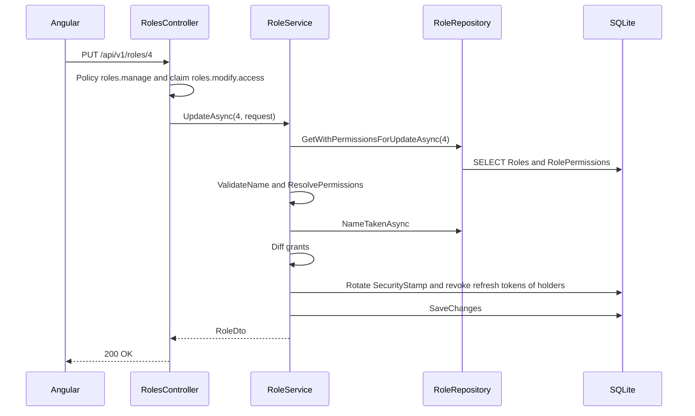

# Role Configuration – Technical Documentation

> **Project:** TaskFlow – Intelligent Task Allocation & Tracking System
> **Parent Module:** Settings  ·  **Child Module:** 08.3 Role Configuration
> **Version:** 1.0  ·  **Last Updated:** 31-Oct-2026
> **Backend:** ASP.NET Core Web API (.NET 10)  ·  **Frontend:** Angular  ·  **Database:** SQLite (EF Core)
> **Author:** Jojo George (jojogeorge3344@gmail.com)
> © 2026 Jojo George. All rights reserved.

---

## 1. Technical Overview
Role Configuration is `RolesController` (class-level `roles.manage`) over `RoleService`, `RoleRepository` and `PermissionRepository`. It manages custom `Roles` and their `RolePermissions` grants against the fixed permission catalogue in `Common/Security/PermissionCatalog.cs`. System roles and the `Permissions` table are protected by SQLite triggers. A permission change on a role signs out its holders: their security stamp is rotated and their refresh tokens are revoked (through `IEmployeeRepository` and `IRefreshTokenRepository`). The catalogue endpoints for create/update/delete always refuse.

## 2. Architecture Flow


## 3. Backend File Structure

| Layer | Path | Files |
|-------|------|-------|
| Controller | `TaskFlow.Api/Controllers/Settings/` | `RolesController.cs` |
| Service | `TaskFlow.Api/Services/Settings/RoleConfiguration/` | `IRoleService.cs`, `RoleService.cs` |
| Repository | `TaskFlow.Api/Repositories/Settings/RoleConfiguration/Roles/` | `IRoleRepository.cs`, `RoleRepository.cs`, `RoleSummary.cs` |
| Repository | `TaskFlow.Api/Repositories/Settings/RoleConfiguration/Permissions/` | `IPermissionRepository.cs`, `PermissionRepository.cs` |
| DTOs | `TaskFlow.Api/Dtos/Settings/RoleConfiguration/` | `RoleDtos.cs` (`PermissionDto`, `RoleDto`, `RoleOptionDto`, `SaveRoleRequest`) |
| Validators | – | None. Name and permission rules are in `RoleService` |
| Entities | `TaskFlow.Api/Models/Entities/` | `Role.cs`, `Permission.cs`, `RolePermission.cs` |
| Security | `TaskFlow.Api/Common/Security/` | `PermissionKeys.cs`, `PermissionCatalog.cs`, `EffectivePermissions.cs`, `SystemRoles.cs` |
| Exceptions | `TaskFlow.Api/Common/Exceptions/` | `RoleException.cs` (`RoleFailure`) |
| Seeders | `TaskFlow.Api/Persistence/Seeders/` | `AccessControlSeeder.cs` |
| Migrations | `TaskFlow.Api/Persistence/Migrations/` | `20261019133820_AddRolesAndPermissions.cs` (triggers) |

## 4. Frontend File Structure

| Type | Path | Purpose |
|------|------|---------|
| Page component | `src/app/modules/settings/role-configuration/pages/permissions-management.component.{ts,html}`, `permissions-management.model.ts` | `PermissionsManagementComponent` (tree + matrix) |
| API service | `src/app/modules/settings/role-configuration/services/role.service.ts` | `RoleService.list()/permissions()/create()/update()/delete()/assignable()` |
| Models | `src/app/modules/settings/role-configuration/models/role.model.ts` | `AccessRole`, `PermissionInfo`, `SaveRoleRequest`, `SYSTEM_ROLE_IDS` |
| Utils | `src/app/modules/settings/role-configuration/utils/permission-tree.ts` | `buildTree`, `toggleKey` (auto-ticks `requires`), `setScope`, `setMany`, `restrictForCaller` (`RESTRICTED_KEYS`), `isSelectable` |
| Route / Guard | `src/app/modules/settings/settings.routes.ts` (`settings/permissions`), `src/app/shared/auth/auth.guard.ts` | `permissionGuard` with `RolesManage` |
| Menu | `src/app/layouts/nav-items.ts` | "Role Configuration" item when `RolesManage` is held |

---

## 5. API & Logic

### 5.1 API Endpoints
All routes are under `[Route("api/v1")]` with class-level `[RequirePermission(roles.manage)]`.

| # | Method | Endpoint | Description | Permission (Policy) | Request DTO | Response DTO |
|---|--------|----------|-------------|---------------------|-------------|--------------|
| 1 | GET | `/api/v1/roles` | All roles (system first). Without `roles.view.all` only the caller's own role is returned | `roles.manage` (+ claim check `roles.view.all`) | – | `IReadOnlyList<RoleDto>` |
| 2 | GET | `/api/v1/roles/{id:int}` | One role | `roles.manage` | – | `RoleDto` |
| 3 | POST | `/api/v1/roles` | Create custom role | `roles.manage` + claim `roles.modify.access` (else `Forbid()`) | `SaveRoleRequest` | `201 Created` + `RoleDto` |
| 4 | PUT | `/api/v1/roles/{id:int}` | Rename custom role and replace its permissions | `roles.manage` + claim `roles.modify.access` | `SaveRoleRequest` | `RoleDto` |
| 5 | DELETE | `/api/v1/roles/{id:int}` | Delete custom role nobody holds | `roles.manage` + claim `roles.modify.access` | – | `204 No Content` |
| 6 | GET | `/api/v1/permissions` | The fixed permission catalogue in display order | `roles.manage` | – | `IReadOnlyList<PermissionDto>` |
| 7 | POST | `/api/v1/permissions` | Always refused (`CatalogIsFixed`) | `roles.manage` | – | `403` ProblemDetails |
| 8 | PUT | `/api/v1/permissions/{id:int}` | Always refused | `roles.manage` | – | `403` ProblemDetails |
| 9 | DELETE | `/api/v1/permissions/{id:int}` | Always refused | `roles.manage` | – | `403` ProblemDetails |

Related (Management module): `GET /api/v1/users/roles` in `EmployeesController` returns `RoleOptionDto` for the employee form. It does not include permissions.

### 5.2 Request / Response Samples
```json
// POST /api/v1/roles
{ "name": "Team Lead", "permissionKeys": ["tasks.view.all", "tasks.create", "workload.view"] }
```
```json
// 201 Created
{ "id": 4, "name": "Team Lead", "isSystem": false, "userCount": 0, "permissionKeys": ["tasks.create", "tasks.view.all", "workload.view"] }
```
```json
// GET /api/v1/permissions (one entry)
{ "id": 52, "key": "settings.ai.edit", "name": "Edit AI provider settings", "description": "Configure AI providers, keys and models.", "group": "Settings", "isAssignable": true, "module": "Settings", "screen": "TFA Settings", "section": "AI providers", "action": "Edit", "requires": "settings.ai.view", "scopeGroup": null, "scopeRank": 0, "alwaysGranted": false }
```
> The `id` values in the samples are illustrative. Always-on entries return `id: 0`.

### 5.3 Service Layer Logic
**Method:** `RoleService.GetRolesAsync()`
- `RoleRepository.GetSummariesAsync()` returns the roles. `PermissionKeys` = `EffectivePermissions.Visible(EffectivePermissions.Expand(stored))`: legacy keys are expanded to their finer children, lower scope levels are added, and keys not in the catalogue are dropped.

**Method:** `RoleService.GetPermissionsAsync()`
- Maps `PermissionCatalog.All` to `PermissionDto`, taking the `Id` from `PermissionRepository.GetIdsByKeyAsync()`. The hierarchy comes from code, not from the table.

**Method:** `RoleService.CreateAsync(SaveRoleRequest)`
1. `ValidateName`: trim. Empty gives `RoleFailure.Invalid` "Enter a name for the role.". Over 100 gives "The role name can be at most 100 characters.".
2. `ResolvePermissionsAsync`:
   - trim and distinct the keys
   - expand legacy keys through `EffectivePermissions.LegacyChildren`
   - drop `AlwaysGranted` keys
   - unknown keys give "Unknown permission: …"
   - a missing `Requires` gives "\"X\" also needs \"Y\"."
   - an `IsAssignable = false` key (taken from the catalogue) gives "… can only be held by the Administrator role and cannot be given to another role."
3. `EnsureNameFreeAsync`: `NameTakenAsync` (NOCASE column) gives `RoleFailure.Duplicate` "A role named \"…\" already exists.".
4. Creates `Role { IsSystem = false, CreatedAt = now }` with its `RolePermission` rows. `SaveAsync` maps `UniqueConstraintException` to "A role with that name already exists." (409).

**Method:** `RoleService.UpdateAsync(int id, SaveRoleRequest)`
1. `LoadCustomRoleAsync`: not found gives 404 "That role does not exist.". `IsSystem` gives `RoleFailure.ReadOnly` (403) "{name} is a system role and is read-only: it cannot be changed or deleted.".
2. Validates the name and permissions as in Create, then diffs the grants (removes the unwanted ones, adds the missing ones).
3. If the grants changed, `EndSessionsOfRoleHoldersAsync` sets a new `SecurityStamp` (`Guid.NewGuid().ToString("N")`) on every holder and sets `RevokedAt = now` on their active refresh tokens.
4. Saves and returns the role.

**Method:** `RoleService.DeleteAsync(int id)`
1. `LoadCustomRoleAsync` (same rules as above).
2. `IEmployeeRepository.CountHoldingRoleAsync(id)` > 0 gives `RoleFailure.InUse` (409) "1 user still holds this role. Move them to another role first." or "{n} users still hold this role. Move them to another role first.".
3. Removes the role. The `RolePermissions` rows are deleted by cascade.

### 5.4 Repository Layer

| Method | Description | Query Notes |
|--------|-------------|-------------|
| `RoleRepository.GetSummariesAsync()` | Roles with user count and stored keys | `AsNoTracking`, `OrderByDescending(IsSystem).ThenBy(Id)`. `UserCount` uses `Db.Users.IgnoreQueryFilters()`, so soft-deleted accounts are counted |
| `RoleRepository.GetWithPermissionsForUpdateAsync(id)` | Tracked role with grants | `Include(Permissions)` |
| `RoleRepository.NameTakenAsync(name, exceptRoleId)` | Name collision check | `AnyAsync`. The column collation is `NOCASE` |
| `RoleRepository.GetPermissionKeysByRoleNameAsync(roleName)` | Keys held by a role name | Used by `TaskService` (Monitoring) |
| `PermissionRepository.GetIdsByKeyAsync()` | Key to Id map | `AsNoTracking` |
| `PermissionRepository.GetByKeysAsync(keys)` | Tracked permission rows to grant | `Where(keys.Contains(Key))` |
| `IEmployeeRepository.CountHoldingRoleAsync` / `GetHoldingRoleForUpdateAsync` | Holders of a role | Management module |
| `IRefreshTokenRepository.GetActiveForUsersForUpdateAsync` | Active refresh tokens of the holders | Auth module |

### 5.5 Sequence Diagram


---

## 6. Database Design

| Table | Column | Type | Constraints | Description |
|-------|--------|------|-------------|-------------|
| `Roles` | `Id` | int | PK | 1 Administrator, 2 Manager, 3 Employee (system) |
| `Roles` | `Name` | string(100) | Not Null, Unique, Collation `NOCASE` | Role name |
| `Roles` | `IsSystem` | bool | Not Null | System roles are read-only |
| `Roles` | `CreatedAt` | DateTime | Not Null | UTC |
| `Permissions` | `Id` | int | PK | Row id |
| `Permissions` | `Key` | string(100) | Not Null, Unique | e.g. `settings.ai.edit` |
| `Permissions` | `Name` | string(200) | Not Null | Display name |
| `Permissions` | `Description` | string(500) | Not Null | Description |
| `Permissions` | `Group` | string(100) | Not Null | Catalogue module |
| `Permissions` | `IsAssignable` | bool | Not Null | False = Administrator only |
| `RolePermissions` | `RoleId` | int | PK (composite), FK | Role |
| `RolePermissions` | `PermissionId` | int | PK (composite), FK | Permission |

Also used (owned by other modules): `Users.RoleId` and `Users.SecurityStamp` (Management), `RefreshTokens.RevokedAt` (Authentication).

**Relationships**
- `RolePermissions.RoleId → Roles.Id` (FK, Cascade)
- `RolePermissions.PermissionId → Permissions.Id` (FK, Restrict)
- `Users.RoleId → Roles.Id` (FK, Restrict)

**Database triggers** (migration `20261019133820_AddRolesAndPermissions`):
- `TR_Roles_SystemNoUpdate` / `TR_Roles_SystemNoDelete` – "System roles are read-only." / "System roles cannot be deleted."
- `TR_Permissions_NoUpdate` / `TR_Permissions_NoDelete` – "The permission catalog is read-only."
- `TR_RolePermissions_SystemNoUpdate` / `TR_RolePermissions_SystemNoDelete` – "System roles are read-only." (inserts are allowed, so the seeder can add new grants)

**Seed data:** `AccessControlSeeder` creates the system roles and missing permissions. It grants every stored permission to the Administrator on every start. Manager and Employee get their `GrantedTo*` defaults only when a permission is first created.

## 7. Security & Authorization
- **Authorization:** class-level `[RequirePermission(roles.manage)]` on `RolesController`.
- **In-action claim checks:** `RolesController` checks `User.HasClaim("permission", roles.view.all)` and `roles.modify.access` inside the actions.
- **Data scope:** Role listing is narrowed to the caller's own role without `roles.view.all`.
- **Frontend:**
  - `permissionGuard` on `settings/permissions` and the menu item in `buildNavigation()`.
  - In-component checks `canViewAllRoles` and `canModifyAccess`.
  - `restrictForCaller()` marks `roles.administrator.assign` as not assignable for callers who do not hold it.

| Permission Key | Endpoint(s) | UI Element Controlled |
|----------------|-------------|-----------------------|
| `roles.manage` | All `/api/v1/roles*` and `/api/v1/permissions*` | Menu "Role Configuration", route `/settings/permissions` |
| `roles.view.all` | `GET /api/v1/roles` (filter) | Role list shows all roles, not only one's own |
| `roles.modify.access` | `POST`, `PUT`, `DELETE /api/v1/roles` | "New role", editable name/tree, Copy from, Delete, Save bar |
| `roles.administrator.assign` | (Management `EmployeesController`) | Whether the Administrator-only entry is offered in the tree |

## 8. Validations & Error Handling

| Rule | Layer | HTTP Code | Error Message |
|------|-------|-----------|---------------|
| Role name empty | `RoleService` | 400 | Enter a name for the role. |
| Role name > 100 | `RoleService` | 400 | The role name can be at most 100 characters. |
| Unknown permission key | `RoleService` | 400 | Unknown permission: {keys}. |
| Required permission missing | `RoleService` | 400 | "{name}" also needs "{needed}". |
| Non-assignable permission | `RoleService` | 400 | {names} can only be held by the Administrator role and cannot be given to another role. |
| Duplicate role name | `RoleService` | 409 | A role named "{name}" already exists. / A role with that name already exists. |
| System role change/delete | `RoleService` | 403 | {name} is a system role and is read-only: it cannot be changed or deleted. |
| Role in use | `RoleService` | 409 | 1 user still holds this role. Move them to another role first. |
| Role not found | `RoleService` | 404 | That role does not exist. |
| Catalogue mutation | `RolesController.CatalogIsFixed` | 403 | The permission list is fixed and cannot be changed. |
| Create/update/delete role without `roles.modify.access` | `RolesController` (`Forbid()`) | 403 | (empty body) |

Errors from `RoleService` are `RoleException` (`RoleFailure`) and are mapped to ProblemDetails by `GlobalExceptionHandler`. Shared rules are in the parent document.

## 9. Integrations / Side Effects
- **Sessions:** A permission change on a custom role rotates `Users.SecurityStamp` and revokes the active `RefreshTokens` of every holder.
- **Authorization everywhere:** `SessionValidation` refreshes permission claims on each request, so grants saved here apply on the next call in every module.
- **Monitoring:** `TaskService` reads `GetPermissionKeysByRoleNameAsync`.
- **AI Assistant:** knowledge page `Services/Assistant/Knowledge/change-role.md`.
- **Activity Log:** no activity row is written for role changes.

## 10. Configuration
_Not applicable: Role Configuration has no `appsettings.json` keys. The permission catalogue is defined in code (`PermissionCatalog.cs`)._

## 11. Testing

| Test Type | File / Location | Covers |
|-----------|-----------------|--------|
| Unit | `tests/TaskFlow.UnitTests/Settings/RoleConfiguration/PermissionCatalogTests.cs` | Catalogue integrity |
| Unit | `tests/TaskFlow.UnitTests/Persistence/RolesMigrationTests.cs` | Roles migration and triggers |
| Unit | `tests/TaskFlow.UnitTests/Monitoring/TaskManagement/Tasks/CustomRolePermissionTests.cs`, `Monitoring/EmployeeWorkload/CustomRoleWorkloadTests.cs` | Custom role permissions in other modules |
| Integration | `tests/TaskFlow.IntegrationTests/Settings/RoleConfiguration/RolesEndpointsTests.cs` | Roles and permissions endpoints |
| Integration | `tests/TaskFlow.IntegrationTests/Settings/RoleConfiguration/RoleAssignmentSafeguardTests.cs` | Administrator-role safeguards |

> Test paths are taken from `tests-filelist.json`. Test contents were not read.

## 12. Known Limitations / Gaps found
- Changing only a custom role's name does not sign its holders out; only a change to its permissions does.
- **Permission matrix missing rows:** `roles.view.all` and `roles.modify.access` exist in `PermissionCatalog.cs` and `PermissionKeys.cs` but are not in `role-permission-matrix.csv` or `permission-inventory.csv`.
- **Matrix vs code – `roles.administrator.assign`:** the matrix lists Custom role as "CONFIGURABLE", but the catalogue sets `IsAssignable: false`, and `RoleService.ResolvePermissionsAsync` refuses it for any custom role. The correct value is Denied.
- **Matrix vs code – `roles.manage` assignable to custom roles:** the catalogue has `IsAssignable = true`, while the `RolesController`/`RoleService` frontend comments say "Administrator only" (audit item 1). A custom role holding `roles.manage` + `roles.modify.access` can create a role with `employees.role.assign`.
- **`GET /api/v1/roles/{id}` ignores `roles.view.all`:** a holder of `roles.manage` without `roles.view.all` gets only their own role from `GET /roles`, but can still read any role by id.
- **"Duplicate as custom role"** is shown for system roles without `roles.modify.access`. The new draft is then not editable and cannot be saved.
- **Empty 403 bodies:** `Forbid()` in `RolesController` returns no ProblemDetails, so the UI shows only the fallback ("Could not save the role.").
- **Stale comments:** `RoleService` (Angular) and `PermissionsManagementComponent` say "Administrator only", but access is permission-based.

---
<sub>© 2026 Jojo George. All rights reserved. Unauthorized copying or distribution of this document is prohibited.</sub>
