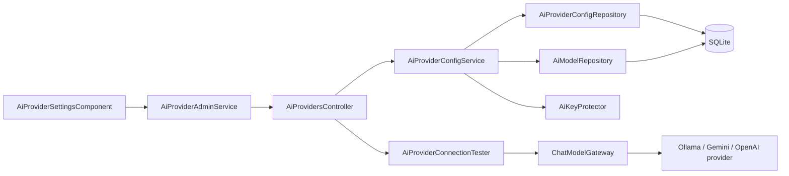
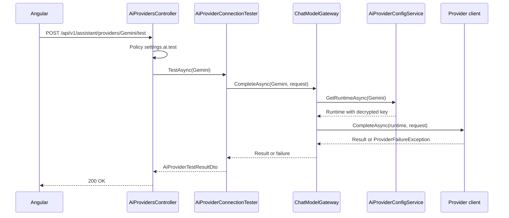

# TFA Settings – Technical Documentation

> **Project:** TaskFlow – Intelligent Task Allocation & Tracking System
> **Parent Module:** Settings  ·  **Child Module:** 08.4 TFA Settings
> **Version:** 1.0  ·  **Last Updated:** 31-Oct-2026
> **Backend:** ASP.NET Core Web API (.NET 10)  ·  **Frontend:** Angular  ·  **Database:** SQLite (EF Core)
> **Author:** Jojo George (jojogeorge3344@gmail.com)
> © 2026 Jojo George. All rights reserved.

---

## 1. Technical Overview
TFA Settings is `AiProvidersController` over `AiProviderConfigService`, `AiProviderConnectionTester`, `AiProviderConfigRepository` and `AiModelRepository`. It stores one `AiProviderConfigs` row per AI provider (Ollama, Gemini, OpenAI) and the list of selectable `AiModels`. API keys are encrypted with ASP.NET Core Data Protection (`AiKeyProtector`) and never returned. The connection test goes through the Assistant's `IChatModelGateway` (`ChatModelGateway`) to the provider clients in `Integrations/Ai/Providers/`.

## 2. Architecture Flow


## 3. Backend File Structure

| Layer | Path | Files |
|-------|------|-------|
| Controller | `TaskFlow.Api/Controllers/Settings/` | `AiProvidersController.cs` |
| Service | `TaskFlow.Api/Services/Settings/TfaSettings/ProviderConfig/` | `IAiProviderConfigService.cs`, `AiProviderConfigService.cs` |
| Service (test) | `TaskFlow.Api/Services/Settings/TfaSettings/ConnectionTest/` | `IAiProviderConnectionTester.cs`, `AiProviderConnectionTester.cs` |
| Repository | `TaskFlow.Api/Repositories/Settings/TfaSettings/ProviderConfig/` | `IAiProviderConfigRepository.cs`, `AiProviderConfigRepository.cs` |
| Repository | `TaskFlow.Api/Repositories/Settings/TfaSettings/AiModels/` | `IAiModelRepository.cs`, `AiModelRepository.cs` |
| DTOs | `TaskFlow.Api/Dtos/Settings/TfaSettings/` | `AiProviderDtos.cs` (`AiProviderOptionDto`, `AiProviderConfigDto`, `UpdateAiProviderRequest`, `UpdateAiProvidersRequest`, `AiProviderTestResultDto`) |
| Validators | `TaskFlow.Api/Dtos/Settings/TfaSettings/Validators/` | `UpdateAiProvidersRequestValidator.cs` (also `UpdateAiProviderRequestValidator`) |
| Entities | `TaskFlow.Api/Models/Entities/` | `AiProviderConfig.cs`, `AiModel.cs` |
| Enums | `TaskFlow.Api/Models/Enums/` | `AiProviderKind.cs`, `ProviderFailureKind.cs` |
| Constants | `TaskFlow.Api/Common/Constants/` | `AiProviderCatalog.cs` |
| AI integration | `TaskFlow.Api/Integrations/Ai/` | `KeyProtection/AiKeyProtector.cs`, `KeyProtection/KeyRingProtectionCheck.cs`, `Registry/ChatModelProviderRegistry.cs`, `Providers/OllamaProvider.cs`, `Providers/GeminiProvider.cs`, `Providers/OpenAiProvider.cs`, `Providers/ProviderHttp.cs`, `Providers/ProviderFailure.cs`, `Providers/AiProviderRuntime.cs`, `Providers/ChatModelTypes.cs` |
| Gateway (Assistant module) | `TaskFlow.Api/Services/Assistant/ModelGateway/`, `Services/Assistant/Chat/` | `ChatModelGateway.cs`, `ProviderFailureMessages.cs` |
| Seeders | `TaskFlow.Api/Persistence/Seeders/` | `AiProviderSeeder.cs` |
| Config | `TaskFlow.Api/Config/` | `AiProviderOptions.cs`, `IntegrationRegistration.cs` |
| Migrations | `TaskFlow.Api/Persistence/Migrations/` | `20261018183210_AddAssistant.cs` (`AiProviderConfigs`), `20261019163241_AddAiModels.cs` (`AiModels`) |

## 4. Frontend File Structure

| Type | Path | Purpose |
|------|------|---------|
| Page component | `src/app/modules/settings/tfa-settings/pages/tfa-settings.component.ts` | `TfaSettingsComponent` wrapper |
| Child component | `src/app/modules/settings/tfa-settings/components/ai-provider-settings.component.{ts,html}`, `ai-provider-settings.model.ts` | `AiProviderSettingsComponent`, `ProviderForm`, `ADD_MODEL`, `CLOUD_SERVERS` |
| API service | `src/app/modules/settings/tfa-settings/services/ai-provider-admin.service.ts` | `AiProviderAdminService.getConfig()/save()/removeModel()/test()` |
| Route / Guard | `src/app/modules/settings/settings.routes.ts` (`settings/tfa`), `src/app/shared/auth/auth.guard.ts` | `permissionGuard` with `SettingsAiView` |
| Menu | `src/app/layouts/nav-items.ts` | "TFA Settings" item when `SettingsAiView` is held |

---

## 5. API & Logic

### 5.1 API Endpoints
Controller `AiProvidersController`, `[Route("api/v1/assistant/providers")]`, class `[Authorize]`.

| # | Method | Endpoint | Description | Permission (Policy) | Request DTO | Response DTO |
|---|--------|----------|-------------|---------------------|-------------|--------------|
| 1 | GET | `/api/v1/assistant/providers/config` | Every provider with status. Key never returned | `settings.ai.view` | – | `IReadOnlyList<AiProviderConfigDto>` |
| 2 | PUT | `/api/v1/assistant/providers/config` | Save provider settings | `settings.ai.edit` | `UpdateAiProvidersRequest` | `IReadOnlyList<AiProviderConfigDto>` |
| 3 | DELETE | `/api/v1/assistant/providers/{kind}/models?name=` | Remove an administrator-added model | `settings.ai.model.remove` | Query `name` | `IReadOnlyList<AiProviderConfigDto>` |
| 4 | POST | `/api/v1/assistant/providers/{kind}/test` | One tiny request to the provider | `settings.ai.test` | – | `AiProviderTestResultDto` |

`{kind}` binds to `AiProviderKind` (`Ollama`, `Gemini`, `OpenAI`). Related (Assistant module): `GET /api/v1/assistant/providers` (`assistant.chat`) returns `AiProviderOptionDto` for configured providers only, through `GetAvailableAsync`.

### 5.2 Request / Response Samples
```json
// PUT /api/v1/assistant/providers/config
{ "providers": [
  { "kind": "Ollama", "isEnabled": false, "modelName": "llama3.2:3b", "baseUrl": "http://localhost:11434" },
  { "kind": "Gemini", "isEnabled": true, "modelName": "gemini-2.0-flash", "apiKey": "<secret>" },
  { "kind": "OpenAI", "isEnabled": false, "modelName": "gpt-4o-mini", "clearKey": true }
] }
```
```json
// 200 OK (one element)
{ "kind": "Gemini", "displayName": "Google Gemini", "locality": "Cloud", "requiresKey": true, "isEnabled": true, "modelName": "gemini-2.0-flash", "baseUrl": null, "keySet": true, "keyLast4": "x9Qa", "isConfigured": true, "keyReadable": true, "models": ["gemini-2.0-flash", "gemini-2.5-flash", "gemini-2.5-pro"], "customModels": [] }
```
```json
// POST /api/v1/assistant/providers/Ollama/test -> 200 OK
{ "ok": false, "message": "Ollama is not running or cannot be reached. Ask an administrator to start it, or choose another model.", "failureKind": "Unreachable" }
```

### 5.3 Service Layer Logic
**Method:** `AiProviderConfigService.GetAdminConfigAsync()`
- For each `AiProviderCatalog.All` kind, `ToDto` builds the response:
  - `Models` = all `AiModels` of that kind, plus the chosen model if it is missing
  - `CustomModels` = the non-built-in ones
  - `BaseUrl` only for Ollama (default `http://localhost:11434`)
  - `KeySet` and `KeyLast4`
  - `KeyReadable` = the stored key can still be `Unprotect`-ed
  - `IsConfigured` = enabled, has a model, and has either a URL (Ollama) or a decryptable key

**Method:** `AiProviderConfigService.SaveAsync(int userId, UpdateAiProvidersRequest)`
1. Loads all tracked config rows. For each update:
   - a null `Kind`, `IsEnabled` or `ModelName` gives `RequestValidationException("providers", "Every provider setting must be provided.")`
   - a trimmed model name that is empty or over 100 characters gives "The {Provider} model name must be 1 to 100 characters."
2. Creates the row if it is missing. Sets `IsEnabled` and `ModelName`. When the provider is enabled, `RememberModelAsync` adds a non-built-in `AiModel` if the name is new.
3. `BaseUrl`: for Ollama, the normalised value (trimmed, trailing `/` removed) or the default. For cloud providers, `null`.
4. A non-empty `ApiKey` on Ollama gives "Ollama does not use an API key.". Otherwise `EncryptedApiKey = _keyProtector.Protect(key)` and `KeyLast4` = the last 4 characters. `ClearKey == true` nulls both.
5. Sets `UpdatedByUserId` and `UpdatedAt`. `SaveKeepingAnyDuplicateModelAsync` handles a duplicate model race: on `UniqueConstraintException` it detaches the duplicate added models and saves again.
6. The frontend sends `isEnabled = true` only for the selected provider, so one server is active. The backend itself allows several enabled providers.

**Method:** `AiProviderConfigService.RemoveModelAsync(kind, name)`
- Not found gives `NotFoundException("That model is not in the list.")`. `IsBuiltIn` gives a 400 "A built-in model cannot be removed.". `UsesModelAsync` gives a 400 "That model is the one saved for its server. Choose another model and save before removing it.". Otherwise it removes the model and returns the config.

**Method:** `AiProviderConfigService.GetRuntimeAsync(kind)`
- Returns `AiProviderRuntime(kind, model, baseUrl, decryptedKey)` or `null` when the provider is not configured. It logs a warning when an enabled provider's key cannot be decrypted.

**Method:** `AiProviderConnectionTester.TestAsync(kind)`
1. Builds a `ChatModelRequest` with the system text "This is a connection test. Reply with the single word OK." and the user message "Reply with OK.".
2. Calls `IChatModelGateway.CompleteAsync(kind, request)`. The gateway gets the runtime, throws `ProviderNotConfiguredException` when it is null, and calls the provider through `IChatModelProviderRegistry`.
3. On success, `Ok = true` with "The connection works.". `ProviderNotConfiguredException` gives `ProviderFailureMessages.NotConfigured(kind)`. `ProviderFailureException` gives `ProviderFailureMessages.For(kind, failure.Kind, failure.RetryAfter)` and its `FailureKind`. The test always returns `200`, never an error status.

**Provider clients:**
- `OllamaProvider` calls `{BaseUrl}/api/chat` with no key.
- `GeminiProvider` calls `v1beta/models/{model}:generateContent`, with the key in the `x-goog-api-key` header.
- `OpenAiProvider` calls `https://api.openai.com/v1/chat/completions`.

`ProviderHttp` maps a timeout to `Timeout` and an `HttpRequestException` to `Unreachable`. Status codes and provider error codes map to `RateLimited` (429), `InvalidKey` (401/403) and `ModelUnavailable` (404). Redirects are not followed.

### 5.4 Repository Layer

| Method | Description | Query Notes |
|--------|-------------|-------------|
| `AiProviderConfigRepository.GetAllAsync()` | All provider rows | `AsNoTracking` |
| `AiProviderConfigRepository.GetAllForUpdateAsync()` | Tracked rows for save | Tracked `List` |
| `AiProviderConfigRepository.GetAsync(kind)` | One row | `AsNoTracking` |
| `AiProviderConfigRepository.UsesModelAsync(kind, name)` | Is this the saved model | `AnyAsync` |
| `AiModelRepository.GetAllAsync()` | All models | `AsNoTracking`, built-in first, then by `Id` |
| `AiModelRepository.IsKnownAsync(kind, name)` | Stored or staged in this request | Checks `Set.Local` then the database |
| `AiModelRepository.GetForUpdateAsync(kind, name)` | Tracked model to remove | `FirstOrDefaultAsync` |
| `AiModelRepository.DropAddedModelsStoredElsewhereAsync()` | Race recovery | Detaches `Added` entries that now exist |

### 5.5 Sequence Diagram


---

## 6. Database Design

| Table | Column | Type | Constraints | Description |
|-------|--------|------|-------------|-------------|
| `AiProviderConfigs` | `Id` | int | PK | Row id |
| `AiProviderConfigs` | `Kind` | string(16) | Unique (enum as string) | `Ollama`, `Gemini`, `OpenAI` |
| `AiProviderConfigs` | `IsEnabled` | bool | Not Null | Provider switched on |
| `AiProviderConfigs` | `ModelName` | string(100) | Not Null | Chosen model |
| `AiProviderConfigs` | `BaseUrl` | string(300) | Nullable | Ollama only |
| `AiProviderConfigs` | `EncryptedApiKey` | string | Nullable | Data Protection ciphertext, never returned |
| `AiProviderConfigs` | `KeyLast4` | string(4) | Nullable | Display hint |
| `AiProviderConfigs` | `UpdatedByUserId` | int? | – (no FK) | Last editor |
| `AiProviderConfigs` | `UpdatedAt` | DateTime | Not Null | UTC |
| `AiModels` | `Id` | int | PK | Row id |
| `AiModels` | `Kind` | string(16) | Unique with `Name` | Provider |
| `AiModels` | `Name` | string(100) | Not Null, Unique with `Kind` | Model name |
| `AiModels` | `IsBuiltIn` | bool | Not Null | From `AiProviderCatalog.BuiltInModels` |

**Relationships:** no FK. `AiModels.Kind` and `AiProviderConfigs.Kind` are matched by value.

**Seed data:** `AiProviderSeeder` inserts the built-in models and one config row per provider. Ollama is enabled only on a fresh install (no users yet).

## 7. Security & Authorization
- **Authorization:** class `[Authorize]` plus one `[RequirePermission]` per action (`settings.ai.view`, `settings.ai.edit`, `settings.ai.model.remove`, `settings.ai.test`).
- **Secrets:**
  - API keys are encrypted with Data Protection (purpose `TaskFlow.AiProviderKeys`). The key ring lives at `Storage:Root`/`AiProviders:KeyRingPath` and is DPAPI-protected on Windows.
  - At startup, `KeyRingProtectionCheck` warns about unprotected master keys.
  - Keys are never returned. Provider logs contain only provider, failure kind and HTTP status.
  - The Ollama URL validator blocks link-local and cloud-metadata hosts (SSRF guard).
- **Frontend:** `permissionGuard` on `settings/tfa`, the menu item in `buildNavigation()`, and in-component checks `canEdit`, `canTest` and `mayRemoveModel`.

| Permission Key | Endpoint(s) | UI Element Controlled |
|----------------|-------------|-----------------------|
| `settings.ai.view` | `GET /api/v1/assistant/providers/config` | Menu "TFA Settings", route `/settings/tfa`, section visibility |
| `settings.ai.edit` | `PUT /api/v1/assistant/providers/config` | "Save TFA settings" button |
| `settings.ai.test` | `POST /api/v1/assistant/providers/{kind}/test` | "Test connection" button |
| `settings.ai.model.remove` | `DELETE /api/v1/assistant/providers/{kind}/models` | "Remove this model from the list" button |
| `settings.ai.manage` (legacy) | – | Not shown. Expands to the four `settings.ai.*` keys for roles that still hold it |

## 8. Validations & Error Handling

| Rule | Layer | HTTP Code | Error Message |
|------|-------|-----------|---------------|
| Providers null / duplicate kind | `UpdateAiProvidersRequestValidator` | 400 | Providers are required. / Each provider can only appear once. |
| Model name blank | `UpdateAiProviderRequestValidator` | 400 | Model name cannot be blank. |
| Bad / metadata URL, > 300 | Validator | 400 | The server address must be a valid http or https URL, and not a link-local or cloud metadata address. |
| Key with whitespace, > 500 | Validator | 400 | The API key cannot contain spaces. |
| New key and clearKey together | Validator | 400 | Provide a new key or clear the key, not both. |
| Missing provider field | `AiProviderConfigService` | 400 | Every provider setting must be provided. |
| Model name length | `AiProviderConfigService` | 400 | The {Provider} model name must be 1 to 100 characters. |
| Key sent for Ollama | `AiProviderConfigService` | 400 | Ollama does not use an API key. |
| Remove: name missing | `AiProvidersController` | 400 | The model name is required. |
| Remove: not in list | `AiProviderConfigService` | 404 | That model is not in the list. |
| Remove: built-in | `AiProviderConfigService` | 400 | A built-in model cannot be removed. |
| Remove: saved model | `AiProviderConfigService` | 400 | That model is the one saved for its server. Choose another model and save before removing it. |

The connection test never returns an error status; failures come back in `AiProviderTestResultDto` (`ok: false`, `message`, `failureKind`). Shared rules are in the parent document.

## 9. Integrations / Side Effects
- **AI Assistant:** `AssistantService` and `AssistantController` use `GetAvailableAsync` for the model selector and `IChatModelGateway` for calls. Assistant knowledge page: `Services/Assistant/Knowledge/tfa-settings.md`.
- **External providers:** the test and all TFA calls go to Ollama (`{BaseUrl}/api/chat`), Gemini or OpenAI as described in 5.3.
- **Activity Log:** none (only `UpdatedByUserId` / `UpdatedAt` on each provider row).

## 10. Configuration

| Key (`appsettings.json`) | Purpose | Default |
|--------------------------|---------|---------|
| `AiProviders:KeyRingPath` | Data Protection key-ring folder, relative to `Storage:Root` | `dp-keys` |
| `AiProviders:TimeoutSeconds` | Timeout of one provider HTTP call | `60` |
| `Storage:Root` | Root folder for the key ring (shared, see parent) | `""` |

## 11. Testing

| Test Type | File / Location | Covers |
|-----------|-----------------|--------|
| Unit | `tests/TaskFlow.UnitTests/Settings/TfaSettings/ProviderConfig/AiProviderConfigServiceTests.cs` | Provider save, keys, models |
| Unit | `tests/TaskFlow.UnitTests/Settings/TfaSettings/ProviderConfig/AiProviderSeederTests.cs` | First-run AI defaults |
| Unit | `tests/TaskFlow.UnitTests/Integrations/Ai/KeyProtection/AiKeyProtectorTests.cs`, `KeyRingProtectionCheckTests.cs` | Key encryption and key-ring check |
| Unit | `tests/TaskFlow.UnitTests/Integrations/Ai/Providers/ChatProviderTests.cs` | Provider clients |
| Unit | `tests/TaskFlow.UnitTests/Assistant/ModelGateway/ProviderFailureHandlingTests.cs` | Failure classification and messages |
| Integration | `tests/TaskFlow.IntegrationTests/Settings/TfaSettings/AssistantProviderEndpointsTests.cs` | Provider config/test/remove endpoints |
| Integration | `tests/TaskFlow.IntegrationTests/Settings/TfaSettings/AiDefaultsOnFirstRunTests.cs` | Seeded AI defaults |
| Integration | `tests/TaskFlow.IntegrationTests/Integrations/Ai/ProviderRedirectTests.cs` | Redirects not followed |
| Integration | `tests/TaskFlow.IntegrationTests/Common/KeyRingStartupWarningTests.cs` | Key-ring warning |
| Integration (support) | `tests/TaskFlow.IntegrationTests/TestSupport/ScriptedChatProvider.cs` | Fake provider (by name) |

> Test paths are taken from `tests-filelist.json`. Test contents were not read.

## 12. Known Limitations / Gaps found
- The backend allows several providers to be enabled at once. Only the frontend enforces "one active server".
- **TFA view-only inputs:** without `settings.ai.edit`, the Model, Server, address and API-key inputs and the Remove/Keep key buttons stay editable. Only Save is hidden (audit).
- **TFA test with unsaved changes:** `test()` calls `save()` first when `needsSave()` is true. A user with `settings.ai.test` but not `settings.ai.edit` gets a 403 from the save, and the test does not run.

---
<sub>© 2026 Jojo George. All rights reserved. Unauthorized copying or distribution of this document is prohibited.</sub>
