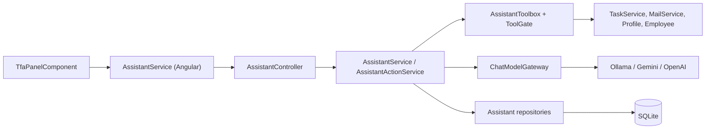
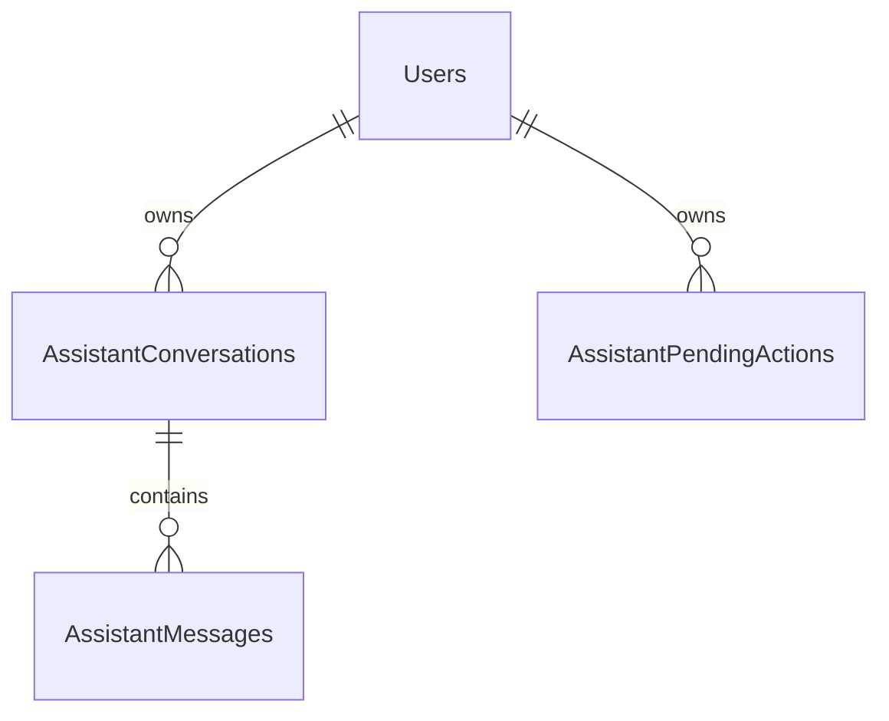

# TaskFlow Assistant (TFA) Module – Technical Documentation

> **Project:** TaskFlow – Intelligent Task Allocation & Tracking System
> **Module:** TaskFlow Assistant (TFA)  ·  **Child Modules:** Chat, Actions and Tools, Help Knowledge, Audit Log and Rate Limits, Voice Input
> **Version:** 1.0  ·  **Last Updated:** 31-Oct-2026
> **Backend:** ASP.NET Core Web API (.NET 10)  ·  **Frontend:** Angular  ·  **Database:** SQLite (EF Core)
> **Author:** Jojo George (jojogeorge3344@gmail.com)
> © 2026 Jojo George. All rights reserved.

> ✅ Target framework confirmed: `net10.0` (.NET 10), from `backend/src/TaskFlow.Api/TaskFlow.Api.csproj`.

---

## 1. Technical Overview
TFA is a tool-calling chat assistant hosted inside the TaskFlow API. One controller (`AssistantController`, route prefix `api/v1/assistant`) exposes the signed-in user's own conversation, the actions TFA has prepared, and the list of AI providers the user may choose.

Main responsibilities:
- **Conversation engine** (`AssistantService`): validates a message (length, `SecretScreen`), applies the per-user rate limit, builds the system prompt (`AssistantPrompt`), then runs a bounded tool loop (max 4 tool rounds) against the selected provider through `IChatModelGateway`. Nothing is persisted until the provider has answered. → 09.1
- **Provider abstraction** (`Integrations/Ai`): `IChatModelProvider` implementations for Ollama (`/api/chat`), Google Gemini (`v1beta/models/{model}:generateContent`) and OpenAI (`v1/chat/completions`). Every network/HTTP problem is classified into a `ProviderFailureKind` and surfaced to the UI as a fixed message, never the raw provider body. API keys are encrypted with ASP.NET Core Data Protection (`AiKeyProtector`) and only decrypted in memory for one call. → 09.1
- **Tools** (`Services/Assistant/Tools`): 9 `IAssistantTool` implementations (6 read/guidance tools, 3 action-preparing tools). `AssistantToolbox` advertises only tools the caller may use and re-checks authorization on every call through `AssistantToolGate` → `IAssistantAuthorizer`, which evaluates the API's own `perm:{key}` authorization policies. → 09.2
- **Pending actions** (`AssistantActionService`): action tools only create an `AssistantPendingAction` (10-minute lifetime). Only the user's `POST actions/{id}/confirm` executes it, after re-checking the policy with the caller's current token and atomically claiming the row (`TryClaimAsync`), so it runs at most once. → 09.2
- **Help knowledge** (`HelpKnowledgeBase`): 19 embedded markdown topics with front-matter (title, roles, others, keywords, link), keyword-scored search, role-aware redaction. → 09.3
- **Audit and limits**: `AssistantAuditLog` writes `AssistantAudits` rows (no bodies/keys); `AssistantRateLimiter` is an in-memory sliding 1-minute window of 20 requests per user. → 09.4
- **Frontend**: a standalone Angular panel (`TfaPanelComponent`) mounted in the shell for users holding `assistant.chat`, with a signal-based `AssistantService`, action cards, model selector, cloud-provider notice and browser speech recognition / synthesis (wake phrase "Hey TF assistant"). → 09.1, 09.2, 09.5

## 2. Architecture Flow

## 3. Backend File Structure
Shared files (used by several children) are listed in full; child-specific files are listed in each child document.

| Layer | Path | Files | Child |
|-------|------|-------|-------|
| Controller | `TaskFlow.Api/Controllers/Assistant/` | `AssistantController.cs` (all endpoints; `RunActionAsync` helper for action endpoints) | 09.1, 09.2 |
| Service – Caller | `TaskFlow.Api/Services/Assistant/Access/` | `AssistantCaller.cs` (also `AssistantPolicies`) | Shared |
| DTOs | `TaskFlow.Api/Dtos/Assistant/` | `AssistantDtos.cs`, `AssistantActionDtos.cs`, `AssistantFailureDto.cs` | 09.1, 09.2 |
| Entities | `TaskFlow.Api/Models/Entities/` | `AssistantConversation.cs`, `AssistantMessage.cs`, `AssistantPendingAction.cs`, `AssistantAudit.cs` | 09.1, 09.2, 09.4 |
| Enums | `TaskFlow.Api/Models/Enums/` | `AssistantActionKind.cs`, `AssistantActionStatus.cs`, `AssistantMessageRole.cs`, `AiProviderKind.cs`, `ProviderFailureKind.cs` | 09.1, 09.2, 09.4 |
| Authorization | `TaskFlow.Api/Authorization/Assistant/` | `IAssistantAuthorizer.cs`, `AssistantAuthorizer.cs` | 09.2 |
| Exceptions | `TaskFlow.Api/Common/Exceptions/` | `AssistantExceptions.cs` (`AssistantRequestException` → 09.1, `AssistantRateLimitedException` → 09.4, `AssistantActionConflictException` → 09.2) | Shared |
| DI | `TaskFlow.Api/Config/` | `ServiceRegistration.cs` (Assistant block), `RepositoryRegistration.cs` (Assistant block), `IntegrationRegistration.cs` (Data Protection, provider `HttpClient`s), `AiProviderOptions.cs` | Shared |
| Child-specific | `Services/Assistant/Chat/`, `ModelGateway/`, `Integrations/Ai/`, `Repositories/Assistant/Conversations/`, `Messages/` | see `09.1-Chat.md` | 09.1 |
| Child-specific | `Services/Assistant/Actions/`, `Tools/`, `Toolbox/`, `Repositories/Assistant/PendingActions/`, `People/` | see `09.2-Actions-and-Tools.md` | 09.2 |
| Child-specific | `Services/Assistant/HelpKnowledge/`, `Knowledge/` | see `09.3-Help-Knowledge.md` | 09.3 |
| Child-specific | `Services/Assistant/AuditLog/`, `RateLimits/`, `Repositories/Assistant/Audits/` | see `09.4-Audit-Log-and-Rate-Limits.md` | 09.4 |
| Rules | `TaskFlow.Api/Services/Assistant/Rules/` | `AssistantRules.cs`, `SecretScreen.cs` → 09.1; `AssistantActionRules.cs`, `TaskPrioritiser.cs` → 09.2 | 09.1, 09.2 |

## 4. Frontend File Structure

| Type | Path | Purpose | Child |
|------|------|---------|-------|
| Panel component | `src/app/modules/assistant/components/tfa-panel.component.ts/.html` | Floating TFA button, panel shell, cloud notice, feed, failure card, voice wiring | 09.1, 09.5 |
| Child components | `tfa-header`, `tfa-composer`, `tfa-message` (`components/`) | Header, composer, message rendering | 09.1 (composer mic → 09.5) |
| Child components | `tfa-action-card` (`components/`) | Pending action card | 09.2 |
| API service | `src/app/modules/assistant/services/assistant.service.ts` | All HTTP calls to `/api/v1/assistant` | 09.1, 09.2 |
| Voice services | `services/wake-phrase.service.ts`, `speak.service.ts` | Speech recognition / synthesis | 09.5 |
| Models | `src/app/modules/assistant/models/assistant.model.ts`, `services/assistant.model.ts`, `services/wake-phrase.model.ts`, `services/speak.model.ts` | TypeScript interfaces matching the DTOs | Shared |
| Mount / guard | `src/app/layouts/shell.component.ts/.html` | `@if (canUseAssistant())` renders `app-tfa-panel`; `canUseAssistant` = user permissions include `Permissions.AssistantChat`. Shell route is behind `authGuard`, `mfaSetupGuard` (`routes/app.routes.ts`) | Shared |
| Permission constants | `src/app/shared/auth/permissions.ts` | `AssistantChat: 'assistant.chat'`, `AssistantActions: 'assistant.actions.confirm'` | Shared |

There is no TFA route and no menu entry in `layouts/nav-items.ts` (only the separate **TFA Settings** entry, which belongs to the Settings module).

---

## 5. Child Modules

| # | Child Module | Main endpoints (count) | Key permissions | Document |
|---|--------------|------------------------|-----------------|----------|
| 09.1 | Chat | `GET conversation`, `POST conversation/messages`, `POST conversation/new`, `GET providers` (4) | `assistant.chat` | `09.1-Chat.md` |
| 09.2 | Actions and Tools | `PUT actions/{id}`, `POST actions/{id}/confirm`, `POST actions/{id}/cancel` (3) + 9 model tools | `assistant.actions.confirm`, `roles.manage`, `assistant.chat` | `09.2-Actions-and-Tools.md` |
| 09.3 | Help Knowledge | none – `search_help` tool inside `POST conversation/messages` (0) | `assistant.chat` | `09.3-Help-Knowledge.md` |
| 09.4 | Audit Log and Rate Limits | none – guards `POST conversation/messages`, writes audit rows (0) | – | `09.4-Audit-Log-and-Rate-Limits.md` |
| 09.5 | Voice Input | none – frontend only, uses `POST conversation/messages` (0) | `assistant.chat` | `09.5-Voice-Input.md` |

All endpoints are under `/api/v1/assistant` and carry the class-level `[Authorize]` (JWT). Child documents are in the `09-Assistant/` folder next to this file.

---

## 6. Database Design
Four TFA tables, created by migration `Persistence/Migrations/20261018183210_AddAssistant.cs` (which also creates `AiProviderConfigs`, owned by the Settings module). Configuration in `Persistence/AppDbContext.cs` (`modelBuilder.Entity<AssistantConversation>` … `AssistantAudit`).

| Table | Purpose | Owned by child |
|-------|---------|----------------|
| `AssistantConversations` | One row per conversation; latest by Id is the active one | 09.1 Chat |
| `AssistantMessages` | User and assistant messages with `MetaJson` (kind, links, ranked tasks, action id) | 09.1 Chat |
| `AssistantPendingActions` | Prepared actions and their status | 09.2 Actions and Tools |
| `AssistantAudits` | Action outcome audit rows | 09.4 Audit Log and Rate Limits |

Column-level detail is in each owning child document. 09.3 and 09.5 use no tables.

**Relationships**
- `AssistantConversations.UserId → Users.Id` (FK, Cascade)
- `AssistantMessages.ConversationId → AssistantConversations.Id` (FK, Cascade)
- `AssistantPendingActions.UserId → Users.Id` (FK, Cascade)
- `AssistantPendingActions.ConversationId` and `AssistantAudits.UserId` are plain columns without FK constraints.

## 7. Security & Authorization
- **Authentication:** JWT bearer token + refresh-token cookie; `[Authorize]` on `AssistantController`. `AssistantCaller` reads user id and role from the validated token claims only.
- **Authorization:** Permission policies `perm:{key}` registered for every `PermissionCatalog.All` entry (`Config/CrossCuttingRegistration.cs`, `RequireClaim(AuthClaims.Permission, key)`); keys in `Common/Security/PermissionKeys.cs` (`AssistantChat = "assistant.chat"`, `AssistantActions = "assistant.actions.confirm"`). TFA tools and confirmations are checked with the same policies through `IAssistantAuthorizer` (`IAuthorizationService.AuthorizeAsync`).
- **Defaults** (`PermissionCatalog.cs`): both TFA keys `GrantedToManager: true, GrantedToEmployee: true, GrantToAllExistingRoles: true`; Administrator holds all assignable entries.
- **Data scope:** Own – conversations and pending actions are always filtered by `UserId` (another user's id yields 404). Task data is read through `ITaskService.ListAsync / GetDetailsAsync(…, userId, role)`, so the Task Management scope (own / all tasks) applies.
- **Model containment:** the model can only call advertised tools; action tools only create pending actions; tool output is marked as data and passed through `SecretScreen.Redact`; refusals and confirmations use fixed text (`AssistantTexts`).
- **Secrets:** `SecretScreen` blocks passwords/keys in user text; API keys are encrypted with Data Protection purpose `TaskFlow.AiProviderKeys` (DPAPI-protected key ring on Windows); provider `HttpClient`s have logging removed and `AllowAutoRedirect = false`; Gemini key sent in `x-goog-api-key` header, OpenAI as Bearer header.
- **Frontend:** the panel is rendered only when the user has `assistant.chat` (shell). Action card buttons are not gated by `assistant.actions.confirm` (see 09.2 Gaps).

| Permission Key | Endpoint(s) | UI Element Controlled | Child |
|----------------|-------------|-----------------------|-------|
| `assistant.chat` | 4 conversation/provider endpoints | Floating TFA button and whole panel (`shell.component.html` `@if (canUseAssistant())`) | 09.1 (also 09.3, 09.5) |
| `assistant.actions.confirm` | 3 action endpoints | None in UI | 09.2 |
| `roles.manage` | Tool `propose_role_change`; re-checked in `ConfirmAsync` | Tool advertised to the model only when held | 09.2 |

## 8. Validations & Error Handling
Shared rules only; child-specific rules are in each child document.

| Rule | Layer | HTTP Code | Error Message |
|------|-------|-----------|---------------|
| No permission (endpoint) | Policy | 403 | Forbidden |
| Unhandled error | `GlobalExceptionHandler` | 500 | Something went wrong. Please try again. |

Errors are returned by `Middleware/GlobalExceptionHandler.cs` as `application/problem+json`: `AppException` → its `StatusCode`, `Title` (`TFA could not handle that`, `Too many requests`, `This action can no longer be done`) and message; `RetryAfter` sets the `Retry-After` header. The Angular service shows the problem `detail` via `apiErrorMessage` with per-call fallback texts (listed in 09.1 and 09.2).

## 9. Integrations / Side Effects
- **AI Assistant:** this is the AI Assistant module; the tools it exposes are listed in `09.2-Actions-and-Tools.md` §5.1.
- **Notifications / Email / Profile / Employees:** through confirmed actions – see 09.2.
- **AI providers and key-ring startup check:** see 09.1.
- **Activity Log:** TFA's own audit rows – see 09.4. Endpoint-level 403s on any TFA endpoint are also recorded by the application's `DeniedActionAuditHandler`.

## 10. Configuration

| Key (`appsettings.json`) | Purpose | Default |
|--------------------------|---------|---------|
| `Application:Timezone` | Fallback time zone for "today" / overdue when no application setting is stored (`AppClock`); used by the system prompt (09.1) and task ranking (09.2) | `Asia/Kolkata` |
| `ConnectionStrings:Default` | SQLite database | `<secret>` |

Child-specific keys and code constants: `AiProviders:*`, `Storage:Root`, `AssistantRules.*`, frontend provider/cloud keys → 09.1; `AssistantActionRules.Lifetime` → 09.2; `HelpKnowledgeBase.MinimumScore` → 09.3; `AssistantRateLimiter.RequestsPerMinute` → 09.4; `tfa.handsfree` → 09.5.

## 11. Testing

| Test Type | File / Location | Covers |
|-----------|-----------------|--------|
| Integration | `tests/TaskFlow.IntegrationTests/Assistant/AssistantEndpointsTests.cs` | Assistant endpoints + authorization (all children) |

Child-specific test files are listed in each child document. (Coverage descriptions are inferred from file names only.) ⚠️ To be confirmed: no frontend `*.spec.ts` files for the assistant module were found in the supplied tree.

## 12. Known Limitations / Future Enhancements
Child-specific gaps are listed in each child document.

**Module-wide gaps found**
- **No BRD / design coverage:** none of the 20 BRD screen documents and neither `Artifacts/TDD-TaskFlow.md` nor `TaskFlow Proj/project.md` describe TFA; permission-audit-summary.md lists "Where does the TFA assistant go?" as an open question (catalog module "TFA assistant", matrix module "TFA assistant").
- **Stale audit finding:** permission-gaps.md §F says `permissions.ts` claims the assistant "needs no key"; the current `permissions.ts` comment correctly says mail, notifications and the assistant have keys.
- **Permission-inventory paths are outdated:** the inventory references `core/layout/tfa-panel.component.html`, `backend/src/TaskFlow.Application/Assistant/AssistantCaller.cs` etc.; the code now lives in `modules/assistant/components/` and `TaskFlow.Api/Services/Assistant/Access/`.
- **Project file:** `TaskFlow.Api.csproj` targets `net10.0` and embeds `Services\Assistant\Knowledge\*.md` (verified).

---
© 2026 Jojo George. All rights reserved. Unauthorized copying or distribution of this document is prohibited.
