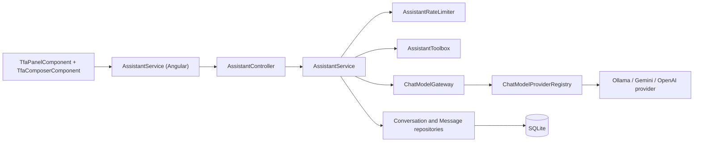
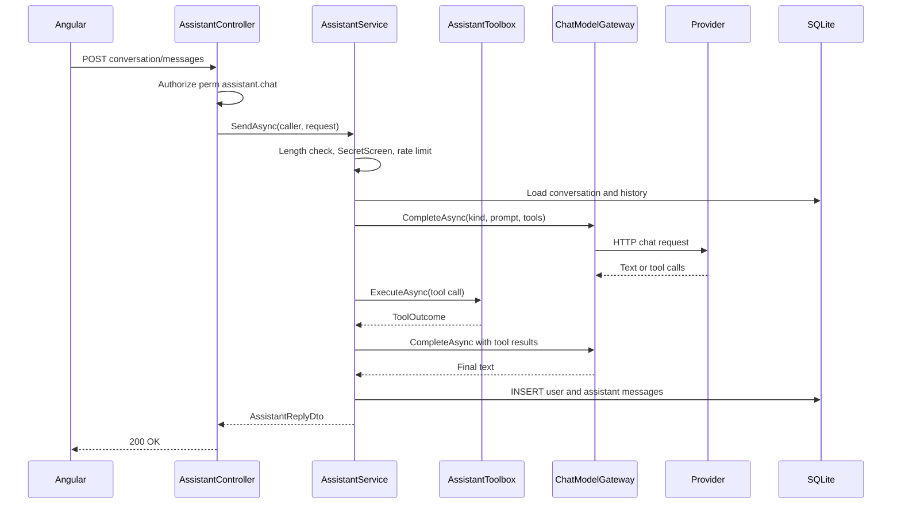

# Chat – Technical Documentation

> **Project:** TaskFlow – Intelligent Task Allocation & Tracking System
> **Parent Module:** TaskFlow Assistant (TFA)  ·  **Child Module:** 09.1 Chat
> **Version:** 1.0  ·  **Last Updated:** 31-Oct-2026
> **Backend:** ASP.NET Core Web API (.NET 10)  ·  **Frontend:** Angular  ·  **Database:** SQLite (EF Core)
> **Author:** Jojo George (jojogeorge3344@gmail.com)
> © 2026 Jojo George. All rights reserved.

---

## 1. Technical Overview
Chat is TFA's conversation engine. `AssistantController` exposes four `perm:assistant.chat` endpoints for the caller's own conversation and the provider list. `AssistantService` validates a message (length, `SecretScreen`), applies the per-user rate limit (09.4), builds the system prompt (`AssistantPrompt`), then runs a bounded tool loop (max 4 tool rounds) against the selected provider through `IChatModelGateway`. Nothing is persisted until the provider has answered.

The provider abstraction (`Integrations/Ai`) has `IChatModelProvider` implementations for Ollama (`/api/chat`), Google Gemini (`v1beta/models/{model}:generateContent`) and OpenAI (`v1/chat/completions`). Every network/HTTP problem is classified into a `ProviderFailureKind` and surfaced to the UI as a fixed message, never the raw provider body. API keys are encrypted with ASP.NET Core Data Protection (`AiKeyProtector`) and only decrypted in memory for one call.

On the frontend, the standalone `TfaPanelComponent` (mounted in the shell for holders of `assistant.chat`) with `TfaHeaderComponent`, `TfaComposerComponent` and `TfaMessageComponent` talks to the signal-based Angular `AssistantService`, which also handles the model selector and the cloud-provider notice.

## 2. Architecture Flow


## 3. Backend File Structure

| Layer | Path | Files |
|-------|------|-------|
| Controller | `TaskFlow.Api/Controllers/Assistant/` | `AssistantController.cs` (conversation and provider endpoints) |
| Service – Chat | `TaskFlow.Api/Services/Assistant/Chat/` | `IAssistantService.cs`, `AssistantService.cs`, `AssistantPrompt.cs`, `AssistantTexts.cs`, `ProviderFailureMessages.cs` |
| Service – Caller | `TaskFlow.Api/Services/Assistant/Access/` | `AssistantCaller.cs` (shared, see parent) |
| Service – Model gateway | `TaskFlow.Api/Services/Assistant/ModelGateway/` | `IChatModelGateway.cs`, `ChatModelGateway.cs` |
| Service – Rules | `TaskFlow.Api/Services/Assistant/Rules/` | `AssistantRules.cs`, `SecretScreen.cs` |
| Repository | `TaskFlow.Api/Repositories/Assistant/` | `Conversations/IAssistantConversationRepository.cs`, `AssistantConversationRepository.cs`; `Messages/IAssistantMessageRepository.cs`, `AssistantMessageRepository.cs`; (`People/IAssistantDirectoryRepository.cs` – `GetFullNameAsync` only, owned by 09.2) |
| DTOs | `TaskFlow.Api/Dtos/Assistant/` | `AssistantDtos.cs` (`SendAssistantMessageRequest`, `AssistantConversationDto`, `AssistantReplyDto`, `AssistantMessageDto`, `AssistantLinkDto`, `AssistantMessageMeta`, `PrioritisedTask`), `AssistantFailureDto.cs`; `AiProviderOptionDto` lives in `Dtos/Settings/TfaSettings/AiProviderDtos.cs` (Settings module) |
| Validators | – | No validator class; checks are in `AssistantService` |
| Entities | `TaskFlow.Api/Models/Entities/` | `AssistantConversation.cs`, `AssistantMessage.cs` |
| Enums | `TaskFlow.Api/Models/Enums/` | `AssistantMessageRole.cs`, `AiProviderKind.cs`, `ProviderFailureKind.cs` |
| Integrations – AI | `TaskFlow.Api/Integrations/Ai/` | `Providers/IChatModelProvider.cs`, `ChatModelTypes.cs`, `AiProviderRuntime.cs`, `ProviderFailure.cs`, `ProviderHttp.cs`, `OllamaProvider.cs`, `GeminiProvider.cs`, `OpenAiProvider.cs`; `Registry/IChatModelProviderRegistry.cs`, `ChatModelProviderRegistry.cs`; `KeyProtection/IAiKeyProtector.cs`, `AiKeyProtector.cs`, `KeyRingProtectionCheck.cs` |
| Exceptions | `TaskFlow.Api/Common/Exceptions/` | `AssistantExceptions.cs` (`AssistantRequestException`) |
| Constants | `TaskFlow.Api/Common/Constants/` | `AiProviderCatalog.cs` |
| DI | `TaskFlow.Api/Config/` | `IntegrationRegistration.cs` (Data Protection, provider `HttpClient`s), `AiProviderOptions.cs` |

## 4. Frontend File Structure

| Type | Path | Purpose |
|------|------|---------|
| Panel component | `src/app/modules/assistant/components/tfa-panel.component.ts/.html` | Floating TFA button, panel shell, cloud notice, feed, failure card (voice wiring → 09.5) |
| Child components | `src/app/modules/assistant/components/tfa-header.component.ts/.html` | Title, New chat, Close, model selector |
| Child components | `src/app/modules/assistant/components/tfa-composer.component.ts/.html` | Message box, Send, starter suggestions (`TFA_SUGGESTIONS`) (mic and hands-free toggle → 09.5) |
| Child components | `src/app/modules/assistant/components/tfa-message.component.ts/.html` | One message: text, refusal, notice, ranked tasks, links (action card → 09.2) |
| API service | `src/app/modules/assistant/services/assistant.service.ts` | HTTP calls to `/api/v1/assistant`, signals for panel, providers, messages, failure, held message; `localStorage` keys `tfa.provider`, `tfa.cloudAck` |
| Models | `src/app/modules/assistant/models/assistant.model.ts`, `services/assistant.model.ts` | TypeScript interfaces matching the DTOs |
| Mount / guard | `src/app/layouts/shell.component.ts/.html` | `@if (canUseAssistant())` renders `app-tfa-panel` |

---

## 5. API & Logic

### 5.1 API Endpoints

| # | Method | Endpoint | Description | Permission (Policy) | Request DTO | Response DTO |
|---|--------|----------|-------------|---------------------|-------------|--------------|
| 1 | GET | `/api/v1/assistant/conversation` | Caller's latest conversation (newest 100 messages, with action cards) | `perm:assistant.chat` | – | `AssistantConversationDto` |
| 2 | POST | `/api/v1/assistant/conversation/messages` | Send a message; provider failure returns 200 with `failure` | `perm:assistant.chat` | `SendAssistantMessageRequest` | `AssistantReplyDto` |
| 3 | POST | `/api/v1/assistant/conversation/new` | Start a new conversation | `perm:assistant.chat` | – | `204 No Content` |
| 4 | GET | `/api/v1/assistant/providers` | Configured providers for the model selector (no key data) | `perm:assistant.chat` | – | `IReadOnlyList<AiProviderOptionDto>` |

All endpoints also carry the class-level `[Authorize]` (JWT).

### 5.2 Request / Response Samples
```json
// POST /api/v1/assistant/conversation/messages
{ "text": "What should I prioritise?", "provider": "Gemini" }
```
```json
// 200 OK – answered
{
  "messages": [
    { "id": 41, "role": "User", "content": "What should I prioritise?", "kind": "Text",
      "createdAt": "2026-10-31T10:00:00Z", "provider": null, "links": [], "rankedTasks": [], "action": null },
    { "id": 42, "role": "Assistant", "content": "Start with TSK-12, it is 2 days overdue...", "kind": "Text",
      "createdAt": "2026-10-31T10:00:00.001Z", "provider": "Gemini",
      "links": [ { "label": "TSK-12", "route": "/tasks/12" } ],
      "rankedTasks": [ { "rank": 1, "taskId": 12, "taskCode": "TSK-12", "title": "Fix login", "priority": "High",
        "status": "InProgress", "deadline": "2026-10-29T12:30:00Z", "dueDate": "2026-10-29", "daysUntilDue": -2,
        "stage": "Overdue", "isBlocked": false } ],
      "action": null }
  ],
  "failure": null
}
```
```json
// 200 OK – provider failure (nothing stored)
{
  "messages": [],
  "failure": { "kind": "RateLimited", "provider": "Gemini",
    "message": "Google Gemini's free limit or rate limit has been reached. Try again in about 30 seconds, or choose another model.",
    "retryAfterSeconds": 30,
    "alternatives": [ { "kind": "Ollama", "displayName": "Ollama", "modelName": "llama3.2:3b", "locality": "Local" } ] }
}
```
```json
// GET /api/v1/assistant/providers – 200 OK
[ { "kind": "Ollama", "displayName": "Ollama", "modelName": "llama3.2:3b", "locality": "Local" } ]
```

### 5.3 Service Layer Logic
**Method:** `SendAsync(AssistantCaller caller, SendAssistantMessageRequest request, CancellationToken)` – `AssistantService`
1. Trim text; if empty or longer than `AssistantRules.MaxMessageLength` (2000) throw `AssistantRequestException` (400).
2. `SecretScreen.ContainsSecret(text)` (password phrase with digit/symbol value, `sk-…`, `AIza…`, `Bearer …`, JWT, 32+ char mixed token) → return a transient `Notice` message (`AssistantTexts.SecretBlocked`, id 0). Nothing is sent or stored.
3. `IAiProviderConfigService.GetAvailableAsync` → pick `request.Provider` or the first available; if absent/not configured throw `AssistantRequestException` with `ProviderFailureMessages.NotConfigured(kind)` or the "TFA is not available yet…" text.
4. `IAssistantRateLimiter.TryAcquire(userId)` → non-null wait throws `AssistantRateLimitedException` (429 + `Retry-After`) – see 09.4.
5. Load or create the active conversation (`FindLatestForUpdateAsync`, latest by Id).
6. `LoadHistoryAsync`: newest `HistoryMessages*2` (24) messages, drop `Notice` metas, take 12, stop at 6000 characters, reverse to chronological.
7. Build the system prompt `AssistantPrompt.Build(userName, caller.Role, IAppClock.TodayLocalAsync, ApplicationSettings.Name)`.
8. `RunTurnAsync`: up to `MaxToolRounds` (4) rounds; the final round sends no tools. For each tool call → `IAssistantToolbox.ExecuteAsync` (09.2); collect `Links`, `RankedTasks`, `PendingActionId`. A `FixedReply` (refusal or prepared action) ends the turn with that exact text. Tool results are passed through `SecretScreen.Redact` before going back to the model. Empty model text → `AssistantTexts.EmptyAnswer`.
9. `ProviderFailureException` → return `AssistantReplyDto([], AssistantFailureDto(...))` with alternatives = other available providers. Nothing stored.
10. On success, add user + assistant `AssistantMessage` rows (assistant `CreatedAt` = now + 1 ms, `ProviderKind`, `MetaJson` = `AssistantMessageMeta`), update `conversation.UpdatedAt`, `SaveChangesAsync`, map via `ToDtosAsync` (action cards loaded through `IAssistantActionCards.GetCardsAsync`, 09.2).

**Method:** `GetConversationAsync(caller)` – latest conversation's newest `ConversationMessages` (100) messages, reversed; empty `AssistantConversationDto(null, [])` if none.

**Method:** `NewConversationAsync(caller)` – inserts a new `AssistantConversation` (it becomes the latest, hence active).

**Model gateway:** `ChatModelGateway.CompleteAsync(kind, request)` → `IAiProviderConfigService.GetRuntimeAsync(kind)` (decrypts key with `IAiKeyProtector`; null → `ProviderNotConfiguredException`) → `IChatModelProviderRegistry.Get(kind).CompleteAsync(runtime, request with { ModelName })`. Failures are logged with provider, kind and HTTP status only.

**Provider classification** (`ProviderFailureKind`): HTTP 429 / `insufficient_quota` / `rate_limit_exceeded` / `RESOURCE_EXHAUSTED` → `RateLimited`; 401/403 / `invalid_api_key` / `UNAUTHENTICATED` / `PERMISSION_DENIED` → `InvalidKey`; 404 / `model_not_found` / `NOT_FOUND` → `ModelUnavailable`; `HttpClient` timeout → `Timeout`; `HttpRequestException` → `Unreachable`; unparsable or empty reply → `Unexpected`. Ollama retries once without tools when the model does not support tools.

### 5.4 Repository Layer

| Method | Description | Query Notes |
|--------|-------------|-------------|
| `IAssistantConversationRepository.FindLatestForUpdateAsync(userId)` | Active conversation | Tracked; `Where UserId`, `OrderByDescending Id`, first |
| `IAssistantMessageRepository.GetNewestAsync(conversationId, take)` | Newest messages, newest first | `AsNoTracking`, `OrderByDescending Id`, `Take` |
| `IAssistantDirectoryRepository.GetFullNameAsync(userId)` | Name for the system prompt | `AsNoTracking`, projection |
| `Add(entity)` (`IBaseRepository`) | Insert conversation/message | Saved through `IUnitOfWork.SaveChangesAsync` |

### 5.5 Sequence Diagram


---

## 6. Database Design

| Table | Column | Type | Constraints | Description |
|-------|--------|------|-------------|-------------|
| `AssistantConversations` | `Id` | INTEGER | PK, autoincrement | Conversation id |
| `AssistantConversations` | `UserId` | INTEGER | Not Null, FK → `Users.Id`, indexed `IX_AssistantConversations_UserId` | Owner |
| `AssistantConversations` | `CreatedAt` | TEXT (DateTime) | Not Null | Created (UTC) |
| `AssistantConversations` | `UpdatedAt` | TEXT (DateTime) | Not Null | Last message (UTC) |
| `AssistantMessages` | `Id` | INTEGER | PK, autoincrement | Message id |
| `AssistantMessages` | `ConversationId` | INTEGER | Not Null, FK, indexed `IX_AssistantMessages_ConversationId` | Parent conversation |
| `AssistantMessages` | `Role` | TEXT(16) | Not Null, enum as string (`User`, `Assistant`, `Tool`) | Author |
| `AssistantMessages` | `Content` | TEXT | Not Null | Message text |
| `AssistantMessages` | `MetaJson` | TEXT | Nullable | `AssistantMessageMeta`: kind, links, ranked tasks, action id |
| `AssistantMessages` | `ProviderKind` | TEXT(16) | Nullable, enum as string | Provider that answered |
| `AssistantMessages` | `CreatedAt` | TEXT (DateTime) | Not Null | UTC |

Provider configuration and encrypted keys are read from `AiProviderConfigs` (Settings module) through `IAiProviderConfigService`.

**Relationships**
- `AssistantConversations.UserId → Users.Id` (FK, Cascade)
- `AssistantMessages.ConversationId → AssistantConversations.Id` (FK, Cascade)

## 7. Security & Authorization
- **Authentication:** JWT bearer token + refresh-token cookie; class-level `[Authorize]`. `AssistantCaller` reads user id and role from the validated token claims only.
- **Authorization:** `perm:assistant.chat` on all four endpoints.
- **Data scope:** Own – conversations are filtered by `UserId`. Task data reached through tools follows the Task Management scope (`ITaskService…(userId, role)`).
- **Model containment:** tool output is marked as data and passed through `SecretScreen.Redact`; refusals use fixed text (`AssistantTexts`).
- **Secrets:** `SecretScreen` blocks passwords/keys in user text; API keys are encrypted with Data Protection purpose `TaskFlow.AiProviderKeys` (DPAPI-protected key ring on Windows); provider `HttpClient`s have logging removed and `AllowAutoRedirect = false`; Gemini key sent in `x-goog-api-key` header, OpenAI as Bearer header.
- **Frontend:** the panel is rendered only when the user has `assistant.chat` (shell).

| Permission Key | Endpoint(s) | UI Element Controlled |
|----------------|-------------|-----------------------|
| `assistant.chat` | `GET /api/v1/assistant/conversation`, `POST /api/v1/assistant/conversation/messages`, `POST /api/v1/assistant/conversation/new`, `GET /api/v1/assistant/providers` | Floating TFA button and whole panel (`shell.component.html` `@if (canUseAssistant())`) |

## 8. Validations & Error Handling

| Rule | Layer | HTTP Code | Error Message |
|------|-------|-----------|---------------|
| Message empty or > 2000 chars | `AssistantService` (`AssistantRequestException`) | 400 | A message must be between 1 and 2000 characters. |
| No provider configured | `AssistantService` | 400 | TFA is not available yet. An administrator needs to configure an AI provider. |
| Chosen provider not configured | `AssistantService` | 400 | {Provider} is not configured. Choose another model, or ask an administrator to set it up. |
| Password / key in message | `SecretScreen` | 200 (Notice message) | For your safety I did not send or keep that message: … |
| Provider failure | `ChatModelGateway` → `AssistantService` | 200 (`failure` object) | `ProviderFailureMessages.For(...)` text per kind |

The rate limit (429) is in 09.4; 403 / 500 handling is in the parent document. Angular fallbacks via `apiErrorMessage`: *"TFA could not answer. Please try again."*, *"Could not start a new chat."*

## 9. Integrations / Side Effects
- **AI providers:** Ollama (`{BaseUrl or http://localhost:11434}/api/chat`, Local), Google Gemini (`https://generativelanguage.googleapis.com/v1beta/models/{model}:generateContent`, Cloud), OpenAI (`https://api.openai.com/v1/chat/completions`, Cloud). Configuration and keys come from `IAiProviderConfigService` (Settings module, table `AiProviderConfigs`). Built-in default models: `llama3.2:3b`, `gemini-2.0-flash`, `gpt-4o-mini`.
- **Startup:** `Program.cs` runs `KeyRingProtectionCheck.Check` on the key ring folder and logs a warning when keys are stored unprotected or could not be checked.
- **Notifications / Email / Activity Log:** none raised by sending a chat message.

## 10. Configuration

| Key (`appsettings.json`) | Purpose | Default |
|--------------------------|---------|---------|
| `AiProviders:KeyRingPath` | Data Protection key-ring folder (relative to `Storage:Root`) used to encrypt provider API keys | `dp-keys` |
| `AiProviders:TimeoutSeconds` | `HttpClient.Timeout` for every provider call | `60` |
| `Storage:Root` | Base folder for the key ring path | `""` |

Code constants (not configurable): `AssistantRules.MaxMessageLength` 2000, `HistoryMessages` 12, `HistoryCharacters` 6000, `MaxToolRounds` 4, `ConversationMessages` 100. Frontend: `PROVIDER_REFRESH_MS` 60000; `localStorage` keys `tfa.provider`, `tfa.cloudAck`. (`Application:Timezone` is shared – see parent.)

## 11. Testing

| Test Type | File / Location | Covers |
|-----------|-----------------|--------|
| Integration | `tests/TaskFlow.IntegrationTests/Assistant/AssistantEndpointsTests.cs` | Assistant endpoints + authorization (shared with 09.2) |
| Integration | `tests/TaskFlow.IntegrationTests/Settings/TfaSettings/AssistantProviderEndpointsTests.cs` | Provider endpoints |
| Integration | `tests/TaskFlow.IntegrationTests/Settings/TfaSettings/AiDefaultsOnFirstRunTests.cs` | Default AI providers/models on first run |
| Integration | `tests/TaskFlow.IntegrationTests/Common/KeyRingStartupWarningTests.cs` | Startup key-ring warning |
| Unit | `tests/TaskFlow.UnitTests/Assistant/Chat/AssistantServiceTests.cs` (+ `AssistantServiceHarness.cs`) | Conversation engine |
| Unit | `tests/TaskFlow.UnitTests/Assistant/ModelGateway/ChatModelGatewayTests.cs`, `ProviderFailureHandlingTests.cs` | Gateway, failure classification |
| Unit | `tests/TaskFlow.UnitTests/Assistant/Rules/SecretScreenTests.cs` | Secret screening |
| Unit | `tests/TaskFlow.UnitTests/Integrations/Ai/KeyProtection/AiKeyProtectorTests.cs`, `KeyRingProtectionCheckTests.cs` | Key encryption, key-ring check |
| Unit | `tests/TaskFlow.UnitTests/Settings/TfaSettings/ProviderConfig/AiProviderConfigServiceTests.cs`, `AiProviderSeederTests.cs` | Provider config used by TFA |

(Coverage descriptions are inferred from file names only.)

## 12. Known Limitations / Gaps found
- Old conversations and messages are kept indefinitely; there is no retention/cleanup or "delete my history".
- `ProviderNotConfiguredException` is not an `AppException`; if a provider is disabled between the availability check and the call it would surface as a generic 500.

---
<sub>© 2026 Jojo George. All rights reserved. Unauthorized copying or distribution of this document is prohibited.</sub>
