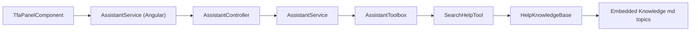
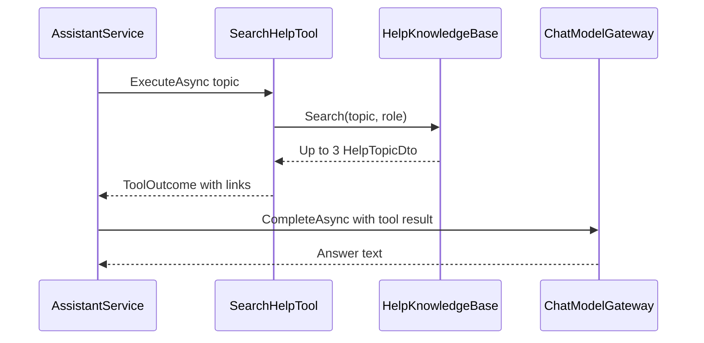

# Help Knowledge – Technical Documentation

> **Project:** TaskFlow – Intelligent Task Allocation & Tracking System
> **Parent Module:** TaskFlow Assistant (TFA)  ·  **Child Module:** 09.3 Help Knowledge
> **Version:** 1.0  ·  **Last Updated:** 31-Oct-2026
> **Backend:** ASP.NET Core Web API (.NET 10)  ·  **Frontend:** Angular  ·  **Database:** SQLite (EF Core)
> **Author:** Jojo George (jojogeorge3344@gmail.com)
> © 2026 Jojo George. All rights reserved.

---

## 1. Technical Overview
`HelpKnowledgeBase` (singleton) holds 19 embedded markdown topics with front-matter (title, roles, others, keywords, link). It provides keyword-scored search and role-aware redaction. It has no endpoint and no database: it is reached only through the `search_help` model tool (`SearchHelpTool`, 09.2) inside `POST /api/v1/assistant/conversation/messages` (09.1). Answers are rendered in the normal chat feed by the frontend.

## 2. Architecture Flow


## 3. Backend File Structure

| Layer | Path | Files |
|-------|------|-------|
| Service – Help | `TaskFlow.Api/Services/Assistant/HelpKnowledge/` | `IHelpKnowledgeBase.cs`, `HelpKnowledgeBase.cs`, `HelpTopicDto.cs` |
| Help content | `TaskFlow.Api/Services/Assistant/Knowledge/` | 19 `*.md` topics (`about-tfa.md`, `application-settings.md`, `board.md`, `change-password.md`, `change-role.md`, `change-task-status.md`, `compose-mail.md`, `create-task.md`, `department-management.md`, `edit-profile.md`, `employee-management.md`, `mail-folders.md`, `notifications.md`, `reassign-task.md`, `reminder-settings.md`, `reports-and-workload.md`, `task-comments-and-activity.md`, `task-list-and-filters.md`, `tfa-settings.md`) |
| Tool (caller) | `TaskFlow.Api/Services/Assistant/Tools/` | `AssistantReadTools.cs` (`SearchHelpTool`, documented in 09.2) |
| Project file | `TaskFlow.Api/` | `TaskFlow.Api.csproj` (`EmbeddedResource` for the topics) |
| DI | `TaskFlow.Api/Config/` | `ServiceRegistration.cs` (`AddSingleton` `IHelpKnowledgeBase` → `HelpKnowledgeBase`) |

## 4. Frontend File Structure

| Type | Path | Purpose |
|------|------|---------|
| Child components | `src/app/modules/assistant/components/tfa-message.component.ts/.html` | Renders the answer text and screen link buttons |
| Child components | `src/app/modules/assistant/components/tfa-composer.component.ts/.html` | Starter suggestion *How do I change a task status?* |

No help-specific frontend files.

---

## 5. API & Logic

### 5.1 API Endpoints

| # | Method | Endpoint | Description | Permission (Policy) | Request DTO | Response DTO |
|---|--------|----------|-------------|---------------------|-------------|--------------|
| – | – | (no endpoint) | Used only through the `search_help` tool inside `POST /api/v1/assistant/conversation/messages` | `perm:assistant.chat` (on the send endpoint) | – | `HelpTopicDto` (internal) |

### 5.2 Request / Response Samples
```text
// Topic file format: Services/Assistant/Knowledge/create-task.md
---
title: Create a task
roles: Manager, Administrator
others: Tasks are created by Managers and Administrators. If you need a new task, ask your manager to create and assign it to you.
keywords: create task, new task, add task, assign task, create a task, make a task
link: /tasks/new
---
(markdown body with the steps)
```
```json
// search_help result passed to the model (Employee asking "how do I create a task")
{ "found": true, "topics": [ { "title": "Create a task",
  "content": "Tasks are created by Managers and Administrators. If you need a new task, ask your manager to create and assign it to you.",
  "notAvailableForThisUsersRole": true } ] }
```

### 5.3 Service Layer Logic
**Method:** `HelpKnowledgeBase.Search(string query, string role, int maxResults = 3)`
1. Topics are loaded once (singleton) from embedded manifest resources whose name contains `.Assistant.Knowledge.` and ends `.md`; `Topic.Parse` reads the `---` front-matter (`title`, `roles` default `all`, `others`, `keywords`, `link`).
2. Query is lower-cased and tokenised (separators, length ≥ 3, stop words removed).
3. Score per topic: multi-word keyword contained in query +6; single keyword whole-word match (plural tolerant) +4; token in keyword words +3; token in title words +2.
4. Keep score ≥ 3 (`MinimumScore`), order by score desc then id, take 3.
5. `ToDto`: if `roles` contains `all` or the caller's role name → full body + link; otherwise `others` note (or "{Title} is not available to your role.") with no link and `IsRestricted = true`.

> ✅ Confirmed: `TaskFlow.Api.csproj` declares `<EmbeddedResource Include="Services\Assistant\Knowledge\*.md" />`, so `LoadEmbedded` finds the help files.

Topic `roles:` values in the shipped files: `Administrator` – `application-settings`, `change-role`, `department-management`, `employee-management`, `tfa-settings`; `Manager, Administrator` – `create-task`, `reassign-task`, `reminder-settings`, `reports-and-workload`; `all` – the other 10.

### 5.4 Repository Layer

| Method | Description | Query Notes |
|--------|-------------|-------------|
| – | No database access | In-memory list of embedded topics |

### 5.5 Sequence Diagram


---

## 6. Database Design
_Not applicable – Help Knowledge uses no database tables; topics are embedded resources held in memory._

## 7. Security & Authorization
- **Authorization:** reached only through `POST /api/v1/assistant/conversation/messages` (`perm:assistant.chat`); the `search_help` tool itself has no extra policy.
- **Data scope:** role-aware redaction – a topic whose `roles` do not include `all` or the caller's role claim name returns only the `others` note, without steps or link.
- **Frontend:** visible as part of the TFA Panel (holders of `assistant.chat`).

| Permission Key | Endpoint(s) | UI Element Controlled |
|----------------|-------------|-----------------------|
| `assistant.chat` | `POST /api/v1/assistant/conversation/messages` (tool `search_help`) | How-to answers and link buttons in the TFA Panel |

## 8. Validations & Error Handling

| Rule | Layer | HTTP Code | Error Message |
|------|-------|-----------|---------------|
| No topic scores ≥ 3 | `HelpKnowledgeBase.Search` | 200 (tool result, no topics) | Model tells the user it does not have that information |
| Topic not for caller's role | `HelpKnowledgeBase.ToDto` | 200 (tool result, `IsRestricted`) | `others` note, or "{Title} is not available to your role." |

## 9. Integrations / Side Effects
- **Notifications / Email / Activity Log:** none.
- **Other modules:** topic content describes screens of other modules and links to their routes (for example `/tasks/new`, `/profile`).

## 10. Configuration
_Not applicable – no configuration keys._ Code constants: `HelpKnowledgeBase.MinimumScore` 3; `Search` `maxResults` default 3.

## 11. Testing

| Test Type | File / Location | Covers |
|-----------|-----------------|--------|
| Unit | `tests/TaskFlow.UnitTests/Assistant/HelpKnowledge/HelpKnowledgeBaseTests.cs` | Help search |
| Unit | `tests/TaskFlow.UnitTests/Assistant/Tools/AssistantReadToolsTests.cs` | `search_help` tool (shared with 09.2) |

(Coverage descriptions are inferred from file names only.)

## 12. Known Limitations / Gaps found
- Help search is keyword scoring over 19 static topics; no semantic search.

**Gaps found**
- **Help topics are role-name based, not permission based:** `roles:` front-matter (Administrator; Manager, Administrator) is compared with the role claim name, so a custom role that holds e.g. `tasks.create` still gets the "not available to your role" note; and an Employee granted extra permissions likewise.
- **Help topic link mismatch:** `department-management.md` is titled "Project management" (project keywords) but links to `/departments`; a `/projects` route exists.

---
<sub>© 2026 Jojo George. All rights reserved. Unauthorized copying or distribution of this document is prohibited.</sub>
