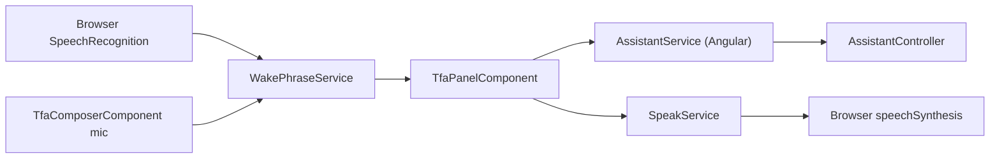
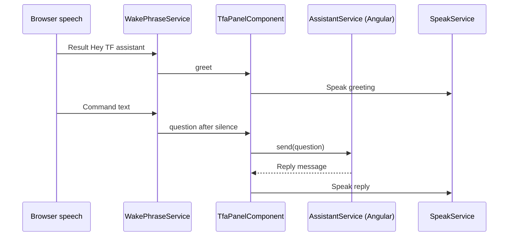

# Voice Input – Technical Documentation

> **Project:** TaskFlow – Intelligent Task Allocation & Tracking System
> **Parent Module:** TaskFlow Assistant (TFA)  ·  **Child Module:** 09.5 Voice Input
> **Version:** 1.0  ·  **Last Updated:** 31-Oct-2026
> **Backend:** ASP.NET Core Web API (.NET 10)  ·  **Frontend:** Angular  ·  **Database:** SQLite (EF Core)
> **Author:** Jojo George (jojogeorge3344@gmail.com)
> © 2026 Jojo George. All rights reserved.

---

## 1. Technical Overview
Voice Input (hands-free) is frontend only. `WakePhraseService` wraps the browser `SpeechRecognition` / `webkitSpeechRecognition` API to listen for the wake phrase "Hey TF assistant" and for dictated commands; `SpeakService` wraps `speechSynthesis` to read answers aloud. `TfaPanelComponent` wires both to the panel, and `TfaComposerComponent` provides the mic button and hands-free toggle. Recognised text is sent through the normal chat endpoint (09.1); the backend cannot tell a spoken question from a typed one.

## 2. Architecture Flow


## 3. Backend File Structure

| Layer | Path | Files |
|-------|------|-------|
| – | – | _Not applicable – no voice-specific backend files; text goes through `AssistantController` / `AssistantService` (09.1)._ |

## 4. Frontend File Structure

| Type | Path | Purpose |
|------|------|---------|
| Voice services | `src/app/modules/assistant/services/wake-phrase.service.ts` | Browser `SpeechRecognition` (wake phrase, dictation; `localStorage` key `tfa.handsfree`) |
| Voice services | `src/app/modules/assistant/services/speak.service.ts` | `speechSynthesis` (max 500 chars spoken) |
| Models | `src/app/modules/assistant/services/wake-phrase.model.ts`, `services/speak.model.ts` | TypeScript interfaces for the speech factories |
| Panel component | `src/app/modules/assistant/components/tfa-panel.component.ts/.html` | Voice wiring, `answerAloud`, voice hint and heard text under the TFA button |
| Child components | `src/app/modules/assistant/components/tfa-composer.component.ts/.html` | Mic button, listening bar, hands-free toggle |

---

## 5. API & Logic

### 5.1 API Endpoints

| # | Method | Endpoint | Description | Permission (Policy) | Request DTO | Response DTO |
|---|--------|----------|-------------|---------------------|-------------|--------------|
| – | – | (frontend only) | Recognised text is sent through `POST /api/v1/assistant/conversation/messages` | `perm:assistant.chat` | `SendAssistantMessageRequest` | `AssistantReplyDto` |

### 5.2 Request / Response Samples
```json
// Spoken "Hey TF assistant, what are my upcoming tasks" becomes
{ "text": "what are my upcoming tasks", "provider": "Ollama" }
```

### 5.3 Service Layer Logic
**`WakePhraseService`** (`wake-phrase.service.ts`)
1. `SPEECH_RECOGNITION_FACTORY` creates `SpeechRecognition` / `webkitSpeechRecognition` or null (unsupported).
2. Hands-free listens continuously for `WAKE_PHRASE` (regex tolerant of "Hey T F assistant", "Hay TFA assistant", "Hey Tifa assistant").
3. Emits `wake`, `greet` (phrase alone), `interim` (live text) and `question` (after `COMMAND_SILENCE_MS` 2000 ms of silence). Capture timeout `WAKE_CAPTURE_TIMEOUT_MS` 8000 ms; mic-button dictation timeout `DICTATION_TIMEOUT_MS` 10000 ms.
4. Restarts ended sessions after 50 ms; quick failures back off from 300 ms and give up after 6 with a reason message.
5. Only a deliberate turn-off is persisted (`tfa.handsfree`).

**`SpeakService`** (`speak.service.ts`): `speechSynthesis` wrapper (`SPEECH_SYNTHESIS_FACTORY`, `UTTERANCE_FACTORY`); max `MAX_SPOKEN_CHARS` 500; `TfaPanelComponent.answerAloud` speaks only replies to spoken questions and pauses recognition while speaking.

### 5.4 Repository Layer

| Method | Description | Query Notes |
|--------|-------------|-------------|
| – | No backend storage | Browser `localStorage` only |

### 5.5 Sequence Diagram


---

## 6. Database Design
_Not applicable – no tables; only the browser `localStorage` key `tfa.handsfree` is stored._

## 7. Security & Authorization
- Voice controls are part of the TFA Panel, rendered only for holders of `assistant.chat` (shell).
- Speech-to-text is done by the browser's own speech service; TaskFlow keeps no audio. Spoken text passes through the same server-side checks as typed text (length, `SecretScreen`, rate limit).

| Permission Key | Endpoint(s) | UI Element Controlled |
|----------------|-------------|-----------------------|
| `assistant.chat` | `POST /api/v1/assistant/conversation/messages` | Mic button, listening bar, hands-free toggle, wake phrase |

## 8. Validations & Error Handling

| Rule | Layer | HTTP Code | Error Message |
|------|-------|-----------|---------------|
| Browser has no speech recognition | `WakePhraseService` (factory returns null) | – | Voice input is not supported in this browser. Try Chrome or Edge, or type your question. |
| Error `not-allowed` / `service-not-allowed` (no auto start) | `WakePhraseService.onError` | – | Microphone access was denied. Allow it in your browser to use voice, or type your question. |
| Error `audio-capture` | `WakePhraseService.onError` | – | No microphone was found. You can type your question instead. |
| Error `network` | `WakePhraseService.onError` | – | Voice needs an internet connection in this browser. You can type your question instead. |
| Error `not-allowed` while auto-starting from an earlier visit | `WakePhraseService.waitForGesture` | – | Click anywhere on the page to turn "Hey TF assistant" back on. |
| `no-speech` / `aborted` | `WakePhraseService.onError` | – | Ignored (normal while waiting) |
| Repeated quick session ends | `WakePhraseService.onEnd` / `retryLater` | – | Gives up after 6 attempts with a reason message (not persisted as "off") |

## 9. Integrations / Side Effects
- **Browser APIs:** Web Speech API (`SpeechRecognition`, `speechSynthesis`).
- **Notifications / Email / Activity Log:** none.

## 10. Configuration
_Not applicable – no `appsettings.json` keys._ Frontend constants: `COMMAND_SILENCE_MS` 2000, `WAKE_CAPTURE_TIMEOUT_MS` 8000, `DICTATION_TIMEOUT_MS` 10000, `MAX_SPOKEN_CHARS` 500; `localStorage` key `tfa.handsfree` (`TFA_VOICE_KEY`).

## 11. Testing

| Test Type | File / Location | Covers |
|-----------|-----------------|--------|
| Frontend unit | `modules/assistant/services/wake-phrase.service.spec.ts` | Wake-phrase detection and command capture |
| Frontend unit | `modules/assistant/services/speak.service.spec.ts` | Spoken replies |

## 12. Known Limitations / Gaps found
- No voice-specific gaps were recorded in the existing review. Voice depends on browser support (Chrome, Edge).

---
<sub>© 2026 Jojo George. All rights reserved. Unauthorized copying or distribution of this document is prohibited.</sub>
