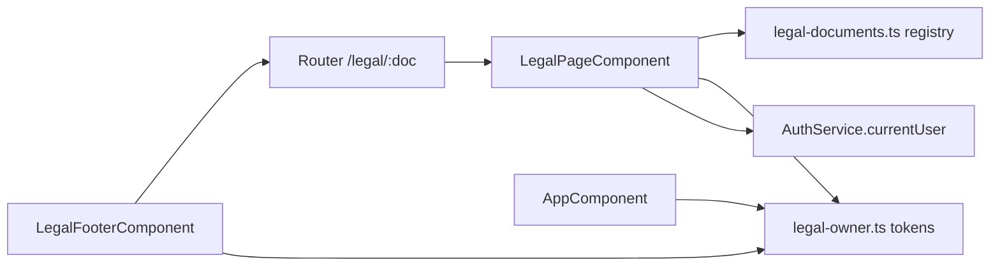

# Legal Module – Technical Documentation

> **Project:** TaskFlow – Intelligent Task Allocation & Tracking System
> **Module:** Legal  ·  **Child Modules:** Legal Documents, Legal Footer and Ownership Notice
> **Version:** 1.0  ·  **Last Updated:** 31-Oct-2026
> **Backend:** ASP.NET Core Web API (.NET 10)  ·  **Frontend:** Angular  ·  **Database:** SQLite (EF Core)
> **Author:** Jojo George (jojogeorge3344@gmail.com)
> © 2026 Jojo George. All rights reserved.

> ✅ Target framework confirmed: `net10.0` (.NET 10), from `backend/src/TaskFlow.Api/TaskFlow.Api.csproj`.

---

## 1. Technical Overview
Legal is a **frontend-only** module. It has no controller, service, repository, DTO, entity or table. It contains:
- A **document registry** (`legal-documents.ts`) that holds the five legal documents as typed structured data (`LegalDocument` → `LegalSection` → `LegalBlock`).
- A **single owner record** (`legal-owner.ts`: `LEGAL_OWNER`, `LEGAL_APPLICATION`, `LEGAL_TOKENS`). The registry writes `{{owner}}`, `{{year}}`, `{{email}}`, `{{rights}}`, `{{applicationName}}` and `{{applicationTitle}}` as tokens, and `resolveLegalTokens()` replaces them at render time.
- One standalone renderer, `LegalPageComponent`, used by five lazily loaded public routes (`/legal/copyright|terms|privacy|disclaimer|licenses`). Each route passes `data.documentId`. Detail: `10.1-Legal-Documents.md`.
- A shared `LegalFooterComponent` (`app-legal-footer`, variants `surface` / `dark`). The application shell, the login page and the account recovery page embed it.
- `AppComponent.ngOnInit` sets the document `<title>` and the `author` / `description` / `copyright` meta tags from the same owner record. Detail (footer and metadata): `10.2-Legal-Footer-and-Ownership-Notice.md`.

## 2. Architecture Flow

No HTTP call is made and no database is involved.

## 3. Backend File Structure

| Layer | Path | Files |
|-------|------|-------|
| Controller | _Not applicable for this module._ | – |
| Service | _Not applicable for this module._ | – |
| Repository | _Not applicable for this module._ | – |
| DTOs | _Not applicable for this module._ | – |
| Validators | _Not applicable for this module._ | – |
| Entities | _Not applicable for this module._ | – |
| Enums | _Not applicable for this module._ | – |
| Authorization | _Not applicable for this module._ | – |

A search of `backend/src/TaskFlow.Api` for legal / copyright / privacy / terms found no legal endpoint or service. Some backend facts that the Privacy Policy text relies on are listed in section 9 of `10.1-Legal-Documents.md`.

## 4. Frontend File Structure

| Type | Path | Purpose | Child |
|------|------|---------|-------|
| Module folder | `src/app/modules/legal/` (`legal.routes.ts`, `pages/`, `models/`, `utils/`) | Routes, page component, document model and registry | 10.1 |
| Shared owner record | `src/app/modules/legal/utils/legal-owner.ts` | `LEGAL_OWNER`, `LEGAL_APPLICATION`, `LEGAL_TOKENS`, `resolveLegalTokens(text)`, `legalOwnershipLine()` | 10.1 and 10.2 |
| Shared component | `src/app/shared/components/legal-footer/` | `LegalFooterComponent` and `LegalFooterVariant` | 10.2 |
| Consumers / metadata | `layouts/shell.component.html`, `modules/auth/login/…`, `modules/auth/account-recovery/…`, `app.component.ts` | Embed the footer; set title and meta tags | 10.2 |
| Route / Guard | _None_ | No guard and no permission check. No entry in `layouts/nav-items.ts` | 10.1 and 10.2 |

The full file lists are in each child document.

---

## 5. Child Modules

| # | Child Module | Main endpoints (count) | Key permissions | Document |
|---|--------------|------------------------|-----------------|----------|
| 10.1 | Legal Documents | 0 API endpoints (5 public client routes `/legal/*`) | _(none)_ | `10.1-Legal-Documents.md` |
| 10.2 | Legal Footer and Ownership Notice | 0 API endpoints (no routes; shared component + app metadata) | _(none)_ | `10.2-Legal-Footer-and-Ownership-Notice.md` |

The child documents are in the `10-Legal/` folder next to this file.

---

## 6. Database Design
_Not applicable for this module._ (No tables, entities or migrations. All content is static frontend data.)

| Table | Owned by child | Notes |
|-------|----------------|-------|
| _(none)_ | – | Both children read only the in-memory `legal-owner.ts` / `legal-documents.ts` constants |

**Relationships**
- _Not applicable for this module._

## 7. Security & Authorization
- **Authentication:** Not required. `LEGAL_ROUTES` is registered at root level, outside the shell route that has `authGuard` and `mfaSetupGuard`. `AuthService.currentUser()` is read only to choose the back-link target (10.1).
- **Authorization:** No permission key. `PermissionCatalog.cs` / `PermissionKeys.cs` have no legal key, and the frontend `permissions.ts` and `nav-items.ts` have no legal entry.
- **Data scope:** _Not applicable for this module._ The content is the same for every visitor.
- **Frontend:** No route guard and no permission directive.
- **Output safety:** All document and footer text is rendered with Angular interpolation (`{{ }}`), so it is HTML-escaped. `innerHTML` is not used.

| Permission Key | Endpoint(s) | UI Element Controlled |
|----------------|-------------|-----------------------|
| _(none)_ | – | Legal pages and footer are always visible (Always On for every role, and also for visitors who are not signed in) |

## 8. Validations & Error Handling

| Rule | Layer | HTTP Code | Error Message |
|------|-------|-----------|---------------|
| Required field / Duplicate / No permission / Not found (API) | _Not applicable for this module._ | – | – |

The global exception middleware does not apply because no API is called. Client-side not-found and unknown-path handling belongs to 10.1 and is described there.

## 9. Integrations / Side Effects
- **Notifications:** _Not applicable for this module._
- **Email:** _Not applicable for this module._
- **Activity Log:** _Not applicable for this module._
- **AI Assistant:** No tools are exposed. No file in `Services/Assistant/Knowledge/*.md` mentions the legal pages.
- Child-specific side effects (document head metadata in 10.2, Privacy Policy facts checked against the backend in 10.1) are in the child documents.

## 10. Configuration

| Key (`appsettings.json`) | Purpose | Default |
|--------------------------|---------|---------|
| _None for this module_ | Owner values are compile-time constants in `legal-owner.ts` (`LEGAL_OWNER.name` "Jojo George", `year` 2026, `email` "jojogeorge3344@gmail.com", `rights` "All Rights Reserved"), used by both children | – |

Backend settings that only the Privacy Policy text refers to are listed in `10.1-Legal-Documents.md`.

## 11. Testing

| Test Type | File / Location | Covers |
|-----------|-----------------|--------|
| Unit | _None found_ | `tests-filelist.json` (backend tests) has no Legal test. No frontend spec files were supplied. |
| Integration | _None found_ | – |

> ⚠️ To be confirmed: whether frontend specs exist (for example `legal-page.component.spec.ts`), because frontend test files are not in the supplied file list.

## 12. Known Limitations / Future Enhancements
Module-wide items only. Child-specific gaps are listed in each child document.

**Gaps found**
- **Audit vs code (access):** `permission-inventory.csv` rows 453–456 say "All signed-in users (no key)". In code the legal routes are **public**: they are registered outside the `authGuard` shell, and the footer links appear on the login and account recovery screens.
- **Audit vs code (paths):** the audit points to `features/legal/legal-page.component.ts`, `features/legal/legal-footer.component.html` and `core/layout/shell.component.html:129`. The real files are `modules/legal/pages/legal-page.component.ts`, `shared/components/legal-footer/legal-footer.component.html` and `layouts/shell.component.html:130`.
- **Missing stylesheet files:** `styleUrl: './legal-page.component.css'` and `'./legal-footer.component.css'` are referenced, but no `.css` file is in the supplied tree.
  > ⚠️ To be confirmed: whether the CSS files were left out of the export or are really missing (a missing file would break the build).
- **No BRD screen:** no screen file under `Requirements/Screens Wise Feature Development Plan/` covers Legal, and `permission-gaps.md` lists "legal pages" as not in the module list. The module is defined by the code alone.

---
© 2026 Jojo George. All rights reserved. Unauthorized copying or distribution of this document is prohibited.
