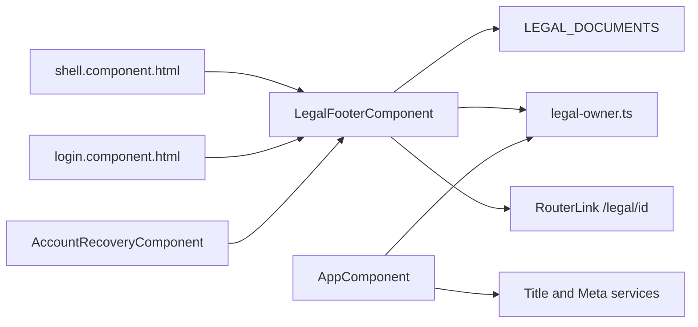
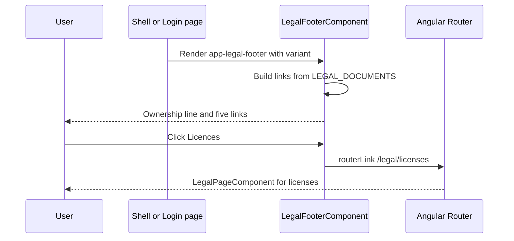

# Legal Footer and Ownership Notice – Technical Documentation

> **Project:** TaskFlow – Intelligent Task Allocation & Tracking System
> **Parent Module:** Legal  ·  **Child Module:** 10.2 Legal Footer and Ownership Notice
> **Version:** 1.0  ·  **Last Updated:** 31-Oct-2026
> **Backend:** ASP.NET Core Web API (.NET 10)  ·  **Frontend:** Angular  ·  **Database:** SQLite (EF Core)
> **Author:** Jojo George (jojogeorge3344@gmail.com)
> © 2026 Jojo George. All rights reserved.

---

## 1. Technical Overview
This child is frontend-only. It has two parts:
- The shared standalone `LegalFooterComponent` (`app-legal-footer`, variants `surface` / `dark`). The application shell, the login page and the account recovery page embed it. It builds its five links from `LEGAL_DOCUMENTS` and its ownership line from `legal-owner.ts`.
- `AppComponent.ngOnInit`, which sets the document `<title>` and the `author` / `description` / `copyright` meta tags from the same owner record.

There is no HTTP call, controller, service, repository or table.

## 2. Architecture Flow

## 3. Backend File Structure

| Layer | Path | Files |
|-------|------|-------|
| Controller / Service / Repository / DTOs / Validators / Entities / Enums / Authorization | _Not applicable for this module._ | – |

## 4. Frontend File Structure

| Type | Path | Purpose |
|------|------|---------|
| Shared component | `src/app/shared/components/legal-footer/legal-footer.component.ts` / `.html` / `legal-footer.model.ts` | `LegalFooterComponent`, `LegalFooterVariant = 'surface' \| 'dark'` |
| Data / utils (shared with 10.1) | `src/app/modules/legal/utils/legal-owner.ts` | `LEGAL_APPLICATION`, `legalOwnershipLine()` |
| Data / utils (from 10.1) | `src/app/modules/legal/utils/legal-documents.ts` | `LEGAL_DOCUMENTS`, read to build the links |
| Consumers | `src/app/layouts/shell.component.html` (`<app-legal-footer variant="surface" />`), `src/app/modules/auth/login/pages/login.component.html` (`variant="dark"`), `src/app/modules/auth/account-recovery/pages/account-recovery.component.ts` (inline template, `variant="dark"`) | Embed the footer |
| Metadata | `src/app/app.component.ts` | `Title.setTitle` + `Meta.updateTag` (author, description, copyright) |
| Route / Guard | _None_ | The footer has no route of its own and no permission check |

---

## 5. API & Logic

### 5.1 API Endpoints
_Not applicable for this module._ The footer links target the client routes of 10.1 (`/legal/copyright`, `/legal/terms`, `/legal/privacy`, `/legal/disclaimer`, `/legal/licenses`).

### 5.2 Request / Response Samples
_Not applicable for this module._

### 5.3 Service Layer Logic
_Not applicable for this module._ (No backend service.) The frontend logic is:
- `LegalFooterComponent` (`selector: 'app-legal-footer'`):
  - `variant = input<LegalFooterVariant>('surface')`. The `dark` variant adds class `legal-footer--dark`.
  - `links = LEGAL_DOCUMENTS.map(doc => ({ id, path: '/legal/' + doc.id, label: doc.navLabel }))`, so the links always match the registry order.
  - `currentDocumentId` is `computed`. It walks `ActivatedRoute.firstChild` to the deepest route and reads `snapshot.data['documentId']`. `isActive(id)` sets `aria-current="page"` on the matching link.
  - Template: `<footer>` → ownership line "`{{ ownershipLine }} · {{ applicationName }} — {{ applicationTitle }}.`" → `<nav aria-label="Legal documents">` list of `routerLink`s.
- `AppComponent.ngOnInit`:
  - `title.setTitle('TaskFlow — Intelligent Task Allocation & Tracking System')`
  - `meta.updateTag({ name: 'author', content: 'Jojo George' })`
  - `meta.updateTag({ name: 'description', content: LEGAL_APPLICATION.description })`
  - `meta.updateTag({ name: 'copyright', content: legalOwnershipLine() })`

### 5.4 Repository Layer
_Not applicable for this module._

### 5.5 Sequence Diagram

---

## 6. Database Design
_Not applicable for this module._ (No tables, entities or migrations. The footer reads only the in-memory `legal-owner.ts` and `legal-documents.ts` constants.)

**Relationships**
- _Not applicable for this module._

## 7. Security & Authorization
- **Authentication:** Not required. The footer is shown on the public Sign in and Account Recovery screens as well as inside the signed-in shell.
- **Authorization:** No permission key and no permission directive on the footer.
- **Output safety:** The ownership line is rendered with Angular interpolation (`{{ }}`), so it is HTML-escaped.

| Permission Key | Endpoint(s) | UI Element Controlled |
|----------------|-------------|-----------------------|
| _(none)_ | – | `app-legal-footer` ownership line and five links, and the browser title / meta tags, are always shown (Always On for every role, and also for visitors who are not signed in) |

## 8. Validations & Error Handling
_Not applicable for this module._ The footer has no input. Its links are built from `LEGAL_DOCUMENTS`, so each link matches a registry entry and a route in `legal.routes.ts`.

## 9. Integrations / Side Effects
- **Notifications / Email / Activity Log:** _Not applicable for this module._
- **Document head:** `AppComponent` sets the browser title and the `author`, `description` and `copyright` meta tags.

## 10. Configuration
_Not applicable for this module._ The ownership values are compile-time constants in `legal-owner.ts` (see the parent document, section 10).

## 11. Testing

| Test Type | File / Location | Covers |
|-----------|-----------------|--------|
| Unit | _None found_ | `tests-filelist.json` (backend tests) has no Legal test. No frontend spec files were supplied. |
| Integration | _None found_ | – |

> ⚠️ To be confirmed: whether a frontend spec such as `legal-footer.component.spec.ts` exists, because frontend test files are not in the supplied file list.

## 12. Known Limitations / Gaps found
- **Footer `aria-current` is never set in practice:** `LegalFooterComponent` highlights the current document, but the footer is never rendered on the legal pages (they are outside the shell and do not include `app-legal-footer`). Also, `currentDocumentId` reads a route snapshot inside `computed` with no signal dependency, so it would not update on navigation.
- **Missing stylesheet file:** `styleUrl: './legal-footer.component.css'` is referenced but not in the supplied tree (module-wide note in the parent document).

---
© 2026 Jojo George. All rights reserved. Unauthorized copying or distribution of this document is prohibited.
